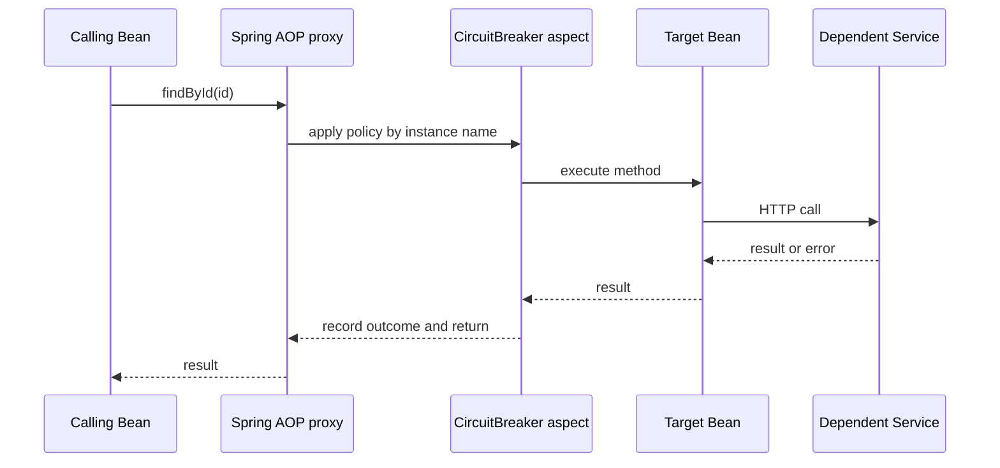

# Self-Invocation Limitations, Proxies, and Method Scope

## Objectives

Resilience4j allows applying a Circuit Breaker via the `@CircuitBreaker` annotation on Spring bean methods. Annotations keep business code concise, but they only take effect when the call goes through a Spring AOP proxy. If one method inside a bean directly calls another method on the same bean, that internal call normally bypasses the proxy and does not run the Circuit Breaker advice. Understanding proxy boundaries and method scope helps avoid situations where the annotation is present in code yet requests remain unprotected.

After this lesson, you will be able to:

- Explain how a Spring AOP proxy handles calls annotated with `@CircuitBreaker`.
- Identify self-invocation cases that prevent Circuit Breaker advice from applying.
- Choose method boundaries and instance names appropriate for the dependency being protected.
- Fix self-invocation by extracting a separate bean or using Spring Cloud CircuitBreaker's programmatic API.
- Verify proxies, fallbacks, and metrics with an integration test.

## Annotations Are Applied Through a Spring AOP Proxy

When using the Resilience4j Spring Boot integration, `@CircuitBreaker` is processed by Resilience4j's aspect. Spring creates a proxy wrapping the bean to which advice applies. When another bean calls a method on the proxy, the call passes through the aspect before entering the method body.

Overview flow:



Example of a service calling a catalog service:

```java
import io.github.resilience4j.circuitbreaker.annotation.CircuitBreaker;
import org.springframework.stereotype.Service;

@Service
public class CatalogService {
    private final CatalogClient catalogClient;

    public CatalogService(CatalogClient catalogClient) {
        this.catalogClient = catalogClient;
    }

    @CircuitBreaker(name = "catalog-read", fallbackMethod = "findFallback")
    public Product findById(String id) {
        return catalogClient.findById(id);
    }

    public Product findFallback(String id, Throwable error) {
        return Product.unavailable(id);
    }
}
```

When a controller or another bean injects `CatalogService` and calls `findById`, Spring can route the call through the proxy so the aspect applies the `catalog-read` Circuit Breaker instance. If the circuit is `OPEN`, the call to `catalogClient` is blocked and the fallback can execute. `Product`, `CatalogClient`, and `Product.unavailable` are application-defined types.

An annotation does not automatically turn every call inside a class into a protected call. The core requirement is that the call must go through the proxy Spring created for the bean.

## Self-Invocation Bypasses the Proxy

Self-invocation occurs when a method in a bean calls another method on the same object using `this` or an unqualified call:

```java
@Service
public class CatalogService {
    private final CatalogClient catalogClient;

    public CatalogService(CatalogClient catalogClient) {
        this.catalogClient = catalogClient;
    }

    public Product loadPageProduct(String id) {
        // Direct call on the target object, does not go back through the Spring proxy.
        return findById(id);
    }

    @CircuitBreaker(name = "catalog-read", fallbackMethod = "findFallback")
    public Product findById(String id) {
        return catalogClient.findById(id);
    }

    public Product findFallback(String id, Throwable error) {
        return Product.unavailable(id);
    }
}
```

If an external caller invokes `loadPageProduct` via the proxy, the proxy only sees the call to `loadPageProduct`. Once the method body runs, `findById` is invoked directly on the target object. The internal call does not pass through the proxy a second time, so the `@CircuitBreaker` aspect on `findById` is not triggered. As a result:

- The supplier/call to `CatalogClient` still executes even when the expected Circuit Breaker instance is `OPEN`.
- The `catalog-read` Circuit Breaker does not record the outcome of this internal call.
- The `findFallback` fallback is not invoked by the annotation on `findById`.

This is a subtle bug because the code contains the annotation, the application starts up, and the method still returns results. You must inspect the actual call path rather than just looking for annotations in source code.

## Interface Proxies and Class-Based Proxies

Spring AOP typically uses one of two proxy types:

| Proxy Type | How It Works | Things to Watch |
|---|---|---|
| JDK dynamic proxy | Creates a proxy implementing the bean's interfaces. | Callers must invoke via an interface exposed by the proxy; methods not on the interface are outside that proxy's surface. |
| Class-based proxy (CGLIB) | Creates a subclass to override advisible methods. | Cannot advise `final`, `private`, or non-overridable methods; `final` classes cannot be subclassed either. |

The actual proxy type depends on Spring configuration and bean structure. With a JDK proxy, inject and call the bean via its interface. With CGLIB, methods must be overridable and called through the proxy. In both cases, self-invocation still bypasses the proxy because internal calls target the underlying object directly.

To avoid depending on proxy implementation details, place annotated methods on a Spring bean called from another bean, use proxyable methods, and inject beans through appropriate abstractions. In languages or configurations where classes/methods are `final` by default, ensure the mechanism to open classes is compatible with the chosen proxy type.

## Choosing the Method Scope to Protect

Place `@CircuitBreaker` on a method representing a dependency call boundary. That method should have a clear responsibility: calling a remote service or an operation whose failure characteristics need separate tracking.

Example:

```java
@Service
public class ProductGateway {
    private final CatalogClient catalogClient;
    private final InventoryClient inventoryClient;

    public ProductGateway(
            CatalogClient catalogClient,
            InventoryClient inventoryClient) {
        this.catalogClient = catalogClient;
        this.inventoryClient = inventoryClient;
    }

    @CircuitBreaker(name = "catalog-read", fallbackMethod = "catalogFallback")
    public Product readCatalog(String id) {
        return catalogClient.findById(id);
    }

    @CircuitBreaker(name = "inventory-read", fallbackMethod = "inventoryFallback")
    public Stock readInventory(String id) {
        return inventoryClient.findStock(id);
    }

    private Product catalogFallback(String id, Throwable error) {
        return Product.unavailable(id);
    }

    private Stock inventoryFallback(String id, Throwable error) {
        return Stock.unknown(id);
    }
}
```

In practice, these two methods must be called through the proxy from another bean. The example illustrates scoping: catalog and inventory failures can be tracked by two separate Circuit Breaker instances. If both methods use the same instance name, they can share the same configuration and Circuit Breaker state; only do so when both operations genuinely belong to the same failure boundary.

Do not place an overly broad annotation on an orchestration method that performs multiple unrelated tasks, such as input validation, local computation, calling catalog, and updating a cache. If the entire method is treated as a single dependency call, validation errors or local errors may also be counted toward the Circuit Breaker. Extracting dependency calls into a gateway with clear boundaries makes error classification and metrics more accurate.

## Fallbacks Must Match the Method Signature

With Resilience4j annotations, the fallback is usually a method in the same bean. The fallback method must:

- Have a return type compatible with the protected method.
- Accept the business parameters of the original method in the same order.
- Have an extra exception parameter at the end to receive the failure cause.
- Can use `Throwable` for general handling or a specific exception type to handle one category of errors.

Example:

```java
@CircuitBreaker(name = "catalog-read", fallbackMethod = "findFallback")
public Product findById(String id, String locale) {
    return catalogClient.findById(id, locale);
}

public Product findFallback(String id, String locale, CallNotPermittedException error) {
    return cache.findProduct(id, locale)
            .orElse(Product.unavailable(id));
}
```

The fallback above handles the case where the Circuit Breaker rejects the call. If the method can fail with multiple exception types, you can create fallback overloads for each type or use `Throwable` to classify inside. Ensure overloads are not ambiguous and signatures match the Resilience4j version in use.

Fallbacks are also affected by self-invocation. If the call does not pass through the proxy, the annotation's fallback is not triggered. Furthermore, a fallback should not call back into the failing dependency over an unprotected path; use a cache, meaningful degraded data, or propagate an appropriate error to the caller.

## Fixing Self-Invocation by Extracting a Bean

The most maintainable solution is usually moving the dependency call operation to a separate bean. The orchestration bean calls the gateway bean through the Spring container, so the call passes through the proxy.

```java
@Service
public class CatalogGateway {
    private final CatalogClient catalogClient;

    public CatalogGateway(CatalogClient catalogClient) {
        this.catalogClient = catalogClient;
    }

    @CircuitBreaker(name = "catalog-read", fallbackMethod = "findFallback")
    public Product findById(String id) {
        return catalogClient.findById(id);
    }

    public Product findFallback(String id, Throwable error) {
        return Product.unavailable(id);
    }
}

@Service
public class ProductFacade {
    private final CatalogGateway catalogGateway;

    public ProductFacade(CatalogGateway catalogGateway) {
        this.catalogGateway = catalogGateway;
    }

    public Product loadPageProduct(String id) {
        // Inter-bean call goes through CatalogGateway's proxy.
        return catalogGateway.findById(id);
    }
}
```

`ProductFacade` is responsible for orchestrating application flow; `CatalogGateway` is responsible for communicating with the dependency and applying the Circuit Breaker. This separation clarifies failure boundaries, facilitates isolated testing, and avoids internal calls on the same target object.

## Other Ways to Call Through the Proxy

In certain situations where extracting a bean is not feasible, you can consider these options:

**Inject a self-reference via Spring:** you can inject the bean's own proxy, typically with `@Lazy` to avoid a circular dependency during initialization. Then call the method via the proxy reference instead of `this`. This approach requires careful design so as not to create call loops or make the dependency graph hard to understand.

**Use `AopContext.currentProxy()`:** Spring can expose the current proxy if `exposeProxy` is enabled. This ties business code to Spring AOP and makes testing harder; only use it when there is a clear justification.

**Use the programmatic API:** if you need to control call boundaries directly in code, you can use Spring Cloud CircuitBreaker's `CircuitBreakerFactory` or `ReactiveCircuitBreakerFactory` to wrap the supplier/publisher. This does not rely on annotations for internal calls, though the actual dependency call must still be placed inside the protected supplier or publisher.

Example with the synchronous factory:

```java
@Service
public class CatalogGateway {
    private final CatalogClient catalogClient;
    private final CircuitBreaker circuitBreaker;

    public CatalogGateway(
            CatalogClient catalogClient,
            CircuitBreakerFactory<?, ?> factory) {
        this.catalogClient = catalogClient;
        this.circuitBreaker = factory.create("catalog-read");
    }

    public Product findById(String id) {
        return circuitBreaker.run(
                () -> catalogClient.findById(id),
                error -> Product.unavailable(id));
    }
}
```

Here, the Circuit Breaker is invoked directly in the method body. Even if `findById` is called from another method on the same bean, the supplier still passes through the Circuit Breaker because the code explicitly calls `run`. There is no need to rely on an aspect to intercept internal calls.

## Configuring Instances by Annotation Name

The name in `@CircuitBreaker(name = "catalog-read")` must match an instance configured in Resilience4j:

```yaml
resilience4j:
  circuitbreaker:
    instances:
      catalog-read:
        slidingWindowType: COUNT_BASED
        slidingWindowSize: 20
        minimumNumberOfCalls: 10
        failureRateThreshold: 50
        waitDurationInOpenState: 8s
        permittedNumberOfCallsInHalfOpenState: 3
      inventory-read:
        slidingWindowType: COUNT_BASED
        slidingWindowSize: 30
        minimumNumberOfCalls: 15
        failureRateThreshold: 40
        waitDurationInOpenState: 10s
        permittedNumberOfCallsInHalfOpenState: 2
```

Each instance name has its own configuration and runtime state. Multiple methods sharing one name will share the same Circuit Breaker instance as managed by the integration. Different names create different statistical boundaries. Name instances after dependencies or operations with shared failure characteristics; do not include request IDs in instance names.

If using `@CircuitBreaker` with `fallbackMethod`, the fallback must exist and match the signature. If the instance configuration has a mismatched name, the application may fall back to default settings or lack the expected configuration depending on the integration and version. Check startup logs and metrics by instance tag to confirm the name binds correctly.

## Aspect Ordering When Combining Multiple Annotations

A method may use multiple annotations such as `@Retry`, `@RateLimiter`, `@Bulkhead`, and `@CircuitBreaker`. When multiple aspects intercept the same call, execution order affects:

- Whether the Circuit Breaker records each attempt or the final outcome of the retry sequence.
- Whether timeout applies per attempt or to the entire operation.
- Whether a Bulkhead permit is held during retry backoff.
- Which exception reaches the fallback and each aspect's metrics.

Do not rely on implicit ordering if the application requires specific behavior. Resilience4j provides aspect order configuration properties for annotations in respective versions; check your version's documentation and set explicit ordering if needed. After changing order, test actual request counts, attempt counts, total duration, and Circuit Breaker sample counts.

In many cases, using an orchestration layer that explicitly codes the order is easier to read than stacking many annotations on one method. Either way, ensure retry does not retry `CallNotPermittedException` when the Circuit Breaker is already `OPEN`.

## Verifying Proxy and Method Scope

An integration test should verify behavior through the bean the application actually injects, rather than calling an unwrapped target object directly.

Example checking whether a bean is a proxy:

```java
import static org.assertj.core.api.Assertions.assertThat;

import org.junit.jupiter.api.Test;
import org.springframework.aop.support.AopUtils;
import org.springframework.beans.factory.annotation.Autowired;
import org.springframework.boot.test.context.SpringBootTest;

@SpringBootTest
class CatalogGatewayProxyTest {
    @Autowired
    private CatalogGateway catalogGateway;

    @Test
    void gatewayIsManagedThroughSpringProxy() {
        assertThat(AopUtils.isAopProxy(catalogGateway)).isTrue();
    }
}
```

Checking the proxy only confirms the bean is wrapped; it does not yet prove the annotation protects the intended call. Add behavioral tests:

1. Mock `CatalogClient` so initial calls throw a transient error.
2. Invoke the annotated method through the bean injected from the Spring context.
3. Verify the fallback is called and the Circuit Breaker records errors as configured.
4. Trigger enough failures to transition the circuit to `OPEN`; confirm subsequent calls do not invoke the mock client.
5. Call an orchestration method with self-invocation; compare against calling through an extracted gateway bean to catch paths bypassing the proxy.
6. Observe metrics by instance name to verify only calls going through the proxy are recorded.

In tests, avoid relying on long wait durations. You can configure a small sliding window, low minimum number of calls, and a short `OPEN` wait duration in a test profile. Do not carry this test configuration into production.

## Common Pitfalls

- **Assuming every call is protected just because an annotation is present:** the aspect only runs when the call passes through the proxy.
- **Calling `this.method()` within the same bean:** self-invocation bypasses the proxy and does not trigger the target method's Circuit Breaker annotation.
- **Placing annotations on non-proxyable methods:** `private`/`final` methods or methods not on a JDK proxy's interface may not receive advice as expected.
- **Injecting the target instead of the Spring bean proxy:** can lose AOP advice.
- **Using the same instance name for independent dependencies:** state and statistics become unintentionally shared.
- **Scoping annotations too broadly:** validation errors or local processing can be counted as dependency failures.
- **Wrong fallback signature:** Resilience4j cannot find a matching fallback, or the original error is masked by a fallback invocation error.
- **Fallback calling back into the failing dependency:** adds extra load and can create failure loops.
- **Checking only `AopUtils`:** a proxied bean alone does not prove a specific call goes through advice.
- **Ignoring aspect ordering:** Retry, TimeLimiter, Bulkhead, and Circuit Breaker may record different call counts than expected.

Treat the proxy as the execution boundary of an annotation. Place Circuit Breakers on methods representing a dependency, invoke those methods through Spring bean proxies, and test both fallbacks and states. If internal flows need to call protected methods, prefer extracting a separate gateway bean or wrapping calls with Spring Cloud CircuitBreaker's programmatic API.
