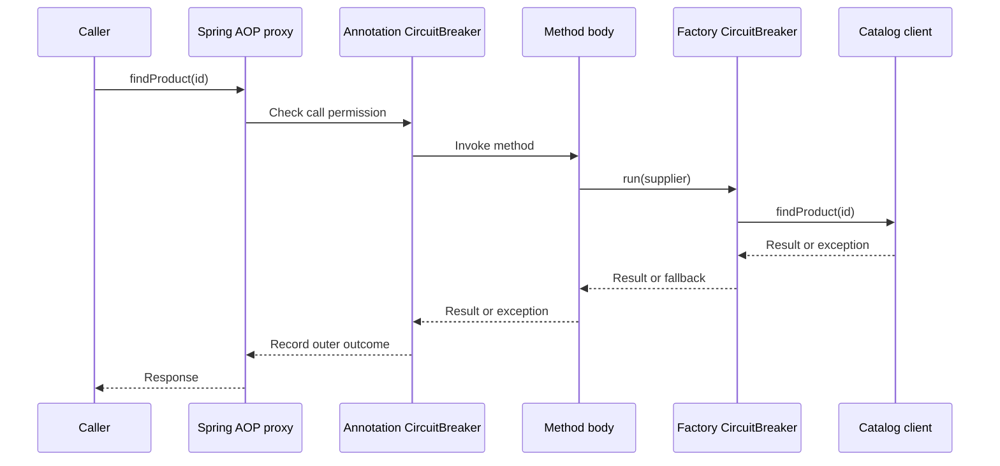

# Avoiding Double Wrapping the Same Operation via Factory and Annotation

Spring Cloud Circuit Breaker provides a programmatic API via `CircuitBreakerFactory` or `ReactiveCircuitBreakerFactory`. At the same time, Resilience4j provides annotations such as `@CircuitBreaker` so AOP automatically wraps method calls. Both approaches can protect a call to a dependent service, but if used together on the same execution path, the operation can end up wrapped by two circuit breaker layers.

Two protection layers for the same request usually make behavior unpredictable: a single failure may be recorded multiple times, a fallback may run in the inner layer before the outer layer observes the failure, and breaker states may no longer reflect a single business call. Therefore, each dependency operation should have one designated place responsible for applying CircuitBreaker. Choose either the annotation or the factory for that execution path and avoid nesting both without an explicit purpose.

## Two Ways to Apply CircuitBreaker

`CircuitBreakerFactory` is Spring Cloud Circuit Breaker's API. The application creates an instance by ID and calls `run` to wrap the supplier:

```java
@Service
public class CatalogService {

    private final CircuitBreakerFactory<?, ?> circuitBreakerFactory;
    private final CatalogClient catalogClient;

    public CatalogService(
            CircuitBreakerFactory<?, ?> circuitBreakerFactory,
            CatalogClient catalogClient) {
        this.circuitBreakerFactory = circuitBreakerFactory;
        this.catalogClient = catalogClient;
    }

    public Product findProduct(String productId) {
        CircuitBreaker breaker = circuitBreakerFactory.create("catalog");

        return breaker.run(
                () -> catalogClient.findProduct(productId),
                error -> Product.unavailable(productId)
        );
    }
}
```

In this approach, the wrapping point is shown directly in code. Readers can see exactly which supplier is inside the circuit breaker and which fallback handles exceptions.

Resilience4j can apply a circuit breaker using an annotation:

```java
@Service
public class CatalogService {

    private final CatalogClient catalogClient;

    public CatalogService(CatalogClient catalogClient) {
        this.catalogClient = catalogClient;
    }

    @CircuitBreaker(name = "catalog", fallbackMethod = "findProductFallback")
    public Product findProduct(String productId) {
        return catalogClient.findProduct(productId);
    }

    private Product findProductFallback(String productId, Throwable cause) {
        return Product.unavailable(productId);
    }
}
```

The annotation is processed through Spring AOP. When another bean calls the method via the Spring proxy, Resilience4j's aspect can wrap the call, manage execution permission, and route exceptions to the fallback. The fallback method must be compatible with the return type and parameters of the original method; it may accept an additional exception parameter at the end of the signature.

The two examples above are independent choices. The factory API belongs to the Spring Cloud Circuit Breaker abstraction; `@CircuitBreaker` is a Resilience4j annotation. Do not assume this annotation is part of Spring Cloud's common API or is automatically active just because some circuit breaker starter was added. To use the annotation, the application needs the AOP dependency and a Resilience4j Spring integration compatible with the running Spring Boot version, along with properly configured component scanning and auto-configuration.

## The Double-Wrapping Scenario

A common mistake is keeping the annotation on a method while also adding `factory.create(...).run(...)` around the call inside that same method:

```java
@Service
public class CatalogService {

    private final CircuitBreakerFactory<?, ?> factory;
    private final CatalogClient catalogClient;

    public CatalogService(
            CircuitBreakerFactory<?, ?> factory,
            CatalogClient catalogClient) {
        this.factory = factory;
        this.catalogClient = catalogClient;
    }

    @CircuitBreaker(name = "catalog", fallbackMethod = "fallback")
    public Product findProduct(String productId) {
        CircuitBreaker inner = factory.create("catalog");
        return inner.run(() -> catalogClient.findProduct(productId));
    }

    private Product fallback(String productId, Throwable error) {
        return Product.unavailable(productId);
    }
}
```

When the method is called through the proxy, the annotation can create an outer protection layer. Then the method body calls `run` to create an inner protection layer. The execution path now looks like:



Depending on the backend, version, and registry registration, the two layers may reference the same Resilience4j instance or two separate instances. Do not rely on both places sharing the name `catalog` to assume the system automatically merges them into one protection layer. Whether sharing an instance or using separate instances, two wrappers still add an extra orchestration layer and alter permission checks, outcome recording, and error handling.

## Consequences of Double Wrapping

| Consequence | What Can Happen |
|---|---|
| Outcomes recorded multiple times | The same request passes through two wrappers and can generate multiple recordings/events or consume probe quota more than expected |
| Two state machines | If the two wrappers use different instances, each breaker has its own sliding window, thresholds, and state |
| Nested fallbacks | The inner fallback may return a degraded value; the outer breaker sees a successful result and never knows the underlying dependency failed |
| Exceptions handled twice | If the inner layer propagates an exception outward, the outer layer can trigger its fallback again or record another failure |
| Hard-to-interpret metrics | Call counts, error counts, and fallback counts across instances no longer correspond directly to business operations |
| Abnormal HALF_OPEN behavior | Acquiring permission twice for the same operation can consume more than one trial permit or reject calls when the quota is small |

For example, the inner layer calls catalog and hits a timeout, then its fallback returns `Product.unavailable`. The outer layer only sees the method complete normally and may record a success. The outer breaker's dashboard may therefore fail to reflect dependency errors while the inner breaker records failures. Even if both use the same registry instance, a single request still traverses the protection logic multiple times and makes metrics and quotas difficult to interpret.

## Choose a Single Policy Owner

Choose your wrapping mechanism based on how you want to organize code:

| Criterion | Using Annotation | Using Factory |
|---|---|---|
| Need concise code with policy tied to the method | Suitable | Can be more verbose |
| Need dynamic breaker selection from runtime data | Harder because annotations usually declare a fixed ID | Suitable because the ID can be chosen when calling `create` |
| Need explicit control over supplier location and scope | Less explicit due to AOP | Explicit in code |
| Want to use Spring Cloud Circuit Breaker's common API | Resilience4j annotation is not a common API | Suitable |
| Need per-method dedicated fallback | Use `fallbackMethod` | Pass fallback function to `run` |

Example of an annotation-only policy: the service method calls the client directly and only the annotation owns protection.

```java
@CircuitBreaker(name = "catalog", fallbackMethod = "fallback")
public Product findProduct(String productId) {
    return catalogClient.findProduct(productId);
}
```

Example of a factory-only policy: remove the annotation and wrap only the supplier in code.

```java
public Product findProduct(String productId) {
    CircuitBreaker breaker = circuitBreakerFactory.create("catalog");
    return breaker.run(
            () -> catalogClient.findProduct(productId),
            error -> Product.unavailable(productId)
    );
}
```

For reactive flows, the same principle applies: choose either `ReactiveCircuitBreakerFactory` or the reactive annotation mechanism supported by your Resilience4j version. Avoid wrapping a publisher with the reactive factory and also placing a circuit breaker annotation on the same method when the goal is a single state machine for one operation.

## Understanding AOP Proxy Scope Properly

AOP annotations only work when calls go through a Spring proxy. Several situations easily trick developers into thinking an annotation is applied when the aspect is never invoked:

- **Self-invocation:** one method in the same object calls `this.otherMethod()`. Internal calls do not go through the Spring proxy, so `otherMethod`'s advice is usually bypassed.
- **Instantiating with `new`:** manually created instances are not managed by Spring and have no Spring AOP proxy.
- **Visibility and proxy type:** JDK proxies operate through interfaces; subclass-based proxies have restrictions with `final` methods/classes and `private` methods. Place protection boundaries on `public` methods of Spring-managed beans.
- **Missing AOP integration:** annotations are present in code, but the aspect dependency or auto-configuration is not loaded, so no advice executes.

If two methods both need annotations and one must call the other, extract the protected method into a separate bean and inject that bean. Calls through the bean proxy will cross the AOP boundary. Before adding a new protection layer, clearly identify which method represents a dependency operation and let only one mechanism own the circuit breaker at that boundary.

## Configuration and Instance Names

Resilience4j annotations typically reference an instance via `name`, whereas Spring Cloud Circuit Breaker's factory receives an ID via `create(id)`. Sharing the same name string in two places does not automatically prove they share one wrapper, one registry, or one policy. Check how your backend creates registries and how the Spring Cloud/Resilience4j version in use registers beans.

Example instance configuration for Resilience4j annotations or registry:

```yaml
resilience4j:
  circuitbreaker:
    instances:
      catalog:
        slidingWindowType: COUNT_BASED
        slidingWindowSize: 20
        minimumNumberOfCalls: 10
        failureRateThreshold: 50
        waitDurationInOpenState: 10s
```

The `catalog` ID must stay consistent with the name selected in the active protection mechanism. Do not duplicate the same configuration in multiple places with conflicting threshold values. If Java `Customizer` beans, properties, and annotations coexist, determine the effective configuration order/source for your exact version and document it in your application design.

## Combining with Retry, TimeLimiter, and Bulkhead

A method may need multiple protection policies, but each policy should have a clear role and be applied only once in an intentional order:

- `CircuitBreaker` decides whether to permit dependency calls based on state and error statistics.
- `Retry` decides whether to retry transient failures.
- `TimeLimiter` limits waiting time for asynchronous tasks.
- `Bulkhead` limits the number of concurrent calls.

Do not place two `@CircuitBreaker` annotations or combine an annotation with a factory on the same request merely to "increase protection." If retry is needed alongside a circuit breaker, explicitly decide whether the breaker measures each attempt or the final outcome of the retry sequence. If a fallback is needed, select only one layer responsible for turning errors into business results; nested fallbacks require explicit design so an outer layer does not treat an original error as a success.

Resilience4j can apply multiple annotations via AOP. Aspect ordering across policies affects attempt counts, measured durations, exception recording, and when fallbacks run. Check the aspect order configuration of your version and write integration tests for the desired order; do not infer execution order solely from the order of annotations in source code.

## Testing to Catch Double Protection

A good test should prove that each business request passes through exactly one CircuitBreaker boundary and that the fallback triggers once.

Scenarios to verify:

1. **Success:** the dependency is called once, the caller receives the result directly, and only one breaker records the expected outcome.
2. **Dependency throws an exception:** the chosen fallback is invoked exactly once; no fallback in another layer masks or alters the result unexpectedly.
3. **Breaker OPEN:** the supplier is not called; the caller receives the fallback or rejection error according to contract.
4. **HALF_OPEN:** a single probe consumes only the expected number of permits; requests are not rejected because the same operation asks for permission twice.
5. **Metrics and events:** failure/success recordings match one attempt by design, without unintended doubling.
6. **AOP proxy:** invoke the service through the Spring bean to confirm annotations actually apply; add a dedicated test for self-invocation if internal call paths exist.
7. **Factory path:** verify the right ID and instance configuration are used, and the supplier is wrapped once.

Example annotation-only test verifying the fallback and exact client call count:

```java
@SpringBootTest
class CatalogServiceTest {

    @Autowired
    private CatalogService catalogService;

    @MockBean
    private CatalogClient catalogClient;

    @Test
    void usesFallbackWhenCatalogFails() {
        when(catalogClient.findProduct("p-1"))
                .thenThrow(new RuntimeException("catalog unavailable"));

        Product result = catalogService.findProduct("p-1");

        assertEquals("p-1", result.id());
        assertFalse(result.isAvailable());
        verify(catalogClient, times(1)).findProduct("p-1");
    }
}
```

The test must obtain `CatalogService` from the Spring context so calls go through the proxy; instantiating it manually with `new CatalogService(...)` will not test AOP annotations. Circuit breaker configuration in tests should be sufficient for failures to be recorded and fallbacks invoked according to the chosen backend behavior.

## Checklist for Reviewing a Call Path

1. Identify which method actually calls the dependent service.
2. Check whether the method has `@CircuitBreaker` or an equivalent annotation.
3. Check inside the method for `factory.create(...).run(...)` or another CircuitBreaker decorator.
4. Choose one mechanism to own the protection boundary and remove duplicate wrappers unless specifically required.
5. Verify where the fallback executes and whether the result type preserves the contract.
6. Confirm the AOP proxy is active when using annotations; check for self-invocation and bean lifecycle issues.
7. Test success, failure, OPEN, HALF_OPEN, fallback, and metrics to ensure a single operation is not unintentionally recorded multiple times.

Good design lets readers immediately see what is responsible for a dependency's circuit breaker. Use annotations when you want declarative method-level policies and AOP fits; use the factory when you need a common API, dynamic ID selection, or explicit control over the supplier. Combine the two approaches only when you genuinely need two independent, intentional layers with distinct quotas, states, fallbacks, and metrics, backed by tests proving that behavior.
