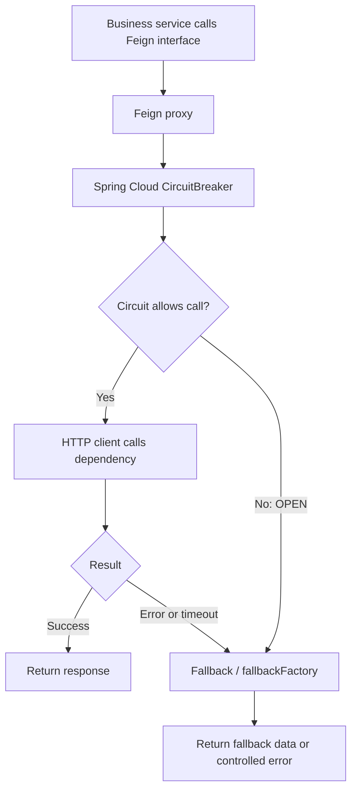

# Enabling Spring Cloud CircuitBreaker for Feign Clients

Spring Cloud OpenFeign can wrap each Feign client call with Spring Cloud CircuitBreaker. When this integration is enabled, calls to a dependent service are executed through a Circuit Breaker instead of always calling directly through the Feign proxy. If the failure rate or slow call rate exceeds the threshold, the circuit can transition to `OPEN` and reject subsequent calls during the wait duration. The application can declare a `fallback` or `fallbackFactory` to return a fallback result when a call fails or the circuit does not permit the call.

In the Spring Cloud Circuit Breaker module, OpenFeign is a common integration point because many Spring Cloud applications use Feign to call other services. Enabling Circuit Breaker for Feign protects HTTP calls declared via interfaces, while keeping most business code independent of how Resilience4j records state and metrics.

## How the Integration Works

When `spring.cloud.openfeign.circuitbreaker.enabled` is enabled, Spring Cloud OpenFeign creates a Feign proxy integrated with Circuit Breaker. Each method invoked on the Feign interface is executed through a corresponding Circuit Breaker. When the dependency responds normally, the result is returned to the caller. When an error is thrown, the Circuit Breaker records it according to the configured policy; the fallback is invoked if the client has declared one.



The Circuit Breaker protects calls to each Feign method based on the identifier generated by the factory. It does not automatically protect an entire multi-step business process or multiple Feign clients. If a use case calls `inventoryClient`, `pricingClient`, and `shippingClient`, each call can have its own Circuit Breaker; the logic to aggregate results still belongs to the business service.

## Adding Required Dependencies

The application needs Spring Cloud OpenFeign and the Circuit Breaker backend it wants to use. With Resilience4j, the Maven dependencies typically include:

```xml
<dependencies>
    <dependency>
        <groupId>org.springframework.cloud</groupId>
        <artifactId>spring-cloud-starter-openfeign</artifactId>
    </dependency>
    <dependency>
        <groupId>org.springframework.cloud</groupId>
        <artifactId>spring-cloud-starter-circuitbreaker-resilience4j</artifactId>
    </dependency>
</dependencies>
```

Manage the Spring Cloud version using a BOM compatible with the project's Spring Boot version. You should not manually mix incompatible versions of Spring Cloud, OpenFeign, and Resilience4j. If the application already includes a Circuit Breaker starter via another dependency, inspect the dependency tree to avoid declaring duplicate backends or pulling in unwanted versions.

## Enabling OpenFeign Circuit Breaker

Declare `@EnableFeignClients` on the application configuration and enable the Circuit Breaker property in `application.yml`:

```java
import org.springframework.boot.SpringApplication;
import org.springframework.boot.autoconfigure.SpringBootApplication;
import org.springframework.cloud.openfeign.EnableFeignClients;

@SpringBootApplication
@EnableFeignClients
public class OrderApplication {

    public static void main(String[] args) {
        SpringApplication.run(OrderApplication.class, args);
    }
}
```

```yaml
spring:
  cloud:
    openfeign:
      circuitbreaker:
        enabled: true
```

The `spring.cloud.openfeign.circuitbreaker.enabled` property is the integration switch. If it is not enabled, declaring `fallback` on a Feign client does not automatically make calls protected by a Circuit Breaker. After enabling it, inspect startup logs and test a failing call to confirm that the fallback is invoked through the expected integration path.

## Declaring a Feign Client and Fallback

Consider an example service calling an inventory API. `name` identifies the target service; `contextId` identifies the client configuration in the Spring context. `fallback` points to a bean implementing the same interface:

```java
import org.springframework.cloud.openfeign.FeignClient;
import org.springframework.web.bind.annotation.GetMapping;
import org.springframework.web.bind.annotation.PathVariable;

@FeignClient(
    name = "inventory",
    contextId = "inventoryClient",
    fallback = InventoryFallback.class)
public interface InventoryClient {

    @GetMapping("/inventory/{sku}")
    InventoryResponse find(@PathVariable("sku") String sku);
}
```

The fallback class must be a Spring bean and implement the full Feign interface:

```java
import org.springframework.stereotype.Component;

@Component
class InventoryFallback implements InventoryClient {

    @Override
    public InventoryResponse find(String sku) {
        return InventoryResponse.unavailable(sku);
    }
}
```

`InventoryResponse.unavailable(...)` is an illustrative factory method of the application's DTO. Represent the unavailable state explicitly in the response contract. You should not return `availableQuantity = 0` as if the real stock quantity were read when the actual data is inaccessible; the caller might mistakenly assume the system confirmed an out-of-stock state.

A static fallback is suitable when all errors share the same handling. It does not directly receive the error cause of the call. If you need to distinguish timeouts, connection errors, authentication errors, or an `OPEN` Circuit Breaker, use `fallbackFactory`.

## Using `fallbackFactory` to Inspect the Cause

`FallbackFactory` receives the `Throwable` that caused the call to fall back and creates an implementation of the Feign interface. This allows the application to log the cause, select cached data, or return an appropriate domain error:

```java
import org.slf4j.Logger;
import org.slf4j.LoggerFactory;
import org.springframework.cloud.openfeign.FallbackFactory;
import org.springframework.stereotype.Component;

@Component
class InventoryFallbackFactory implements FallbackFactory<InventoryClient> {

    private static final Logger log =
        LoggerFactory.getLogger(InventoryFallbackFactory.class);

    private final InventoryCache inventoryCache;

    InventoryFallbackFactory(InventoryCache inventoryCache) {
        this.inventoryCache = inventoryCache;
    }

    @Override
    public InventoryClient create(Throwable cause) {
        return sku -> {
            log.warn("Failed to call inventory for SKU {}: {}",
                sku, cause.toString());

            return inventoryCache.find(sku)
                .orElseGet(() -> InventoryResponse.unavailable(sku));
        };
    }
}
```

Declare the factory in `@FeignClient`:

```java
@FeignClient(
    name = "inventory",
    contextId = "inventoryClient",
    fallbackFactory = InventoryFallbackFactory.class)
public interface InventoryClient {

    @GetMapping("/inventory/{sku}")
    InventoryResponse find(@PathVariable("sku") String sku);
}
```

Choose either `fallback` or `fallbackFactory` for a Feign client based on your needs; there is no need to declare both. Do not let the fallback call back into the same protected Feign client, as this can create a call loop or continue hitting the same Circuit Breaker. If the fallback uses a cache or another service, those dependencies also need appropriate timeouts and protection policies.

## Naming Circuit Breakers per Feign Method

Resilience4j needs an instance name to look up configuration for a Circuit Breaker. The name generated by Spring Cloud OpenFeign depends on the resolver and the Spring Cloud version. Therefore, when declaring configuration per Feign method, you must determine the exact actual name being used.

You can provide a `CircuitBreakerNameResolver` to define a stable naming rule. The following example uses the client name and method name:

```java
import org.springframework.cloud.openfeign.CircuitBreakerNameResolver;
import org.springframework.context.annotation.Bean;
import org.springframework.context.annotation.Configuration;

@Configuration
class FeignCircuitBreakerNamingConfiguration {

    @Bean
    CircuitBreakerNameResolver circuitBreakerNameResolver() {
        return (feignClientName, target, method) ->
            feignClientName + "_" + method.getName();
    }
}
```

For the `inventory` client and the `find` method, the resolver above produces the name `inventory_find`. The Resilience4j configuration can use that exact name:

```yaml
resilience4j:
  circuitbreaker:
    instances:
      inventory_find:
        slidingWindowType: COUNT_BASED
        slidingWindowSize: 20
        minimumNumberOfCalls: 10
        failureRateThreshold: 50
        slowCallDurationThreshold: 800ms
        slowCallRateThreshold: 50
        waitDurationInOpenState: 5s
        permittedNumberOfCallsInHalfOpenState: 3
```

The resolver is a shared configuration in the application context, so ensure the returned names do not collide across clients or methods that require separate policies. If multiple methods share the same name, they will share the same Circuit Breaker instance and the same sliding window. If you want separate configurations, include the method in the name as shown in the example. When changing the resolver, update the keys in `resilience4j.circuitbreaker.instances` accordingly and verify the actual names through logs or metrics.

## Combining Feign Timeouts with Circuit Breaker

A Circuit Breaker does not replace HTTP client timeouts. If a Feign client lacks appropriate connect/read timeouts, a request can wait too long before returning an error for the Circuit Breaker to record. Timeouts can be configured per client in `application.yml`:

```yaml
spring:
  cloud:
    openfeign:
      circuitbreaker:
        enabled: true
      client:
        config:
          inventory:
            connectTimeout: 500
            readTimeout: 1000
```

The `connectTimeout` and `readTimeout` values in the example are in milliseconds. Connect timeout limits the time to establish a connection; read timeout limits the time waiting to read data depending on the HTTP client in use. Actual timeout behavior also depends on the client implementation and other phases such as waiting for a connection pool. Choose timeouts smaller than the end-to-end request budget and leave room for fallback handling, response serialization, and returning to the caller.

Resilience4j can configure failure rate and slow call rate separately. For example, the Circuit Breaker opens when at least 50% of samples are errors or at least 50% of calls exceed the 800 ms slow threshold, after at least 10 samples in a 20-call window. A timeout error thrown by Feign is typically recorded according to the Circuit Breaker's exception policy; verify the actual exception type before customizing `recordExceptions` or `ignoreExceptions`.

## Distinguishing Circuit Breaker from Feign Retry

Circuit Breaker and Retry solve two different problems. Circuit Breaker stops calling a dependency when recent results indicate the service is unhealthy. Retry re-attempts an error considered transient. You should not retry indefinitely or retry errors rejected by a Circuit Breaker, as doing so can add load while the dependency is recovering.

Spring Cloud OpenFeign provides `Retryer.NEVER_RETRY` by default, so you should not assume all I/O errors are automatically retried. If an application explicitly adds a Retryer or uses Resilience4j Retry, clearly define the retry count and total timeout. `CallNotPermittedException` and non-retryable errors must be excluded from the retry predicate. For operations with side effects, only retry when the API supports idempotency or has duplicate-handling protection.

## Important Considerations When Using Fallbacks

- **Do not hide dependency status:** a fallback may return cached data or an unavailable status, but you must clearly distinguish fallback data from fresh data retrieved from the service.
- **Do not fabricate false success:** avoid returning business-meaningful default values such as inventory quantity 0, price 0, or an order created status when nothing was actually confirmed.
- **Keep fallbacks short and bounded:** a cache or backup service can also be slow. A fallback should not call back into the failing dependency.
- **Preserve the cause for observability:** use `fallbackFactory` when you need to record the error type; do not log full payloads, tokens, or sensitive data.
- **Control fallback beans:** the fallback must be a Spring bean within the application's component scan scope. If there is a separate `@Configuration` class for a Feign client, avoid letting it be component-scanned into the parent context, as it could inadvertently apply to other clients.
- **Do not assume every exception should open the circuit:** business errors such as resource not found may not reflect dependency health. Configure exception classification based on error semantics.

## Verifying the Integration

After enabling Circuit Breaker, test success, failure, and open-circuit scenarios:

1. Call the Feign client when the dependency is healthy. Confirm that the normal response is returned and the Circuit Breaker records a success.
2. Have the dependency return a connection error or exceed the timeout. Confirm that the failure is recorded according to the configuration and the fallback is invoked.
3. Generate enough failing samples to exceed `failureRateThreshold`. Confirm that the Circuit Breaker transitions to `OPEN` and subsequent calls are rejected fast without sending new HTTP requests.
4. Confirm that `fallbackFactory` receives the appropriate cause, specifically distinguishing client errors from `CallNotPermittedException`.
5. After `waitDurationInOpenState`, confirm that the circuit transitions to `HALF_OPEN` as configured and only allows the defined number of test calls.
6. Let the dependency recover and confirm that the circuit returns to `CLOSED` after successful probes.
7. Check logs and metrics to confirm that the Circuit Breaker name matches the `resilience4j.circuitbreaker.instances` configuration key.

You can use WireMock or a mock HTTP server to control status codes, latency, and connection errors. When testing an `OPEN` circuit, count the actual requests reaching the mock server: the call count should not increase when the Circuit Breaker rejects requests. Also verify that the fallback does not mislead the caller into thinking the dependency returned data successfully.

## Configuration Flow Summary

To enable Spring Cloud CircuitBreaker for Feign clients, add the OpenFeign starter and a compatible Circuit Breaker backend, enable `spring.cloud.openfeign.circuitbreaker.enabled`, declare the Feign interface with a fallback or fallback factory, and then configure Resilience4j using the actual Circuit Breaker name. Feign timeouts bound HTTP wait times; Circuit Breaker tracks failures and slow calls; fallback provides a controlled response when the dependency cannot serve requests. When these parts are configured together consistently, Feign calls can fail faster, reduce cascading failures, and maintain a clear response contract for calling services.
