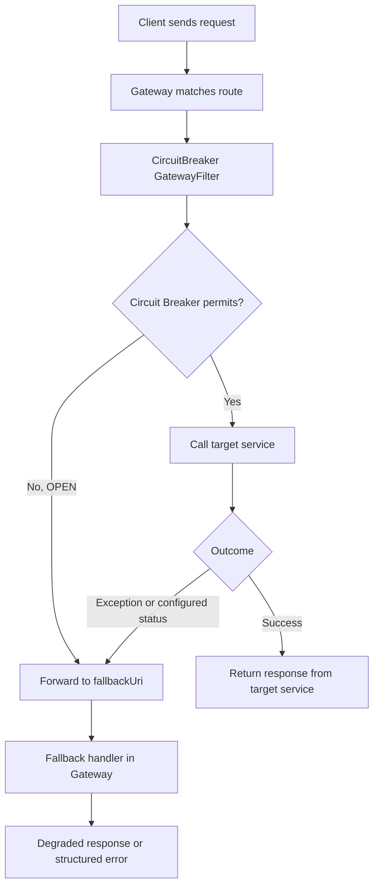

# `fallbackUri` with `forward:` and Handling Fallback Responses

## Objectives

Spring Cloud Gateway can protect a route using the `CircuitBreaker` GatewayFilter. When the call to the target service fails or the Circuit Breaker rejects the request, the filter can internally dispatch the request to a fallback handler via `fallbackUri`. With the `forward:` scheme, the Gateway forwards the `ServerWebExchange` to a handler within the Gateway application itself, which can return degraded data, cached data, or a service-temporarily-unavailable response.

After this lesson, you will be able to:

- Configure `fallbackUri: forward:/...` for a Gateway route.
- Distinguish connection/timeout failures from HTTP statuses that should be declared in `statusCodes`.
- Write a reactive fallback handler and choose appropriate HTTP statuses and response bodies.
- Read the failure cause from exchange attributes without leaking internal details.
- Avoid fallback loops, uncontrolled retries, and calling back into the failing dependency.

## How Does `fallbackUri` Work?

`fallbackUri` is the fallback target used by the CircuitBreaker GatewayFilter when a protected request cannot complete normally. With the `forward:` scheme, the Gateway dispatches the request to an internal path within the same application. This path is typically handled by a WebFlux controller.

Basic flow:



`forward:` is an internal dispatch. It does not create a new HTTP request to a remote host. Therefore, the fallback handler must be implemented inside the Gateway application and have a matching mapping. With Spring Cloud Gateway's CircuitBreaker GatewayFilter, `fallbackUri` uses the `forward:` scheme; do not put an arbitrary URL of another server in this property.

## Configuring a Route with fallbackUri

Example of a `/catalog/**` route forwarding requests to the catalog service. If the Circuit Breaker is open, the call times out, or it encounters an error counted as a failure, the Gateway forwards to `/fallback/catalog`:

```yaml
spring:
  cloud:
    gateway:
      routes:
        - id: catalog-route
          uri: lb://CATALOG-SERVICE
          predicates:
            - Path=/catalog/**
          filters:
            - name: CircuitBreaker
              args:
                name: catalog
                fallbackUri: forward:/fallback/catalog
                statusCodes:
                  - '500'
                  - '503'
```

Key components:

- `name: catalog` is the Circuit Breaker ID used to look up the Resilience4j configuration.
- `fallbackUri: forward:/fallback/catalog` is the internal path invoked by the Gateway when fallback handling is needed.
- `statusCodes` declares HTTP statuses from the target service treated as Circuit Breaker failures. This example places 500 and 503 in the failure group.
- `lb://CATALOG-SERVICE` requires load-balancer integration to resolve instances of the catalog service. It can be replaced with an appropriate target URI for your deployment model.

Failures such as inability to connect to upstream or timeouts typically surface as exceptions and trigger the fallback. An HTTP 500 or 503 response does not necessarily turn into an exception automatically in the Gateway. If you want those statuses counted by the Circuit Breaker, declare them in `statusCodes`. Do not include every 4xx code in the list: 400, 401, 403, or 404 usually reflect request issues or business outcomes rather than service health.

## Configuring the Circuit Breaker Instance

The name `catalog` in the Gateway filter must match the configured instance:

```yaml
resilience4j:
  circuitbreaker:
    instances:
      catalog:
        slidingWindowType: COUNT_BASED
        slidingWindowSize: 20
        minimumNumberOfCalls: 10
        failureRateThreshold: 50
        slowCallRateThreshold: 60
        slowCallDurationThreshold: 1s
        waitDurationInOpenState: 8s
        permittedNumberOfCallsInHalfOpenState: 3
```

This example uses the 20 most recent outcomes to compute rates in `CLOSED`, evaluates only after at least 10 calls, and opens the circuit when the failure rate reaches 50% or the slow-call rate reaches 60%. After eight seconds in `OPEN`, the Circuit Breaker can allow up to three probes through in `HALF_OPEN`.

The Gateway runs in reactive mode, so you need the Spring Cloud CircuitBreaker reactive Resilience4j dependency matching the Spring Cloud release train in use. Use the project's BOM to manage versions instead of arbitrarily mixing Spring Cloud, Gateway, and Resilience4j versions.

## Writing a Reactive Fallback Handler

The fallback controller needs a mapping matching the path after `forward:`. You can use `@RequestMapping` so the handler accepts multiple HTTP methods if the original route supports GET, POST, or other methods.

```java
import java.util.Map;

import org.slf4j.Logger;
import org.slf4j.LoggerFactory;
import org.springframework.cloud.gateway.support.ServerWebExchangeUtils;
import org.springframework.http.HttpStatus;
import org.springframework.http.MediaType;
import org.springframework.http.ResponseEntity;
import org.springframework.web.bind.annotation.RequestMapping;
import org.springframework.web.bind.annotation.RestController;
import org.springframework.web.server.ServerWebExchange;

import reactor.core.publisher.Mono;

@RestController
public class GatewayFallbackController {
    private static final Logger log = LoggerFactory.getLogger(GatewayFallbackController.class);

    @RequestMapping(path = "/fallback/catalog", produces = MediaType.APPLICATION_JSON_VALUE)
    public Mono<ResponseEntity<Map<String, Object>>> catalogFallback(
            ServerWebExchange exchange) {
        Throwable cause = exchange.getAttribute(
                ServerWebExchangeUtils.CIRCUITBREAKER_EXECUTION_EXCEPTION_ATTR);

        String causeType = cause == null
                ? "unknown"
                : cause.getClass().getSimpleName();
        log.warn("Catalog route is using fallback; causeType={}", causeType);

        Map<String, Object> body = Map.of(
                "code", "CATALOG_UNAVAILABLE",
                "message", "The catalog service is temporarily unavailable",
                "degraded", true);

        return Mono.just(ResponseEntity
                .status(HttpStatus.SERVICE_UNAVAILABLE)
                .body(body));
    }
}
```

The Gateway places the Circuit Breaker execution cause in the exchange attribute `CIRCUITBREAKER_EXECUTION_EXCEPTION_ATTR` when an exception is present. The fallback handler can read this attribute for logging or choosing a response. The attribute may be absent on some execution paths, so the example checks for `null`. Log only the error type or necessary internal code; never return stack traces, internal hosts, credentials, or raw exception messages to clients.

The response in the example uses HTTP 503 because the catalog service cannot currently serve requests. The response body includes a stable error code for clients to handle and a `degraded` flag indicating the result is not a normal upstream response. The message content can be localized according to the application's API contract.

## Returning Cached Data When Possible

A fallback does not always have to return 503. If the product allows serving stale cached data, the fallback handler can attempt to read the cache first. When data is found, return 200 along with metadata indicating the response is degraded data; if no data exists, return 503.

Illustrative example with a reactive cache:

```java
import org.springframework.web.bind.annotation.PathVariable;

public record CatalogFallbackBody(
        String code,
        ProductView data,
        boolean degraded) {}

// Example method in GatewayFallbackController.
@RequestMapping(path = "/fallback/catalog/{id}", produces = MediaType.APPLICATION_JSON_VALUE)
public Mono<ResponseEntity<CatalogFallbackBody>> catalogFallback(
        @PathVariable String id) {
    return catalogCache.findById(id)
            .map(product -> ResponseEntity.ok(
                    new CatalogFallbackBody("CACHED_CATALOG", product, true)))
            .defaultIfEmpty(ResponseEntity
                    .status(HttpStatus.SERVICE_UNAVAILABLE)
                    .body(new CatalogFallbackBody("CATALOG_UNAVAILABLE", null, true)));
}
```

To use this mapping, the route must declare a URI template variable named `id`, such as predicate `Path=/catalog/{id}`, and forward to `forward:/fallback/catalog/{id}`. Spring Cloud Gateway expands URI variables from the matched route request into `fallbackUri`. If the route only uses a wildcard such as `Path=/catalog/**`, no named `id` variable exists; in that case, use a fixed fallback path or re-declare the predicate with the appropriate variable.

Cached data needs staleness rules. If the response contains prices or stock levels, consider returning `cachedAt`, `stale`, or data age so callers do not mistake stale data for live data. Do not return cached data if it could cause dangerous business decisions or violate consistency requirements.

## Distinguishing Upstream Errors from Business Errors

A Circuit Breaker should reflect dependency health. HTTP status classification must therefore follow the API contract:

| Upstream result | Should it trigger the Circuit Breaker? | Common handling |
|---|---|---|
| Connection failure, connection reset | Yes, if it is a dependency error. | Forward to fallback. |
| Timeout | Yes. | Forward to fallback; check Gateway/client timeouts. |
| HTTP 500 or 503 | Yes if declared in `statusCodes`. | Forward to fallback. |
| HTTP 429 | Depends on contract and overload policy. | Can rate-limit separately or add to failure status list. |
| HTTP 400, 401, 403 | Usually no. | Return request/authentication error per contract. |
| HTTP 404 | Usually no. | Preserve resource-not-found semantics. |

If 404 is added to `statusCodes`, a large volume of nonexistent IDs can open the circuit even when the service is healthy. Conversely, if upstream returns 503 without declaring that status as a failure, the Gateway may forward the 503 response to the client without accumulating failures in the Circuit Breaker as intended.

## Fallbacks Must Not Create Loops

A fallback must terminate with an intentional response or error. Avoid the following structures:

- Forwarding the fallback back into the protected route itself.
- Having the fallback call the same upstream through another route while still depending on the failing service.
- Having the fallback perform unbounded retries or wait longer than the original request.
- Multiple fallback routes calling each other so the request never terminates.

Place the fallback handler on a separate internal path, such as `/fallback/catalog`, and ensure this path does not match the protected `/catalog/**` route again. If the fallback needs to call another service, that must be an independent dependency with its own timeout and protection policy; never use the very dependency that failed to form a call loop.

Fallbacks should also be fast and resource-bounded. If the fallback reads from a cache or backup database, bound concurrency and timeouts for that source. If the backup source is also unavailable, return a structured 503 error instead of cascading through more layers.

## Notes on Request Body and HTTP Methods

`forward:` forwards the exchange internally to the handler. For GET, a fallback typically needs only path/query/headers. For POST or PUT, do not assume the body can be re-read arbitrarily after the request has passed through filters and been sent upstream. A reactive request body is a stream that may be consumable only once; replaying it requires explicit design and memory bounds.

If a fallback for a write operation needs data from the body, decide beforehand where to cache the body, size limits, how to protect sensitive data, and behavior when the client disconnects. For payment or order creation operations, never automatically return fake success when upstream times out: the server may have already processed the request before the response was lost. Use an idempotency key and a status lookup endpoint to determine the outcome before allowing a retry.

## Monitoring Fallbacks in Operations

Track the following metrics separately:

- Number of requests entering fallback by route and Circuit Breaker ID.
- Fallback cause: Circuit Breaker `OPEN`, timeout, connection error, or configured upstream status.
- Rate of fallbacks returning cache vs. returning 503.
- Fallback processing latency and failures of the cache/backup source.
- Number of Circuit Breaker transitions across `CLOSED`, `OPEN`, and `HALF_OPEN`.
- Number of rejected requests and probes in `HALF_OPEN`.

Do not count only 503 responses, because a cached fallback can return 200 while upstream is still failing. A separate metric for fallbacks enables dashboards to surface degraded mode even when responses succeed at the HTTP level.

Set alerts when the fallback rate spikes suddenly, fallback cache becomes too stale, or the fallback handler itself throws errors. Logs should include route ID, Circuit Breaker name, cause type, and correlation ID; avoid logging full request bodies or sensitive exception messages.

## Verification Practice

Execute in a test environment with a catalog service that can intentionally return errors:

1. Start the Gateway, reactive Resilience4j Circuit Breaker, and catalog service. Send a successful request to `/catalog/**` to confirm normal routing.
2. Have upstream return HTTP 500. Confirm `statusCodes` causes the Circuit Breaker to record a failure and the Gateway forwards to `/fallback/catalog`.
3. Have upstream return HTTP 404. Confirm the status is not in the failure list so not-found semantics are preserved without triggering fallback solely for 404.
4. Disconnect or make upstream time out. Confirm the exception goes to the fallback handler.
5. Generate enough failures to transition the Circuit Breaker to `OPEN`. Send more requests and confirm the Gateway skips calling upstream and goes straight to fallback.
6. Recover upstream and observe `HALF_OPEN` probes; confirm the circuit closes once probes succeed.
7. Disable the backup cache or make the cache fail. Confirm the fallback returns a structured 503 without calling back into the original route.
8. Inspect logs/metrics to distinguish upstream responses, cached responses, and 503 responses from fallback.

## Common Mistakes

- **Using a remote URL in `fallbackUri`:** CircuitBreaker GatewayFilter uses `forward:` to dispatch to an internal handler.
- **Forgetting to create a controller for the forward path:** Gateway lacks a matching handler and the fallback itself can fail.
- **Not configuring `statusCodes`:** HTTP 5xx responses may be forwarded as normal responses instead of being counted as Circuit Breaker failures.
- **Putting all 4xx codes in statusCodes:** business errors or bad requests can open the circuit unnecessarily.
- **Using a fallback path matching the original route:** creates a loop or keeps calling the failing dependency.
- **Returning HTTP 200 for every fallback:** callers and monitoring may mistakenly believe the dependency is healthy.
- **Always returning 503 despite valid cache:** loses the degraded-serving capability permitted by the product.
- **Exposing exception messages:** can reveal hosts, topology, or internal details.
- **Uncontrolled request body re-reading:** the reactive body may already be consumed, and caching it can consume excessive memory.
- **Returning fake success for write operations:** a timeout does not prove the server did not execute side effects.

`fallbackUri: forward:` creates an internal fallback handling path directly inside the Gateway. Combine the CircuitBreaker route, an appropriate `statusCodes` list, and a fast fallback handler with a clear response contract. When the fallback uses a cache, explicitly represent degraded data; when unable to serve, return a structured temporary error so clients can handle it safely.
