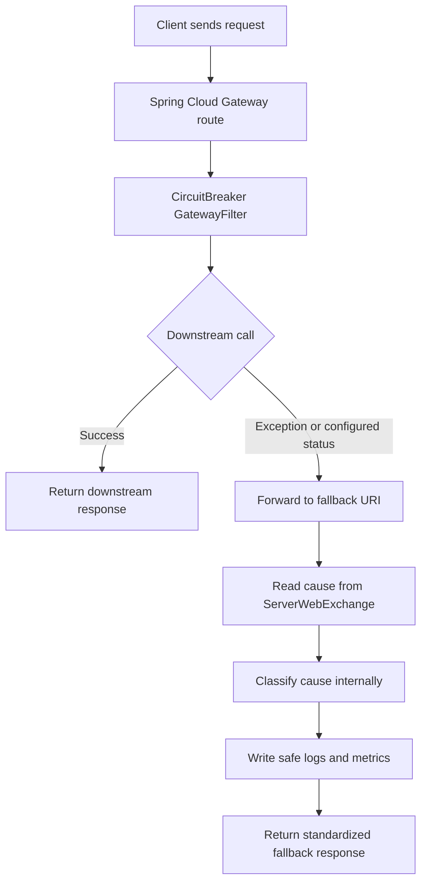

# Passing Fallback Causes and Avoiding Internal Detail Exposure

Spring Cloud Gateway can use the CircuitBreaker GatewayFilter to protect a route calling a downstream service. When the call fails or the Circuit Breaker rejects the request, the filter can forward processing to an internal fallback endpoint. This endpoint needs to know the cause to log it and choose an appropriate response, yet must never expose exceptions, internal addresses, or deployment details in the public response.

The Gateway provides the cause that triggered the fallback via a ServerWebExchange attribute. With a reactive Gateway, the handler can read this attribute, classify the exception, log it alongside the request ID, and return a standardized response. Doing this properly lets operations investigate incidents while clients receive only safe error codes and messages.

## 1. Fallback Flow of the CircuitBreaker GatewayFilter

The CircuitBreaker GatewayFilter wraps the route call. If downstream returns a normal result and no configured error condition applies, the response continues to the client. If the call throws an exception or the response status is in the list configured to be treated as an error, the filter can forward the request to the fallback URI.

In a reactive Gateway, the fallback URI typically uses the forward scheme to dispatch internally to a handler within the same Gateway application. This is an internal forward, not an HTTP redirect to an external URL.

Overall flow:

The error cause is stored in the exchange attribute named by the constant:

~~~java
ServerWebExchangeUtils.CIRCUITBREAKER_EXECUTION_EXCEPTION_ATTR
~~~

This constant belongs to Spring Cloud Gateway's ServerWebExchangeUtils class. The fallback handler can retrieve the Throwable from ServerWebExchange to see which error led to the fallback.

Do not confuse this mechanism with OpenFeign's FallbackFactory. OpenFeign passes the cause into the create(Throwable) method of FallbackFactory. The Gateway filter stores the cause in a ServerWebExchange attribute for the fallback handler to read within the request context.

## 2. Configuring a Route with fallbackUri

Example where the Gateway forwards inventory requests to the inventory service and uses an internal fallback endpoint when the Circuit Breaker triggers:

~~~yaml
spring:
  cloud:
    gateway:
      routes:
        - id: inventory-route
          uri: lb://inventory-service
          predicates:
            - Path=/api/inventory/**
          filters:
            - name: CircuitBreaker
              args:
                name: inventory
                fallbackUri: forward:/fallback/inventory
                statusCodes:
                  - 500
                  - 503
~~~

Explanation:

- inventory-route is the Gateway route ID.
- lb://inventory-service requires service discovery/load balancer to resolve the target service.
- Path determines which requests the route handles.
- The CircuitBreaker filter uses the instance named inventory.
- fallbackUri forwards internally to the /fallback/inventory handler.
- statusCodes lists downstream HTTP statuses to treat as errors for Circuit Breaker handling.

The statusCodes list is optional. If downstream returns HTTP 503 as a normal response and that status is not configured as an error, the Gateway can pass the response back to the client instead of running fallback. Select statuses according to the downstream API contract; do not treat every 4xx code as an infrastructure error because 404 or 409 can be valid business outcomes.

The name inventory in Circuit Breaker configuration should match the Resilience4j instance name if the application uses Resilience4j. You must enable the reactive Circuit Breaker starter compatible with the project's Spring Cloud Gateway and Spring Boot versions.

A Fallback URI with the forward scheme must point to an internal handler that the Gateway can dispatch to. Do not place an arbitrary public URL in fallbackUri expecting the filter to issue a redirect. If you need to call a remote fallback service, design that call as a separate dependency with its own timeouts and protection mechanisms.

## 3. Reading the Cause from ServerWebExchange

The fallback controller can accept ServerWebExchange and read the attribute set by the CircuitBreaker GatewayFilter:

~~~java
import org.springframework.cloud.gateway.support.ServerWebExchangeUtils;
import org.springframework.http.HttpStatus;
import org.springframework.http.ResponseEntity;
import org.springframework.web.bind.annotation.RequestMapping;
import org.springframework.web.bind.annotation.RestController;
import org.springframework.web.server.ServerWebExchange;

import reactor.core.publisher.Mono;

@RestController
public class InventoryFallbackController {

    @RequestMapping("/fallback/inventory")
    public Mono<ResponseEntity<GatewayFallbackResponse>> inventoryFallback(
            ServerWebExchange exchange) {

        Throwable cause = exchange.getAttribute(
                ServerWebExchangeUtils.CIRCUITBREAKER_EXECUTION_EXCEPTION_ATTR);

        String requestId = exchange.getRequest().getId();
        FailureKind kind = classify(cause);

        // Only record controlled information in operational logs.
        logFallback(requestId, kind, cause);

        GatewayFallbackResponse response = new GatewayFallbackResponse(
                "INVENTORY_TEMPORARILY_UNAVAILABLE",
                "The inventory service is currently unable to process the request.",
                requestId
        );

        return Mono.just(
                ResponseEntity.status(publicStatus(kind)).body(response)
        );
    }
}
~~~

Example using a public DTO:

~~~java
public record GatewayFallbackResponse(
        String code,
        String message,
        String requestId) {
}
~~~

The attribute may not exist on certain execution paths or when the handler is invoked directly. Therefore, handle a null cause and classify it as UNKNOWN instead of assuming an exception is always present.

The exchange's request ID can be used to correlate Gateway logs. If the system already has a correlation ID or trace ID from tracing infrastructure, use the value validated and managed by the system. Never blindly trust a client-supplied header as a reliable identifier.

## 4. Classifying Causes Without Exposing Exceptions to Clients

A fallback handler typically needs to distinguish several error categories:

- Circuit Breaker OPEN: new calls are rejected before being sent downstream.
- Timeout: downstream or the network failed to respond within the deadline.
- Connection failure: unable to establish or maintain a connection.
- Other upstream failure: downstream returned an error or the client threw another exception.
- Unknown: no specific cause found.

You can classify by exception type along the cause chain:

~~~java
import java.net.ConnectException;
import java.util.concurrent.TimeoutException;

import io.github.resilience4j.circuitbreaker.CallNotPermittedException;

enum FailureKind {
    CIRCUIT_OPEN,
    TIMEOUT,
    CONNECTION_FAILURE,
    UPSTREAM_FAILURE,
    UNKNOWN
}

private FailureKind classify(Throwable cause) {
    if (hasCause(cause, CallNotPermittedException.class)) {
        return FailureKind.CIRCUIT_OPEN;
    }

    if (hasCause(cause, TimeoutException.class)) {
        return FailureKind.TIMEOUT;
    }

    if (hasCause(cause, ConnectException.class)) {
        return FailureKind.CONNECTION_FAILURE;
    }

    if (cause != null) {
        return FailureKind.UPSTREAM_FAILURE;
    }

    return FailureKind.UNKNOWN;
}

private boolean hasCause(
        Throwable error,
        Class<? extends Throwable> expectedType) {

    Throwable current = error;

    while (current != null) {
        if (expectedType.isInstance(current)) {
            return true;
        }

        Throwable next = current.getCause();
        if (next == current) {
            break;
        }
        current = next;
    }

    return false;
}
~~~

Actual exceptions depend on the HTTP client, Circuit Breaker adapter, and library versions. For example, a timeout might surface as a Reactor Netty exception, a WebClient exception, or a framework wrapper. DNS, TLS, and connection reset errors may also have types other than ConnectException.

Accordingly, the helper above is a starting point. Observe actual cause chains in a development environment, then add any required exception types. Avoid classifying based on message text because messages can change across versions or contain sensitive details.

## 5. Mapping Internal Causes to Public Responses

The application can preserve detailed causes in logs, while client responses should use stable error codes and generic messages.

Status mapping example:

~~~java
private HttpStatus publicStatus(FailureKind kind) {
    return switch (kind) {
        case TIMEOUT -> HttpStatus.GATEWAY_TIMEOUT;
        case CIRCUIT_OPEN,
             CONNECTION_FAILURE,
             UPSTREAM_FAILURE,
             UNKNOWN -> HttpStatus.SERVICE_UNAVAILABLE;
    };
}
~~~

You can use the same generic response body for multiple causes to avoid revealing internal structure:

~~~json
{
  "code": "INVENTORY_TEMPORARILY_UNAVAILABLE",
  "message": "The inventory service is currently unable to process the request.",
  "requestId": "a-server-generated-request-id"
}
~~~

The client knows the operation could not be completed and has a requestId to provide when contacting support. The client does not need to know that the Circuit Breaker is OPEN, which hostname failed, which exception class was thrown, or the downstream's internal port.

If the API follows a standard error convention, use the same envelope and field names as the remaining endpoints. Do not let each fallback endpoint invent a different response format.

## 6. Which Information Must Not Be Returned Externally?

A Throwable can contain plenty of data useful to operators that is inappropriate for public clients. Never return cause.getMessage(), cause.toString(), or a stack trace directly in the response.

Information to keep within internal logs/traces:

- Exception class names and cause chains.
- Internal hostnames, IPs, ports, or downstream URIs.
- DNS, TLS, connection pool, and network details.
- Internal route names, service discovery names, and topology.
- Stack traces, package names, and code line numbers.
- SQL, internal queries, or request/response payloads.
- Tokens, cookies, authorization headers, and personal data.
- Circuit Breaker instance names and operational configuration when not meant to be public.

A safe public response should contain only:

- A stable error code for clients to handle.
- A brief message that does not describe infrastructure.
- An appropriate HTTP status.
- A controlled Request ID or correlation ID.
- Optionally a retry hint if supported by API policy and backed by a valid basis.

Do not return messages like "Connection refused at inventory-db.internal:8443" or "CallNotPermittedException from inventoryCircuitBreaker". Such details can help outsiders infer internal architecture, hostnames, and technology stacks.

## 7. Logging Causes in the Operational Domain

Fallbacks must produce enough information for operations teams to investigate. Log the request ID, route ID, failure kind, dependency name, and exception type. Stack traces can be logged in controlled internal logs when needed for investigation, while avoiding tokens, sensitive payloads, or full headers.

Example:

~~~java
private void logFallback(
        String requestId,
        FailureKind kind,
        Throwable cause) {

    String exceptionType = cause == null
            ? "none"
            : cause.getClass().getName();

    log.warn(
            "Gateway fallback activated: route=inventory, requestId={}, kind={}, exceptionType={}",
            requestId,
            kind,
            exceptionType
    );

    if (cause != null) {
        log.debug(
                "Gateway fallback cause details: requestId={}",
                requestId,
                cause
        );
    }
}
~~~

If debug logging is enabled to record stack traces, ensure the log sink has appropriate access controls, reasonable retention, and sensitive-data masking. Do not log detailed causes at INFO/WARN if the message could contain URLs or untrusted input data.

Do not log merely "fallback happened" without a request ID and cause category. When many concurrent requests fail, logs without correlation are hard to link to traces or client requests.

## 8. Fallbacks Can Return Degraded Data or Controlled Errors

Not every fallback needs to return 503. The choice depends on business requirements:

- If no safe alternative data exists, return 503 or 504 with the standard error envelope.
- If a sufficiently fresh cache exists and business rules allow stale data, you can return cached data along with metadata indicating the data source and update timestamp.
- If part of the response is still usable, you can return a degraded result clearly marked as such.
- If the operation is a critical transaction such as payment or order creation, do not pretend it succeeded when the downstream outcome is unknown.

Example DTO representing cached data:

~~~java
public record InventoryFallbackResponse(
        String sku,
        Integer availableQuantity,
        boolean degraded,
        String source,
        Instant cachedAt) {
}
~~~

If using a cache, the fallback must verify freshness. Stale inventory data can cause overselling; stale payment data can lead to wrong decisions. Fallbacks must obey the endpoint's business rules rather than merely trying to return HTTP 200.

A fallback also must not call back into the failing downstream itself. If the fallback needs to call another dependency, that dependency must have its own timeout, resource bounds, and protection mechanisms. Otherwise, the fallback path can create another failure cascade.

## 9. Distinguishing Exception Fallbacks from Status Code Fallbacks

The CircuitBreaker GatewayFilter can trigger fallback due to an exception or due to a status code declared in statusCodes.

Two distinct cases:

| Scenario | Example | What to check |
|---|---|---|
| Exception | Timeout, connection error, CallNotPermittedException | Cause attribute and cause chain |
| Configured status | Downstream returns 500 or 503 | statusCodes list and how the adapter converts responses into errors |
| Unconfigured status | Downstream returns a normal 404 | Response can pass straight through to the client |
| Fallback handler error | Fallback controller itself throws an exception | Fallback's own error handling and final response |

When a status code is configured, the Gateway can convert that response into an error condition for the Circuit Breaker to record and trigger fallback. Test with the exact statuses returned by downstream, since behavior depends on filter configuration and version.

If status 404 means "product not found," you usually should not add it to statusCodes just to trigger a generic fallback. If status 503 indicates the dependency cannot serve requests, it can be added to the list and return a standardized temporary error.

## 10. Preventing the Fallback Endpoint from Becoming an Unintended Public Route

A forward Fallback URI is invoked internally by the Gateway filter, yet the fallback endpoint is still a mapping in the application. If routing or security configuration permits direct access, clients can call the fallback endpoint without going through the Circuit Breaker.

Considerations:

- Place the fallback path in an internal namespace, for example /internal/fallback/inventory.
- Do not create a separate public route pointing to the fallback path unless needed.
- Use appropriate security rules to prevent external clients from calling internal endpoints directly.
- Do not rely on obscure path names as a security mechanism.
- If the handler is called directly without a cause attribute, return a safe default response or reject according to policy.
- Do not use client-supplied headers to spoof error causes or mark a request as having passed through the Circuit Breaker.

Internal forwarding does not automatically guarantee the endpoint can only be called by the filter. Inspect route matching and the security chain to ensure the fallback path does not become an unintended public API.

## 11. Monitoring Fallbacks Without Exposing Causes

Maintain separate metrics for fallbacks and classified cause types. For example, metrics can count fallbacks by route and failure kind:

- Number of Circuit Breaker OPEN rejections.
- Number of timeouts.
- Number of connection failures.
- Number of downstream response statuses routed to fallback.
- Number of times the fallback handler itself threw errors.
- Ratio of responses served via cache or degraded data.
- Fallback processing duration.

Metric labels should have low cardinality. You can use route ID and standardized failure kind; do not place request IDs, user IDs, full URLs, or exception messages in labels, as that creates excessive time series and can leak data.

Logs and traces can retain finer details within controlled boundaries. Metrics serve trends and alerting; logs/traces serve per-request investigation.

## 12. Testing Causes and Safe Responses

A fallback test should verify both sides: internal causes are recorded accurately and public responses leak no information.

Scenarios to include:

| Scenario | Expected internal cause | Public response |
|---|---|---|
| Circuit Breaker OPEN | CallNotPermittedException | 503 and generic error code |
| Downstream timeout | Timeout exception | 504 or status per API contract |
| Connection refused | Connection error | 503 and safe message |
| Downstream returns configured 503 | Status fallback per filter | 503 with standard error envelope |
| Downstream returns unconfigured 404 | Does not trigger generic fallback | 404 per API contract |
| Cause attribute missing | UNKNOWN | Safe default response or rejection |
| Fallback handler errors | Handler exception | Common error handler, no stack trace returned |

When testing, verify:

1. The route actually uses CircuitBreaker GatewayFilter.
2. The Fallback URI forwards to the right handler.
3. The handler reads the Gateway's exception attribute properly.
4. The cause chain is classified accurately for actual HTTP client exception types.
5. The response contains no exception messages, stack traces, hostnames, or internal URIs.
6. The Request ID can link the response to logs/traces.
7. The fallback handler does not call back into the failing dependency.
8. The fallback endpoint is not exposed as an unintended public API.

You can assert on the response body to verify it contains no exception class names, internal hostnames, ports, or stack traces. At the same time, inspect internal logs to confirm request ID and failure kind remain available for investigation.

## 13. Common Mistakes

- **Not reading the exception attribute**: fallback handler only returns a generic message and loses root-cause diagnosability.
- **Assuming the attribute is always populated**: the handler must handle null causes and direct invocation paths.
- **Returning cause.getMessage() to clients**: the message may contain hosts, URIs, credentials, or internal data.
- **Returning stack traces in JSON**: exposes classes, packages, structure, and implementation details.
- **Classifying only the outermost exception**: the root cause may lie deeper in the cause chain.
- **Using message text to detect timeouts**: messages are less stable than exception types or error codes.
- **Configuring statusCodes too broadly**: can treat business 404/409 responses as infrastructure failures.
- **Fallback calling the same downstream again**: creates loops or continues increasing load.
- **Not securing the fallback endpoint**: clients can invoke the internal handler directly.
- **Putting exception messages in metric labels**: cardinality explodes and internal data can leak.
- **Missing request ID**: hard to correlate fallback responses with logs and traces.
- **Fallback returning 200 for every error**: hides incidents and misleads callers about business state.

## 14. Implementation Workflow

When implementing CircuitBreaker GatewayFilter and a fallback handler in Spring Cloud Gateway, follow this sequence:

1. Identify the route and which downstream exceptions or statuses should trigger fallback.
2. Configure CircuitBreaker GatewayFilter with an instance name and fallbackUri using internal forward.
3. Declare a fallback handler accepting ServerWebExchange.
4. Read Throwable from CIRCUITBREAKER_EXECUTION_EXCEPTION_ATTR and handle the missing-cause case.
5. Classify the cause by exception types/cause chains observed from the actual HTTP client.
6. Write internal logs containing request ID, route ID, and failure kind; secure logs and scrub sensitive data.
7. Map causes to standardized public statuses, error codes, and messages.
8. Never include exception messages, stack traces, hostnames, internal URIs, or tokens in responses.
9. Control access to the fallback endpoint and avoid creating unnecessary public routes.
10. Test exceptions, statusCodes, null causes, fallback handler errors, and information-leak-free responses.
11. Monitor fallback metrics with low-cardinality labels and correlate logs/traces by request ID.

Gateway fallbacks must satisfy two goals: operations teams know the real cause for investigation, while clients receive only enough information to handle the request. Reading the cause from ServerWebExchange, classifying by exception type, and keeping details in internal logs achieves both goals. Public responses should use stable statuses and error codes, generic messages, and a request ID; never return exception messages or dependency infrastructure details.
