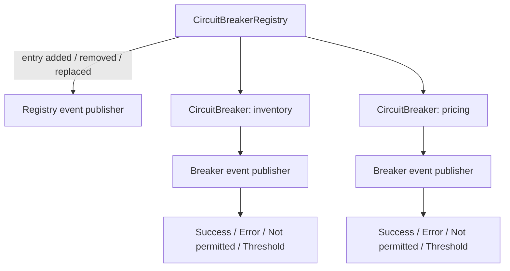

# Success, Error, Slow Call, and Rejected Call Events

A circuit breaker does more than transition between `CLOSED`, `OPEN`, and `HALF_OPEN`; it also emits events describing what just happened to a protected call. Resilience4j provides an event publisher so the application can listen for successful outcomes, errors, ignored errors, rejected calls, exceeded failure or slow-call thresholds, and state changes.

Events help explain why a breaker opened, measure the impact of slow dependencies, and distinguish errors from the target service from calls blocked locally by the application. They complement metrics and logs: events describe a specific change or outcome, metrics aggregate trends over time, and logs preserve context for investigation. Listeners should process quickly so they do not slow down the protected call path.

## 1. Registry and Event Publishers Have Two Scopes

Resilience4j manages circuit breakers through `CircuitBreakerRegistry`. The registry creates and looks up breakers by name. The registry itself also emits events when an entry is added, removed, or replaced. After obtaining a breaker, the application can register listeners on that breaker's own event publisher to receive operational events.



The two scopes should not be confused:

| Publisher | Events | Purpose |
|---|---|---|
| `CircuitBreakerRegistry.getEventPublisher()` | Entry added, removed, or replaced | Track the lifecycle of breakers inside the registry |
| `CircuitBreaker.getEventPublisher()` | Success, error, ignored error, not permitted, threshold exceeded, state transition, and reset | Track the activity of a specific breaker |

For example, `inventory` and `pricing` can reside in the same registry while having separate event publishers and statistics. A listener on the `inventory` breaker only receives events emitted by that breaker; a listener registered on the registry receives entry-management events.

## 2. Retrieving a Breaker from the Registry

An application can create a registry and retrieve a breaker by ID:

```java
import io.github.resilience4j.circuitbreaker.CircuitBreaker;
import io.github.resilience4j.circuitbreaker.CircuitBreakerRegistry;

public class InventoryProtection {
    private final CircuitBreakerRegistry registry =
            CircuitBreakerRegistry.ofDefaults();

    public CircuitBreaker inventoryBreaker() {
        return registry.circuitBreaker("inventory");
    }
}
```

`circuitBreaker("inventory")` returns the breaker named `inventory` in the registry. If the entry does not exist yet, the registry creates a new entry using the default configuration or the configuration provided to the registry. When using Spring Boot with Resilience4j auto-configuration, the registry is normally managed by Spring and configured from `application.yml`; the application should inject that registry instead of creating a new registry on every request.

Example of injecting the registry into a Spring bean:

```java
@Component
public class InventoryEventConfiguration {
    private final CircuitBreakerRegistry registry;

    public InventoryEventConfiguration(CircuitBreakerRegistry registry) {
        this.registry = registry;
    }
}
```

The native registry is a Resilience4j API. If the gateway only uses Spring Cloud's `CircuitBreakerFactory` abstraction, accessing the native registry and event publisher couples observability code to Resilience4j. This is a reasonable trade-off when the application has chosen Resilience4j as its implementation and needs detailed events, though you should recognize that this part of the code is no longer implementation-independent.

## 3. Success Events

When the supplier completes normally and the breaker records a successful outcome, Resilience4j emits `CircuitBreakerOnSuccessEvent`. The event includes the breaker name and the measured execution duration. This duration is useful for analyzing call latency even when the call does not fail.

```java
CircuitBreaker breaker = registry.circuitBreaker("inventory");

breaker.getEventPublisher()
        .onSuccess(event -> log.info(
                "Circuit breaker {} succeeded in {}",
                event.getCircuitBreakerName(),
                event.getElapsedDuration()));
```

Do not count only successes. When latency climbs gradually, the success rate may remain high while the dependency is holding threads or connections longer than normal. Combining success counts with execution duration helps detect degradation before it turns into widespread failures.

If a call succeeds but exceeds `slowCallDurationThreshold`, the outcome may still be a business success while counting toward slow call statistics. The success event along with its elapsed duration helps the application spot the latency of that call.

## 4. Error Events

When the supplier throws an exception and the breaker classifies the outcome as a failure, Resilience4j emits `CircuitBreakerOnErrorEvent`. The event contains the exception and execution duration. This signals that a call was attempted but did not complete normally.

```java
breaker.getEventPublisher()
        .onError(event -> log.warn(
                "Circuit breaker {} failed after {}: {}",
                event.getCircuitBreakerName(),
                event.getElapsedDuration(),
                event.getThrowable().toString()));
```

Errors can come from timeouts, connection refused, DNS, HTTP 5xx, or programming bugs in the supplier. The event does not automatically identify the business root cause; the application must classify the exception and its cause chain appropriately. Avoid logging full requests/responses or credentials when handling events.

Resilience4j also provides `CircuitBreakerOnIgnoredErrorEvent` for exceptions configured to be ignored. Ignored exceptions are not counted as either successes or failures in the sliding window. A separate listener helps distinguish business errors that are intentionally ignored from errors contributing to the failure rate.

```java
breaker.getEventPublisher()
        .onIgnoredError(event -> log.debug(
                "Circuit breaker {} ignored error: {}",
                event.getCircuitBreakerName(),
                event.getThrowable().toString()));
```

Do not add `onIgnoredError` counts to the errors used to calculate failure rate. You can track them separately to see how frequently the application encounters exceptions classified as not affecting dependency health.

## 5. Call-Not-Permitted Events

When the circuit breaker does not grant permission to execute the supplier, Resilience4j emits `CircuitBreakerOnCallNotPermittedEvent`. The most common case is when the breaker is `OPEN`; in `HALF_OPEN`, exhausting the allotted probe permissions can also cause new calls to be rejected.

```java
breaker.getEventPublisher()
        .onCallNotPermitted(event -> log.warn(
                "Circuit breaker {} rejected a call",
                event.getCircuitBreakerName()));
```

A rejected call is different from a failed supplier execution. When the breaker blocks a call, the code calling the target service does not run; no request was necessarily sent over the network. Therefore, do not log `CallNotPermittedException` as if the backend had just returned HTTP 500 or timed out.

Not-permitted events are useful for measuring the breaker's impact on traffic. If rejected call counts rise, correlate them with the breaker state, the time it transitioned to `OPEN`, fallback behavior, and preceding errors. This event also helps distinguish a breaker actively shielding the backend from a backend continuing to receive requests and returning errors itself.

## 6. Slow-Call Events

Resilience4j distinguishes the execution duration of an individual call from the slow-call rate in the sliding window. A call is considered slow when its execution duration exceeds `slowCallDurationThreshold`. When the slow-call rate reaches or exceeds `slowCallRateThreshold` after enough samples are collected, the breaker can open even if many calls still succeed.

Two event types should be distinguished:

- `CircuitBreakerOnSuccessEvent` or `CircuitBreakerOnErrorEvent` records the outcome of each individual call along with its elapsed duration. The application can use this duration to observe individual slow calls.
- `CircuitBreakerOnSlowCallRateExceededEvent` reports that the slow-call rate has exceeded the configured threshold. This is a statistical threshold event, not a separate event for every slow call.

Registering a listener when the slow-call rate threshold is exceeded:

```java
breaker.getEventPublisher()
        .onSlowCallRateExceeded(event -> log.warn(
                "Circuit breaker {} exceeded the slow-call rate threshold: {}",
                event.getCircuitBreakerName(),
                event));
```

To understand per-call latency, observe the elapsed duration in success/error events or use HTTP client metrics/traces. Do not rely solely on `onSlowCallRateExceeded`, as it only reports threshold exceedance and does not replace a latency histogram.

Configuration example:

```yaml
resilience4j:
  circuitbreaker:
    instances:
      inventory:
        slidingWindowType: COUNT_BASED
        slidingWindowSize: 20
        minimumNumberOfCalls: 10
        failureRateThreshold: 50
        slowCallDurationThreshold: 800ms
        slowCallRateThreshold: 60
        waitDurationInOpenState: 10s
        permittedNumberOfCallsInHalfOpenState: 3
```

With the configuration above, calls taking longer than 800 ms count as slow calls. Once a minimum of 10 samples is reached and the slow-call rate in the window hits 60%, the breaker can transition to `OPEN`. These values are illustrative only; choose values suited to your target latency and the dependent service's capacity.

## 7. Failure-Rate-Exceeded Events

When the failure rate exceeds `failureRateThreshold`, Resilience4j emits `CircuitBreakerOnFailureRateExceededEvent`. This event explains the shift from error statistics to a protection decision. It differs from `CircuitBreakerOnErrorEvent`: an error event describes a single failed call, whereas the threshold-exceeded event indicates the failure rate in the window has met the trigger condition.

```java
breaker.getEventPublisher()
        .onFailureRateExceeded(event -> log.error(
                "Circuit breaker {} exceeded the failure-rate threshold: {}",
                event.getCircuitBreakerName(),
                event));
```

Not every error immediately produces a threshold-exceeded event. The breaker needs at least `minimumNumberOfCalls` and a failure rate reaching the threshold. For example, with a minimum of 10 samples and a 50% threshold, 2 errors out of 4 calls are not yet enough to evaluate; once 10 samples are collected, the failure rate is calculated over the configured window.

## 8. State Transition and Reset Events

`CircuitBreakerOnStateTransitionEvent` is emitted when the breaker changes state, such as `CLOSED` to `OPEN`, `OPEN` to `HALF_OPEN`, or `HALF_OPEN` back to `CLOSED`. This event is usually the most helpful when investigating when the system started blocking calls and when the dependency was allowed to receive probes again.

```java
breaker.getEventPublisher()
        .onStateTransition(event -> log.info(
                "Circuit breaker {} changed state: {}",
                event.getCircuitBreakerName(),
                event.getStateTransition()));
```

Resilience4j also emits a reset event when a breaker is reset. Resetting clears statistics and returns the breaker to its initial state according to the implementation's API. A reset does not prove the target service has recovered; it only alters the local state machine and statistics. Do not automate resets just to clear red alerts on a dashboard.

## 9. Registering Multiple Listeners on a Breaker

An application can register multiple event types on the same publisher. The following example combines success, error, rejected call, slow-call threshold, and state transition listeners:

```java
import io.github.resilience4j.circuitbreaker.CircuitBreaker;
import io.github.resilience4j.circuitbreaker.CircuitBreakerRegistry;
import org.springframework.stereotype.Component;

@Component
public class InventoryCircuitBreakerEvents {

    public InventoryCircuitBreakerEvents(CircuitBreakerRegistry registry) {
        CircuitBreaker breaker = registry.circuitBreaker("inventory");

        breaker.getEventPublisher()
                .onSuccess(event -> log.info(
                        "inventory success in {}", event.getElapsedDuration()))
                .onError(event -> log.warn(
                        "inventory error after {}: {}",
                        event.getElapsedDuration(), event.getThrowable()))
                .onIgnoredError(event -> log.debug(
                        "inventory ignored error: {}", event.getThrowable()))
                .onCallNotPermitted(event -> log.warn(
                        "inventory call not permitted"))
                .onSlowCallRateExceeded(event -> log.warn(
                        "inventory slow-call rate exceeded: {}", event))
                .onFailureRateExceeded(event -> log.error(
                        "inventory failure rate exceeded: {}", event))
                .onStateTransition(event -> log.info(
                        "inventory state transition: {}", event.getStateTransition()));
    }
}
```

This snippet illustrates registering listeners on a breaker obtained from the registry. In a real application, `log` must be declared with an appropriate logger, such as SLF4J. Listeners must be registered once during the bean lifecycle, not on every request; repeated registration causes the same event to be handled multiple times and inflates logs/metrics unexpectedly.

If the registry creates the breaker before listeners are registered, retrieving the existing breaker via `registry.circuitBreaker("inventory")` still lets you register listeners for subsequent events. Listeners do not retroactively receive events emitted before registration.

## 10. Tracking Entries Added to or Removed from the Registry

The registry's event publisher is useful when breakers are created dynamically from configuration or application needs. Listeners can record entry lifecycle events:

```java
registry.getEventPublisher()
        .onEntryAdded(event -> log.info(
                "Circuit breaker registered: {}",
                event.getAddedEntry().getName()))
        .onEntryRemoved(event -> log.info(
                "Circuit breaker removed: {}",
                event.getRemovedEntry().getName()))
        .onEntryReplaced(event -> log.info(
                "Circuit breaker replaced: {}",
                event.getNewEntry().getName()));
```

Accessor names on registry events can differ depending on event type and Resilience4j version; use the API provided by the managed dependency version. The key distinction is that registry events describe the lifecycle of breaker objects, while the breaker's event publisher describes call outcomes and the state machine.

When a registry manages many instances, entry events help detect unexpected new instances appearing. If breaker IDs are built from dynamic request data, the number of entries can grow continuously. That is a sign to review naming rules and registry scope.

## 11. Configuring and Limiting the Event Consumer

Resilience4j allows configuring the event consumer buffer size for a circuit breaker via `eventConsumerBufferSize` in the instance or default configuration, depending on how configuration is structured.

```yaml
resilience4j:
  circuitbreaker:
    configs:
      default:
        eventConsumerBufferSize: 20
        slidingWindowSize: 100
        minimumNumberOfCalls: 20
    instances:
      inventory:
        baseConfig: default
```

The event buffer is useful for ring-buffer consumers and endpoints inspecting recent events. It is not durable storage and does not guarantee retaining the complete event history. When the buffer fills up, older events can be overwritten according to the buffer's policy. If you need audit history or long-term analysis, export events to a suitable logging/monitoring system.

Do not use the event buffer as a replacement for metrics. Events can be numerous and granular; aggregated metrics are better suited for dashboards, alerts, and trend analysis. Store only necessary fields, avoiding payloads or sensitive data.

## 12. Listeners Must Be Lightweight and Non-Blocking

Events are emitted during call processing or state transitions. Synchronous, heavy listeners can increase request latency, hold threads longer, and even contribute to overload. Therefore, listeners should:

- Perform brief operations such as incrementing a counter, writing a structured log, or enqueuing a small message.
- Avoid making HTTP calls, database queries, or calls to other services directly inside an event callback.
- Never throw exceptions back into the breaker's execution flow; handle internal listener errors safely.
- Avoid registering listeners repeatedly on every request.
- Avoid logging full stack traces for every repeated error; use sampling or an appropriate log level.
- Never put user IDs, request IDs, or payloads into metric labels due to cardinality and data exposure risks.

If asynchronous event processing is required, callbacks can push minimal data into a bounded queue for a dedicated worker to process later. The queue needs a full-queue policy: drop telemetry events, coalesce events, or increment a dropped-event counter. Do not create an unbounded queue, or the observability path itself can become a source of memory exhaustion.

## 13. Events, Metrics, and Logs Serve Different Purposes

| Mechanism | Question Answered | Example |
|---|---|---|
| Event | What just happened? | A call failed, the breaker rejected a call, state transitioned to `OPEN` |
| Metric | What are the current trends and rates? | Failure rate, slow call rate, rejected call count, latency histogram |
| Log | What context is available for investigation? | Breaker ID, dependency, exception class, trace ID, and timestamp |
| Trace | Which steps did the request pass through and where was time spent? | HTTP span to inventory-service and response wait time |

Resilience4j integrates with Micrometer to export breaker metrics when the required dependency and configuration are present. Event listeners can supplement with custom counters, but avoid duplicating metrics already provided by the exporter. Before adding custom metrics, determine what data dashboards actually need and inspect the existing metrics endpoint.

For example, when `onCallNotPermitted` increases, the rejection metric increases, and a state transition shows the breaker just moved from `CLOSED` to `OPEN`, the system has evidence that traffic is being blocked by the breaker. If only `onError` rises while the breaker stays closed, check `minimumNumberOfCalls`, the failure threshold, and exception classification.

## 14. Testing Event Listeners

Test both that listeners receive the expected event types and that listeners do not alter protection behavior. Test scenarios can use a small breaker configuration:

1. Supplier returns normally; verify the success listener is invoked and elapsed duration has a value.
2. Supplier throws a recorded exception; verify the error listener receives the right cause.
3. Supplier throws an ignored exception; verify the ignored-error listener is invoked and the error does not contribute to failure rate.
4. Drive the breaker to `OPEN`; invoke another call and verify the call-not-permitted listener is called without running the supplier.
5. Generate enough slow samples to exceed `slowCallRateThreshold`; verify the slow-call-rate-exceeded event is emitted.
6. Generate enough failed samples to exceed `failureRateThreshold`; verify the failure-rate-exceeded event is emitted.
7. Verify `onStateTransition` when the breaker changes state.
8. Add or remove a breaker in the registry; verify entry lifecycle listeners receive the expected events.
9. Register a listener once and verify a single event is not handled redundantly.

In tests, you can use `CountDownLatch`, a mock consumer, or thread-safe counters to await events. Avoid assuming events are emitted on a separate thread; design listeners and tests according to the publisher semantics of the version in use. If you need to verify event ordering, explicitly control call sequence and state transitions to avoid depending on nondeterministic timing.

## 15. Event Observability Implementation Workflow

When adding event listeners for a circuit breaker in Spring Cloud, follow this sequence:

1. Obtain the `CircuitBreakerRegistry` managed by Resilience4j/Spring and identify the breaker IDs to monitor.
2. Register listeners on `CircuitBreaker.getEventPublisher()` once during the bean lifecycle.
3. Track success, error, ignored error, and call-not-permitted events to separate supplier outcomes from breaker rejections.
4. Track elapsed duration and `onSlowCallRateExceeded` to detect slow calls alongside threshold breaches.
5. Track `onFailureRateExceeded` and `onStateTransition` to explain when the breaker opens and recovers.
6. Use the registry event publisher if you need to observe breakers being added, removed, or replaced.
7. Keep callbacks lightweight; emit logs/metrics or push events to a bounded queue.
8. Combine events with Micrometer, logs, and traces; do not treat the event buffer as durable storage.
9. Write tests for each event type and verify listeners do not slow down calls.

Success, error, slow-call, and rejected-call events show what the breaker is observing at every moment. `onSuccess` and `onError` describe individual call outcomes; slow-call and failure-rate events report statistical threshold breaches; `onCallNotPermitted` shows the breaker blocked a call; `onStateTransition` explains state machine changes. Combining proper registry scoping, lightweight listeners, and metrics/traces keeps Spring Cloud circuit breakers transparent without turning observability itself into a new bottleneck.
