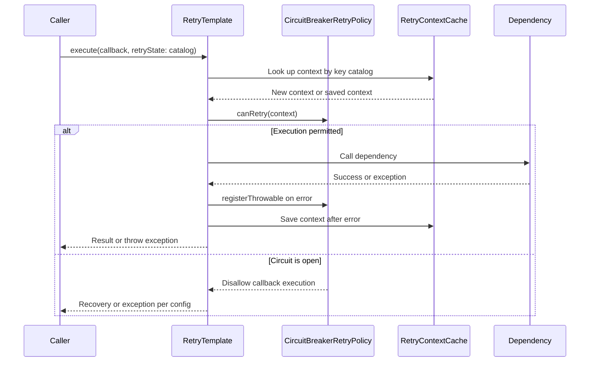
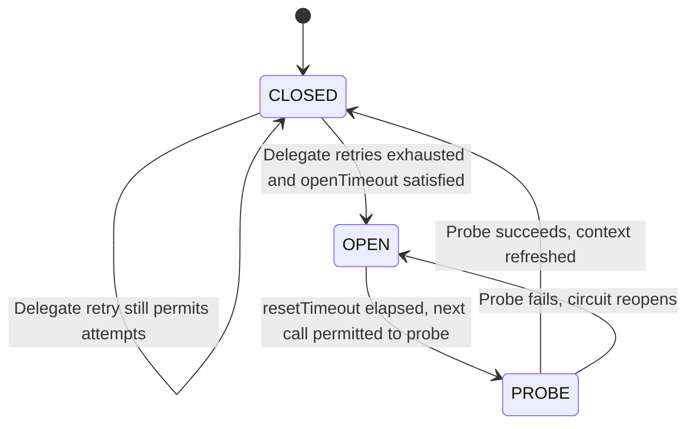

# CircuitBreakerRetryPolicy, DefaultRetryState, and Stateful Retry

Spring Cloud Circuit Breaker offers a backend based on Spring Retry. This backend combines `CircuitBreakerRetryPolicy` with stateful retry and `DefaultRetryState` to preserve failure context across calls. `CircuitBreakerRetryPolicy` decides when a call is permitted to proceed according to the retry policy and open/reset durations; `DefaultRetryState` provides the key that lets Spring Retry locate the context for the same breaker across executions.

These three components have distinct responsibilities:

| Component | Role |
|---|---|
| Delegate `RetryPolicy` | Decides which exceptions can be retried and limits the retry count or duration |
| `CircuitBreakerRetryPolicy` | Wraps the retry policy, tracks circuit state in the retry context, rejects calls when the circuit is open, and governs open/reset timing |
| `DefaultRetryState` | Carries a stable key so `RetryTemplate` can look up the saved retry context across calls |

Spring Cloud Circuit Breaker creates `CircuitBreakerRetryPolicy` and `DefaultRetryState` for breakers using the Spring Retry backend. Applications typically configure the retry policy via `SpringRetryConfigBuilder`; you do not need to instantiate those two objects manually on every request. Understanding these underlying classes explains why breaker state persists across calls and how to pick the right key.

## Stateless Retry and Stateful Retry

With stateless retry, `RetryTemplate` performs attempts within a single `execute` call. The retry context generally lives within the current execution thread. If all attempts fail, the last exception or recovery callback is returned to the caller.

With stateful retry, a failed execution can end by throwing an exception outward. The retry context is stored in a `RetryContextCache` keyed by `RetryState`. When the same work is submitted again with the same key, `RetryTemplate` retrieves the previous context and resumes from the saved state. This mechanism is useful when the current transaction must roll back after an error and the work is invoked again in a new transaction; it is also the foundation that enables Spring Retry to maintain circuit breaker state across calls.

| Characteristic | Stateless Retry | Stateful Retry |
|---|---|---|
| Retry context | Tied to a single execution | Can be stored and looked up across multiple executions |
| After an attempt fails | `RetryTemplate` can retry within the same call | Exception can be thrown so the caller/transaction finishes; the next call continues by key |
| Work identification | No external key needed | Requires a stable key across retries |
| Common use cases | Retrying a short network call within the same request | Retrying batch items or work requiring transaction rollback between attempts |

Stateful retry does not mean an HTTP request is held open while waiting. Each call can complete; the retry context is reused when the same work is submitted again. In Spring Cloud's circuit breaker, the key is typically tied to the breaker ID, such as `catalog`, so calls belonging to the same failure domain share context.

## How CircuitBreakerRetryPolicy Coordinates with the Delegate Policy

`CircuitBreakerRetryPolicy` implements the `RetryPolicy` interface and can wrap another retry policy:

```java
RetryPolicy delegate = new SimpleRetryPolicy(3);
CircuitBreakerRetryPolicy circuitPolicy =
        new CircuitBreakerRetryPolicy(delegate);

circuitPolicy.setOpenTimeout(5_000L);
circuitPolicy.setResetTimeout(20_000L);
```

In this example, `SimpleRetryPolicy(3)` allows up to three total attempts within a single retry execution, including the initial call. The delegate determines the limit and error classification; `CircuitBreakerRetryPolicy` adds circuit breaker behavior around that decision.

The two policy timeouts have distinct meanings:

- `openTimeout` is the window used to determine whether the circuit needs to open. When the delegate no longer permits retries and the elapsed time since the context started is still within this window, the circuit is marked open.
- `resetTimeout` is the wait period after the circuit opens before the context is reset. Once this duration has elapsed, the next call can be allowed to retry the dependency and start a new context.

The setters on `CircuitBreakerRetryPolicy` accept values in milliseconds. For example, `5_000L` equals five seconds and `20_000L` equals twenty seconds. These are not percentage thresholds or sliding window sizes.

Nor does `openTimeout` mean "open whenever errors occur for five seconds" independently of the delegate. The opening condition depends on the delegate exhausting its retry budget and the elapsed context time. If you need policies based on failure rate or slow calls over a statistical window, choose a backend that supports that model, such as Resilience4j.

## DefaultRetryState and the Retry Context Key

`DefaultRetryState` implements `RetryState`. This object carries the key used by `RetryTemplate` to look up the saved context across executions. Common constructors include:

```java
RetryState state = new DefaultRetryState("catalog");
```

Or additionally configuring context refresh and rollback classification:

```java
RetryState state = new DefaultRetryState(
        "catalog",
        false,
        throwable -> true
);
```

Meaning of the parameters:

- `key`: identifier of the work or breaker to recognize across calls. For a circuit breaker, use a key stable per dependency, such as `catalog`.
- `forceRefresh`: indicates whether looking up an existing context can be skipped because this is definitely fresh state. The default value is `false`.
- `rollbackClassifier`: classifies whether an exception requires a rollback. If no classifier is provided, the conservative default treats exceptions as requiring rollback.

Do not use a `requestId`, timestamp, or new UUID per request when you want requests targeting the same dependency to share circuit state. If the key changes every time, the retry context gets fragmented and the breaker cannot recognize shared history. Conversely, if you share the same key across two independent business tasks in ordinary stateful retry, their states can get mixed together.

With Spring Cloud Circuit Breaker, the factory creates `DefaultRetryState` for the breaker automatically. When using `RetryTemplate` directly, the developer is responsible for supplying the right key and calling the `execute` overload that accepts `RetryState`.

## Where RetryContextCache Stores State

`DefaultRetryState` does not store data itself. It only supplies the key and control hints to `RetryTemplate`. `RetryTemplate` uses `RetryContextCache` to store the context by key, then retrieves that context on subsequent executions.



Spring Retry's default cache is an in-process in-memory cache. Therefore, stateful retry in this form does not synchronize automatically across replicas and does not guarantee state retention across JVM restarts. With multiple pods, each pod may hold its own context; sharing a breaker ID does not by itself create a distributed circuit breaker. Account for this characteristic in your design and operational observability.

## Configuring the Spring Retry Backend via Spring Cloud Circuit Breaker

To use the Spring Retry backend, add the corresponding starter and manage the version via the Spring Cloud BOM:

```xml
<dependency>
    <groupId>org.springframework.cloud</groupId>
    <artifactId>spring-cloud-starter-circuitbreaker-spring-retry</artifactId>
</dependency>
```

Spring Cloud Circuit Breaker uses `SpringRetryCircuitBreakerFactory`. You can configure a default retry policy for all IDs:

```java
import org.springframework.cloud.client.circuitbreaker.Customizer;
import org.springframework.cloud.circuitbreaker.springretry.SpringRetryCircuitBreakerFactory;
import org.springframework.cloud.circuitbreaker.springretry.SpringRetryConfigBuilder;
import org.springframework.context.annotation.Bean;
import org.springframework.context.annotation.Configuration;
import org.springframework.retry.policy.SimpleRetryPolicy;

@Configuration
public class SpringRetryCircuitBreakerConfiguration {

    @Bean
    public Customizer<SpringRetryCircuitBreakerFactory> defaultRetryConfiguration() {
        return factory -> factory.configureDefault(id ->
                new SpringRetryConfigBuilder(id)
                        .retryPolicy(new SimpleRetryPolicy(3))
                        .build()
        );
    }
}
```

In this example, every breaker uses a retry policy allowing up to three attempts. Spring Cloud constructs the `CircuitBreakerRetryPolicy` and `DefaultRetryState` parts in the backend. If only one dependency needs a different policy, configure it by ID:

```java
@Bean
public Customizer<SpringRetryCircuitBreakerFactory> catalogRetryConfiguration() {
    return factory -> factory.configure(
            builder -> builder
                    .retryPolicy(new SimpleRetryPolicy(2))
                    .build(),
            "catalog"
    );
}
```

Do not configure the same ID in multiple places with conflicting retry policies. Check the Spring Cloud Circuit Breaker and Spring Retry versions in your active BOM before relying on a specific builder API. Official Spring Cloud examples use `SpringRetryConfigBuilder.retryPolicy(...)` to supply the delegate policy.

## Calling Dependencies Through the Factory and Fallback

The service creates a breaker by ID and wraps the call in `run`:

```java
@Service
public class CatalogService {

    private final CircuitBreakerFactory<?, ?> circuitBreakerFactory;
    private final CatalogClient catalogClient;

    public CatalogService(
            CircuitBreakerFactory<?, ?> circuitBreakerFactory,
            CatalogClient catalogClient) {
        this.circuitBreakerFactory = circuitBreakerFactory;
        this.catalogClient = catalogClient;
    }

    public Product findProduct(String productId) {
        CircuitBreaker breaker = circuitBreakerFactory.create("catalog");

        return breaker.run(
                () -> catalogClient.findProduct(productId),
                error -> Product.unavailable(productId)
        );
    }
}
```

The ID `catalog` is a stable identifier for the breaker. Requests using the same ID pass through the same configuration and context managed by the backend. When the policy allows execution, the supplier invokes the client and Spring Retry applies the retry policy. When the circuit is open or the execution exhausts its retries, the fallback can produce an alternative result for the caller.

The fallback does not turn the original call into a success inside the retry context. It only determines the result the caller receives. When the dependency fails, preserve metrics/logs and cause information so the dependent service's health is not masked.

## Customizing RetryTemplate and Listening to Events

Spring Cloud Circuit Breaker lets you customize `RetryTemplate` before the factory returns a breaker to callers using `addRetryTemplateCustomizers`. This approach is suitable for registering a `RetryListener` or adjusting template observability behavior:

```java
@Bean
public Customizer<SpringRetryCircuitBreakerFactory> retryListenerConfiguration() {
    return factory -> factory.addRetryTemplateCustomizers(retryTemplate ->
            retryTemplate.registerListener(new RetryListener() {
                @Override
                public <T, E extends Throwable> boolean open(
                        RetryContext context,
                        RetryCallback<T, E> callback) {
                    return false;
                }

                @Override
                public <T, E extends Throwable> void close(
                        RetryContext context,
                        RetryCallback<T, E> callback,
                        Throwable throwable) {
                    // Record the final outcome of the retry block.
                }

                @Override
                public <T, E extends Throwable> void onError(
                        RetryContext context,
                        RetryCallback<T, E> callback,
                        Throwable throwable) {
                    // Record each failed attempt.
                }
            })
    );
}
```

`onError` is invoked when an attempt fails; `close` runs when the retry block closes. Callbacks should be lightweight—avoid calling other services or doing slow synchronous logging on the request path. If you need to emit metrics, use low-cardinality tags such as breaker ID and outcome type, not user ID or request ID.

## Using RetryTemplate Directly When Stateful Retry Is Needed

When not using the Spring Cloud factory and you want to understand how the primitives work together, you can configure `RetryTemplate` directly:

```java
RetryTemplate retryTemplate = new RetryTemplate();

CircuitBreakerRetryPolicy circuitPolicy =
        new CircuitBreakerRetryPolicy(new SimpleRetryPolicy(3));
circuitPolicy.setOpenTimeout(5_000L);
circuitPolicy.setResetTimeout(20_000L);

retryTemplate.setRetryPolicy(circuitPolicy);

Product product = retryTemplate.execute(
        context -> catalogClient.findProduct(productId),
        context -> Product.unavailable(productId),
        new DefaultRetryState("catalog")
);
```

This example demonstrates the low-level Spring Retry API: `CircuitBreakerRetryPolicy` wraps the delegate, while `DefaultRetryState("catalog")` supplies the key to save/retrieve the context. Do not simultaneously wrap the same supplier with another `SpringRetryCircuitBreakerFactory`; pick a single execution boundary for that operation.

In real application code, place `RetryTemplate` in a shared bean rather than creating a new instance per request. If the template or cache is recreated repeatedly, context will no longer be shared across calls. At the same time, keep the key stable for the circuit being protected.

## Interpreting the Circuit Lifecycle

With a delegate policy and stateful context, the overall flow can be described as follows:

1. **Circuit allows calls:** the callback is executed according to the retry policy. The delegate determines the number of attempts and which exceptions are retried.
2. **Delegate exhausts retries:** if the `openTimeout` condition is satisfied, `CircuitBreakerRetryPolicy` marks the circuit open in the retry context.
3. **Circuit is open:** subsequent calls using the same key are blocked from invoking the callback and go to recovery/fallback depending on integration.
4. **After `resetTimeout` elapses:** the next call can reinitialize the context to probe the dependency. If it succeeds, the old error state is cleared; if it fails, the policy can reopen the circuit.



`PROBE` in the diagram illustrates the test call after the reset duration; do not assume the Spring Retry backend exposes the exact same state, metrics, and event APIs as Resilience4j. In particular, this model does not use a sliding window computing failure/slow-call rates like Resilience4j.

## Implementation Considerations

- **Pick the right delegate policy:** retry only exceptions that are likely transient. Do not retry validation, authorization, or business errors that retrying cannot fix.
- **Understand total attempts:** `SimpleRetryPolicy(3)` limits total attempts to three, not three retries on top of the initial call.
- **Keep keys stable:** for a breaker, key by dependency/breaker ID; for stateful batch retry, key by business item. Never rotate keys on every attempt.
- **Distinguish the two timeouts:** `openTimeout` participates in deciding to open the circuit when the delegate exhausts retries; `resetTimeout` determines when the context can be reset to try again.
- **Do not treat the default cache as distributed:** in-memory context does not sync across JVMs and can be lost on restart.
- **Avoid uncontrolled nested retries:** retries in the client, service, and gateway can multiply attempts. Account for total duration, call count, and generated load.
- **Do not replace network timeouts:** a retry policy does not configure connect/read timeouts on the HTTP client. Configure client timeouts so a single attempt cannot hang indefinitely.
- **Pick the right backend:** Spring Retry uses synchronous `RetryTemplate`. For `Mono`/`Flux`, use a reactive integration like Resilience4j instead of blocking the reactive thread with `.block()`.

## Testing Stateful Retry and Circuit Breaker

Test both retries within a single call and state preserved across multiple calls:

| Scenario | What to Verify |
|---|---|
| Dependency succeeds immediately | Callback runs once and the context finishes successfully |
| A few transient errors then success | Delegate executes the permitted number of attempts |
| Delegate exhausts retries within `openTimeout` | Circuit transitions to the open state per policy |
| Subsequent call with same ID while circuit is open | Callback does not call dependency; recovery/fallback is applied |
| Call with a different key | Does not mistakenly use another breaker's context |
| Subsequent call with same key after `resetTimeout` | Call can probe the dependency and context refreshes based on outcome |
| Two replicas receiving requests | Confirm per-replica local state; do not assume shared state |
| Application restart | Confirm in-memory context is recreated and recovery behavior is acceptable |

For custom stateful retry setups, add tests covering `RetryContextCache` and transaction rollback. A mock unit test that merely asserts code calls `execute` does not prove cache keys, concurrency, and transaction isolation behave properly; integration tests are needed for critical paths.

## When to Choose This Backend

Spring Retry fits when the application already uses the Spring Retry ecosystem, needs `RetryTemplate`/`RetryPolicy` integration, and wants to combine retry with a stateful circuit breaker mechanism. If you need count-based or time-based sliding windows, failure/slow-call rates, bulkheads, time limiters, or full reactive support, Resilience4j typically offers a richer feature set. Choose the backend based on the semantics you actually need, not simply because both carry the name "circuit breaker".

## References

- [Spring Cloud Circuit Breaker — Configuring Spring Retry Circuit Breakers](https://docs.spring.io/spring-cloud-circuitbreaker/reference/spring-cloud-circuitbreaker-spring-retry.html)
- [Spring Retry — CircuitBreakerRetryPolicy API](https://docs.spring.io/spring-retry/docs/current/apidocs/spring.retry/org/springframework/retry/policy/CircuitBreakerRetryPolicy.html)
- [Spring Retry — DefaultRetryState API](https://docs.spring.io/spring-retry/docs/api/current/org/springframework/retry/support/DefaultRetryState.html)
- [Spring Retry — RetryTemplate API](https://docs.spring.io/spring-retry/docs/api/current/org/springframework/retry/support/RetryTemplate.html)
- [Spring Retry — Stateful Retry overview](https://docs.spring.io/spring-batch/trunk_bkp/reference/html/retry.html)
