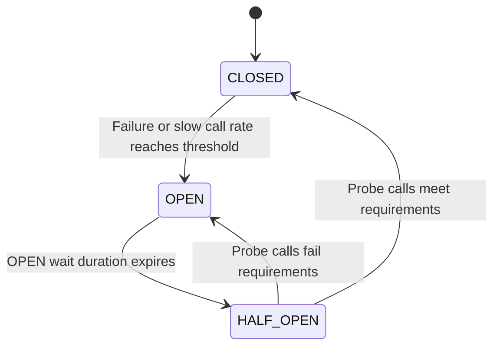

# HALF_OPEN: Allowing a Limited Number of Recovery Probe Calls

## Objectives

When a dependent service experiences an outage, the Circuit Breaker transitions from `CLOSED` to `OPEN` to stop requests from piling onto the failing service. However, if it stayed `OPEN` forever, the system would never have an opportunity to detect that the service has recovered. The `HALF_OPEN` state bridges that gap: after a wait period, the circuit breaker permits only a small number of probe calls through, observes their outcomes, and then decides whether to close the circuit or reopen it.

After this lesson, you will be able to:

- Describe the condition for transitioning from `OPEN` to `HALF_OPEN` and the possible outcomes after the probe round.
- Distinguish the number of probe calls in `HALF_OPEN` from the sliding window used to evaluate failures in `CLOSED`.
- Configure `permittedNumberOfCallsInHalfOpenState`, wait duration, and failure thresholds using Resilience4j in a Spring Cloud application.
- Combine Circuit Breaker with fallback, timeout, bulkhead, and reactive calls; read metrics to evaluate service protection effectiveness.

## Role of HALF_OPEN in the State Machine

The Circuit Breaker has three primary operating states:

| State | Behavior | Purpose |
|---|---|---|
| `CLOSED` | Permits calls to reach the dependent service and records outcomes. | Normal operation while collecting failure and latency data. |
| `OPEN` | Rejects calls immediately, typically with `CallNotPermittedException`; application-level handling may switch to a fallback. | Cuts off request traffic to an unhealthy service to prevent cascading failures. |
| `HALF_OPEN` | Permits only the configured number of probe calls; calls exceeding the limit continue to be rejected. | Tests whether the service has recovered under a small, controlled load. |

Basic state transition flow:



In `CLOSED`, the Circuit Breaker records call outcomes in a sliding window. Once enough minimum samples have been collected, if the failure rate or slow call rate reaches the configured threshold, the circuit transitions to `OPEN`. For example, with `failureRateThreshold: 50`, a failure rate equal to or greater than 50% can trigger `OPEN` once the sample count reaches `minimumNumberOfCalls`.

In `OPEN`, new calls are not forwarded to the dependent service. The circuit breaker remains in this state for `waitDurationInOpenState`. Once the wait duration expires, it can transition to `HALF_OPEN` to test recovery. If `automaticTransitionFromOpenToHalfOpenEnabled` is `false` (the default), the next call arriving after the wait duration triggers the transition. If this property is enabled, a background task automatically transitions the state when the wait duration expires, even without new incoming requests.

In `HALF_OPEN`, Resilience4j allows up to `permittedNumberOfCallsInHalfOpenState` probe calls. Remaining calls are rejected until the circuit breaker has enough outcomes to make a decision. Once the permitted calls complete:

- If both the failure rate and slow call rate are below their respective thresholds, the Circuit Breaker transitions back to `CLOSED` and resumes normal traffic.
- If either rate reaches or exceeds its threshold, the Circuit Breaker returns to `OPEN` and begins a new wait cycle.

`maxWaitDurationInHalfOpenState` sets the maximum time limit to remain in `HALF_OPEN`. A value of `0` means no time limit; the circuit breaker waits for all permitted probe calls to finish. If a positive duration is set and that duration expires before the probe phase can complete, the Circuit Breaker transitions back to `OPEN`. This setting is useful when calls may hang for a long time or never return a result.

## Probe Call Count and Sliding Window Are Two Different Concepts

Two configuration settings are frequently confused:

| Setting | When Is It Used? | Meaning |
|---|---|---|
| `slidingWindowSize` | Primarily when evaluating outcomes in `CLOSED`. | Window size used to calculate failure rate and slow call rate. |
| `minimumNumberOfCalls` | When evaluating thresholds in `CLOSED`. | Minimum number of samples required before rates are used to decide whether to open the circuit. |
| `permittedNumberOfCallsInHalfOpenState` | While in `HALF_OPEN`. | Maximum number of probe calls permitted through during a recovery check round. |

Resilience4j supports two sliding window types:

- `COUNT_BASED`: the window holds outcomes of a fixed number of most recent calls. With `slidingWindowSize: 20`, the circuit breaker evaluates up to the 20 most recent outcomes.
- `TIME_BASED`: the window is divided into time buckets and evaluates outcomes over the configured number of seconds. With `slidingWindowSize: 10`, the window covers the last 10 seconds.

For example, a catalog service has a window of 20 calls and `minimumNumberOfCalls: 10`. In `CLOSED`, the Circuit Breaker does not use the failure rate to open the circuit until at least 10 samples exist. After opening and completing the wait duration, it transitions to `HALF_OPEN` and grants only three probe calls if `permittedNumberOfCallsInHalfOpenState: 3`. These three calls are a dedicated recovery test sample; they do not mean waiting for another 20 calls before deciding the state.

Suppose the failure rate threshold is 50% and the probe round has three calls:

- Zero calls fail: 0% failure rate; the service can be considered recovered and the circuit closes if the slow call rate also passes.
- One call fails: approximately 33% failure rate, below the 50% threshold; the circuit can close if no other threshold is violated.
- Two calls fail: approximately 67% failure rate, exceeding the threshold; the circuit returns to `OPEN`.

This example assumes three completed samples and considers only the failure rate threshold. If `slowCallRateThreshold` is configured, calls exceeding `slowCallDurationThreshold` can also cause the circuit to reopen even if they do not throw exceptions.

## Configuring Resilience4j in Spring Cloud

The following example configures a Circuit Breaker named `catalog`. These values are a starting point for practice; in production, adjust them according to normal latency, traffic, and load capacity of the dependent service.

```yaml
resilience4j:
  circuitbreaker:
    instances:
      catalog:
        registerHealthIndicator: true
        slidingWindowType: COUNT_BASED
        slidingWindowSize: 20
        minimumNumberOfCalls: 10
        failureRateThreshold: 50
        slowCallRateThreshold: 60
        slowCallDurationThreshold: 800ms
        waitDurationInOpenState: 8s
        permittedNumberOfCallsInHalfOpenState: 3
        maxWaitDurationInHalfOpenState: 5s
        automaticTransitionFromOpenToHalfOpenEnabled: false
        ignoreExceptions:
          - com.example.catalog.InvalidProductIdException
          - io.github.resilience4j.bulkhead.BulkheadFullException
  timelimiter:
    instances:
      catalog:
        timeoutDuration: 2s
        cancelRunningFuture: true
  bulkhead:
    instances:
      catalog:
        maxConcurrentCalls: 20
        maxWaitDuration: 0
```

Meaning of the values directly related to the state machine:

- `waitDurationInOpenState: 8s`: after entering `OPEN`, the circuit breaker waits eight seconds before allowing recovery checks to begin.
- `permittedNumberOfCallsInHalfOpenState: 3`: each `HALF_OPEN` round allows only three probe calls through.
- `maxWaitDurationInHalfOpenState: 5s`: prevents a probe round from being stuck in `HALF_OPEN` indefinitely.
- `automaticTransitionFromOpenToHalfOpenEnabled: false`: the state transitions only when a call arrives after the wait duration; enable this property if automatic transition is needed even under low traffic.
- `ignoreExceptions`: listed business errors do not increase the Circuit Breaker's failure rate. Only ignore exceptions that genuinely do not reflect the health of the dependent service.

The instance name must be consistent between configuration and where the Circuit Breaker is created. With Spring Cloud CircuitBreaker using the Resilience4j implementation, you can invoke it via `ReactiveCircuitBreakerFactory` in reactive flows or `CircuitBreakerFactory` in synchronous flows. Reactive example:

```java
import org.springframework.cloud.client.circuitbreaker.ReactiveCircuitBreaker;
import org.springframework.cloud.client.circuitbreaker.ReactiveCircuitBreakerFactory;
import org.springframework.stereotype.Service;
import org.springframework.web.reactive.function.client.WebClient;
import reactor.core.publisher.Mono;

@Service
public class CatalogGateway {
    private final WebClient webClient;
    private final ReactiveCircuitBreakerFactory<?, ?> circuitBreakerFactory;

    public CatalogGateway(
            WebClient webClient,
            ReactiveCircuitBreakerFactory<?, ?> circuitBreakerFactory) {
        this.webClient = webClient;
        this.circuitBreakerFactory = circuitBreakerFactory;
    }

    public Mono<Product> findById(String id) {
        ReactiveCircuitBreaker breaker = circuitBreakerFactory.create("catalog");

        Mono<Product> request = webClient.get()
                .uri("/products/{id}", id)
                .retrieve()
                .bodyToMono(Product.class);

        return breaker.run(request, error -> {
            // Can read cached data or return an appropriate degraded result.
            return Mono.just(Product.unavailable(id));
        });
    }
}
```

`Product` and `Product.unavailable` in the example are application-specific types that must be defined according to the actual domain model. `ReactiveCircuitBreaker` applies the `catalog` instance's policy to the publisher. When the circuit is `OPEN` or a call fails with a recorded error, the fallback function can return cached data, an unavailable status, or a degraded result specified by the API contract. Fallbacks should be fast, avoid calling the same failing service, and avoid masking business errors with misleading fake data.

If using Resilience4j annotations directly instead of the Spring Cloud CircuitBreaker factory, you can annotate the method with `@CircuitBreaker(name = "catalog", fallbackMethod = "findFallback")`. The fallback method must have the same business parameters plus a trailing exception parameter; its return type must be compatible with the original method. Choose one consistent integration style to avoid accidentally wrapping the same call in multiple Circuit Breakers.

## Combining Timeout and Bulkhead

The Circuit Breaker decides whether to let a call proceed based on its state and recorded outcomes. It does not enforce a deadline on every call or limit concurrent tasks by itself. Two complementary mechanisms address those distinct problems:

- **Timeout / TimeLimiter** limits wait time. If the dependent service responds too slowly, the call terminates with a timeout error; this error can be recorded by the Circuit Breaker and increase the failure rate or slow call rate.
- **Bulkhead** limits the number of concurrent calls or isolates them within a dedicated resource pool. When capacity is exhausted, new requests are rejected or queued as configured, preventing one slow service from consuming all resources meant for other services.

In the sample configuration, `timeoutDuration: 2s` sets the deadline for the integrated TimeLimiter. `maxConcurrentCalls: 20` and `maxWaitDuration: 0` configure a semaphore-based Bulkhead: at most 20 concurrent calls and zero wait time for a permit when full. If thread-pool isolation is needed, Resilience4j provides `thread-pool-bulkhead` with properties such as `coreThreadPoolSize`, `maxThreadPoolSize`, and `queueCapacity`; choose the style matching the application's synchronous or reactive model.

With Reactor when composing operators manually, you can set a timeout directly on `Mono` or `Flux`:

```java
Mono<Product> request = webClient.get()
        .uri("/products/{id}", id)
        .retrieve()
        .bodyToMono(Product.class)
        .timeout(Duration.ofSeconds(2));
```

When using `ReactiveCircuitBreakerFactory`, the instance's TimeLimiter configuration can supply the deadline to the Resilience4j implementation. If using `Mono.timeout` directly, avoid setting two conflicting timeouts on the same call. For a reactive Bulkhead, you can use Resilience4j Reactor's `BulkheadOperator` to limit subscriptions; clearly decide whether Bulkhead rejections should count as dependent service failures. The sample configuration above ignores `BulkheadFullException` so gateway overload does not skew the catalog service's health failure rate.

The ordering of protection layers determines which error type the Circuit Breaker observes. A timeout indicates the dependent call was too slow; a Bulkhead rejection indicates the application reached its local processing limit. Properly classifying these two error types ensures `OPEN` decisions reflect dependent service health rather than local resource limits.

## Monitoring State and Probe Outcomes

When `registerHealthIndicator: true` is enabled alongside Spring Boot Actuator, Circuit Breaker state can appear in the health endpoint. Micrometer also exposes Resilience4j metrics, typically including:

- `resilience4j.circuitbreaker.state`: current state of the instance.
- `resilience4j.circuitbreaker.calls`: call count by outcome and call kind.
- `resilience4j.circuitbreaker.not.permitted.calls`: count of calls rejected because the state did not permit them.
- `resilience4j.circuitbreaker.failure.rate` and `resilience4j.circuitbreaker.slow.call.rate`: rates used to evaluate thresholds.
- `resilience4j.circuitbreaker.buffered.calls`: number of outcomes currently recorded in the window.

Metrics can be queried via Actuator, for example `/actuator/metrics/resilience4j.circuitbreaker.state`, filtered by the `name` tag corresponding to the instance. Available metric names and tags depend on version, registry, and the application's Micrometer configuration. In production, expose only necessary endpoints and secure access.

When investigating an `OPEN` to `HALF_OPEN` transition, correlate transition timestamps, permitted call counts, success/failure outcomes, latency, and rejected call counts. If the circuit keeps bouncing back to `OPEN`, check whether the service has truly recovered, whether the timeout is too short, whether the probe count is representative, and whether fallbacks are hiding error signals. A dependent service's Circuit Breaker state should also not be used automatically as a liveness probe that restarts the entire application whenever that dependency has an outage.

## Practice: Observing a Recovery Cycle

Run in a test environment with a catalog service that can intentionally slow down or return errors:

1. Start both services and send enough successful requests to confirm the `catalog` instance is `CLOSED`.
2. Make the catalog service return errors or respond slowly. Send enough calls to exceed `minimumNumberOfCalls` and hit one of the configured thresholds.
3. Observe the Circuit Breaker transition to `OPEN`. Send more requests and verify they fail fast; verify the fallback returns degraded responses per the API contract.
4. Restore the catalog service and wait for `waitDurationInOpenState` to elapse. Send a request to trigger `HALF_OPEN` if automatic transition is not enabled.
5. Observe up to three probe calls permitted through. Excess requests must continue to be rejected while waiting for probe outcomes.
6. Once all three calls complete, confirm the circuit returns to `CLOSED` if failure and slow call rates are below thresholds. Repeat the test with at least two failing probes to observe the circuit returning to `OPEN`.

During testing, record timestamps, state, probe count, failure rate, latency, and fallback count. Do not generate test load beyond what the environment can handle; the goal is to observe state transition rules with a controlled number of requests.

## Common Configuration Mistakes

- **Setting too many probes:** a `permittedNumberOfCallsInHalfOpenState` value that is too large can create a significant burst of load on a recovering service. Start small and increase based on operational data.
- **Setting too few probes:** one or two samples may not represent service health. Consider real traffic and recovery time when choosing the count.
- **Confusing sliding window with probe count:** `slidingWindowSize` does not govern the number of calls permitted in `HALF_OPEN`; that property is `permittedNumberOfCallsInHalfOpenState`.
- **Letting probe calls hang:** if call deadlines are unclear, `HALF_OPEN` can drag on. Configure timeouts and consider `maxWaitDurationInHalfOpenState`.
- **Fallback calling the same service:** such a fallback can add extra load right when the service is recovering. Use cache, meaningful defaults, or an unavailable response.
- **Counting business errors as infrastructure failures:** define which exceptions to record and which to ignore; otherwise, bad input data can trip the Circuit Breaker.
- **Retries amplifying traffic:** multiple retries inside each probe can turn a few probes into many requests to the dependent service. Limit retry attempts and coordinate backoff with timeouts and the Circuit Breaker.

`HALF_OPEN` is a bounded testing phase, not a guaranteed recovery state. The Circuit Breaker only closes when probe calls provide sufficient evidence that the dependent service meets the configured thresholds; if not, it returns to `OPEN` to continue protecting the rest of the system.
