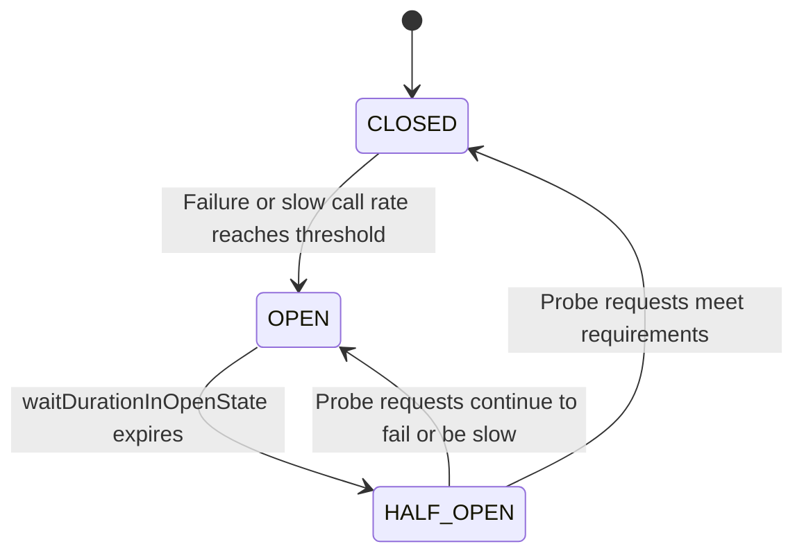

# Wait Duration Before Probing Recovery

In a Circuit Breaker, when the failure rate or slow call rate exceeds the threshold, the breaker transitions from `CLOSED` to `OPEN` to stop sending further requests to the failing service. After opening the circuit, the system needs a cool-down period before checking whether the dependent service has recovered. Resilience4j configures this cool-down period with `waitDurationInOpenState`.

The wait duration gives the dependent service time to stabilize and avoids hitting it with more traffic right after an error spike. Expiring the wait duration only allows transitioning to the `HALF_OPEN` testing phase; it does not prove the service is healthy, nor does it send a health-check request by itself.

## 1. Position of Wait Duration in the State Machine

- `CLOSED`: requests are forwarded to the dependent service. The Circuit Breaker records outcomes in the sliding window. Once the minimum sample count is reached and the failure or slow call rate hits the threshold, the breaker transitions to `OPEN`.
- `OPEN`: new requests fail fast. The application can return fallback data or report that the service is temporarily unavailable. The `waitDurationInOpenState` timer starts when the breaker enters this state.
- `HALF_OPEN`: after the wait duration, the breaker grants permission for only a limited number of probe requests. The outcomes of these requests determine whether the circuit closes or reopens.



For example, the inventory service repeatedly returns errors and the Circuit Breaker transitions to `OPEN` at 10:00:00. If `waitDurationInOpenState` is 20 seconds, the breaker only begins allowing recovery probes around 10:00:20. If the probe requests succeed according to the configured threshold, the circuit returns to `CLOSED`. If they continue to fail, the circuit goes back to `OPEN` and starts a new wait period.

This wait duration begins after the Circuit Breaker has decided to open the circuit. It does not replace `slidingWindowSize`, `minimumNumberOfCalls`, or `failureRateThreshold`: those settings decide when the circuit opens; `waitDurationInOpenState` decides how long to keep the circuit open before trying again.

## 2. Configuration in Spring Cloud CircuitBreaker with Resilience4j

For a Spring Boot application using the non-reactive starter `org.springframework.cloud:spring-cloud-starter-circuitbreaker-resilience4j`, each breaker can be configured in `application.yml`. The name `inventory` must match the ID passed to `circuitBreakerFactory.create("inventory")`.

```yaml
resilience4j:
  circuitbreaker:
    instances:
      inventory:
        slidingWindowType: COUNT_BASED
        slidingWindowSize: 20
        minimumNumberOfCalls: 10
        failureRateThreshold: 50
        waitDurationInOpenState: 20s
        automaticTransitionFromOpenToHalfOpenEnabled: false
        permittedNumberOfCallsInHalfOpenState: 3
        maxWaitDurationInHalfOpenState: 5s
```

Meaning of the related properties:

| Property | Meaning |
| --- | --- |
| `waitDurationInOpenState` | Minimum duration the breaker stays in `OPEN` before it can move to `HALF_OPEN`. Resilience4j defaults to 60 seconds if no other value is configured. |
| `automaticTransitionFromOpenToHalfOpenEnabled` | When `true`, the breaker automatically transitions to `HALF_OPEN` when the timer expires, even without new requests. Default is `false`. |
| `permittedNumberOfCallsInHalfOpenState` | Maximum number of requests permitted for probing in `HALF_OPEN`. |
| `maxWaitDurationInHalfOpenState` | Time limit in `HALF_OPEN` to wait for probe requests to complete. The default value `0` means no time limit is set. |

With the configuration above, the window retains the 20 most recent outcomes and begins evaluating the failure rate only after at least 10 calls. If the failure rate reaches 50% or higher, the circuit opens and holds that state for at least 20 seconds. Afterward, up to three calls are used to evaluate recovery. The values 20 seconds and three calls are only examples; adjust them to the characteristics of the actual service.

Spring Cloud CircuitBreaker also supports default configuration, group configuration, and per-ID configuration. When configuring via properties, property configuration takes precedence over Java `Customizer` configuration. Therefore, if the wait duration in the application does not behave as expected, check the exact breaker ID and the active property configurations.

## 3. Two Ways to Transition from OPEN to HALF_OPEN

When `automaticTransitionFromOpenToHalfOpenEnabled` is `false` (default), Resilience4j does not need to spawn a background task just to flip the state. After the wait duration expires, the breaker may still report `OPEN` until the next call arrives. The call arriving after the deadline triggers the state transition and is treated as a probe call if permitted.

When this property is `true`, the breaker automatically transitions to `HALF_OPEN` as soon as the wait duration expires, even when there is no system traffic. Automatic state transition does not mean Resilience4j calls an endpoint on the dependent service by itself. Actual probe requests still come from subsequent application traffic.

Choose `false` when you want to keep the mechanism simple and re-evaluate only when traffic arrives. Choose `true` when the state needs to transition on time even during low or zero traffic periods, while accounting for scheduler resources and state observability.

## 4. Attaching the Breaker to Service Calls and Fallbacks

The following example uses Spring Cloud CircuitBreaker to protect a synchronous call to the inventory service:

```java
@Service
public class InventoryGateway {
    private final CircuitBreakerFactory<?, ?> circuitBreakerFactory;
    private final InventoryClient inventoryClient;

    public InventoryGateway(
            CircuitBreakerFactory<?, ?> circuitBreakerFactory,
            InventoryClient inventoryClient) {
        this.circuitBreakerFactory = circuitBreakerFactory;
        this.inventoryClient = inventoryClient;
    }

    public Stock getStock(String sku) {
        return circuitBreakerFactory.create("inventory").run(
            () -> inventoryClient.getStock(sku),
            error -> Stock.unavailable(sku)
        );
    }
}
```

`Stock.unavailable(sku)` represents how the application constructs a fallback result according to its data model. When the circuit is `OPEN`, calls fail fast and the fallback function can return the backup result. When the circuit is `HALF_OPEN`, only permitted calls reach the inventory service; their outcomes determine the next state. Fallbacks should be fast, avoid looping back to the protected service itself, and clearly indicate backup data or an undetermined state.

For reactive applications, use the starter `org.springframework.cloud:spring-cloud-starter-circuitbreaker-reactor-resilience4j` and `ReactiveCircuitBreakerFactory`. Wrapping the call carries the same state semantics:

```java
public Mono<Stock> getStock(String sku) {
    return reactiveCircuitBreakerFactory.create("inventory").run(
        webClient.get()
            .uri("/stock/{sku}", sku)
            .retrieve()
            .bodyToMono(Stock.class),
        error -> Mono.just(Stock.unavailable(sku))
    );
}
```

In both call styles, the wait duration is a property of the breaker identified by `inventory`. It is not the timeout of an individual HTTP request. If a probe call might hang for a long time, configure an appropriate timeout for the call style in use; timeout bounds the completion time of a single call, whereas `waitDurationInOpenState` decides when to begin probing recovery.

## 5. Choosing an Appropriate Wait Duration

There is no single optimal value for every service. Choose the wait duration based on how long the dependent service typically needs to restart, restore connections, release resources, or stabilize after an incident. You can start with a conservative value and then tune it with operational data.

- If the wait duration is too short, the breaker repeatedly sends probe traffic to an unrecovered service. The circuit can oscillate between `OPEN` and `HALF_OPEN`, prolonging the incident.
- If the wait duration is too long, the system keeps returning fallbacks even though the dependent service may already be healthy again. Users have to wait longer to receive real data.
- If services have different recovery times, configure separate breakers by ID instead of applying one wait duration to all of them.
- If you need to progressively increase the wait duration after multiple failed attempts, consider an interval function or backoff policy supported by your Resilience4j version. Check the maximum cap so open-circuit duration does not grow unexpectedly.

Distinguish mechanisms that are commonly configured together:

| Mechanism | Question It Answers |
| --- | --- |
| `waitDurationInOpenState` | After opening the circuit, how long before probing recovery? |
| `TimeLimiter` | How long is an individual call allowed to run at most? |
| Retry | When a call fails, should it be retried and how long to wait between attempts? |
| Bulkhead | How many concurrent calls are allowed to consume the dependent service's resources? |

`permittedNumberOfCallsInHalfOpenState` only limits the number of probe calls in `HALF_OPEN`; it does not replace Bulkhead concurrency limits. When combining Retry, TimeLimiter, and Circuit Breaker, inspect the application order and total calls that can be generated so retries do not add load to a recovering service.

## 6. Monitoring and Verification

To tell whether the wait duration is appropriate, monitor transition timestamps, time spent in `OPEN`, rejected call counts, fallback counts, probe call outcomes, failure rates, and dependent service latency. You can enable `registerHealthIndicator: true` if the application uses the health endpoint. Spring Cloud CircuitBreaker can export Resilience4j metrics when the application has Spring Boot Actuator and `resilience4j-micrometer` on the classpath.

A verification scenario should cover both successful recovery and failed recovery paths:

1. Use a stub or test environment to make the dependent service return errors. Send at least the minimum number of calls so the failure rate exceeds the threshold and verify the breaker transitions to `OPEN`.
2. Send additional requests during the wait duration. Verify they fail fast, the fallback is invoked, and request count to the dependent service does not increase from these calls.
3. After the wait duration expires, generate traffic to trigger probe calls. Verify permitted calls do not exceed `permittedNumberOfCallsInHalfOpenState`.
4. Let the probe calls succeed and verify the breaker returns to `CLOSED`. Repeat with failing or slow calls to verify the breaker returns to `OPEN` and starts a new wait period.
5. Separately test behavior when `automaticTransitionFromOpenToHalfOpenEnabled` is `false` and `true`, especially when there is no traffic immediately after the wait duration ends.

Do not check only the final state value. Also inspect the number of calls reaching the dependent service, fallback counts, and transition timestamps to catch cases where configuration is valid but the ordering of Retry, timeout, or fallback unexpectedly increases load.

## 7. Pitfalls to Avoid

- Expiring `waitDurationInOpenState` does not automatically close the circuit. The breaker must pass through `HALF_OPEN` and evaluate probe call outcomes.
- `automaticTransitionFromOpenToHalfOpenEnabled` only transitions the state automatically. It does not run a health check and does not send probe requests to the service.
- `waitDurationInOpenState` is neither `timeoutDuration` nor the backoff interval between Retry attempts.
- A successful fallback result does not mean the call to the dependent service succeeded. Track underlying errors and fallback outcomes separately.
- Do not set the probe call count too high. The goal is to gather enough recovery signal without creating a new wave of load on the service.

## References

- [Resilience4j – CircuitBreaker](https://resilience4j.readme.io/docs/circuitbreaker): states, sliding window, wait duration in `OPEN`, and permitted calls in `HALF_OPEN`.
- [Spring Cloud CircuitBreaker – Configuring Resilience4J Circuit Breakers](https://docs.spring.io/spring-cloud-circuitbreaker/docs/current/reference/html/spring-cloud-circuitbreaker-resilience4j.html): reactive/non-reactive starters, per-instance configuration, TimeLimiter, Bulkhead, and metrics.
