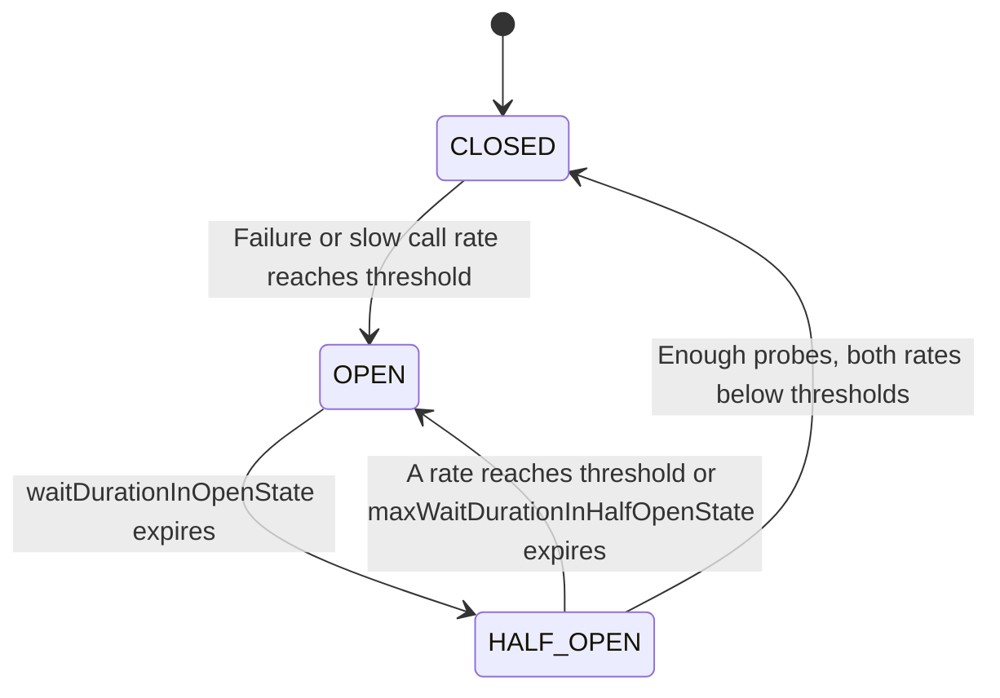

# Call Limits and Termination Conditions in HALF_OPEN

In Spring Cloud Circuit Breaker with Resilience4j, the `HALF_OPEN` state is the phase that tests whether a dependent service has recovered after being protected in `OPEN`. The circuit breaker permits a limited number of probe calls to reach the service. The outcomes of these calls determine whether the breaker transitions back to `CLOSED` or returns to `OPEN`.

Limiting the number of probe calls is critical: if too many calls pass through at once, a newly recovered service may become overloaded again; if too few calls pass through, conclusions about service health can easily be skewed by a single anomalous result. Resilience4j provides settings to control both the number of permitted calls and the maximum duration spent in `HALF_OPEN`.

## Two Limits to Distinguish

| Setting | Meaning | Impact |
|---|---|---|
| `permittedNumberOfCallsInHalfOpenState` | Maximum number of calls granted permission during one probe round in `HALF_OPEN` | Limits the probe load sent to the dependent service |
| `maxWaitDurationInHalfOpenState` | Maximum time the breaker is allowed to remain in `HALF_OPEN` | Prevents the breaker from staying stuck too long when not enough probe calls complete |

`permittedNumberOfCallsInHalfOpenState` is a quota on the circuit breaker instance. Concurrent calling threads sharing the instance consume from that shared quota. Once the quota is exhausted, subsequent calls are rejected with `CallNotPermittedException` while the breaker waits for the probe calls to yield outcomes. The breaker does not queue rejected calls to run later.

`maxWaitDurationInHalfOpenState` bounds the duration of the state, not the HTTP response timeout of each individual request. If the value is `0`, the breaker can remain in `HALF_OPEN` until the required probe calls complete. When a duration greater than `0` is set, the breaker transitions back to `OPEN` if that deadline expires before the test completes.

## State Transition Conditions

The typical sequence is:

1. The breaker transitions to `OPEN` when the failure rate or slow call rate reaches the configured threshold.
2. After `waitDurationInOpenState`, the breaker can transition to `HALF_OPEN`. If `automaticTransitionFromOpenToHalfOpenEnabled` is enabled, Resilience4j transitions automatically when the wait duration expires. If disabled, the next call arriving after the wait duration triggers the transition to `HALF_OPEN`.
3. The breaker grants up to `permittedNumberOfCallsInHalfOpenState` probe call permissions.
4. Once all permitted probe calls complete, the breaker aggregates their outcomes and evaluates the thresholds.
5. If the failure rate **or** slow call rate reaches or exceeds its respective threshold, the breaker transitions back to `OPEN`. If both rates are below their thresholds, the breaker transitions to `CLOSED`.



In `CLOSED`, `slidingWindowSize` and `minimumNumberOfCalls` govern the statistical window used to evaluate normal calls. In `HALF_OPEN`, the number of probe calls is controlled separately by `permittedNumberOfCallsInHalfOpenState`. Therefore, do not increase `slidingWindowSize` hoping to increase the number of probes in `HALF_OPEN`.

The breaker evaluates both outcome types:

- **Failure:** the call ends with an exception configured to be recorded as a failure. Exceptions configured to be ignored are not counted like ordinary failures.
- **Slow call:** execution duration exceeds `slowCallDurationThreshold`. A call can return successfully yet still be counted as slow.

Example with three probes, `failureRateThreshold: 50`, and `slowCallRateThreshold: 50`:

| Outcomes of Three Probes | Failure Rate | Slow Rate | Decision |
|---|---:|---:|---|
| 3 fast successes | 0% | 0% | `CLOSED` |
| 2 failures, 1 fast success | 66.7% | 0% | `OPEN` |
| 1 failure, 2 fast successes | 33.3% | 0% | `CLOSED` |
| 3 successes but 2 slow calls | 0% | 66.7% | `OPEN` |

These are independent per-case examples; the actual decision evaluates both failure rate and slow call rate simultaneously according to the instance configuration. The threshold is the condition for reopening the breaker, so a rate equal to the threshold counts as having reached the threshold.

## Configuring Resilience4j in Spring

The following example configures an instance protecting calls to a catalog service. Three calls are allowed to probe after the breaker finishes its `OPEN` period; the breaker stays in `HALF_OPEN` for at most ten seconds.

```yaml
resilience4j:
  circuitbreaker:
    instances:
      catalogService:
        registerHealthIndicator: true
        slidingWindowType: COUNT_BASED
        slidingWindowSize: 20
        minimumNumberOfCalls: 10
        failureRateThreshold: 50
        slowCallRateThreshold: 50
        slowCallDurationThreshold: 2s
        waitDurationInOpenState: 20s
        permittedNumberOfCallsInHalfOpenState: 3
        maxWaitDurationInHalfOpenState: 10s
        automaticTransitionFromOpenToHalfOpenEnabled: true
```

The two duration settings serve different purposes:

- `waitDurationInOpenState` specifies how long the breaker must stay in `OPEN` before recovery can be probed.
- `maxWaitDurationInHalfOpenState` specifies how long the breaker is allowed to stay in the recovery probe phase at most.

If the dependent service receives no requests after transitioning to `HALF_OPEN`, or receives only part of the required number of probes, the breaker may not yet have enough data to make a decision. A finite `maxWaitDurationInHalfOpenState` value ends this situation by returning the breaker to `OPEN`; the system can retry after a new `waitDurationInOpenState` cycle.

## Integrating with Calls and Fallbacks

With Resilience4j Spring Boot, a method can be protected using an annotation as follows:

```java
@Service
public class CatalogClient {

    @CircuitBreaker(name = "catalogService", fallbackMethod = "catalogFallback")
    public Product findProduct(String productId) {
        return callCatalogService(productId);
    }

    private Product catalogFallback(String productId, Throwable cause) {
        return Product.unavailable(productId);
    }
}
```

The fallback method must retain the business parameters of the original method and can accept an additional trailing exception parameter. When the breaker is `OPEN`, or when the probe quota in `HALF_OPEN` has been exhausted, calls can enter the fallback with `CallNotPermittedException`. The fallback provides an alternative result for the caller; successful execution of the fallback itself does not turn a failed probe into a success and does not cause the breaker to transition to `CLOSED`.

`maxWaitDurationInHalfOpenState` also does not replace HTTP client timeouts or `TimeLimiter`. A hanging probe can still tie up resources in both the application and the dependent service. Set appropriate connect/read timeouts or `TimeLimiter` so each call can finish within the expected time. `Bulkhead` solves a different constraint: it limits the number of concurrent calls consuming application resources. The circuit breaker probe quota, request timeouts, and bulkhead concurrency limits should be configured together in coordination.

## Choosing Quota and Probe Duration

Choose `permittedNumberOfCallsInHalfOpenState` based on the load the service can withstand immediately upon recovering. A small value reduces pressure and lets the breaker decide quickly, though one or two outcomes may not represent actual health. A larger value provides more data, while creating more load and potentially extending the evaluation period when requests complete slowly.

Choose `maxWaitDurationInHalfOpenState` based on the maximum timeout of the dependent call and an acceptable duration for a recovery test. This duration must be long enough for normal probes to complete, yet not so long that the breaker stays in testing mode while the service remains hung. If the request timeout is longer than the `HALF_OPEN` limit, review both settings to avoid probes frequently being cut out of the evaluation cycle.

When validating configuration, verify at least the following scenarios:

1. All probes succeed quickly: breaker returns to `CLOSED`.
2. Probe failure rate reaches the threshold: breaker returns to `OPEN`.
3. Slow call rate reaches the threshold even though calls succeed: breaker returns to `OPEN`.
4. Not enough probes complete before `maxWaitDurationInHalfOpenState`: breaker returns to `OPEN`.
5. Probe quota is exhausted while new calls still arrive: new calls are rejected and can be handled by the fallback.

Monitor state transition events and Resilience4j metrics, especially successful, failed, slow, and rejected call counts. You can inspect the current state via `CircuitBreaker.getState()` when using the Java API, or observe enabled Actuator/metric endpoints in the application. This data helps distinguish genuine service recovery from cases where the breaker only transitioned due to timer expiration.
