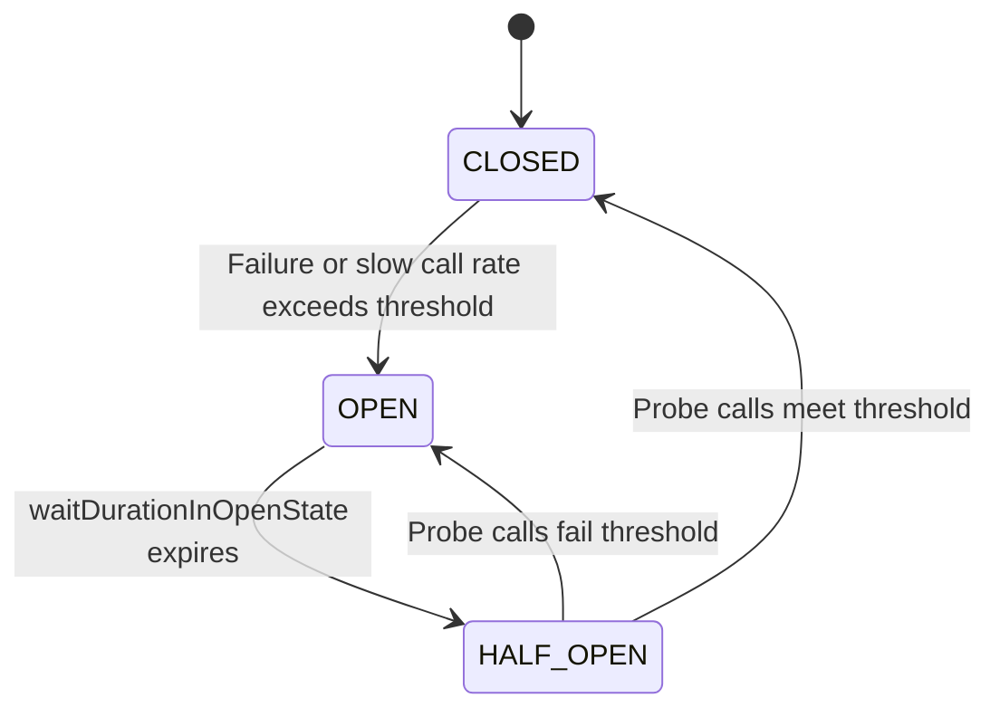
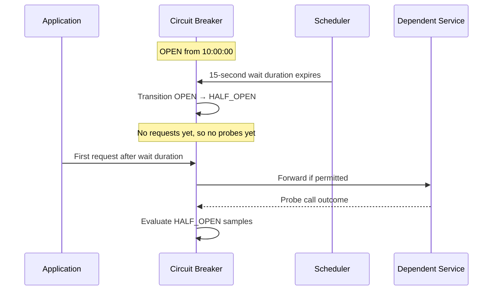
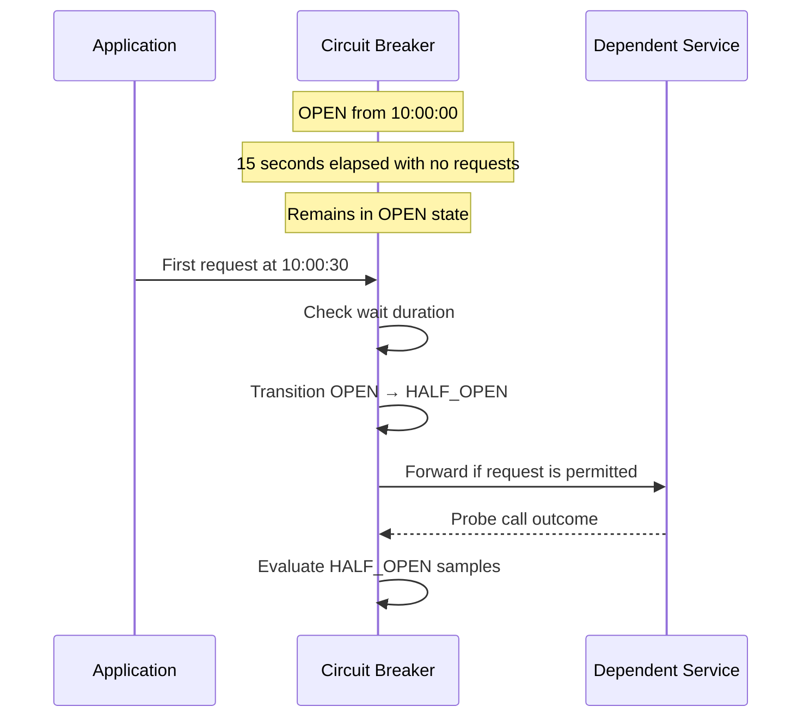

# Automatic Transition vs. Transition on New Call

In Resilience4j, when a Circuit Breaker transitions from `CLOSED` to `OPEN`, it stops forwarding calls to the dependent service for a period of time. After that wait duration, the circuit needs to transition to `HALF_OPEN` to let a number of probe calls pass through. Resilience4j provides two ways to perform the `OPEN` → `HALF_OPEN` step: transitioning via a background scheduler or transitioning lazily when the next call arrives.

Both approaches follow the same protection principle: only a limited number of calls are permitted to test the service after the wait duration. The difference lies in when the internal state switches to `HALF_OPEN`, especially when the system has no traffic.

## Related State Lifecycle

A Circuit Breaker typically starts in `CLOSED`. Call outcomes are recorded in a sliding window. Once the minimum sample count is reached and the failure rate or slow call rate exceeds the configured threshold, it transitions to `OPEN`. Calls arriving while the circuit is `OPEN` fail fast, typically raising `CallNotPermittedException`, so the application can run a fallback.

After `waitDurationInOpenState`, the circuit can transition to `HALF_OPEN`. In this state, the Circuit Breaker grants permission for at most `permittedNumberOfCallsInHalfOpenState` probe calls. Once enough outcomes are collected to evaluate, it transitions back to `CLOSED` if the service appears to have recovered; if the outcomes still exceed the failure or slow call threshold, it returns to `OPEN` and starts a new wait cycle.



The diagram above shows the operational states. Automatic vs. lazy configuration only determines how the `OPEN` → `HALF_OPEN` edge is triggered; it does not alter how outcomes are evaluated in `CLOSED` or `HALF_OPEN`.

## Automatic Transition via Scheduler

When `automaticTransitionFromOpenToHalfOpenEnabled` is enabled, Resilience4j schedules a transition of the Circuit Breaker from `OPEN` to `HALF_OPEN` once `waitDurationInOpenState` ends. The state transition occurs even if no new requests arrive at the application.

For example, the circuit enters `OPEN` at 10:00:00 with a 15-second wait duration. Around 10:00:15, the scheduler transitions the circuit to `HALF_OPEN`. If the dependent service has not yet received any requests, the circuit stays in `HALF_OPEN`, though no probe calls have been sent yet. When requests arrive, the Circuit Breaker grants permission up to the configured number of probe calls.



The advantage of this approach is that the state reflects wait expiration without waiting for a request. This is helpful when dashboards, health indicators, or operational workflows need to observe when the circuit becomes ready to accept probe calls. In return, the system requires a background scheduling mechanism to perform the state transition; account for scheduler resources and lifecycle in the runtime environment.

## Lazy Transition on New Call

When `automaticTransitionFromOpenToHalfOpenEnabled` is `false`, Resilience4j does not proactively change the state merely because the wait duration has elapsed. The circuit continues to be treated as `OPEN` until a new call checks access permission. If the wait duration has ended, that call itself triggers the transition to `HALF_OPEN` and is evaluated as a probe call under the configured limit.

For example, the circuit enters `OPEN` at 10:00:00 with a 15-second wait duration. No requests arrive during the next 30 seconds. The state can still be observed as `OPEN` until the first request arrives at 10:00:30. When this request arrives, the Circuit Breaker sees that the wait duration has passed, transitions to `HALF_OPEN`, and then decides whether to grant permission for the probe request. That request is not an unrestricted normal call forwarded unconditionally; it is subject to the `HALF_OPEN` probe limit.



This approach avoids running background state transitions when there is no traffic. It fits low-request services or cases where the state only needs updating when the application actually needs to call the dependent service. The trade-off to keep in mind is that dashboards may continue displaying `OPEN` after the wait duration has passed until a new call triggers the check.

## Configuration in Spring Cloud CircuitBreaker with Resilience4j

With the Resilience4j backend, you can configure each instance in `application.yml`. The example below sets a count-based window of 10 calls, minimum 5 samples, 50% failure rate threshold, 15-second wait duration, and up to 3 probe calls in `HALF_OPEN`.

```yaml
resilience4j:
  circuitbreaker:
    instances:
      catalog:
        slidingWindowType: COUNT_BASED
        slidingWindowSize: 10
        minimumNumberOfCalls: 5
        failureRateThreshold: 50
        waitDurationInOpenState: 15s
        permittedNumberOfCallsInHalfOpenState: 3
        automaticTransitionFromOpenToHalfOpenEnabled: false
```

With the configuration above, the `catalog` circuit uses lazy transition. To transition automatically via scheduler, keep the remaining properties and set this property in the same `catalog` instance:

```yaml
resilience4j:
  circuitbreaker:
    instances:
      catalog:
        automaticTransitionFromOpenToHalfOpenEnabled: true
```

If configuring directly in Java with Resilience4j, the corresponding setting is `automaticTransitionFromOpenToHalfOpenEnabled` on `CircuitBreakerConfig.Builder`:

```java
CircuitBreakerConfig config = CircuitBreakerConfig.custom()
    .slidingWindowSize(10)
    .minimumNumberOfCalls(5)
    .failureRateThreshold(50)
    .waitDurationInOpenState(Duration.ofSeconds(15))
    .permittedNumberOfCallsInHalfOpenState(3)
    .automaticTransitionFromOpenToHalfOpenEnabled(true)
    .build();
```

In a Spring Cloud CircuitBreaker application, make sure the instance and backend in use match this configuration. Default configuration, group configuration, or per-instance configuration can affect the effective values; when investigating actual behavior, inspect the configuration loaded for the exact Circuit Breaker name.

## Comparison and How to Choose

| Criterion | Automatic Transition (`true`) | Transition on New Call (`false`) |
|---|---|---|
| When `OPEN` → `HALF_OPEN` changes | Scheduler flips state after wait duration | New call checks and triggers transition after wait duration expires |
| When there are no requests | Still transitions to `HALF_OPEN` | Stays in `OPEN` until the next request |
| State observability | Shows wait expiration even without traffic | State changes only when traffic triggers it |
| Background work | Requires scheduling mechanism | No background transition schedule needed for this step |
| Probe behavior | Only requests arriving after transition are considered for permission | Request triggering the transition is evaluated as the first probe |

Choose automatic transition when operations teams need `HALF_OPEN` to appear right after the wait duration, even at zero traffic—for instance, to monitor state on dashboards or integrate with monitoring workflows. Choose lazy transition when you want to reduce background work and only need to reopen probe opportunities when real requests arrive.

Do not treat automatic transition as an active health check. The scheduler only changes the Circuit Breaker's state; it does not send requests to check the dependent service on its own. Both modes require real traffic to generate probes. If no requests arrive, `HALF_OPEN` can remain without new outcomes to conclude that the service has recovered.

## Operational Checklist

- **Distinguish wait duration from recovery time:** `waitDurationInOpenState` is the cool-down period before retrying is allowed. Expiration does not prove the dependent service is healthy.
- **Limit probe calls:** `permittedNumberOfCallsInHalfOpenState` caps permitted requests during the probe phase. Under concurrent traffic, excess requests are still rejected and can take the fallback branch.
- **Track state transition outcomes:** record `CLOSED`, `OPEN`, and `HALF_OPEN` transition events, rejected call counts, failure rates, and slow call rates. This data helps distinguish whether the circuit is waiting, probing, or closed again.
- **Design fallbacks for both moments:** requests rejected while `OPEN` and requests denied permission while `HALF_OPEN` both need proper handling. Fallbacks should return backup data or a controlled notice, avoiding masking failures with a fake success value.
- **Test under zero traffic:** after putting the circuit into `OPEN`, let the wait duration pass without sending requests. In automatic mode, verify the state transitions to `HALF_OPEN`; in lazy mode, verify it only transitions when the next request arrives. Then check the number of granted probes and the resulting transition back to `CLOSED` or `OPEN`.

When investigating a circuit that appears stuck in `OPEN` too long, first check `automaticTransitionFromOpenToHalfOpenEnabled` and actual traffic. If using lazy transition, remaining `OPEN` after the wait duration may be expected behavior: no request has triggered the transition step yet. If using automatic transition, inspect the effective configuration, state transition events, and scheduler activity. In both cases, evaluate probe outcomes before concluding that the dependent service has recovered.
