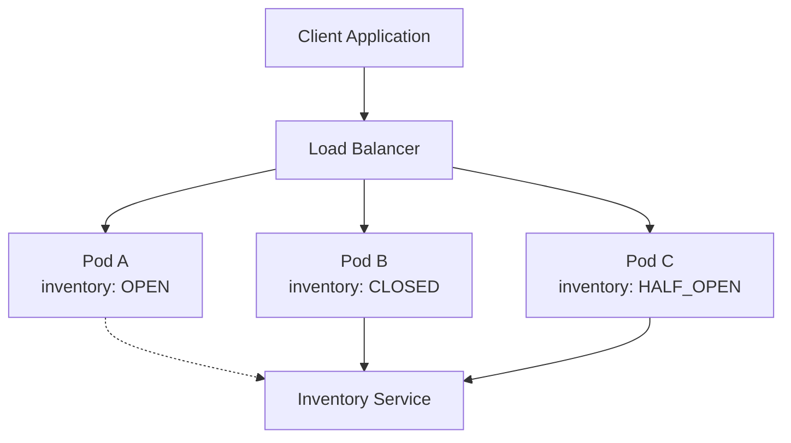
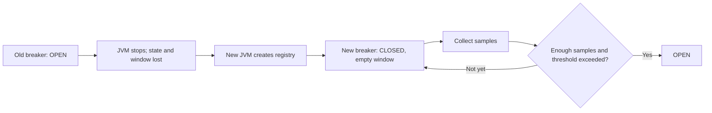

# Process-Local State and Impact of Restarts

In a Spring Cloud application deployed with multiple replicas, each process typically has its own circuit breaker for each dependent service. Breakers may share the same name, use the same configuration file, and call the same target service, yet their `CLOSED`, `OPEN`, or `HALF_OPEN` state is tracked independently in each process's memory. Thus, Resilience4j's circuit breaker is a process-local protection mechanism by default; it does not automatically synchronize state across servers or pods.

This characteristic enables fast circuit-opening decisions right inside the calling application. At the same time, it introduces consequences when the system scales replica counts, rolls out new versions, or restarts after an incident. To operate properly, you must understand a breaker's scope, the data it holds, how state is rebuilt, and the impact of multiple independent breakers on the same dependency.

## 1. Where Does Circuit Breaker State Live?

When an application creates a Resilience4j circuit breaker, the breaker object is managed by a `CircuitBreakerRegistry` inside the application process. The registry manages breakers by name within that registry's scope. Components sharing one breaker instance observe the same state and statistics; another registry in another process manages its own distinct objects.

The breaker stores operational state and statistics needed to make decisions. Key data includes:

- Current state: `CLOSED`, `OPEN`, `HALF_OPEN`, or special states such as `DISABLED` and `FORCED_OPEN`.
- Call outcomes in the sliding window: counts of successes, failures, slow calls, and total recorded samples.
- Timing information for state transitions, such as when the circuit opened and the wait duration before probing is permitted.
- Remaining permitted probe calls when the breaker is `HALF_OPEN`.

Under typical configuration, state and statistical windows reside in the process's memory. Resilience4j does not write circuit breaker state to Redis, a database, or a shared store by default. Exporting metrics via Spring Boot Actuator or Micrometer only allows monitoring systems to read and store observational metrics; doing so does not turn metrics into data for restoring breaker state.

For example, an application might create a breaker for the inventory service via the registry:

```java
import io.github.resilience4j.circuitbreaker.CircuitBreaker;
import io.github.resilience4j.circuitbreaker.CircuitBreakerRegistry;

public class InventoryProtection {
    private final CircuitBreakerRegistry registry =
            CircuitBreakerRegistry.ofDefaults();

    public CircuitBreaker inventoryCircuitBreaker() {
        return registry.circuitBreaker("inventory");
    }

    public void printState() {
        CircuitBreaker breaker = inventoryCircuitBreaker();
        System.out.println("State: " + breaker.getState());
        System.out.println("Buffered calls: "
                + breaker.getMetrics().getNumberOfBufferedCalls());
    }
}
```

This example illustrates creating and reading a breaker inside a single process. In a real Spring Boot application, the registry is typically configured and managed by the Resilience4j integration; you should not create a new registry on every request. When the same registry returns the registered `inventory` breaker, components using that breaker see its shared state and statistics.

The name `inventory` only identifies the breaker within the local registry. Two processes creating a breaker named `inventory` does not mean they reference a shared object. Each process has its own heap, registry, statistical window, and state.

## 2. Each Replica Has an Independent State Machine

Suppose the order service is deployed across three pods. Each pod calls the same inventory service and configures a circuit breaker named `inventory`:



Pod A may have recorded enough failures to open the circuit. Pod B may have received newer traffic or better outcomes and therefore remains `CLOSED`. Pod C may have finished its wait duration and is executing probe calls. This is a valid situation: pods running the same application version have different call histories.

| Scope | State and Statistics |
|---|---|
| One breaker in one registry | Observed by all components sharing that breaker |
| Two differently named breakers in the same registry | Have separate state machines and sliding windows |
| Two separate JVM processes | Have separate registries, states, and statistics, even with the same breaker name |
| Multiple pods of the same service | Each pod typically has its own breaker per dependency |
| Multiple services calling the same backend | Each service and each process evaluates the dependency independently under its own configuration |

Therefore, one pod being `OPEN` does not automatically cause another pod's breaker to transition to `OPEN`. The open pod fails fast according to its policy; the load balancer can still route requests to other pods in `CLOSED` or `HALF_OPEN`. If the target service is still failing, pods still receiving traffic continue recording failures and open their own circuits once they have enough samples.

This independence is beneficial when only a single process is affected—for instance, if that pod has a faulty network connection or experiences anomalous load. Healthy pods can continue serving. However, it also means the breaker does not make a cluster-wide decision. When a dependency suffers a widespread outage, each replica needs its own time and samples to detect it.

## 3. Sliding Windows and Thresholds Are Computed Per Process

Parameters such as `slidingWindowSize`, `minimumNumberOfCalls`, `failureRateThreshold`, and `slowCallRateThreshold` apply to each breaker instance. If each pod has its own breaker, each pod builds its sliding window from the calls it directly observes.

For example, a service has 4 replicas and each breaker uses a `COUNT_BASED` window of 20 calls, with `minimumNumberOfCalls: 10`. The minimum-samples condition is checked independently on each pod. One pod may have received 12 calls and be eligible to evaluate, while another pod has received only 4 calls and cannot conclude yet. There is no single 20-call window automatically aggregated across all 4 pods.

This affects failure detection time during scale-out. If total traffic is split across more replicas, each pod may receive fewer calls. A count-based window may therefore take longer to accumulate enough samples on each pod. With `TIME_BASED`, each pod also aggregates samples within its own time interval; the time window does not become cluster-wide statistics.

Choosing the window type should be based on expected per-replica traffic, not solely on total service throughput. When replica counts change frequently, re-evaluate how long each breaker takes to collect enough samples and the risk that a low-traffic pod fails to open even when the dependency has issues.

## 4. What Happens When a Process Restarts?

When a JVM stops, the circuit breaker objects and sliding window data residing in that process's heap end their lifecycle as well. When the application restarts and creates a new registry and breaker, the new breaker starts in its configured initial state. With standard Resilience4j configuration, the initial state is `CLOSED` and the statistical window has no samples.

This means a breaker that had been `OPEN` does not automatically restore the `OPEN` state after a process restart. Remaining wait time in the open state, prior failure sample counts, and probe outcomes from the old process are not automatically carried over to the new process either.

For example, Pod A opened its circuit to the inventory service after recording a high failure rate. Pod A is replaced during a deployment. The new pod creates the `inventory` breaker in the initial `CLOSED` state. If the inventory service has not recovered yet, the first requests arriving at the new pod will be forwarded and may fail. Only after collecting enough samples and exceeding the threshold will the new breaker transition to `OPEN`.



The diagram emphasizes that a restart creates a new breaker lifecycle. This is not a recovery transition from `OPEN` to `HALF_OPEN`; the new process starts collecting statistics from scratch.

If only one replica restarts, the remaining replicas retain their states and sliding windows. If the entire service restarts, all local breakers are recreated. Consequently, a widespread restart can wipe out the accumulated protection history across processes simultaneously.

## 5. Impact on Traffic During Restarts or Scale-Out

Resetting to `CLOSED` can create a fresh wave of calls to a degraded dependency. While the new breaker does not yet have enough samples, it lacks statistical grounds to open the circuit under the configured threshold. If many new pods start together, total calls sent to the backend can surge sharply.

Common scenarios include:

- **Rolling restart:** new pods start in `CLOSED` while old pods are still `OPEN`. The load balancer may route traffic to new pods, sending calls back into the failing backend.
- **Full replica restart:** many breakers lose their sliding windows simultaneously and begin collecting samples from scratch. The backend may receive a large burst of test traffic when the service comes back.
- **Scale-out:** new replicas lack the failure history of older replicas. They start in the initial state and must evaluate the backend themselves.
- **Crash loop:** each time a process starts, the new breaker loses prior history. If processes are continuously replaced, breakers may never live long enough to accumulate useful samples.

`HALF_OPEN` also has local scope. `permittedNumberOfCallsInHalfOpenState` limits probe calls per breaker, not across the entire service. If N replicas transition to `HALF_OPEN` around the same time and each allows k probe calls, total probe calls can reach up to N × k if all are triggered and receive sufficient traffic. For instance, 8 pods with a limit of 3 calls per pod can generate up to 24 concurrent probe calls.

Therefore, increasing `permittedNumberOfCallsInHalfOpenState` per pod should be weighed alongside the maximum replica count. If the backend can tolerate only a small number of check requests, cap traffic with a bulkhead or additional rate limiter, or design centralized probe coordination if business requirements truly demand a cluster-wide limit.

## 6. Example of Divergent States During a Deployment

Suppose the inventory service experiences a 30-second outage. The order service has three pods:

1. Pod A receives heavy traffic during the outage, hits the failure threshold, and transitions to `OPEN`.
2. Pod B receives fewer requests and has not reached `minimumNumberOfCalls`; its breaker remains `CLOSED`.
3. Pod C opened earlier, completed `waitDurationInOpenState`, and is in `HALF_OPEN` with two permitted probe calls.

Meanwhile, operations deploys a fix and replaces Pod A. The new Pod A starts with its breaker `CLOSED`, while Pods B and C keep their existing states. When the load balancer routes requests to A, the new pod continues calling the inventory service. If the backend is still unstable, new errors are recorded in A's sliding window and may cause its breaker to open again.

An illustrative state table before and after replacing Pod A:

| Replica | Before Restart | After Replacing Pod A |
|---|---|---|
| Pod A | `OPEN`, has failure history | `CLOSED`, new window with no samples |
| Pod B | `CLOSED`, insufficient samples | `CLOSED`, retains prior history |
| Pod C | `HALF_OPEN`, probing | `HALF_OPEN`, retains prior history |

If the backend is still failing, Pod A may temporarily add load. If the backend has recovered, A's first calls can succeed and the breaker accumulates fresh evidence. You cannot infer Pod A's state from Pod B or C; each replica must be observed individually.

## 7. Reducing Risk During Startup and Deployments

Because new breakers do not automatically inherit history from old processes, protecting the backend during startup requires combining additional mechanisms:

- **Bound timeouts:** set appropriate connect and response timeouts so each call does not hold resources too long while the breaker collects samples.
- **Limit concurrency:** use a bulkhead to cap in-flight calls to a dependency per process. If a cluster-wide limit is needed, account for the sum of limits across all replicas.
- **Rate limiting:** use a rate limiter or throttling at the gateway when the backend requires a shared traffic ceiling.
- **Controlled rollouts:** limit how many pods start simultaneously, tune rollout pace, and avoid bringing all new replicas into active traffic at once.
- **Budgeted retries:** cap retry attempts, use backoff with jitter, and avoid letting clients and multiple service layers retry simultaneously and multiply load.
- **Handle side-effecting operations:** use idempotency keys or duplicate-processing guards because timeouts and restarts do not prove the backend failed to execute the operation.

Kubernetes readiness and liveness probes must also be designed according to their purpose. Liveness should reflect whether the process itself needs restarting; an external dependency outage must not cause all pods to restart continuously. Readiness determines whether a pod should receive new traffic and should be evaluated alongside your recovery strategy. If using circuit breaker state directly in health checks, clearly understand how `OPEN` affects the health endpoint and how pods return to receiving traffic; careless configuration can create a loop of ejecting and restarting pods.

Do not use restarts as a way to close a circuit breaker. Restarting clears local history and resets new breakers to their initial state, but it does not heal the target service. If the root cause of overload persists, repeated restarts can subject the backend to extra calls and prolong the incident.

## 8. When Is Shared State Needed?

For most service calls, a local circuit breaker is the right choice: fast decisions, no extra network dependency, and each process reacts to the connection quality it observes. Replicas having different states is not necessarily a bug; it reflects differences in each process's history and runtime conditions.

Only consider coordinating state at a broader scope when there is a clear requirement—for example, when a backend allows only a tiny number of probe calls cluster-wide. Resilience4j does not natively provide a mechanism to synchronize state machines across registries in different JVMs. To share state, the system needs a dedicated solution such as a coordination service, shared state store, or a gateway layer capable of centralized policy management.

Designing shared state also carries costs. Every decision may depend on the network and storage; that store becomes another component that must be protected. You must handle latency, access failures, concurrent update contention, data expiration, and races when two replicas attempt to transition state simultaneously. A poorly designed shared mechanism can introduce a new failure point and slow down a call path that needs fast protection.

A gateway or service mesh can provide outlier-detection and traffic-throttling policies at the proxy layer. However, verify the actual scope of the policy: many sidecar proxies also track endpoints independently. Having a centralized configuration control plane does not mean all failure counters and runtime states are shared cluster-wide.

## 9. Observing State Per Replica

Because breakers are local, service-wide aggregated dashboards can hide differences between pods. For example, if two pods are `OPEN` and two pods are `CLOSED`, an aggregate chart may fail to show which pods are still sending failing requests to the backend. Track state and metrics by breaker name together with replica identity.

Useful signals include:

- Each pod's breaker state and transition counts for `CLOSED`, `OPEN`, and `HALF_OPEN`.
- Counts of successful, failed, slow, and rejected calls per replica.
- Current sample count in the sliding window and time since process startup.
- Counts of fallbacks, timeouts, bulkhead rejections, and retries.
- Restart frequency, number of new pods receiving traffic, and backend error rate over the same time window.

When analyzing an incident, correlate breaker state with deployment history and pod startup times. If new pods persistently show high error rates while older pods remain `OPEN`, the backend may not have recovered yet and new breakers are in their sample-collection phase. If only one pod opens its circuit while others succeed, inspect that pod's network connectivity, node, configuration, or specific routing path before concluding the backend has a global outage.

Per-pod metric labels must be managed carefully to avoid creating excessive time series in environments with many frequently changing instances. You can use detailed dashboards for active replicas while keeping aggregated metrics for service-wide trends. State transition event logs and distributed traces help explain why pods made different decisions.

## 10. Operational Principles to Remember

Circuit breaker state in Resilience4j is tied to the breaker instance and registry living inside the process. Sharing the same breaker name across pods does not create a shared state machine. Sliding windows, minimum sample counts, and probe calls are all evaluated locally. When a process terminates and the registry is recreated, a standard breaker starts in `CLOSED` with a fresh statistical window.

Therefore, when deploying or scaling a service, account for the fact that new replicas have no failure history, multiple breakers may send probe calls concurrently, and a restart wave can increase load on the backend. Combine circuit breakers with timeouts, bulkheads, rate limiting, controlled rollouts, and per-pod observability. If a cluster-wide protection decision is required, explicitly design the coordination mechanism and the new failure points it introduces rather than assuming Resilience4j synchronizes state across processes automatically.
