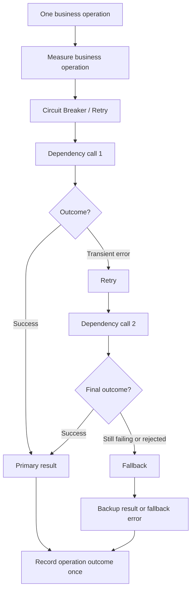

# Separating Primary Operation Metrics from Fallback and Retry Metrics

A single business request can call a dependency multiple times due to retries, be rejected by a Circuit Breaker before sending a request, or receive backup data from a fallback. If all these events are lumped into a single "success/failure" counter, dashboards easily lead to wrong conclusions: an operation may return a response to the caller while the dependency is still failing, or one request may generate multiple HTTP attempts.

When observing Spring Cloud CircuitBreaker and Resilience4j, separate at least three metric layers: **business operation**, **dependency attempt**, and **resilience policy behavior**. Record fallbacks and retries as distinct dimensions. This shows what outcome users received, how the dependency actually performed, and how protection policies intervened.

## Three Metric Layers with Distinct Meanings

| Layer | Unit of Measurement | Operational Question | Metric Examples |
|---|---|---|---|
| Primary operation (business operation) | One end-to-end business execution | Did the caller receive a contract-compliant result? | `catalog.operation.completed`, `catalog.operation.duration` |
| Dependency attempt | One actual request to the dependency | Did the dependency respond with success, error, or high latency? | `catalog.attempts`, `catalog.attempt.duration` |
| Resilience policy | One retry, one Circuit Breaker rejection, one fallback | How often did protection mechanisms intervene and why? | Retry metrics, Circuit Breaker metrics, `catalog.fallbacks` |

For example: a product lookup request calls `catalog`, times out on the first try, and succeeds on the second try. The business operation count is 1; dependency attempt count is 2; executed retry count is 1; fallback count is 0. If both attempts fail and a cache fallback returns data, the business operation can complete with fallback data while the dependency records 2 failed attempts and the fallback runs 1 time.



Metrics across layers do not need to match. That is normal because each layer measures a different unit.

## Defining the "Primary Operation" Clearly

A primary operation is a single business execution initiated by one request or command at a service boundary. This operation may encompass multiple dependency calls, retries, and fallbacks, yet it is counted once in business-level metrics.

Define caller-meaningful outcomes upfront, for example:

- `primary`: data retrieved from the primary dependency.
- `fallback`: completed using cached data or a backup source.
- `error`: failed to obtain a valid result, including when the fallback also failed.
- `cancelled`: the caller canceled the request or subscription before completion.

Do not merge `fallback` into `primary` simply because the HTTP endpoint ultimately returned status 200. If the caller receives stale data from cache, that is a successful delivery from an availability standpoint, yet still a degraded service from a dependency standpoint. Track both dimensions concurrently: `operation outcome` and `delivery source`.

For example, a dashboard might show 99.9% of operations returning a response, yet 8% of them used a fallback. Looking only at response success rate would cause the operations team to miss that the primary dependency is degrading.

## Measuring Individual Dependency Attempts and Retries

An attempt is one actual subscription/client invocation to the dependency. With Reactor, place instrumentation inside `Mono.defer(...)` before `retryWhen(...)` so timers and counters are created per attempt:

```java
Mono<Product> oneAttempt(String sku) {
    return Mono.defer(() -> {
        Timer.Sample sample = Timer.start(meterRegistry);

        return catalogClient.find(sku)
            .doOnSuccess(product -> meterRegistry.counter(
                "catalog.attempts",
                "outcome", "success").increment())
            .doOnError(error -> meterRegistry.counter(
                "catalog.attempts",
                "outcome", classifyAttemptError(error)).increment())
            .doFinally(signal -> sample.stop(Timer.builder(
                    "catalog.attempt.duration")
                .tag("dependency", "catalog")
                .register(meterRegistry)));
    });
}
```

Then compose retry:

```java
Mono<Product> attempts = oneAttempt(sku)
    .retryWhen(Retry.backoff(2, Duration.ofMillis(100))
        .filter(this::isRetryable)
        .doBeforeRetry(retrySignal -> meterRegistry.counter(
            "catalog.retry.scheduled",
            "dependency", "catalog").increment()));
```

With this configuration, `Retry.backoff(2, ...)` allows up to two retries after the initial attempt. If the first attempt times out and the second succeeds, `catalog.attempts{outcome="timeout"}` increments by one, `catalog.attempts{outcome="success"}` increments by one, and `catalog.retry.scheduled` increments by one. Do not count retries as new business operations.

`doBeforeRetry` measures scheduled retries. If you need to know when retries actually start and finish, add instrumentation per attempt or use Resilience4j Retry metrics. A retry can be canceled by an overall deadline before the next attempt starts; thus, "retry scheduled" and "attempt started" are two distinct events.

## Measuring the Business Operation Exactly Once

Operation-level instrumentation should wrap the entire Circuit Breaker, retry, and fallback chain. With reactive publishers, place it inside `Mono.defer(...)` so each subscription corresponds to one business execution:

```java
record Delivery<T>(T value, String source) {}

Mono<Delivery<Product>> findProduct(String sku) {
    Mono<Product> attempts = oneAttempt(sku)
        .retryWhen(retryPolicy);

    Mono<Delivery<Product>> primary = attempts
        .map(product -> new Delivery<>(product, "primary"));

    return Mono.defer(() -> {
        Timer.Sample sample = Timer.start(meterRegistry);

        return reactiveCircuitBreakerFactory.create("catalog")
            .run(primary, error -> productCache.find(sku)
                .switchIfEmpty(Mono.error(
                    new CatalogUnavailableException(sku, error)))
                .map(product -> new Delivery<>(product, "fallback")))
            .doOnNext(delivery -> meterRegistry.counter(
                "catalog.operation.completed",
                "source", delivery.source()).increment())
            .doOnError(error -> meterRegistry.counter(
                "catalog.operation.failed",
                "reason", classifyOperationError(error)).increment())
            .doFinally(signal -> sample.stop(Timer.builder(
                    "catalog.operation.duration")
                .tag("terminal", signal.name().toLowerCase())
                .register(meterRegistry)));
    });
}
```

This example illustrates the structure; `meterRegistry`, `retryPolicy`, `productCache`, the client, and classification helpers are service dependencies. `Delivery` preserves the data source so operation-level metrics separate primary results from fallbacks. The outer timer stops once when the subscription terminates, whereas the attempt timer inside `oneAttempt` runs again for each attempt.

If the fallback also errors, `doOnError` increments the operation failure metric. If the fallback returns data, `catalog.operation.completed{source="fallback"}` increments, while attempt metrics still retain the primary dependency failures. Consequently, fallback responses do not erase traces of the underlying failure.

For synchronous APIs, apply the same principle: start the timer at the start of the business method, measure each client call at the adapter layer, record fallback in the fallback branch, and stop the business timer once in `finally` or via an appropriate observation scope.

## Separating Original Errors, Retry Errors, and Fallback Errors

One request can produce multiple distinct exceptions. Preserve the cause at each stage:

| Stage | Cause Examples | Where to Record? |
|---|---|---|
| Original attempt | `ConnectException`, HTTP 503, `TimeoutException` | Attempt counter/timer and dependency trace span |
| Retry | A subsequent attempt scheduled due to transient error | Retry counter and Retry events |
| Circuit Breaker rejection | `CallNotPermittedException` | Circuit Breaker `not_permitted` metric; do not count as an HTTP attempt to dependency |
| Fallback started | Using cache because dependency failed or circuit is `OPEN` | Fallback invocation counter with reason category |
| Fallback completed | Cache returns backup data | Fallback success counter and operation delivery source |
| Fallback failed | Cache timeout or cache miss | Fallback failure counter and operation failure |

Do not overwrite the original exception with the fallback exception in logs and lose the link between them. You can record `fallback.reason=dependency_timeout` and `fallback.outcome=success`, while keeping the attempt exception in traces or logs tied by correlation ID. If the fallback fails, record `fallback.error=cache_timeout` separately; this separates a broken primary dependency from a broken backup source.

## Understanding Metrics Provided by Resilience4j

Resilience4j Micrometer integration provides separate metrics per component. Exact meter names and tags may change across versions, but common semantic groups include:

| Group | Observable Information | Interpretation |
|---|---|---|
| Circuit Breaker calls | Success, failure, ignored, not permitted | Outcomes seen by the Circuit Breaker at its decorator boundary |
| Circuit Breaker state | State gauge for `CLOSED`, `OPEN`, `HALF_OPEN`, and special states | Current state of the instance |
| Circuit Breaker rates | Failure rate, slow call rate, buffered calls | Sliding window data used for circuit-opening decisions |
| Retry calls | Successful without retry, successful with retry, failed before/after retry | Outcomes of the Retry chain per configured decorator |
| Retry attempts | Retries executed or scheduled | How much retrying was needed to complete an operation |
| TimeLimiter | Success, timeout, and async operation duration | Operations timing out at the TimeLimiter boundary |
| Bulkhead | Permitted calls, rejected calls, and active calls | Concurrency pressure on the dependency |

With Resilience4j Retry, outcomes are typically distinguished as `successful_without_retry`, `successful_with_retry`, `failed_without_retry`, and `failed_with_retry`. These classify outcomes of the Retry chain, not overall business request counts. Inspect actual metrics via `/actuator/metrics` or your running version's Prometheus endpoint before writing dashboards or alerts.

### Decorator Order Affects Circuit Breaker Metrics

If the Circuit Breaker wraps the entire retry chain, it usually sees the final outcome of the retry sequence. For example, if the first two attempts fail and the third succeeds, the Circuit Breaker may record one success for that subscription. If retry wraps outside the Circuit Breaker, each subscription attempt may pass through the Circuit Breaker individually, so the sliding window may receive multiple failures before one success.

Therefore, do not directly compare `resilience4j.circuitbreaker.calls` with `catalog.attempts` without confirming decorator order. Attempt counts usually exceed operation counts; Circuit Breaker sample counts depend on the boundary the decorator protects. Document the ordering of `Retry` and `CircuitBreaker` clearly in operational runbooks so dashboards are interpreted accurately.

## Designing Low-Cardinality Metric Names and Tags

Metrics need enough detail for analysis without creating a new time series for every request. Suitable tags typically include:

- `dependency`: stable dependency name, such as `catalog` or `inventory`.
- `operation`: operation name with a small value set, such as `find_product`.
- `outcome`: `success`, `error`, `fallback`, `timeout`, `rejected`.
- `reason`: normalized error categories such as `connect`, `read_timeout`, `http_5xx`, `circuit_open`, `bulkhead_full`.
- `source`: `primary` or `fallback`.

Never use `requestId`, `traceId`, SKU, full URLs, exception messages, or user IDs as metric tags. Those values have very high cardinality; keep them in traces or controlled logs. Never put stack traces or exception messages into a `reason` label; map exceptions into a small, stable set of categories.

## Combining Metrics, Traces, and Logs

Metrics show aggregate trends, traces follow a specific request, and logs provide event detail. All three sources should share a trace ID or correlation ID for linking, while each source serves its distinct role.

A trace may have this structure:

```text
HTTP GET /products/{sku}                 [business operation]
  └─ catalog.lookup                     [protected operation]
      ├─ catalog HTTP attempt #1         [timeout]
      ├─ retry backoff                   [100 ms]
      ├─ catalog HTTP attempt #2         [HTTP 503]
      └─ product cache fallback          [success]
```

Attempt spans should include duration, peer/dependency, status, and error category. Fallback spans should be marked as backup branches. The primary operation span may complete successfully under the caller's contract while still carrying `delivery.source=fallback` or a degraded status attribute. Never mark a dependency span as successful just because the parent span returned cached data.

When sampling traces, you still need unsampled metrics to measure retry and fallback rates accurately across the whole system. Do not rely on stored trace counts to compute error rates if sampling rates change.

## Dashboard Reading Example

Suppose in one minute there are 1,000 product lookup operations and the dashboard displays:

| Metric | Value | Meaning |
|---|---:|---|
| Business operations | 1,000 | Times callers requested a lookup |
| Primary delivery | 900 | 900 operations retrieved data from `catalog` |
| Fallback delivery | 80 | 80 operations were served from cache |
| Operation failed | 20 | 20 operations had no valid result |
| Dependency attempts | 1,180 | Total actual calls made to `catalog` |
| Retry attempts | 180 | Retries executed after initial attempts |
| Fallback invocations | 100 | Total fallback invocations, including 80 successes and 20 failures |

From these figures, you can deduce:

- Callers sent 1,000 operations, not 1,180 operations. 1,180 is the number of dependency attempts.
- 80 operations were served via fallback; the fallback rate across total operations is 8%.
- 20 operations ultimately failed; the business error rate is 2%.
- 100 fallback invocations exceeds 80 fallback deliveries because 20 fallbacks failed to retrieve data.
- 180 retry attempts show the dependency had issues on some calls; do not treat them as 180 new operations.

Looking only at a 98% business operation success rate makes the system appear healthy. Yet an 8% fallback rate and 180 retries reveal that the primary dependency is degrading. This is why keeping metric layers separate is essential.

## Which Metrics Should Trigger Alerts?

Do not create a single alert based on raw fallback or retry counts alone. Combine rates, duration, and state:

- Alert on dependency health when attempt failure rate or p95/p99 latency exceeds thresholds over a sustained interval.
- Alert on degraded service when the share of operations using fallback rises, even if operation response success rate remains high.
- Alert on user impact when operation failure rate or operation latency breaches SLOs.
- Alert on abnormal retry behavior when retries per operation climb sharply or the retry budget burns quickly.
- Alert on Circuit Breaker state when the circuit stays `OPEN` for a prolonged period or oscillates repeatedly between `CLOSED` and `OPEN`.
- Alert on backup sources when fallback failure rate rises or fallback latency consumes most of the deadline.

Set evaluation windows and thresholds according to actual traffic. For low-traffic dependencies, use minimum sample thresholds or longer windows to avoid firing on a few requests. For critical endpoints, pair error budgets and SLOs to alert based on caller impact.

## Incident Metric Inspection Workflow

When dashboards show operations succeeding while users report stale or missing data:

1. Check `delivery.source` to see whether results came from the primary dependency or fallback.
2. Compare business operation counts with dependency attempt counts to determine whether retries are amplifying traffic.
3. Inspect retry outcomes and per-attempt causes to locate connection errors, timeouts, or HTTP 5xx responses.
4. Check Circuit Breaker state, failure rate, slow call rate, and `not_permitted` counts to see if the circuit is blocking requests.
5. Check fallback invocations, fallback success/failure counts, and latency to verify whether the backup source is coping.
6. Use trace IDs to connect the operation, attempts, and fallback within a single request; cross-reference with event logs without adding that ID as a metric tag.

When numbers are separated by their proper units, operations teams can distinguish between "the user was served," "the dependency responded cleanly," and "the system had to invoke protection mechanisms." This forms the basis for evaluating Circuit Breaker, Retry, and fallback effectiveness without obscuring the true health of downstream dependencies.
