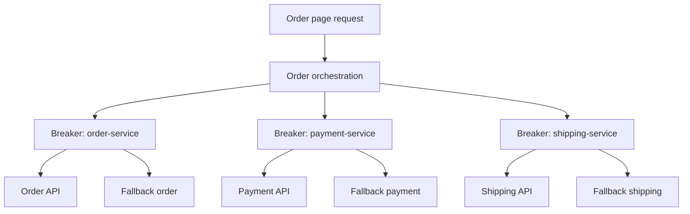

# Choosing a Circuit Breaker per Dependency or per Operation

When using Spring Cloud Circuit Breaker, every protected call needs an identifier (ID) so the factory can retrieve the right circuit breaker instance. An important design question is whether to assign IDs by **dependent service** or by **business operation**. This decision determines which calls share a sliding window, failure rate, `CLOSED`/`OPEN`/`HALF_OPEN` state, and probe quota.

There is no single rule that fits every system. Choose the scope based on the failure domain: which calls share a common failure cause and need to be tripped together? If multiple operations genuinely depend on the same remote capability, sharing a breaker can effectively prevent cascading failures. If operations have independent processing paths, SLAs, or failure characteristics, separating breakers prevents one operation from disrupting another.

## A circuit breaker protects a failure domain

A circuit breaker collects the outcomes of calls passing through the same instance. When the failure rate or slow-call rate reaches the threshold, the instance transitions to `OPEN` and rejects subsequent calls. After the wait duration elapses, the breaker transitions to `HALF_OPEN` to test recovery using the permitted number of probes.

Therefore, the breaker scope is precisely the scope that shares the protection decision:

- Methods using the same ID within the same registry/factory instance share state and statistics.
- Different IDs have independent state machines and sliding windows, even when they call the same remote host.
- A stable ID should represent an operationally meaningful failure domain, not a single request or a single user.

For example, an application calls a catalog service through three operations: reading a product, searching, and updating inventory. If all three use the same catalog cluster, connection pool, and backend capacity, a catalog infrastructure failure can affect all three simultaneously. Using a single `catalog` breaker allows failures from one operation to close the call path to the other operations within the same failure domain.

Conversely, if search runs on a separate search cluster while inventory updates go to an inventory service, they should not share a breaker just because both appear in the "catalog" business domain. They have different endpoints, capacities, and failure causes; they require separate breakers based on the actual dependencies.

## Comparing per-dependency and per-operation scope

| Criterion | One breaker per dependency | Separate breaker per operation |
|---|---|---|
| Statistics scope | Multiple operations calling the same dependency share samples | Each operation has its own sliding window |
| When one operation fails | Can open the breaker for other operations sharing the ID | Only that operation is tripped |
| When the entire dependency fails | Multiple operations stop calling early together | Each breaker must accumulate enough samples before opening |
| Localized failure on one endpoint | Can impact other healthy endpoints | Isolates healthy endpoints from the failing endpoint |
| Operational complexity | Fewer instances and metrics | More configurations, states, and metrics |
| Statistical data | Larger sample set, but may mix different characteristics | Smaller samples, more accurately reflecting each operation |

Choose per-dependency when operations depend on a single failure domain and need to be protected as a group. Choose per-operation when operations differ significantly enough in SLA, timeout, load, or failure probability to warrant separate policies.

## When to share a single breaker

Sharing an ID is usually appropriate when:

- Calls go to the same service or backend cluster and share processing capacity.
- An incident on one endpoint usually signals that the dependency is degrading for the remaining endpoints.
- The operations have similar timeouts, slow-call thresholds, and recovery requirements.
- You want operations to have enough traffic for the breaker to detect failures quickly, rather than splitting samples into windows with too few requests.

For example, two methods `getProduct` and `getCategory` both call a catalog API that shares a connection pool. If the catalog API stops responding, keeping two separate breakers could force each breaker to wait for its own `minimumNumberOfCalls`. Sharing `catalog-read` aggregates outcomes into one window and can open earlier.

```java
@Service
public class CatalogReadService {

    private final CircuitBreakerFactory<?, ?> factory;
    private final CatalogClient client;

    public CatalogReadService(
            CircuitBreakerFactory<?, ?> factory,
            CatalogClient client) {
        this.factory = factory;
        this.client = client;
    }

    public Product getProduct(String id) {
        return factory.create("catalog-read").run(
                () -> client.getProduct(id),
                error -> Product.unavailable(id)
        );
    }

    public Category getCategory(String id) {
        return factory.create("catalog-read").run(
                () -> client.getCategory(id),
                error -> Category.unavailable(id)
        );
    }
}
```

Both methods use the same `catalog-read` ID, and therefore use the same instance in the factory's backend. If either one encounters an error, that outcome contributes to the shared statistics. When the breaker opens, both methods skip calling the catalog API and run their respective fallbacks.

Fallbacks still need to fit each operation. Sharing a breaker does not mean sharing a single fallback or returning the same data type. `getProduct` can return an unavailable product, while `getCategory` can return a cached category if business rules permit.

## When to split breakers by operation

Split IDs when there are significant differences in:

- **SLA and timeout:** a search operation might tolerate 800 ms, whereas reading basic information must complete within 150 ms.
- **Load characteristics:** one endpoint has large traffic bursts or long processing times, while another has low and steady traffic.
- **Criticality:** a payment authorization operation needs a different protection policy from an operation fetching product recommendations.
- **Failure domain:** endpoints use separate backends or connection pools, so failure in one endpoint does not prove the other is unavailable.
- **Fallback:** each operation has different degradation capabilities and business rules, requiring separate observability.

For example, `catalog-search` runs on a high-latency search cluster, while `catalog-detail` reads from a detail API. If the search cluster is overloaded, reading product details should not be automatically blocked when the two systems are genuinely independent.

```java
public SearchResult search(String query) {
    return factory.create("catalog-search").run(
            () -> searchClient.search(query),
            error -> SearchResult.temporarilyUnavailable()
    );
}

public Product getDetail(String productId) {
    return factory.create("catalog-detail").run(
            () -> detailClient.getProduct(productId),
            error -> detailCache.find(productId)
                    .orElseGet(() -> Product.unavailable(productId))
    );
}
```

The two breakers can be configured with different `slowCallDurationThreshold`, `failureRateThreshold`, and `minimumNumberOfCalls` values. Ensure that the IDs in code match the instance names in the Resilience4j configuration if the backend uses per-instance properties.

## Configuring multiple instances according to chosen boundaries

The example below configures one shared breaker for the catalog read group and two independent breakers for search and detail reads:

```yaml
resilience4j:
  circuitbreaker:
    instances:
      catalog-read:
        slidingWindowType: COUNT_BASED
        slidingWindowSize: 30
        minimumNumberOfCalls: 15
        failureRateThreshold: 50
        slowCallRateThreshold: 50
        slowCallDurationThreshold: 500ms
        waitDurationInOpenState: 10s
        permittedNumberOfCallsInHalfOpenState: 3
      catalog-search:
        slidingWindowType: COUNT_BASED
        slidingWindowSize: 20
        minimumNumberOfCalls: 10
        failureRateThreshold: 40
        slowCallRateThreshold: 50
        slowCallDurationThreshold: 1500ms
        waitDurationInOpenState: 20s
        permittedNumberOfCallsInHalfOpenState: 2
      catalog-detail:
        slidingWindowType: TIME_BASED
        slidingWindowSize: 30
        minimumNumberOfCalls: 10
        failureRateThreshold: 50
        slowCallRateThreshold: 40
        slowCallDurationThreshold: 300ms
        waitDurationInOpenState: 10s
        permittedNumberOfCallsInHalfOpenState: 3
```

This is an example for the Resilience4j backend. For other Spring Cloud Circuit Breaker backends, the configuration style may differ. `catalog-read` has a larger window because it aggregates read traffic; `catalog-search` uses a longer slow-call duration threshold; `catalog-detail` uses a time-based window. These numbers only illustrate how policies are expressed and should be tuned to actual latency and the caller's time budget.

Do not create a separate configuration for each URL if they do not have independent failure domains. Every new instance needs enough traffic to satisfy `minimumNumberOfCalls`; excessive splitting can cause breakers to rarely evaluate the failure rate and react slowly to incidents.

## Designing for operations that call multiple dependencies

A business operation may call multiple dependent services. For example, an order detail page needs the order service, payment service, and shipping service. Do not create a single circuit breaker named `order-page` to wrap the entire flow if the goal is to protect each dependency.

Instead, place a breaker at each outbound call boundary:



Each breaker tracks the exact dependency it protects. If the payment API fails, the payment breaker opens, but order and shipping can still be called if they are independent. The orchestrator decides how to compose the aggregated response when part of the data is unavailable. This keeps the cause of degradation clear and prevents a failure in one dependency from disabling all remaining parts.

If multiple dependencies pass through a shared gateway or connection pool, also consider the infrastructure-level failure domain. A failing gateway can affect multiple APIs; in that case, an additional breaker at the gateway boundary may be needed, though it does not replace per-dependency breakers if each service still has distinct failure characteristics.

## Do not confuse circuit breaker with bulkhead

The two mechanisms may share a dependency boundary, but they protect in different ways:

| Mechanism | Purpose | Scope to consider |
|---|---|---|
| Circuit breaker | Stop calling when outcomes indicate the dependency is failing or slow | Failure domain and statistical policy |
| Bulkhead | Limit concurrent calls consuming resources | Resources to isolate, such as thread pool, semaphore, or connection pool |

You can share a single breaker across multiple catalog operations while still needing a separate Bulkhead for the search group if search requests consume more resources. Conversely, two separate breakers do not automatically create two independent resource pools. If you want concurrency isolation, configure the corresponding Bulkhead or connection pool.

## Mistakes when choosing scope

| Mistake | Consequence | Adjustment |
|---|---|---|
| One application-wide breaker | Failure of one dependency can block healthy dependencies | Split by failure domain |
| One breaker per request or user | Too many instances, each lacking statistical data | Use stable, low-cardinality IDs |
| One breaker per URL despite same backend | Fragments traffic and reacts slowly during shared backend failures | Group endpoints sharing a failure domain |
| Merging independent dependencies into one breaker | One failing service blocks another service | Split instances by actual dependency |
| Splitting every operation while keeping identical arbitrary timeouts/thresholds | Increases operational overhead without clear isolation benefits | Split only when SLA, load, or failure domain differs |
| Assuming identical IDs across pods share state | Each JVM still has its own sliding window and state | Observe per replica; do not treat a local registry as distributed |

## Evaluating the impact of minimumNumberOfCalls

When splitting a breaker by operation, each instance receives fewer requests. Resilience4j only calculates the failure rate after the window has recorded at least `minimumNumberOfCalls` outcomes. If an endpoint receives only two requests per minute while `minimumNumberOfCalls` is 20, the breaker may take many minutes to gather enough samples.

When sharing a breaker per dependency, operations contribute to the same window and can help detect failures faster. However, ensure that outcomes across operations are comparable. If operation A is inherently much slower than operation B, combining them can cause the slow-call rate to be dominated by A. In that case, splitting the breaker or using different thresholds/configurations may be more appropriate.

Do not adjust `minimumNumberOfCalls` solely to make the breaker open faster. Evaluate request rate, sliding window size, failure rate, latency percentiles, and the impact of a high-traffic operation on other operations.

## Instance naming, metrics, and process scope

Choose short, stable names that describe the failure domain, such as `catalog-read`, `catalog-search`, or `payment-authorize`. Do not include `userId`, `tenantId`, request IDs, or query parameters in instance names. High-cardinality names increase the number of state machines, memory usage, and metric series.

Within one JVM, calls using the same instance ID from the same factory/backend share state. Each application replica, however, has its own local registry and state. If six pods are running, six breakers named `catalog-read` do not automatically synchronize sliding windows or state transitions. One pod can be `OPEN` while another pod remains `CLOSED`.

Track metrics and events by breaker name, and attach replica metadata at the telemetry layer if needed for diagnosis. Do not aggregate local states into an assumed cluster-wide state. If requirements call for a cluster-wide tripping decision, that is a different coordination design beyond a standard local registry.

## Decision-making process

Before creating a new ID, answer these questions in order:

1. Do these operations call the same dependency and share the same failure domain?
2. When one operation fails, do the remaining operations need to be tripped to avoid continuing to load the same backend?
3. Do the operations share the same timeout, slow-call threshold, load, and SLA?
4. If shared, could one endpoint skew the statistics of another endpoint?
5. If separated, does each breaker receive enough traffic to reach `minimumNumberOfCalls` within an acceptable time?
6. Can fallbacks differ per operation even when the breaker is shared?
7. Is a separate Bulkhead needed to isolate resources even when sharing a breaker?

If the operations share a failure domain and have similar policies, use one breaker per dependency. If they have different failure domains or protection requirements, split breakers by specific operation/dependency. For multi-service workflows, place breakers at each outbound call and let orchestration decide how to aggregate results.

## Testing breaker boundaries

Tests should prove exactly which operations share state and which are independent:

| Scenario | What to verify |
|---|---|
| Two operations sharing an ID | Same instance and same sliding window |
| Two operations using separate IDs | Failures in operation A do not open breaker B |
| One endpoint fails in a shared group | The shared breaker records errors according to the chosen policy |
| One endpoint has much higher latency | Verify whether the group's slow-call rate is skewed |
| Shared breaker transitions to `OPEN` | All calls using that ID are rejected and per-operation fallbacks still honor their contracts |
| Separate breaker transitions to `OPEN` | Independent dependencies/operations continue operating |
| Splitting traffic across multiple breakers | Each instance has enough samples to evaluate against `minimumNumberOfCalls` |
| Multiple replicas | Confirm state is local and observable per pod |

In integration tests, use a real factory/backend from the Spring context and invoke the services through the actual beans. You can configure a small window to produce deterministic state transitions, then inspect `getState()` or Resilience4j instance events. Avoid only mocking `CircuitBreakerFactory`, because mocks do not prove that calls with the same ID actually share state in the backend.

## Design principles

A circuit breaker should represent the failure domain that needs protection. Share per dependency when multiple operations share failure causes, SLAs, and policies; split per operation when you need to isolate load characteristics, latency, or failure probability. Keep instance names stable with low cardinality, place breakers at each dependency call boundary, and evaluate the impact of `minimumNumberOfCalls` before fragmenting traffic. This decision enables the breaker to trip the exact failing part while maintaining availability for independent operations.
