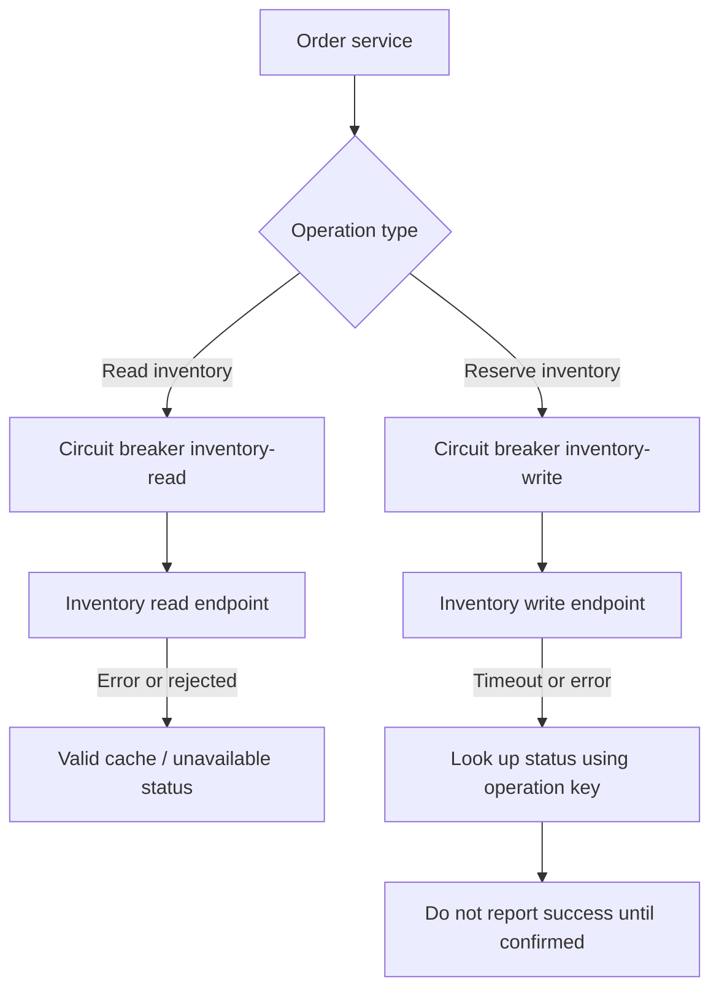

# Considering Splitting Read, Write, and Different Latency Groups

A single service can expose multiple types of operations with very different characteristics. Reading inventory typically requires a fast response and can accept cached data that is sufficiently fresh; reserving inventory is a write operation with side effects that requires a clear transaction outcome; generating a report may take several seconds or longer. If all operations share one circuit breaker, errors or latency in one group can cause the remaining groups to be tripped along with it.

In Spring Cloud CircuitBreaker with Resilience4j, the identifier passed to `CircuitBreakerFactory.create(...)` determines which circuit breaker is used for a call. Choosing that identifier is therefore a boundary design decision: which operations should share a statistics window and state, and which operations need separate policies? This lesson explains how to consider splitting reads/writes and latency groups so that the circuit breaker accurately reflects failure domains, time budgets, and business semantics.

## 1. Choosing boundaries by operation characteristics

Do not default to giving every method its own circuit breaker, nor lump every call to the same host into a single breaker. One breaker should represent a group of operations that share similar characteristics:

- Same dependency or same failure domain: calls that are likely to degrade together from a single cause.
- Same latency budget: response times considered normal or slow are similar.
- Same outcome semantics: error classification and how the application recovers are similar.
- Same retry and idempotency policy: operations can be retried in a similar way.
- Sufficient traffic to produce meaningful statistical samples within the chosen window.

If two operations have different latencies and recovery semantics, sharing a breaker can allow one operation to inappropriately impact the other. If split too finely, each breaker lacks enough data to evaluate and increases the number of configurations, metrics, and states to operate.

| Criterion | Consider sharing a breaker when | Consider splitting breakers when |
|---|---|---|
| Failure domain | Same dependency, same degradation cause, and same recovery behavior. | One operation calls a different service or resource that can fail independently. |
| Latency budget | Same response target and same slow-call threshold. | One group requires fast responses while the other inherently takes longer to process. |
| Business semantics | Same error handling, fallback, and retry behavior. | Reads can use a cache, whereas writes must report clear transaction status. |
| Traffic volume | Total traffic adequately represents a group with uniform behavior. | Merging two groups causes statistics to mask an incident specific to one group. |
| Resources | Same pool and no need for separate load isolation. | Separate concurrency limits or pools are needed so one group does not exhaust the other's resources. |

## 2. Why read and write operations often need to be separated

Read and write operations usually have different business contracts, even when calling the same service.

**Reading data** can often use cached or stale data within acceptable bounds when a dependency is temporarily unavailable. The primary goal is maintaining responsiveness and clearly communicating data freshness. Reads are typically idempotent, so they can have a bounded retry policy for recoverable errors.

**Writing data** can produce side effects such as deducting inventory, creating orders, or charging money. When a request times out, you cannot assume the transaction was not executed: the target service may have committed while the response was lost. A fallback must never return a false success. If retries are needed, the operation must have an idempotency key or duplicate-execution prevention mechanism.

Because of these differences, a read breaker and a write breaker can use different failure thresholds, open durations, and fallbacks. For example, a read breaker may allow falling back to cache; a write breaker may fail fast and direct the caller to a transaction status lookup workflow.



Splitting breakers does not mean the two operations are completely isolated. If reads and writes share a connection pool, thread pool, or database, load from the write group can still consume resources and slow down the read group. A circuit breaker only separates statistics and tripping decisions; isolating resources requires adding a Bulkhead, separate pools, or appropriate load limits.

## 3. Using separate identifiers for read and write

The example below uses two stable IDs for the same inventory service:

```java
import org.springframework.cloud.client.circuitbreaker.CircuitBreakerFactory;
import org.springframework.stereotype.Service;

@Service
public class InventoryFacade {
    private final CircuitBreakerFactory<?, ?> circuitBreakerFactory;
    private final InventoryClient inventoryClient;
    private final InventoryCache inventoryCache;

    public InventoryFacade(
            CircuitBreakerFactory<?, ?> circuitBreakerFactory,
            InventoryClient inventoryClient,
            InventoryCache inventoryCache) {
        this.circuitBreakerFactory = circuitBreakerFactory;
        this.inventoryClient = inventoryClient;
        this.inventoryCache = inventoryCache;
    }

    public Stock getStock(String sku) {
        return circuitBreakerFactory.create("inventory-read").run(
            () -> inventoryClient.getStock(sku),
            error -> inventoryCache.getFreshStock(sku)
                .orElseGet(() -> Stock.unavailable(sku))
        );
    }

    public ReservationResult reserveStock(String sku, int quantity, String idempotencyKey) {
        return circuitBreakerFactory.create("inventory-write").run(
            () -> inventoryClient.reserveStock(sku, quantity, idempotencyKey),
            error -> {
                throw new InventoryWriteUnavailableException(
                    "Unable to confirm inventory reservation operation",
                    error
                );
            }
        );
    }
}
```

This example assumes `getFreshStock` only returns cached data still within the business-acceptable freshness window. A `Stock.unavailable` result must be distinguished from zero stock. For the write operation, the fallback throws an exception carrying the root cause instead of returning a `ReservationResult` pretending to have succeeded. The caller can use the idempotency key to look up the status before deciding whether to resend the command.

The IDs `inventory-read` and `inventory-write` must be used consistently across Resilience4j configuration, metrics, and dashboards. Avoid constructing IDs from SKU, user ID, or request ID; dynamic IDs cause instance count and cardinality to grow uncontrollably.

## 4. Separate configuration for read and write

Read and write groups may require different thresholds and durations. Example:

```yaml
resilience4j:
  circuitbreaker:
    instances:
      inventory-read:
        slidingWindowType: COUNT_BASED
        slidingWindowSize: 50
        minimumNumberOfCalls: 20
        failureRateThreshold: 50
        slowCallDurationThreshold: 300ms
        slowCallRateThreshold: 60
        waitDurationInOpenState: 5s
        permittedNumberOfCallsInHalfOpenState: 5
      inventory-write:
        slidingWindowType: COUNT_BASED
        slidingWindowSize: 30
        minimumNumberOfCalls: 10
        failureRateThreshold: 40
        slowCallDurationThreshold: 1s
        slowCallRateThreshold: 50
        waitDurationInOpenState: 15s
        permittedNumberOfCallsInHalfOpenState: 2
```

These numbers only illustrate how policies are separated, not universal defaults suitable for every system. Inventory reads have a 300 ms response budget and can therefore use a shorter slow-call threshold. Reservation writes may take longer but need caution regarding errors and recovery time. Use p95/p99 metrics, SLOs, and target service capacity to tune them.

`minimumNumberOfCalls` must be evaluated separately for each breaker. If write traffic is low, a threshold of 10 samples may take a long time to reach; the breaker might not evaluate rates yet while the dependency is degrading. You can use a time-based window or adjust the sample count, but do not merge reads and writes solely to increase sample counts if the two groups have different error semantics.

## 5. Splitting groups by latency budget

Beyond read/write, the same service may have operations with different latency budgets. For example:

- `catalog-fast-read`: looking up a single product to render a page.
- `catalog-search`: searching with multiple criteria and index processing.
- `reporting-batch`: generating reports or aggregating data with longer execution times.

If these operations are lumped into one breaker, a `slowCallDurationThreshold` suited for reports would be too loose for the product display API. Conversely, a tight threshold for the interactive API could cause normal reports to be classified as slow and open the circuit for fast lookups as well.

| Operation group | Illustrative budget | What to prioritize |
|---|---|---|
| Fast UI lookup | 200–300 ms | Early latency detection, cache fallback if data is still valid. |
| Complex search | 800 ms–1.5 s | Balance latency and result quality; may degrade features under overload. |
| Reports/batch | Several seconds to tens of seconds | Separate timeouts, limited concurrency, and asynchronous processing when appropriate. |

The time ranges above are only examples to illustrate latency groups. Actual budgets must be determined from API contracts, internal processing times, and caller deadlines. Do not apply a long slow-call threshold to all operations simply because a few endpoints inherently take a long time.

## 6. Only group operations that share the same failure domain

Two operations with the same latency budget still may not belong in the same breaker if they call different dependencies. For example, price lookup and inventory lookup may both need under 300 ms, yet if they are served by two independent services, an incident in the pricing service should not automatically open the inventory breaker.

Conversely, multiple methods on the same client can share a breaker if they depend on the same service, share a connection pool, and recover together. Sharing helps accumulate enough samples, but can allow one failing method to pull the remaining methods into the `OPEN` state.

Consider both logical and infrastructure failure domains:

- Same host, yet two endpoints backed by different clusters or pools can be two separate failure domains.
- Two different endpoints sharing a database and connection pool can degrade simultaneously.
- A cache-reading endpoint and a database-writing endpoint may have different dependency paths even within the same service.
- A batch operation can consume far more resources than a single-item read and require a separate Bulkhead.

Breakers should be placed at dependency call boundaries that can fail independently. If operations share a common resource, evaluate whether they should share error statistics or also need a Bulkhead to separate load.

## 7. Avoiding over-splitting and insufficient statistical samples

Creating a breaker per method can leave each window receiving very few calls. When `minimumNumberOfCalls` is not reached, the circuit breaker cannot yet evaluate the failure rate or slow-call rate as configured. A rarely called endpoint can continue sending failing requests for a long time because it never accumulates enough samples.

Conversely, grouping too many methods that do not share a failure domain into one breaker causes a localized failure to affect the whole group. Balance isolation against sample quality.

| Splitting strategy | Risk |
|---|---|
| One breaker for all dependencies and all operations | One failing dependency can open the circuit for healthy dependencies. |
| One breaker per method or per request | Insufficient samples, many instances, hard to manage metrics and configuration. |
| One breaker for a group of operations sharing dependency, latency, and semantics | Usually better balanced, though cross-impact among methods in the group must still be monitored. |

If a group has low traffic, you can group more closely similar operations or choose an appropriate time-based window. Do not put a sensitive write operation into a read breaker just to increase sample count. Business correctness is more important than having a failure rate that looks stable.

## 8. Breaker identifiers must be stable and meaningful

Choose IDs that describe the dependency together with the operation group, for example:

```text
inventory-read
inventory-write
catalog-fast-read
catalog-search
reporting-batch
payment-authorize
payment-status-read
```

Stable IDs enable accurate mapping across Java code, YAML configuration, events, metrics, and dashboards. Avoid auto-generated method names if naming conventions might change during refactoring; avoid combining IDs with input data such as SKU or tenant if true isolation is not required.

If per-tenant separation is needed, evaluate tenant scale, instance lifecycle, metric cardinality, and eviction mechanisms. Do not create unbounded circuit breakers per tenant without limits. For most systems, breakers by dependency and operation group are sufficient; per-tenant load limits can be handled by a dedicated rate limiter or quota.

## 9. Splitting breakers does not replace Bulkhead and RateLimiter

Two independent breakers may have separate states and sliding windows, yet still run in the same process and share a thread pool, connection pool, or OS resources. When the batch group holds all connections, the fast-read group's breaker can still time out even while that breaker is `CLOSED`.

Coordinate mechanisms together:

- **CircuitBreaker:** stops calls to a dependency when failure rate or slow-call rate exceeds thresholds.
- **Bulkhead:** limits concurrency so one operation group does not exhaust resources needed by another group.
- **RateLimiter:** limits request rate to a dependency or operation group.
- **Timeout:** bounds wait time on HTTP clients and asynchronous tasks.
- **Retry:** only retries recoverable errors, with limits and alignment to idempotency.

For example, you can use a separate bulkhead for `reporting-batch` with low concurrency, while `catalog-fast-read` has concurrency limits tailored to UI traffic. If connection pools need to be separated, HTTP client configuration must reflect that boundary as well; simply defining two circuit breaker IDs does not automatically create two pools.

## 10. Aligning fallbacks with read/write semantics

Fallbacks should reflect the contract of the operation group:

| Group | Acceptable fallback | What to avoid |
|---|---|---|
| Catalog read | Cache within freshness limit, reduced data, or unavailable status. | Returning unbounded stale data without marking it. |
| Inventory read | Timestamped cache or temporarily unavailable result. | Returning quantity 0 when actual quantity is unknown. |
| Reservation write | Unconfirmed status, lookup reference code, or controlled error. | Reporting reservation succeeded before confirmation. |
| Payment | Query transaction status via idempotency key. | Resending a charge command with a new key or fabricating success. |
| Long-running report | Return job ID, in-progress status, or latest report data if business rules allow. | Holding synchronous requests indefinitely or returning an incomplete report as fresh data. |

If a read fallback uses a cache, include metadata on update timestamp and staleness limits. For write operations, timeouts can produce uncertain outcomes; idempotency keys, transaction state, and reconciliation workflows are required.

## 11. Testing breaker boundaries

Tests should prove that groups are truly independent by design:

1. Cause `inventory-read` to exceed its failure threshold and verify it transitions to `OPEN`.
2. Call `inventory-write` while the read breaker is `OPEN`; verify the write breaker retains its own state and decision.
3. Make the `reporting-batch` operation slow while keeping `catalog-fast-read` within normal latency thresholds; verify the fast breaker does not open merely because reports are slow when separated by design.
4. Check sample counts of each breaker and when rate evaluation begins.
5. Verify read fallbacks do not return expired data and write fallbacks do not report false success.
6. Verify write timeouts do not cause duplicate transactions when looking up status or retrying with an idempotency key.
7. Generate concurrent load to verify Bulkhead and connection pools actually isolate the intended groups.

Use fake clients or mock servers to control errors and latency. Check both breaker state and actual requests reaching the dependency; checking only the returned fallback value is not enough to prove the supplier was skipped or that other groups were isolated.

## 12. Post-deployment monitoring

Metrics should be attached to stable breaker IDs so dashboards can compare each group:

- Current state and number of state transitions.
- Successful, failed, and rejected call counts.
- Failure rate, slow-call rate, and sample count in the window.
- p50/p95/p99 latency for each operation group.
- Fallback count, fallback success rate, and stale-data response count.
- Bulkhead full count, permit wait time, and active concurrency.

Avoid using SKU, user ID, or request ID as metric tags because cardinality can grow rapidly. Per-request identifiers belong in controlled logs or traces. When a write breaker opens frequently, determine whether it is a dependency outage, an inappropriate latency threshold, or another operation group sharing the breaker.

## 13. Boundary decision process

Before creating a new breaker ID or merging two existing IDs, walk through these steps in order:

1. Identify the actual dependency and failure domain of the operation.
2. Distinguish reads, writes, batch work, and business side effects.
3. Define latency budgets and slow-call thresholds for each group.
4. Define fallback, retry, idempotency, and timeout handling.
5. Estimate traffic per instance to choose the sliding window and `minimumNumberOfCalls`.
6. Check requirements for separate Bulkhead, RateLimiter, and connection pools.
7. Assign a stable ID, configure per ID, and add corresponding metrics.
8. Test cross-impact: opening one breaker must not inadvertently trip an independent group.

Split read, write, and latency groups when they have different recovery semantics, time budgets, or failure domains. Share a breaker when operations genuinely share characteristics and should share statistics. Keep the number of IDs operationally manageable, ensure each window receives enough samples, and remember that a breaker only separates statistical decisions; Bulkhead together with client configuration is what isolates resources. Designing boundaries by these criteria allows Spring Cloud CircuitBreaker to protect the right operation groups without causing unintended open circuits.
