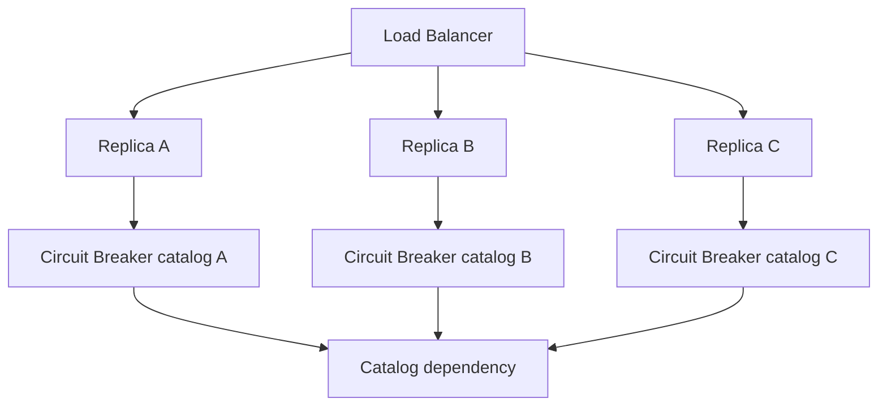
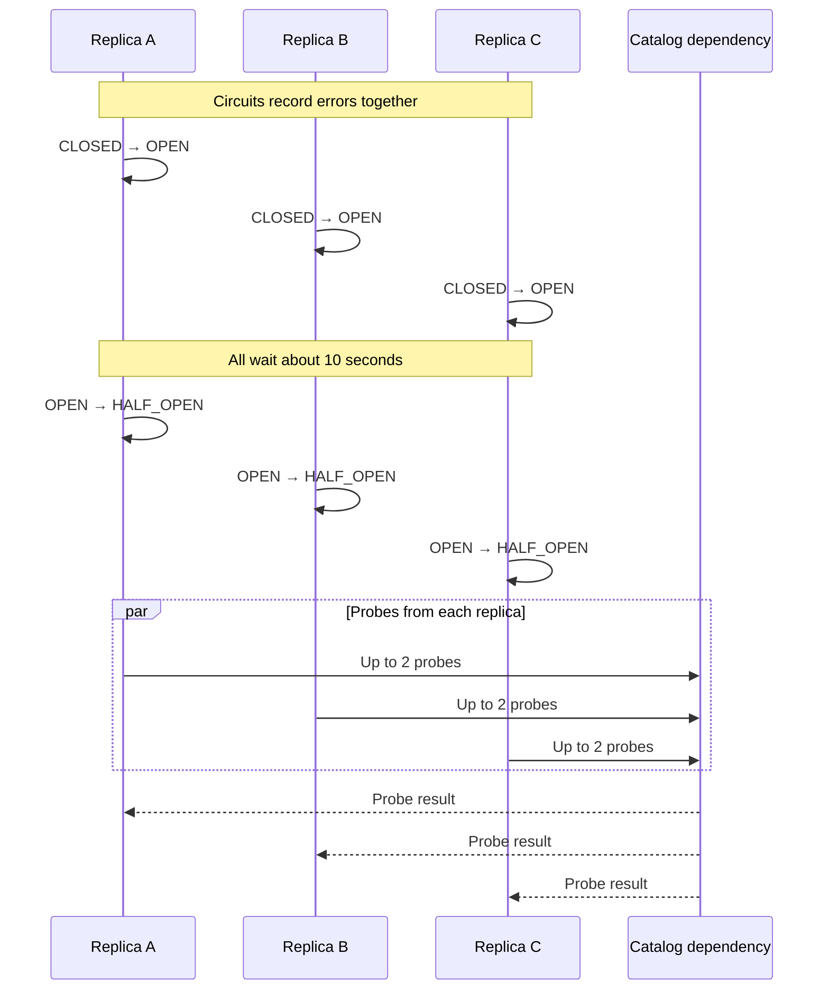

# Per-Replica State and the Thundering Herd Probe Effect

In a Spring Cloud application running multiple replicas, each process typically holds its own Resilience4j Circuit Breaker instance for each circuit name. The `CLOSED`, `OPEN`, and `HALF_OPEN` state, sliding window, and call counters are stored in that process's memory. Replicas do not automatically share state or statistics with one another.

This design lets each replica decide quickly without calling a central coordination service. However, it creates a consequence when a system has many replicas: if all of them detect a dependency failure around the same time and use the same `waitDurationInOpenState`, they can transition to `HALF_OPEN` nearly simultaneously. Each replica is then allowed to send its own batch of trial calls, hitting the newly recovered dependency with a large wave of probes all at once.

## Scope of Circuit Breaker state

A Resilience4j Circuit Breaker is a runtime object inside the process that owns it. Within the same process, components sharing the exact same Circuit Breaker instance share its state and sliding window. When a service is deployed across multiple pods or VMs, each process has its own memory, so instances with the same name remain independent circuits.



The name `catalog` may be identical across all three replicas' configurations, yet each process maintains its own state machine and statistics window. When replica A transitions to `OPEN`, replica B can still be `CLOSED` and continue calling the dependency. A newly started replica also normally initializes a fresh Circuit Breaker in its initial configured state; state from an older replica is not automatically restored from another process's registry.

| Scope | Shared? | Consequence |
|---|---|---|
| Multiple calls using the same Circuit Breaker object in one process | Yes | Same state, sliding window, and event publisher |
| Two Circuit Breakers with different names in the same process | No | Each circuit has its own policy and statistics |
| Same Circuit Breaker name on two different replicas | Not by default | Each replica has its own state and sliding window |
| Metrics collected from multiple replicas | Can be aggregated in observability systems | Aggregating metrics does not mean runtime state is synchronized |

Therefore, a cluster-wide dashboard can show different states for the same dependency. That is not necessarily a configuration bug; it may accurately reflect that each replica observed a different set of outcomes and traffic.

## Why does a synchronized probe wave occur?

Suppose 20 replicas call `catalog` while the dependency stops responding. Because they receive errors within a short interval, most Circuit Breakers can transition `CLOSED` → `OPEN` close together. If all use `waitDurationInOpenState: 10s`, they can also finish their wait duration at roughly the same time.

When each circuit transitions to `HALF_OPEN`, `permittedNumberOfCallsInHalfOpenState` applies separately per instance. If each replica permits 2 trial calls, the fleet can generate up to around 40 probes in a single transition cycle when all 20 replicas receive enough traffic to use their trial allowance. This is a per-replica probe budget, not a fleet-wide limit.



This burst of traffic can overload the recovering dependency again, causing probes to fail and each circuit to return to `OPEN`. If all replicas then wait the same fixed duration again, the phenomenon can repeat rhythmically, producing periodic load spikes instead of a smooth recovery.

## Probe limits are local limits

`permittedNumberOfCallsInHalfOpenState` specifies the number of permitted trial calls in the `HALF_OPEN` state for one Circuit Breaker instance. It does not cap the total probes across the entire deployment, nor is it a general concurrency limit while the circuit is `CLOSED`.

Example with 20 replicas:

| Replicas | Max probes per circuit | Potential total probes |
|---:|---:|---:|
| 5 | 2 | 10 |
| 10 | 2 | 20 |
| 20 | 2 | 40 |
| 40 | 2 | 80 |

The maximum budget can be estimated with the formula:

\[
P_{fleet} \approx N_{replicas} \times P_{half-open-per-replica}
\]

This is an estimate for one Circuit Breaker name and one transition cycle; actual probes depend on traffic reaching each replica, the number of circuits, routing behavior, and when circuits transition. If a single pod has multiple breaker names calling the same dependency, calculate each circuit's budget separately and evaluate the combined load on the dependency.

Do not increase probes per replica just to "check more thoroughly" when the replica count can scale large. With 50 replicas and 5 probes per circuit, the system can generate roughly 250 trial calls in a single cycle. Choose probe counts based on the dependency's load capacity and deployment scale.

## Spreading out transitions to HALF_OPEN

One way to reduce simultaneous probe waves is to stagger wait durations across replicas. If every replica uses a fixed value, they tend to transition in lockstep after a simultaneous outage. You can use randomized wait intervals or jitter in Resilience4j Java configuration so each `OPEN` cycle has a different wait duration.

Example configuring a Circuit Breaker with a randomized `IntervalFunction`:

```java
import io.github.resilience4j.circuitbreaker.CircuitBreakerConfig;
import io.github.resilience4j.core.IntervalFunction;

CircuitBreakerConfig catalogConfig = CircuitBreakerConfig.custom()
    .slidingWindowSize(20)
    .minimumNumberOfCalls(10)
    .failureRateThreshold(50)
    .waitIntervalFunctionInOpenState(
        IntervalFunction.ofRandomized(10_000, 0.5))
    .permittedNumberOfCallsInHalfOpenState(2)
    .build();
```

`IntervalFunction.ofRandomized(...)` adds randomness to the wait interval via the Resilience4j API. Verify the exact API signature and range behavior for the Resilience4j version your project uses. `waitDurationInOpenState` in YAML is a fixed duration; if per-open jitter is required, use the wait-interval scheduling mechanism supported by your library version or an equivalent configuration strategy.

When applying this configuration through Spring Cloud CircuitBreaker, pass `CircuitBreakerConfig` into the customizer for the right factory and ID:

```java
import org.springframework.cloud.client.circuitbreaker.Customizer;
import org.springframework.cloud.circuitbreaker.resilience4j.Resilience4JCircuitBreakerFactory;
import org.springframework.context.annotation.Bean;

@Bean
Customizer<Resilience4JCircuitBreakerFactory> catalogCircuitBreakerPolicy() {
    return factory -> factory.configure(
        builder -> builder.circuitBreakerConfig(catalogConfig),
        "catalog");
}
```

In this example, `catalogConfig` is the configuration built above. If properties also declare the `catalog` instance, check the configuration precedence of your Spring Cloud CircuitBreaker version; property-based configuration may take precedence over the Java customizer. Avoid configuring a value in YAML and assuming the customizer overrode it.

In complete application code, declare `catalogConfig` as a bean or field injected into the configuration class containing the customizer; the two snippets above are separated to distinguish building the config from binding it to the factory.

Jitter spreads out probe timing, but does not enforce a hard fleet-wide cap. If the dependency can only tolerate at most 5 probes per second, a fleet-wide or dependency-side throttling mechanism is still needed.

## Keeping probes small and intentional

Only a small number of trial calls are needed to tell whether a dependency is capable of recovering. In `HALF_OPEN`, choose a small `permittedNumberOfCallsInHalfOpenState`, then observe outcomes and restore traffic in a controlled manner.

Several guidelines:

- Choose probes per replica based on the maximum replica count the service can scale to, not just the current replica count.
- If the dependency recovers slowly or has a low quota limit, start with one probe per circuit and increase only with evidence that it is safe.
- Avoid multiple retries inside a `HALF_OPEN` probe; a single probe can generate multiple actual requests if Retry is nested inside.
- Do not retry `CallNotPermittedException`. That signals the circuit is denying call permission, not a transient dependency error.
- Prefer probes that are real, safe, and idempotent requests. Do not use order creation, payment, or data-mutating operations as probes without duplicate protection.
- Do not run an active health-check loop from every replica just to force the Circuit Breaker into `HALF_OPEN`; that can add load outside business traffic.

If retry sits inside the Circuit Breaker, a chain of multiple attempts may produce only one final outcome for the circuit while still sending multiple requests to the dependency. Consequently, Circuit Breaker sample counts do not fully reflect actual requests received by the dependency during the probe phase. Measure attempts and retries separately.

## Distinguishing local Circuit Breakers from fleet-wide limits

Circuit Breakers should usually keep state local in-process: reading state is fast, has no network dependency, and each replica protects itself when the dependency fails. If total traffic or probes across the entire deployment must be bounded, use a mechanism whose scope matches that requirement.

| Need | Appropriate mechanism | Scope |
|---|---|---|
| Stop one replica from continuing to call a failing dependency | Resilience4j Circuit Breaker | One Circuit Breaker instance inside one process |
| Limit concurrent calls within one replica | Semaphore or ThreadPool Bulkhead | One process/Bulkhead instance |
| Limit fleet-wide call rate | Distributed RateLimiter, gateway, or dependency-side quota | Entire deployment or receiving side |
| Limit total probes accepted by the dependency | Admission control, quota, or queue at gateway/dependency | Explicitly designed shared scope |
| Coordinate rollout and traffic ramp-up after recovery | Progressive rollout, traffic shifting, or orchestration mechanism | Entire deployment |

Local Bulkheads also multiply by replica count. If each pod permits 10 concurrent calls and there are 30 pods, total active calls can reach around 300. Therefore, do not treat a local Bulkhead as a fleet-wide quota.

It is possible to build a distributed Circuit Breaker using a shared state store, but doing so introduces network latency, dependence on the state store, concurrency handling, and consistency challenges. When the state store has an incident, the protection mechanism itself can become a point of failure. Choose this design only when requirements truly demand a unified cluster-wide open decision and behavior when the state store is unreachable has been clearly defined. In many systems, local Circuit Breakers paired with rate limiting or admission control at a shared layer are simpler and easier to operate.

## Impact of uneven traffic distribution

Each replica records only the calls passing through it. If the load balancer distributes traffic unevenly, some replicas may receive enough `minimumNumberOfCalls` to evaluate failure rate and transition to `OPEN`, while low-traffic replicas lack enough samples and remain `CLOSED`.

For example, `minimumNumberOfCalls: 10` applies to each Circuit Breaker instance. With 10 replicas, it does not mean the whole cluster needs only 10 samples. Each instance needs enough samples in its own window before calculating rates under configured conditions. A hot replica can open earlier; a cold replica can continue calling the dependency because it does not yet have enough samples.

When investigating such discrepancies, check:

- Request counts and attempt counts per replica.
- Failure rate, slow-call rate, and buffered calls of each instance.
- Whether the Circuit Breaker name is consistent across replicas.
- Whether new replicas just started or recently scaled up.
- Whether the load balancer uses sticky sessions or distributes unevenly.

Do not sum all samples into a single ratio and expect every local Circuit Breaker to share the same state. Aggregated metrics describe the fleet; the state machine makes decisions from local data.

## Newly started replicas and initial state

When a new replica is created, the Circuit Breaker in the new process normally starts in the initial `CLOSED` state with an empty sliding window. If the deployment scales out right as the dependency is recovering, many new replicas can begin calling the dependency before collecting enough samples to open the circuit.

To reduce startup load:

- Use startup ramp-up or initial traffic limits if the service can receive high request volume as soon as it becomes ready.
- Set appropriate timeouts, Bulkheads, and rate limits to protect the dependency before the sliding window has enough samples.
- Avoid turning an `OPEN` Circuit Breaker state into a liveness failure that makes Kubernetes repeatedly restart pods; restarts wipe local state and spin up more replicas starting in `CLOSED`.
- Design readiness around the application's own ability to serve, rather than assuming one `OPEN` dependency means the entire pod cannot serve other requests.
- Monitor newly created replica counts and attempt spikes during scaling events.

If state must be shared across restarts, that is a separate architectural requirement. Do not assume Resilience4j persists state automatically or synchronizes sliding windows between processes.

## Observing state per replica

Dashboards should show both the overall picture and differences across replicas. Useful information includes:

- Current Circuit Breaker state by dependency and replica.
- Transition counts for `CLOSED` → `OPEN`, `OPEN` → `HALF_OPEN`, and `HALF_OPEN` → `CLOSED`.
- Permitted probes and failed probes per cycle.
- Rejected calls due to `OPEN` or exhausted permits in `HALF_OPEN`.
- Attempt rate, retry rate, failure rate, and dependency latency.
- Number of active, newly started, or scaling replicas.

You can use `service`, `dependency`, `region`, and state tags; pod/replica identity should be attached via the observability platform's resource attributes if supported. Avoid putting request IDs, SKUs, or exception messages into metric labels. In logs and traces, attach pod identity and trace ID to follow a specific probe cycle.

When an aggregated dashboard reports 30% of replicas in `OPEN`, that differs from a single Circuit Breaker having a 30% failure rate. Display the proportion of replicas by state alongside blocked request counts to assess actual traffic impact.

## Testing the thundering herd probe effect

A multi-replica test helps verify that the configuration does not produce excessive bursts:

1. Run multiple instances of the service, each using the same Circuit Breaker configuration against a simulated dependency.
2. Make the dependency return errors long enough for local circuits to transition to `OPEN`.
3. Use a single fixed `waitDurationInOpenState` and record when each replica transitions to `HALF_OPEN`.
4. Let the dependency recover right before the wait ends; count trial requests arriving within a short interval.
5. Set `permittedNumberOfCallsInHalfOpenState` small, then add jitter and repeat the experiment.
6. Compare max probes per replica, actual probes observed, and dependency latency after recovery.
7. Try scaling additional replicas while the dependency is recovering to verify whether fresh instances starting in `CLOSED` cause a traffic spike.
8. Add a Bulkhead or rate limit at the appropriate scope and confirm total traffic does not exceed defined intake capacity.

In test environments, wait durations can be shortened to a few seconds for faster observation, while keeping the proportions between open duration, probe counts, and dependency capacity aligned with production scenarios. Use a controllable clock or scheduler if supported by the library version and integration, avoiding real-time-dependent tests.

## Checklist when designing for multiple replicas

| Question | Decision needed |
|---|---|
| Where does Circuit Breaker state live? | Clearly treat each instance as per-process, not fleet-wide state by default |
| How many breaker names target one dependency? | Count circuits per replica and total circuits across the deployment |
| How many probes are granted in HALF_OPEN? | Calculate `max replicas × probes per replica` for each circuit |
| Do replicas share the exact same wait duration? | Consider jitter or staggered wait intervals |
| Are retries inside probes? | Bound attempts and exclude `CallNotPermittedException` |
| Is a fleet-wide quota needed? | Use a gateway, distributed rate limit, or admission control at the dependency |
| What will newly started replicas do? | Control ramp-up, timeouts, and load before local samples accumulate |
| Does the dashboard distinguish per-replica state? | Track state, probes, attempts, and latency at the appropriate scope |

Multi-replica Circuit Breaker design requires viewing each circuit as a local controller. When many controllers react to the same incident together, their wait durations and probe budgets can add up into a major load wave. Staggering `HALF_OPEN` transitions, keeping probes small, bounding fleet-wide traffic when necessary, and observing state per replica enable the dependency to recover gradually rather than being overwhelmed the moment it comes back online.
