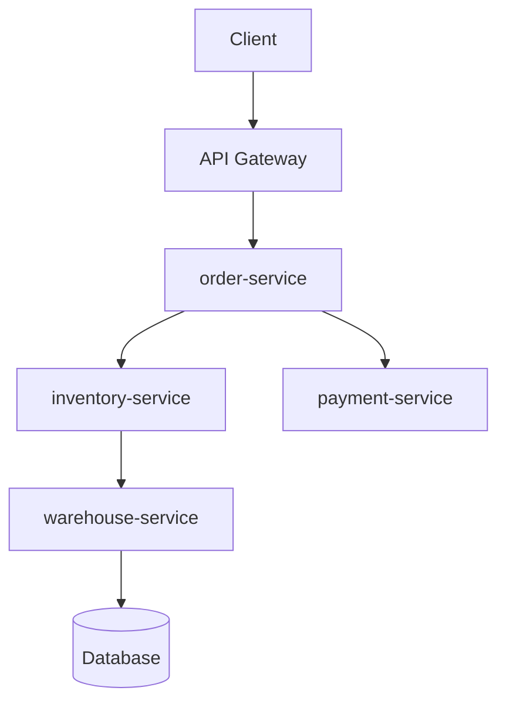
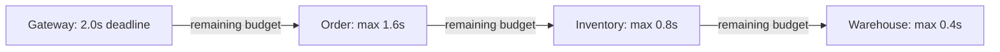

# Multi-Tier Call Chains and Strategies to Prevent Cascading Failures

## Objectives

In a microservice system, a request often traverses multiple tiers: API Gateway calls order-service, order-service calls inventory-service, and inventory-service queries a warehouse service or database. When one dependency slows down or loses availability, upstream tiers can hold threads, connections, memory, and queues waiting for results. If load keeps increasing, even healthy services run out of resources and the incident cascades across the entire system.

A Circuit Breaker is one part of a strategy against cascading failures. To protect the whole chain, place it at the right call boundary and combine it with timeouts/deadlines, Bulkheads, concurrency limits, budgeted retries, and controlled fallbacks.

After this lesson, you will be able to:

- Read a dependency graph and identify edges that can propagate incidents.
- Place a separate Circuit Breaker for each outbound dependency that needs isolation.
- Coordinate timeouts and deadlines across multiple tiers so requests finish within budget.
- Use Bulkheads and concurrency limits to prevent one dependency from exhausting resources.
- Avoid retry amplification and fallback chains when multiple tiers fail together.
- Design degraded responses and test cascading-failure prevention.

## How do cascading failures form?

Consider an order processing flow:



A request to order-service may need to call inventory and payment. Inventory in turn calls warehouse, which then queries the database. If the database slows down, warehouse holds connections and in-flight requests. Inventory waits on warehouse; order-service waits on inventory; Gateway continues holding the client request. As request volume grows, upstream tiers can exhaust threads, connection pools, or concurrency limits.

Several mechanisms amplify incidents:

- **Accumulated wait times:** each tier sets an independent timeout without accounting for remaining request time. Total wait time can far exceed the deadline accepted by the client.
- **Growing queues:** slow requests occupy workers, connections, and concurrent slots; new requests wait longer, pushing latency up further.
- **Fan-out:** one request calls multiple dependencies in parallel or sequentially. Even a single slow branch can hold the overall request; multiple failing branches rapidly increase in-flight tasks.
- **Nested retries:** each tier retries independently, causing one logical request to generate many physical requests to the deepest dependency.
- **Fallbacks calling dependencies:** the fallback path still depends on a failing service or passes through an overloaded tier, generating extra work.

Cascading failures often start from a slow dependency and later manifest as resource exhaustion in callers. Looking only at HTTP 5xx rates at the final tier can miss the initial cause: latency, pool exhaustion, or saturated queues.

## Protecting each edge in the dependency graph

A Circuit Breaker should be placed on the caller side, around outbound calls to a dependency with a clear failure boundary. Example:

| Caller | Protected dependency | Where is the Circuit Breaker placed? | Scope to observe |
|---|---|---|---|
| Gateway | order-service | Route filter or gateway client calling order-service. | Errors/latency observed by Gateway from order-service. |
| order-service | inventory-service | Outbound gateway/client of order-service. | Inventory errors/latency as seen by order-service. |
| order-service | payment-service | Separate outbound gateway/client for payment. | Payment errors/latency as seen by order-service. |
| inventory-service | warehouse-service | Outbound client of inventory. | Warehouse errors/latency as seen by inventory. |
| warehouse-service | database | Circuit Breaker if library and dependency type fit; also use pools, timeouts, and query limits. | Database availability as seen by warehouse. |

Each Circuit Breaker records the caller's perspective. The `inventory` Circuit Breaker in order-service is not a cluster-wide breaker and does not automatically change the Circuit Breaker state at the Gateway. Application instances also typically keep separate local Circuit Breaker states; different pods may transition to `OPEN` at different times.

Do not use a single Circuit Breaker for all outbound dependencies. If payment fails, a Circuit Breaker shared with inventory could open and block inventory functionality even while inventory is healthy. Use separate IDs per dependency or operation group sharing failure characteristics. Configuration profiles can be shared, while runtime state remains separate when dependencies are independent.

A Circuit Breaker protects the caller from initiating new calls when failure signals exceed thresholds. It does not automatically cancel in-flight requests, immediately release held connections, or stop a background job already submitted to the dependency. Therefore, it must be paired with timeouts and concurrency controls.

## Every tier needs a timeout aligned with the overall deadline

Setting independent timeouts at each tier without a shared deadline can cause wait times to add up. For example, Gateway waits up to 3 seconds for order-service; order-service waits 3 seconds for inventory; inventory waits 3 seconds for warehouse. One request can spend nearly 9 seconds across tiers even though the client closes its connection after 3 seconds.

Instead, define an overall deadline and allocate time budgets along the path:



The numbers above are illustrative only. Every tier must leave room for internal processing, response serialization, and network transmission back to the caller. A useful rule is that an outbound call's deadline must be shorter than the current request's remaining deadline. Never set a downstream timeout equal to or longer than what the upstream tier can still wait.

If the system supports deadline propagation, pass the expiration timestamp or remaining time across service boundaries. Receiving tiers recompute remaining budget using a local monotonic clock and do not start new work if the deadline has expired. If using custom headers, standardize format, units, cap rules, and invalid-header handling; never trust arbitrary client-sent values without validation.

Timeouts can be placed at several layers with distinct roles:

- **HTTP client connect timeout:** bounds connection establishment time.
- **Response/read timeout:** bounds time waiting for a response or data.
- **TimeLimiter:** bounds operation wait duration within integration capabilities.
- **Request deadline:** bounds total elapsed time from receiving the request to completion.

Canceling a future or reactive subscription does not guarantee the remote server stops processing immediately. Verify HTTP client cancellation behavior and always keep I/O-level timeouts so connections, sockets, and workers are released.

## Bulkheads and concurrency limits per dependency

Timeouts bound how long a call can wait; Bulkheads limit how many calls can occupy resources simultaneously. If one dependency slows down, a Bulkhead isolates it so other dependencies retain capacity.

Example order-service calling two dependencies:

| Dependency | Illustrative concurrency limit | Reason |
|---|---:|---|
| inventory-service | 30 | Inventory reads have high traffic and can degrade using cached data. |
| payment-service | 10 | Transactions require tight control over concurrent requests. |

Do not share one unbounded pool or semaphore across all outbound calls. When payment hangs, it must not consume all workers or connections meant for inventory. Base limits on both caller and dependency capacity, not merely projected request volume.

With Resilience4j, you can use a semaphore Bulkhead to limit concurrent calls or ThreadPoolBulkhead for thread-pool isolation. In reactive applications, prefer non-blocking clients and appropriate concurrency-limiting mechanisms; never offload blocking calls onto the event loop. Bulkhead queues should have small bounds or zero waiting if requests have tight deadlines. Unbounded queues simply convert overload into rising latency and memory usage.

When a Bulkhead runs out of slots, new requests should fail fast or wait only within defined bounds. Classify these rejection errors separately from dependency health errors. For instance, `BulkheadFullException` indicates the caller exhausted local capacity; it does not necessarily prove the upstream is failing. You can exclude this exception from the Circuit Breaker's failure rate if the measurement goal is upstream health.

## Nested retries can multiply request volume

Suppose a chain has three tiers calling one another: Gateway calls order, order calls inventory, inventory calls warehouse. If each tier allows up to three attempts per request, one logical request at the Gateway can generate up to:

\[
3 \times 3 \times 3 = 27
\]

requests to warehouse when every tier exhausts its retries. If each tier also retries errors already retried by the tier below, traffic can surge sharply right when the system is weakest.

To avoid retry amplification:

- Choose a single tier to own retries for a given error class, usually the tier that best understands idempotency and the operation's deadline.
- Limit total attempts and enforce a per-dependency retry budget, not only per-request limits.
- Use exponential backoff and jitter to spread out retry timing.
- Do not retry business errors, validation errors, or `CallNotPermittedException` when the Circuit Breaker is `OPEN`.
- Do not hold a Bulkhead permit while waiting during backoff.
- Do not start a new attempt if remaining deadline budget is insufficient.

If retries are required at multiple tiers because operations have independent semantics, calculate the maximum total requests and end-to-end time budget. Never assume `maxAttempts: 3` across three tiers produces only three calls in total.

## Placing the Circuit Breaker around the right operation

Example order-service calling inventory with a reactive Circuit Breaker factory:

```java
import org.springframework.cloud.client.circuitbreaker.ReactiveCircuitBreaker;
import org.springframework.cloud.client.circuitbreaker.ReactiveCircuitBreakerFactory;
import org.springframework.stereotype.Service;
import org.springframework.web.reactive.function.client.WebClient;
import reactor.core.publisher.Mono;

@Service
public class InventoryGateway {
    private final WebClient webClient;
    private final ReactiveCircuitBreaker inventoryBreaker;

    public InventoryGateway(
            WebClient webClient,
            ReactiveCircuitBreakerFactory<?, ?> factory) {
        this.webClient = webClient;
        this.inventoryBreaker = factory.create("inventory-from-order");
    }

    public Mono<StockView> getStock(String sku) {
        Mono<StockView> request = webClient.get()
                .uri("/stock/{sku}", sku)
                .retrieve()
                .bodyToMono(StockView.class);

        return Mono.from(inventoryBreaker.run(
                request,
                error -> Mono.error(new InventoryUnavailableException(sku, error))));
    }
}
```

Types `StockView` and `InventoryUnavailableException` are application types. The example propagates the error to the order tier so that tier can decide whether to use cache, return partial results, or report unavailability. If the gateway itself should fall back to cached values, replace `Mono.error(...)` with a cache-reading publisher and mark the result as degraded data.

The key point is that the entire outbound call sits inside the protected publisher. With cold reactive sources like `WebClient`, the request only executes upon subscription. Never subscribe inside the gateway and then return a publisher to the caller, as that can issue duplicate requests and record unintended samples.

For synchronous applications, use `CircuitBreakerFactory` to wrap the HTTP client supplier. Whether using synchronous or reactive APIs, instance names should represent the dependency from the caller's perspective, such as `inventory-from-order`; do not use one shared ID for all downstream services.

## Configuring each dependency independently

Example order-service using separate Circuit Breakers for inventory and payment:

```yaml
resilience4j:
  circuitbreaker:
    instances:
      inventory-from-order:
        slidingWindowType: COUNT_BASED
        slidingWindowSize: 20
        minimumNumberOfCalls: 10
        failureRateThreshold: 50
        slowCallRateThreshold: 60
        slowCallDurationThreshold: 500ms
        waitDurationInOpenState: 8s
        permittedNumberOfCallsInHalfOpenState: 3
      payment-from-order:
        slidingWindowType: COUNT_BASED
        slidingWindowSize: 10
        minimumNumberOfCalls: 5
        failureRateThreshold: 40
        slowCallRateThreshold: 50
        slowCallDurationThreshold: 300ms
        waitDurationInOpenState: 12s
        permittedNumberOfCallsInHalfOpenState: 2
  timelimiter:
    instances:
      inventory-from-order:
        timeoutDuration: 700ms
      payment-from-order:
        timeoutDuration: 500ms
  bulkhead:
    instances:
      inventory-from-order:
        maxConcurrentCalls: 30
        maxWaitDuration: 0
      payment-from-order:
        maxConcurrentCalls: 10
        maxWaitDuration: 0
```

These are illustrative values, not default production settings. `slidingWindowSize` and `minimumNumberOfCalls` govern failure evaluation in `CLOSED`; `waitDurationInOpenState` and `permittedNumberOfCallsInHalfOpenState` control recovery. TimeLimiter bounds wait time at the integration layer, while the HTTP client still needs connect/response timeouts. Bulkhead bounds concurrency separately per dependency.

When integrating through Spring Cloud CircuitBreaker, verify the exact starter and instance configuration mechanism for your release train. When combining multiple decorators such as Circuit Breaker, TimeLimiter, and Bulkhead, determine the execution order and test request counts, permit hold times, and recorded exceptions. Timeouts or Bulkhead rejections should not be miscounted as upstream failures if the statistical goal is measuring dependency health.

## Falling back at the right boundary

A fallback must answer: can the current tier still serve part of the request without calling the failing dependency again?

Examples:

- **Catalog:** can return cached data if staleness is acceptable and the response clearly indicates `stale` or `cachedAt`.
- **Inventory:** if current stock is unknown, return `UNKNOWN` or unavailable status. Never assume stock quantity is 0 or unlimited if doing so alters sales decisions.
- **Payment:** never return false success on timeout. The transaction may already have been processed upstream; an idempotency key and status-query endpoint are required.
- **Search/recommendation:** can drop an optional branch or return partial results if the API contract permits.

Fallbacks should terminate at the tier that has enough business context to choose the response. Avoid fallback chains where order calls an inventory fallback, which calls warehouse, which then calls a failing database. If a fallback requires a secondary dependency, that dependency must have its own timeout, Bulkhead, and resource limits.

Not every fallback should return HTTP 200. Cached data may return 200 with degradation metadata if the contract allows. When no reliable result can be provided, return a structured temporary error such as 503. What matters is that callers can distinguish complete data, degraded data, and undetermined state.

## Fan-out and partial processing

A tier may call multiple dependencies in parallel. For instance, an order detail page calls inventory, payment status, and recommendations. If an optional branch is slow, you do not always need to hold the entire response waiting for that branch.

Safe fan-out strategy:

- Set per-branch deadlines derived from the overall deadline.
- Limit the number of concurrent branches and requests per dependency.
- Protect each branch with its own Circuit Breaker.
- Identify mandatory branches versus optional branches before implementing fallbacks.
- Return partial responses when the API contract permits; mark missing or degraded fields.
- Cancel branches that are no longer needed once the caller has sufficient data or the deadline expires, and verify actual I/O cancellation.

Do not let a slow optional branch hold all request resources if the product allows partial responses. Conversely, never ignore failures on mandatory branches just to preserve HTTP 200; responses must accurately reflect data completeness.

## Load shedding and queue limits

When the system approaches overload, rejecting a fraction of requests early can keep remaining requests completing cleanly. Enforcement points include:

- Concurrency limits at ingress/Gateway and each outbound dependency.
- Bounded queue lengths and slot wait durations.
- Rate limits or quotas per caller/tenant if needed.
- Prioritizing critical requests and shedding non-essential background work when capacity runs low.
- Using Circuit Breakers to fail fast on dependencies whose error rate or latency exceeds thresholds.

Circuit Breakers and load shedding differ. A Circuit Breaker reacts to call outcomes against a dependency; load shedding reacts to the capacity of the receiving system itself. A service may need load shedding even when all dependencies are healthy, such as when CPU or worker pools near saturation.

## Monitoring failures by tier and by edge

To pinpoint where an incident started, dashboards must separate latency and errors on each caller → dependency edge. Useful metrics include:

- Request rate, success/error rate, and p50/p95/p99 latency by route or dependency.
- In-flight requests, queue depth, pool usage, and Bulkhead rejection counts.
- Circuit Breaker state, failure rate, slow-call rate, buffered calls, and not-permitted calls.
- Timeout counts per tier and remaining deadline when starting outbound calls.
- Attempt/retry counts, consumed retry budget, and retry success rate.
- Fallback counts, cache hit ratio during degradation, data age, and partial-response rate.
- Distributed traces linking spans across Gateway and services with consistent route/dependency names.

If Gateway sees order-service as slow, order-service records inventory as slow, and inventory records warehouse timeouts, traces can pinpoint the first bottleneck. With only application-wide aggregate metrics, it is hard to distinguish upstream failure from local caller resource exhaustion.

Resilience4j Circuit Breaker metrics can be exported via Micrometer when the appropriate binder is enabled. Metric names and tags depend on version and registry. Avoid putting user IDs, order IDs, or dynamic request values into Circuit Breaker names or high-cardinality metric tags.

## Practicing cascading failure verification

Run experiments in a test environment with services where latency and errors can be controlled:

1. Start Gateway, order-service, inventory-service, payment-service, and warehouse-service. Send normal requests and record baseline latency on each edge.
2. Make warehouse-service slower than the timeout. Confirm inventory times out and its dedicated warehouse Circuit Breaker records failures; observe the impact on inventory calls from order.
3. Inject enough errors for order's inventory Circuit Breaker to transition to `OPEN`. Confirm order fails fast or returns contract-compliant fallbacks without continuing to send requests to inventory.
4. Keep payment healthy and confirm the payment Circuit Breaker stays `CLOSED`, with payment requests unblocked by inventory failures.
5. Increase concurrency to hit inventory's Bulkhead limit. Confirm payment calls retain dedicated capacity and excess requests are rejected quickly.
6. Enable retries at each tier in the test environment and count requests reaching warehouse. Compare request counts when only one tier retries versus when three tiers each allow three attempts.
7. Set a deadline shorter than the sum of timeouts plus backoff. Confirm downstream tiers do not begin new attempts after the deadline expires.
8. Recover warehouse and observe `HALF_OPEN` probes. Confirm the Circuit Breaker only closes again when probe outcomes meet thresholds.
9. Inspect traces, metrics, queues, pool usage, and fallbacks to confirm the incident stays contained to the failing dependency.

Record logical requests, physical requests per dependency, Circuit Breaker states, Bulkhead rejections, and completion times. Do not generate test load beyond what the test environment can safely handle.

## Common mistakes

- **Placing a Circuit Breaker only at the Gateway:** internal services can still keep calling slow dependencies and exhaust their own resources.
- **Using one Circuit Breaker for all downstream services:** failure in one dependency can block healthy dependencies.
- **Assuming a Circuit Breaker is a cluster-wide switch:** state is normally local per caller instance; it does not auto-sync across pods.
- **Omitting I/O-layer timeouts:** in-flight requests can keep holding connections after the caller has timed out.
- **Setting independent timeouts without a deadline:** wait times accumulate across tiers and breach client SLAs.
- **Retrying at every tier:** physical request volume can grow as the product of each tier's attempts.
- **Holding Bulkhead permits during backoff:** slots remain occupied even while no request is actively executing.
- **Using unbounded queues:** overload turns into latency spikes and memory pressure.
- **Fallbacks calling the failing dependency again:** creates fallback loops and adds load to an already weakened system.
- **Returning false success:** hides undetermined state, especially dangerous for payment and inventory.
- **Failing to separate Bulkhead rejections from upstream errors:** distorts failure rates and opening decisions.
- **Monitoring only 5xx:** misses latency, pool exhaustion, queue depth, and rejected requests.

A multi-tier system resists cascading failures well when each caller controls its own outbound calls, the entire chain shares a finite deadline, resources are isolated per dependency, and retries/fallbacks do not generate unbounded load. Circuit Breakers help each tier stop calling degrading dependencies; timeouts, Bulkheads, load shedding, and cross-tier observability keep the rest of the system serving within predictable limits.
