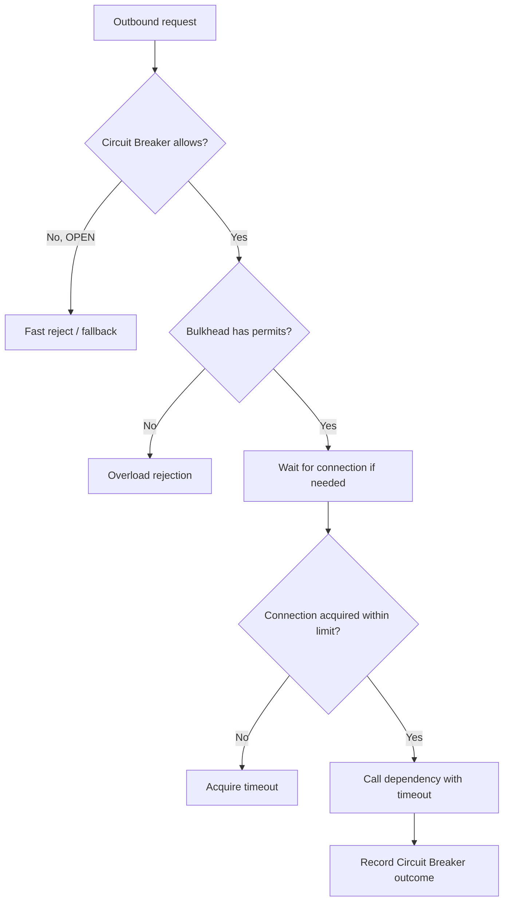

# Thread Pools, Queues, and Connection Pools When Dependencies Are Slow

## Objectives

When a dependent service responds slowly, caller requests must wait longer and hold resources throughout the wait. In synchronous applications, threads can be tied up; in reactive applications, connections and pending tasks still consume resources even though the event loop is not blocked. If thread pools, queues, or connection pools lack appropriate limits, latency in one dependency can degrade the entire application.

In a Spring Cloud Circuit Breaker system, a Circuit Breaker stops sending new calls when a dependency shows signs of failure. To protect performance, you must understand thread pools, queues, and connection pools, and configure proper concurrency limits, timeouts, and rejection policies.

After this lesson, you will be able to:

- Distinguish between thread pools, queues, and connection pools on the caller side.
- Estimate concurrency and resource demand using Little's Law.
- Choose bounded queues, slot-wait timeouts, and overload rejection behavior.
- Configure a semaphore Bulkhead or `ThreadPoolBulkhead` for suitable workloads.
- Configure connection pools for `WebClient`/Reactor Netty and recognize that JDBC pools are a separate resource.
- Coordinate Circuit Breaker, `TimeLimiter`, Bulkhead, and connection pools without masking bottlenecks.
- Monitor saturation, queue wait, connection acquisition, and rejected requests.

## Three Distinct Resource Types

Thread pools, queues, and connection pools often appear together, but they manage different things:

| Resource | What It Manages | When It Is Held | Overload Symptoms |
|---|---|---|---|
| Thread pool | Number of tasks that can run concurrently on worker threads. | While a synchronous task is executing or waiting on blocking I/O. | Active threads hit the cap, queues grow, tasks are rejected. |
| Queue | Tasks accepted but not yet assigned a worker or execution slot. | Whenever arrival rate temporarily exceeds processing rate. | Queue depth and queue wait rise; deadlines expire before tasks start. |
| Connection pool | Network or database connections that can be leased concurrently. | While a request uses a connection to send or receive data. | Active/leased connections hit the limit, pending acquires grow, acquire timeouts occur. |

A synchronous request can hold a thread while waiting for an HTTP connection and awaiting a response. A reactive request typically does not hold a dedicated thread during network waits, yet it can still hold a connection, a concurrency slot, and memory for active publishers. Reactive does not mean waiting on resources is free.

Connection pools also come in different types. An HTTP client pool reuses connections to remote services; a JDBC pool such as HikariCP manages connections to a database. Never add or tune these two pools as if they were the same resource.

## How a Slow Dependency Exhausts Resources

Suppose `order-service` receives 100 requests per second. Each request calls `inventory-service`, and inventory takes an average of two seconds to respond. The average number of pending inventory calls can be roughly 200.

Little's Law describes the relationship between throughput, time, and work in progress:

\[
L = \lambda \times W
\]

Where:

- `L` is the average number of requests/tasks inside the system.
- `lambda` is the average arrival rate, in requests per second.
- `W` is the average time a request spends in the system, in seconds.

In the example above:

\[
L = 100\;requests/s \times 2\;s = 200\;requests
\]

If the HTTP connection pool has only 40 connections, at most about 40 requests can use a connection simultaneously; the rest must wait to acquire a connection or be rejected. If a synchronous application has 50 worker threads and all of them are waiting on inventory, requests calling payment or handling internal work may also run out of threads.

Little's Law describes the average steady state of a stable system; it does not directly prescribe production pool sizes. As the dependency gets slower, `W` increases and in-progress requests rise accordingly. If the arrival rate remains higher than throughput, the system is no longer in steady state: queues keep growing until timeouts, memory limits, or rejection mechanisms intervene.

## Thread Pools and Queues Must Be Bounded

A thread pool caps how many blocking or offloaded tasks can execute concurrently. A queue holds tasks waiting for a worker. Increasing thread counts or queue sizes does not make a dependency process faster.

A large queue can make the system appear as if it is still accepting requests, while queued requests sit past their deadlines. By the time a worker finally processes the task, the caller may have already disconnected or no longer need the result. The work still burns CPU, connections, and memory while delivering no value to the user.

Example Tomcat server configuration:

```yaml
server:
  tomcat:
    threads:
      max: 160
      min-spare: 10
    accept-count: 80
    max-connections: 4000
```

These properties tune Tomcat's inbound request acceptance: worker thread count, connection count, and the pending connection accept queue. They do not configure the outbound HTTP connection pool to `inventory-service`. Distinguish inbound server limits from outbound HTTP client limits.

When a queue is full, the system should fail fast or apply a defined load-shedding policy. Avoid unbounded queues. With a reactive event loop, do not use a policy like `CallerRuns` that runs blocking tasks directly on the submitting thread; doing so can block the event loop and stall unrelated requests.

## Estimating Concurrency and Pool Size

You can use Little's Law to estimate the concurrency needed at a given load and target latency:

\[
Concurrency_{avg} \approx ArrivalRate \times ServiceTime
\]

For example, a dependency handles 60 requests per second with an average duration of 250 ms:

\[
60 \times 0.25 = 15\;concurrent\ calls
\]

The number 15 is the average concurrency under steady-state assumptions. When sizing, also account for peak traffic, p95/p99 latency, bursts, connection setup time, dependency limits, and headroom. Sizing a pool strictly to the average means traffic spikes or latency jitter will quickly saturate the pool.

A practical sizing workflow:

1. Measure the per-dependency arrival rate, not only total inbound requests.
2. Measure mean latency and p95/p99 percentiles when the dependency is healthy and under rising load.
3. Estimate average concurrency, then load test at expected peak load.
4. Choose Bulkhead and connection pool limits so the caller stays within the agreed capacity of the dependency.
5. Keep queues intentionally small and bound queue/acquire wait times.
6. Check CPU, memory, thread count, file descriptors, connections, and throughput during the test.
7. Scale calculations by instance/pod count; the cluster-wide pool total can be much larger than a single pod's pool.

For example, 10 pods each configured with 50 HTTP connections to the same dependency can open up to 500 connections from the cluster. If the dependency can only handle 120 connections, sizing each pod independently can overwhelm upstream even though no single pod exceeds its local cap. Divide the capacity budget across replicas and leave headroom for other clients.

## Bulkheads Limit Concurrent Tasks

Resilience4j provides two common Bulkhead types:

- **Semaphore Bulkhead:** caps concurrent calls using permits. It creates no separate thread pool; calls run on the caller's thread.
- **ThreadPoolBulkhead:** uses a dedicated thread pool and queue to isolate tasks. Suitable for certain blocking workloads or when a separate executor is required; calls execute through the bulkhead's asynchronous mechanism.

Example Semaphore Bulkhead:

```yaml
resilience4j:
  bulkhead:
    instances:
      inventory:
        maxConcurrentCalls: 24
        maxWaitDuration: 0
```

At most 24 calls can hold a permit simultaneously. `maxWaitDuration: 0` instructs it not to wait when permits are exhausted; new calls fail fast. This is a concurrency cap, not a worker thread count.

Example ThreadPoolBulkhead:

```yaml
resilience4j:
  thread-pool-bulkhead:
    instances:
      legacy-catalog:
        coreThreadPoolSize: 4
        maxThreadPoolSize: 8
        queueCapacity: 16
        keepAliveDuration: 20ms
```

Under this illustrative configuration, `ThreadPoolBulkhead` has at most eight worker threads and a queue of at most 16 tasks. When both the pool and queue are full, new tasks are rejected. Do not increase `queueCapacity` to hide a slow dependency; the queue should remain small enough that tasks do not wait past the request deadline.

Choose a model that fits the workload. Semaphore Bulkhead generally suits non-blocking calls or cases where you want to cap concurrency directly on the caller thread. `ThreadPoolBulkhead` can isolate a blocking library, but you must account for context switching, queueing, thread stacks, and context propagation. In reactive pipelines, avoid pushing blocking work onto the event loop; use a dedicated executor or an appropriate scheduler mechanism.

## Ordering of Bulkhead, Circuit Breaker, and Queue

The goal is to reject early when the dependency is `OPEN` or capacity is exhausted, avoiding unnecessary queueing.

An outbound request can pass through these stages:



This is a logical ordering for reasoning about limits, not a guarantee of the default decorator order in every integration. With Spring Cloud CircuitBreaker and Resilience4j, the actual execution order among Circuit Breaker, `TimeLimiter`, and Bulkhead depends on how the factory/customizer and decorators are configured. Verify your concrete configuration and test when combining multiple decorators.

Key guidelines:

- Check the Circuit Breaker before placing a task onto a long queue, if the integration allows controlling order.
- Hold a Bulkhead permit only while the task is actively executing; do not hold permits during retry backoff sleeps.
- Bound connection wait times using a pending-acquire timeout or connection-request timeout.
- Set a response timeout and an overall deadline so in-flight calls cannot hold connections indefinitely.
- Distinguish Bulkhead rejections and connection-pool exhaustion from upstream health failures. If the Circuit Breaker is meant to measure upstream health, do not automatically count every local capacity error as an upstream failure.

A Circuit Breaker does not release a connection already held by a hung request. `TimeLimiter` can stop the caller from waiting, but cancelling a future does not necessarily stop underlying I/O. The HTTP client needs proper timeouts and cancellation support so the connection is eventually returned to the pool.

## HTTP Connection Pools with WebClient and Reactor Netty

`WebClient` typically uses Reactor Netty in WebFlux applications. `ConnectionProvider` manages the connection pool, maximum connections, and pending requests waiting to lease a connection.

Example creating a bounded pool:

```java
import java.time.Duration;

import reactor.netty.http.client.HttpClient;
import reactor.netty.resources.ConnectionProvider;
import org.springframework.context.annotation.Bean;
import org.springframework.context.annotation.Configuration;
import org.springframework.http.client.reactive.ReactorClientHttpConnector;
import org.springframework.web.reactive.function.client.WebClient;

@Configuration
public class CatalogWebClientConfiguration {
    @Bean
    WebClient catalogWebClient() {
        ConnectionProvider provider = ConnectionProvider.builder("catalog-pool")
                .maxConnections(40)
                .pendingAcquireMaxCount(80)
                .pendingAcquireTimeout(Duration.ofMillis(200))
                .maxIdleTime(Duration.ofSeconds(20))
                .maxLifeTime(Duration.ofMinutes(5))
                .evictInBackground(Duration.ofSeconds(30))
                .build();

        HttpClient httpClient = HttpClient.create(provider)
                .responseTimeout(Duration.ofMillis(700));

        return WebClient.builder()
                .baseUrl("http://catalog-service")
                .clientConnector(new ReactorClientHttpConnector(httpClient))
                .build();
    }
}
```

Meaning of the limits:

- `maxConnections(40)`: up to 40 connections in the pool per provider configuration.
- `pendingAcquireMaxCount(80)`: caps the number of requests waiting to borrow a connection.
- `pendingAcquireTimeout(200 ms)`: caps how long a request waits to be granted a connection.
- `maxIdleTime` and `maxLifeTime`: evict connections that have been idle too long or exceeded their lifetime.
- `responseTimeout(700 ms)`: bounds how long the HTTP client waits for a response per Reactor Netty semantics.

These numbers are examples only. If `pendingAcquireMaxCount` is too high, the connection wait queue can hold requests whose deadlines have already expired. If it is too low, brief bursts may be rejected prematurely. Size both `maxConnections` and the pending queue based on upstream capacity, pod count, and caller deadlines.

A connection pool is a shared client resource. When requests hold connections longer because upstream is slow, available connections shrink. When the pool is full, new requests wait to acquire; when the pending queue fills or the acquire timeout expires, the client raises an error. Configure the Circuit Breaker to recognize appropriate timeouts/errors without misclassifying every configuration or local error as an upstream failure.

In practice, create and reuse `WebClient`/`ConnectionProvider` beans per dependency or per dependency group with similar characteristics. Never create a new pool per request, as that defeats pooling and increases socket usage.

## JDBC Connection Pools Are a Separate Limit

If `warehouse-service` queries a database, a JDBC pool such as HikariCP manages the database connections. A slow query can hold a connection for a long time and force other requests to wait for a connection.

Example configuration:

```yaml
spring:
  datasource:
    hikari:
      maximum-pool-size: 20
      minimum-idle: 5
      connection-timeout: 1000
      validation-timeout: 500
      max-lifetime: 1800000
```

`maximum-pool-size` caps the pool's total connections; `connection-timeout` caps how long a caller waits to borrow a connection from the pool, in milliseconds. It is not a query timeout. Configure statement/query timeouts at the JDBC or ORM layer in line with the application deadline. Also verify that total connections across all pods do not exceed the database's limit.

Do not increase `maximum-pool-size` just because requests are waiting for connections. If the database is already saturated on CPU, I/O, or locks, enlarging the pool allows even more concurrent queries and slows the database down further. Measure query latency, active connections, pending threads, and database capacity before making changes.

## Blocking and Reactive Models Require Different Management

In a servlet application using `RestTemplate` or a blocking HTTP client, each call waiting for a response typically holds a worker thread. If the thread pool has 100 workers and 100 calls are all waiting on one dependency, new requests may find no free workers left.

In a WebFlux application using `WebClient`, I/O is non-blocking and the event loop can serve many connections without dedicating a thread per waiting request. Even so:

- The connection pool is still finite.
- The pending acquire queue can still grow.
- Publishers, buffers, and contexts still consume memory.
- CPU-bound or blocking code on the event loop can stall many requests at once.
- Concurrency limits are still needed to avoid flooding the dependency.

Do not call `block()`, `Thread.sleep()`, or blocking JDBC directly on the event loop. If you must invoke a blocking library, offload it to a bounded dedicated scheduler/executor with timeouts and queue control. Do not treat `boundedElastic` as an infinite dumping queue to push every problem off the event loop; you still need to bound concurrent tasks and monitor saturation.

## Coordinating with Retry and Deadlines

Retry generates extra attempts and can keep requests in the system longer. When a dependency is slow, retries without backoff and deadlines can quickly saturate queues, threads, and connection pools.

For example, if each attempt has a 700 ms timeout, with three attempts and backoffs of 100 ms then 200 ms, total elapsed time can approach:

\[
3 \times 700 + 100 + 200 = 2,400\;ms
\]

This figure does not yet include time spent waiting in queues or acquiring connections. If a request has only 900 ms remaining in its deadline, do not start this three-attempt chain. Factor queue wait, acquisition, execution, and backoff into the overall deadline.

Coordination principles:

- Retry only transient errors and operations safe to repeat.
- Use exponential backoff with jitter; do not hold Bulkhead permits while waiting.
- Cap attempt counts and per-dependency retry budgets.
- Do not retry `CallNotPermittedException` when the Circuit Breaker is `OPEN`.
- Do not keep retrying when the actual error is a full Bulkhead or exhausted connection pool; that usually signals the caller is out of capacity.
- Skip starting a new attempt if remaining time is insufficient for queueing/acquisition and response handling.

When the Circuit Breaker transitions to `OPEN`, new calls should be rejected before entering queues or acquiring connections if the integration order allows. When `HALF_OPEN`, permitted probes should also match the connection pool and upstream recovery capacity; avoid letting many pods simultaneously launch a probe wave larger than actual capacity.

## Observing Pools and Queues

You cannot tune pools effectively by looking only at CPU or HTTP 5xx rates. Track both active work and wait times:

| Group | Metrics to Track | Signals to Investigate |
|---|---|---|
| Thread pool | Active threads, pool size, completed tasks, rejected tasks. | Active threads stay at max, task completion drops, rejections rise. |
| Queue | Queue depth, queue capacity, queue wait time, oldest task age. | Queue grows steadily or tasks start after their deadlines. |
| HTTP connection pool | Active/idle connections, pending acquires, acquire latency, acquire timeouts. | Active connections hit max, pending count rises, acquire timeouts appear. |
| JDBC pool | Active/idle/pending connections, connection usage time, acquisition timeout. | Pool is exhausted or queries hold connections too long. |
| Circuit Breaker | State, failure rate, slow-call rate, not-permitted calls. | Frequent `OPEN` state or high rejection counts. |
| Bulkhead | Available permits, concurrent calls, rejected calls. | Permits stay depleted or rejections climb. |

Micrometer can export metrics from Resilience4j and from pools/clients that provide corresponding binders. Metric names and tags depend on versions, libraries, and configuration. Inspect your application's actual metrics before building dashboards. With Reactor Netty, enable appropriate pool metrics and keep pool names stable so you can filter by dependency.

Logs and traces should distinguish:

- Time spent waiting in queues or acquiring a connection.
- Connection time and upstream response time.
- Actual execution time.
- Errors caused by Circuit Breaker, Bulkhead, acquire timeout, or upstream.
- Remaining deadline when the request begins the outbound call.

If response timeouts climb while connection acquisition remains fast, the bottleneck is likely upstream. If pending acquires climb before response timeouts do, the pool may be the caller-side bottleneck. If active threads climb while the connection pool is not full, check for blocking code or locks at the application layer.

## Workflow for Investigating a Slow Dependency

When a dependency starts responding slowly, proceed in order:

1. Confirm p95/p99 latency and error rate for the dependency, comparing against normal baselines.
2. Check the Circuit Breaker state and permitted call rate; determine whether new requests are still reaching upstream.
3. Check Bulkhead permits, active tasks, and rejected tasks to see if the caller is out of concurrency.
4. Inspect the HTTP connection pool or JDBC pool: active, idle, pending acquires, and acquire timeouts.
5. Inspect thread pools and queues: active threads, queue depth, wait times, and expired tasks.
6. Compare pod count and aggregate connections/concurrency against upstream capacity.
7. Check timeouts/deadlines, retries, and backoff to catch work continuing after the caller gave up on the request.
8. Shed load or reject early if queues keep growing; never enlarge pools across the board before identifying the bottleneck.
9. Restore the dependency and verify that `HALF_OPEN` probes, connection acquires, and queue depth return to normal.

## Verification Exercise

Run this in a test environment with a catalog endpoint capable of injecting latency:

1. Configure an HTTP connection pool with at most 20 connections, max 10 pending acquires, and a 200 ms acquire timeout.
2. Configure a Bulkhead for at most 16 concurrent calls with zero wait when permits are exhausted.
3. Send normal load and record active/idle connections, pending acquires, active calls, and latency.
4. Make catalog take more than one second while the caller sends heavy traffic. Observe how the connection pool and Bulkhead reach their limits.
5. Verify that calls exceeding concurrency are rejected or hit acquire timeout according to limits, and queues do not grow without bound.
6. Trigger enough errors for the Circuit Breaker to transition to `OPEN`. Send additional requests and confirm calls are rejected before adding further load upstream.
7. Compare a small-queue configuration against a large-queue configuration. Record queue wait, rate of deadline-expired requests, and useful completed requests.
8. Restore the dependency, observe `HALF_OPEN`, and confirm probe volume stays within the configured capacity.
9. If the application also uses a JDBC pool, run a slow test query and observe the database pool separately; do not confuse JDBC metrics with HTTP connection pool metrics.

Record throughput, p95/p99 latency, active in-flight requests, queue depth, connection acquire timeouts, Bulkhead rejections, and Circuit Breaker state. Do not generate load beyond what the test environment can safely handle.

## Common Mistakes

- **Increasing the thread pool when a dependency is slow:** more threads may only create more waiting requests and increase context switching.
- **Using unbounded queues:** holds expired requests, increases memory usage, and prolongs recovery.
- **Confusing server thread pools with outbound connection pools:** one serves inbound requests, the other manages connections to dependencies.
- **Confusing HTTP pools with JDBC pools:** the two connection types have separate capacities and metrics.
- **Creating a `WebClient` or `ConnectionProvider` per request:** defeats pooling, increases socket count, and complicates lifecycle management.
- **Setting only `TimeLimiter`:** the caller may stop waiting while underlying I/O continues running and holding the connection.
- **Sizing Bulkhead larger than upstream capacity:** the caller can send more requests than the target service can sustain.
- **Oversizing the pending acquire queue:** requests waiting for a connection can expire before even starting.
- **Retrying when pools are already exhausted:** generates extra attempts and worsens overload.
- **Running blocking code on the event loop:** a single task can stall many unrelated reactive requests.
- **Calculating capacity per pod while ignoring cluster total:** aggregate connections across replicas can exceed dependency limits.
- **Looking only at CPU:** pools or queues can saturate while CPU stays low because tasks are blocked waiting on I/O.

Thread pools bound running tasks, queues hold waiting tasks, and connection pools bound active connections. When a dependency slows down, measure all three resource types, enforce deliberate limits, and reject requests early once capacity is exhausted. Circuit Breaker blocks new calls to unhealthy dependencies; Bulkheads, timeouts, bounded queues, and properly sized connection pools keep the rest of the application operational.
