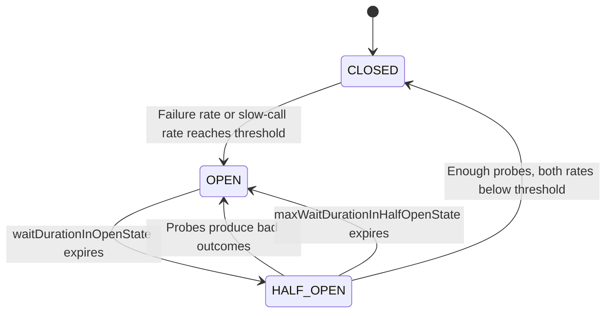

# HALF_OPEN Held Too Long Because Calls Do Not Complete

In Spring Cloud Circuit Breaker using Resilience4j, the `HALF_OPEN` state is the phase that tests whether a dependency has recovered. The circuit breaker grants permission for a limited number of probe calls to reach the dependency. Once enough outcomes arrive, the breaker evaluates the failure rate and slow-call rate to transition back to `CLOSED` or return to `OPEN`.

A common issue is the breaker entering `HALF_OPEN` and staying in that state longer than expected. Possible causes include hanging probes, missing client timeouts, reactive publishers not emitting a terminal signal, or insufficient requests to complete the required number of probes. Left unaddressed, the application may keep rejecting requests or hold onto resources from in-flight calls.

A crucial distinction is that `maxWaitDurationInHalfOpenState` limits how long the breaker may remain in `HALF_OPEN`; it is not a per-HTTP-request timeout and does not automatically guarantee cancellation of running calls. For probes to terminate, timeouts must be configured at the proper execution layer.

## Mechanism for Completing HALF_OPEN

Once `waitDurationInOpenState` expires, the breaker can transition from `OPEN` to `HALF_OPEN`. If `automaticTransitionFromOpenToHalfOpenEnabled` is enabled, Resilience4j transitions the state automatically when the wait period ends. If not enabled, the next call after the wait period triggers the transition.

In `HALF_OPEN`, `permittedNumberOfCallsInHalfOpenState` specifies how many calls are permitted as probes. Permitted calls must produce outcomes for the breaker to aggregate and decide:

- If both failure rate **and** slow-call rate are below thresholds, the breaker transitions back to `CLOSED`.
- If either failure rate **or** slow-call rate reaches its threshold, the breaker transitions back to `OPEN`.
- If probes have not completed or not enough outcomes are available yet, the breaker cannot make a sample-based decision.

`maxWaitDurationInHalfOpenState` governs this last case. The default value `0` means the breaker waits indefinitely until the permitted calls finish. Setting a duration greater than `0` makes the breaker return to `OPEN` when the HALF_OPEN deadline expires and the trial has still not completed.



For example, `permittedNumberOfCallsInHalfOpenState=3` means the breaker allows up to three probes. If two probes finish while the third hangs, the breaker may not yet have enough samples to evaluate. With `maxWaitDurationInHalfOpenState=0`, the state can wait indefinitely. Setting a finite limit makes the breaker return to `OPEN` after the specified duration, though the hanging probe may still occupy a thread, connection, or other resource if the calling layer lacks proper timeouts and cancellation.

## Distinguish Between Different Durations

Several configurations have similar names yet solve different problems:

| Configuration | What It Limits | When the Duration Expires |
|---|---|---|
| `waitDurationInOpenState` | Time the breaker stays in `OPEN` before allowing recovery attempts | Breaker can transition to `HALF_OPEN` |
| `maxWaitDurationInHalfOpenState` | Maximum time the breaker stays in `HALF_OPEN` waiting for probes to complete | Breaker transitions back to `OPEN` if trial is incomplete |
| HTTP connect timeout | Time to establish a connection to the dependency | Client terminates the failed connection attempt |
| HTTP response/read timeout | Time waiting for a response or data from the dependency | Client terminates the call with a timeout exception |
| Reactor `timeout(Duration)` | Time waiting for a signal from a reactive publisher | Publisher emits `TimeoutException` and cancels the upstream subscription |
| Resilience4j `TimeLimiter` | Time waiting for an async task supported by the integration | Future/CompletionStage times out; cancellation depends on config and task capability |

Do not increase `maxWaitDurationInHalfOpenState` merely to give an HTTP request more time to run. If a probe takes 30 seconds while the caller only has a 3-second budget, fix the request timeout. Conversely, if each request finishes in 1 second yet the breaker keeps waiting because it needs three probes and traffic is too low, review probe count, traffic, and the HALF_OPEN limit.

## Diagnose by Symptoms

When a breaker stays in `HALF_OPEN` for a long time, check systematically:

| Symptom | Possible Cause | How to Verify |
|---|---|---|
| Probes start but produce neither success nor error | HTTP call hangs, socket lacks read timeout, or Future task never completes | Check client logs, connection pool, thread dumps, and duration of running requests |
| Some probes complete while one probe never finishes | One specific endpoint or request is hanging | Attach a correlation ID to each probe; inspect latency and traces per endpoint |
| No probes appear after entering `HALF_OPEN` | Low traffic, no caller subscribed, or traffic not reaching that instance | Check request rate, routing, subscriptions, and `automaticTransitionFromOpenToHalfOpenEnabled` |
| Reactive publisher emits neither `onComplete` nor `onError` | Source is a non-terminating publisher, upstream is stuck, or timeout is misplaced | Use signal logging, `doFinally`, tracing, and `StepVerifier` tests |
| Breaker returns to `OPEN` after a fixed interval, yet requests keep running | `maxWaitDurationInHalfOpenState` expired, but client-level timeout has not stopped the call | Check state transition timestamps and requests still in-flight after transition |
| Probes are rejected as soon as traffic arrives | HALF_OPEN quota is already exhausted or multiple code paths share one breaker | Check `permittedNumberOfCallsInHalfOpenState` and calls awaiting completion |

Read state alongside metrics and events rather than looking at a single `state` value. You need to know when `HALF_OPEN` was entered, how many probes started, how many finished, how many calls are running, how many were rejected, and when the next state transition occurs. Looking at `HALF_OPEN` alone cannot distinguish a breaker waiting on a hanging request from one lacking enough traffic to run probes.

## Check HTTP Client Timeouts

For blocking calls, configure timeouts on the HTTP client so each probe finishes within a bounded duration. At minimum, consider:

- Connect timeout: avoid waiting too long when a connection cannot be established.
- Response/read timeout: avoid holding threads and connections indefinitely when the dependency stops sending data.
- Connection pool acquisition timeout: avoid waiting indefinitely to acquire a connection from an exhausted pool.

For example, with Reactor Netty and `WebClient`, you can bound connection and response wait times:

```java
HttpClient httpClient = HttpClient.create()
        .option(ChannelOption.CONNECT_TIMEOUT_MILLIS, 1_000)
        .responseTimeout(Duration.ofSeconds(4));

WebClient webClient = WebClient.builder()
        .clientConnector(new ReactorClientHttpConnector(httpClient))
        .build();
```

`CONNECT_TIMEOUT_MILLIS` limits connection establishment time; `responseTimeout` limits response wait time under Reactor Netty's mechanism. Also check read timeouts, proxy/gateway timeouts, and the overall request deadline in your stack. A timeout at one layer does not automatically replace timeouts at other layers.

If using `RestClient`, `RestTemplate`, or another HTTP client, configure timeouts on the respective request factory/client. Do not rely on `maxWaitDurationInHalfOpenState` to close a socket or interrupt a blocked thread.

## Place Timeouts Inside Reactive Publishers

With `Mono` or `Flux`, place the timeout inside the publisher protected by the circuit breaker so timeout errors pass through the breaker. Example:

```java
public Mono<Product> findProduct(String productId) {
    ReactiveCircuitBreaker breaker =
            reactiveCircuitBreakerFactory.create("catalog");

    Mono<Product> request = Mono.defer(() ->
            webClient.get()
                    .uri("/products/{id}", productId)
                    .retrieve()
                    .bodyToMono(Product.class)
    ).timeout(Duration.ofSeconds(4));

    return breaker.run(
            request,
            error -> Mono.just(Product.unavailable(productId))
    );
}
```

In this example, the timeout sits inside the publisher passed to `breaker.run`. When the source emits no signal within four seconds, the publisher emits `TimeoutException`; the circuit breaker can record that outcome per exception configuration and the fallback returns a substitute publisher to the caller.

If you place the timeout outside the already-protected publisher, the timeout may occur after the circuit breaker layer. In that case, the breaker may observe only a cancellation rather than a timeout exception, depending on the integration and operators. Place the timeout at the boundary you want the circuit breaker to track and verify with tests on your Reactor/Spring Cloud version.

Do not call `.block()` in WebFlux to wait for a probe. Blocking the event loop can stall multiple requests together, starving other probes of a chance to complete. Return `Mono`/`Flux` to WebFlux and let the framework manage subscriptions.

## Configure a Bounded HALF_OPEN Duration

The example below permits three probes. Each reactive call has a four-second timeout; the breaker waits at most eight seconds in `HALF_OPEN` before returning to `OPEN` if outcomes are still incomplete:

```yaml
resilience4j:
  circuitbreaker:
    instances:
      catalog:
        waitDurationInOpenState: 20s
        permittedNumberOfCallsInHalfOpenState: 3
        maxWaitDurationInHalfOpenState: 8s
        failureRateThreshold: 50
        slowCallRateThreshold: 50
        slowCallDurationThreshold: 2s
  timelimiter:
    instances:
      catalog:
        timeoutDuration: 4s
        cancelRunningFuture: true
```

In this example, `maxWaitDurationInHalfOpenState` is longer than a single call's timeout to allow probes to finish under normal conditions. With three probes running concurrently, they can typically complete within each request's timeout. If probes are queued or delayed in starting, add room for scheduling and resource acquisition delays.

`TimeLimiter` applies only to task types and integrations supported by the backend. Specifically, do not assume it can arbitrarily stop a blocking `Supplier<T>` call or reliably cancel a request on a remote system. For HTTP clients, you still need connect/response timeouts at the client layer. For Reactor, use publisher timeouts and verify cancellation propagates to the source.

`maxWaitDurationInHalfOpenState` is a state-machine limit, not an overall request deadline. If it expires before an individual probe's timeout, the breaker may revert to `OPEN` while the probe is still running. Align timeouts under a shared time budget and check for requests still in-flight after the state transition occurs.

## Tune Probe Count and Traffic

`permittedNumberOfCallsInHalfOpenState` must match the capacity of the newly recovered dependency. Setting it too high can send a burst of load across multiple probes; setting it too low lets a single anomalous outcome dictate the state. However, a large probe count also requires enough traffic for permits to be used and enough outcomes for the breaker to evaluate.

If an instance receives very little traffic—such as one request per minute—configuring ten probes can make the breaker wait a long time or exhaust `maxWaitDurationInHalfOpenState` before collecting enough samples. Consider:

- Reducing the probe count in HALF_OPEN to match actual traffic.
- Using a health check or controlled active probing flow if the architecture permits and that probe accurately reflects the dependency.
- Keeping `maxWaitDurationInHalfOpenState` finite to prevent indefinite waiting.
- Not sending synthetic dummy probes continuously just to force the breaker closed; probes must test the real capability used by live requests.

`automaticTransitionFromOpenToHalfOpenEnabled=true` lets the breaker transition to HALF_OPEN once `waitDurationInOpenState` expires, even before a new request arrives. It does not generate probes on its own. Without traffic, the breaker can sit in HALF_OPEN with no calls to complete. When this property is disabled, the first request after the OPEN duration triggers the transition and can serve as the first probe.

## Observe State and Running Calls

During investigation, collect these signals over the same time window:

1. The `OPEN` to `HALF_OPEN` state transition event and exact timestamp.
2. `permittedNumberOfCallsInHalfOpenState` along with the number of calls already permitted.
3. Counts of calls completing as success, failure, or classified as slow.
4. Number of in-flight calls, each call's duration, and the target endpoint.
5. Number of `CallNotPermittedException` occurrences and fallback executions.
6. Transition events back to `CLOSED` or `OPEN`, along with the reason and elapsed duration.

Resilience4j provides an event publisher per instance. You can register a listener once during bean initialization:

```java
CircuitBreaker catalog = registry.circuitBreaker("catalog");

catalog.getEventPublisher()
        .onStateTransition(event -> log.info(
                "Circuit {} transitioned: {}",
                event.getCircuitBreakerName(),
                event.getStateTransition()))
        .onCallNotPermitted(event -> log.warn(
                "Circuit {} rejected a call",
                event.getCircuitBreakerName()));
```

The state transition listener tells you when the breaker changes state; it does not automatically provide the full stack trace of a hanging probe. Combine events with HTTP client metrics, thread dumps, distributed tracing, and logs carrying correlation IDs to locate unfinished requests. Do not register listeners on every request and do not use request IDs as high-cardinality metric labels.

## Ordered Remediation Procedure

When `HALF_OPEN` is held too long, proceed through these steps:

1. **Confirm the exact instance:** verify the breaker name, replica, and timestamp of transition into `HALF_OPEN`. Each JVM maintains its own state machine unless an external distributed mechanism is added.
2. **Count probes:** determine how many calls were permitted, how many started, and how many finished. Distinguish low traffic from hanging requests.
3. **Locate in-flight requests:** use traces, client logs, connection pool metrics, or thread dumps to pinpoint the waiting endpoint and layer.
4. **Add or fix timeouts:** configure connect, response/read, pool-acquisition timeouts, or Reactor `timeout` so every probe finishes within budget.
5. **Choose a finite maxWait:** set `maxWaitDurationInHalfOpenState` larger than normal probe completion time with scheduling headroom; avoid `0` unless indefinite waiting is acceptable.
6. **Adjust probe count:** ensure the dependency can absorb probe load and traffic can complete enough samples before the deadline.
7. **Verify cancellation:** confirm timeouts/subscription cancellation release connections, threads, and Bulkhead permits; do not assume a state change stops older requests.
8. **Test recovery:** simulate fast responses, slow responses, hangs, and recovery; verify the breaker transitions to `CLOSED` or `OPEN` appropriately.

Do not manually reset the breaker as a first-line fix. A reset can allow new requests to hit the dependency while old probes are still running or the root cause of timeouts remains unfixed. If an emergency operational action is needed, confirm the dependency is healthy first and understand how a reset affects in-flight requests.

## Testing Hanging HALF_OPEN Scenarios

Write tests covering completing probes, failing probes, and probes that never terminate. Reactive example using `Mono.never()` to simulate a non-emitting source:

```java
StepVerifier.withVirtualTime(() ->
        Mono.<Product>never().timeout(Duration.ofSeconds(2))
)
        .expectSubscription()
        .thenAwait(Duration.ofSeconds(2))
        .expectError(TimeoutException.class)
        .verify();
```

This test verifies that Reactor's timeout terminates a non-emitting publisher. It does not by itself verify Resilience4j's internal timers, because Reactor virtual time does not automatically drive clocks or schedulers of other libraries.

With a real circuit breaker, create a test instance with a small `permittedNumberOfCallsInHalfOpenState` and a finite `maxWaitDurationInHalfOpenState`. Drive probes using mock publishers or clients:

| Scenario | What to Verify |
|---|---|
| All probes succeed quickly | Breaker transitions back to `CLOSED` |
| Probes fail past threshold | Breaker returns to `OPEN` |
| One probe never completes, client timeout active | Timeout becomes the probe outcome; breaker evaluates full sample set |
| Probe never completes and maxWait expires | Breaker reverts to `OPEN` due to HALF_OPEN limit |
| No traffic in HALF_OPEN | Behavior with `maxWaitDurationInHalfOpenState=0` vs. finite duration verified |
| Breaker reverts to OPEN while old request keeps running | Verify client timeout/cancellation, not just state transition |
| Request cancelled in reactive flow | Verify cancellation propagates to source publisher and resources are released |

Avoid long `Thread.sleep` calls to test timing when you can control the clock or test scheduler supported by your Resilience4j version. For Reactor pipelines, use `StepVerifier`; for the state machine, use short test configurations, supported clocks, or integration tests with explicit time bounds.

## Common Mistakes

- **Only increasing `maxWaitDurationInHalfOpenState`:** the breaker waits longer, yet requests can still hang and consume resources. Configure timeouts on the client or publisher.
- **Setting `maxWaitDurationInHalfOpenState=0` in production unintentionally:** a single non-terminating probe can hold HALF_OPEN indefinitely.
- **Setting maxWait shorter than individual probe timeouts:** the breaker can revert to OPEN before the request finishes; old requests may keep running.
- **Configuring too many probes for a low-traffic dependency:** not enough calls arrive to finish sampling before the deadline.
- **Assuming `TimeLimiter` cancels every operation:** cancellation capability depends on the Future, executor, client, and integration; remote requests may continue running.
- **Calling `.block()` in WebFlux:** can block the event loop and slow down the probes themselves.
- **Checking only state without checking in-flight calls:** misses root causes like hanging requests or exhausted pools.
- **Resetting the breaker before fixing timeouts:** lets fresh load hit the dependency while old requests still hold resources.

## Operational Principles

A recovery trial is meaningful only when probes complete within a bounded timeframe. `permittedNumberOfCallsInHalfOpenState` controls probe count, `maxWaitDurationInHalfOpenState` caps how long the state machine waits for outcomes, and timeouts on HTTP clients, Reactor, or async tasks terminate individual calls. Align these values under one time budget, verify cancellation, and monitor in-flight probes. When `HALF_OPEN` stays active too long, look for incomplete calls or missing traffic before tuning thresholds; it is usually a request-lifecycle and timeout issue, not a reason to raise failure thresholds arbitrarily.
