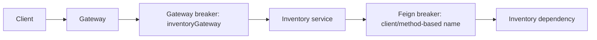

# Feign or Gateway Generates a Different Name Than Expected Configuration Key

When Spring Cloud CircuitBreaker is used with OpenFeign or Spring Cloud Gateway, the circuit breaker name may be generated at a different layer from where the Resilience4j configuration is declared. If the runtime name does not match a key under `resilience4j.circuitbreaker.instances`, the breaker may fall back to default settings instead of the thresholds, timeouts, or policies the team intended. Common symptoms include editing YAML with no behavioral change, metrics appearing under an unexpected name, or a route/Feign method failing to use the right policy.

To diagnose this, separate **route identifier**, **Feign client identifier**, and **breaker ID**. Gateway has a route ID while the CircuitBreaker filter has a `name` attribute; OpenFeign has `name` and `contextId`, whereas the breaker ID may be derived from the client interface, method, and method signature. These values do not automatically match. Resilience4j configuration must match the exact breaker ID the integration actually requests.

## 1. Identify the Three Identifier Layers

An application can simultaneously have multiple names associated with the same dependency:

| Layer | Example | Role |
|---|---|---|
| Gateway route ID | `inventory-route` | Identifies the route in Gateway config, used for route management and observation |
| Gateway CircuitBreaker filter name | `inventoryGateway` | Breaker name used by the filter when calling Spring Cloud CircuitBreaker factory |
| Feign client name | `inventory-service` | Target service name Feign calls, typically tied to service discovery/load balancing |
| Feign `contextId` | `inventoryReadClient` | Identifies a Feign client's configuration context in Spring |
| Feign breaker ID | e.g., `InventoryClientfindBySkuString` | ID generated by OpenFeign integration/resolver for the protected method |
| Resilience4j instance key | `instances.inventoryGateway` | Configuration key that must match the ID received by the breaker factory |

Do not take `route id` or `@FeignClient(name = ...)` and assume it is the configuration key. With Gateway, the breaker name is normally declared explicitly in `args.name`. With OpenFeign, the name may be generated automatically from the method and target, then normalized per version configuration.

## 2. Gateway Route ID Differs from CircuitBreaker Filter Name

In Spring Cloud Gateway, each route has an `id` identifying the route. The `CircuitBreaker` filter accepts a `name` argument; that argument is the breaker name requested by the filter. The two values can be identical if the team chooses so, but nothing requires them to match.

Example:

```yaml
spring:
  cloud:
    gateway:
      routes:
        - id: inventory-route
          uri: lb://inventory-service
          predicates:
            - Path=/api/inventory/**
          filters:
            - name: CircuitBreaker
              args:
                name: inventoryGateway
                fallbackUri: forward:/fallback/inventory
```

In this example:

- `inventory-route` is the route ID.
- `inventory-service` is the service URI Gateway routes to.
- `inventoryGateway` is the breaker name used by the CircuitBreaker filter.
- `/fallback/inventory` is the internal path Gateway forwards to when the fallback triggers per filter configuration.

Therefore, the Resilience4j configuration key must use `inventoryGateway`:

```yaml
resilience4j:
  circuitbreaker:
    instances:
      inventoryGateway:
        slidingWindowType: COUNT_BASED
        slidingWindowSize: 20
        minimumNumberOfCalls: 10
        failureRateThreshold: 50
        slowCallDurationThreshold: 800ms
        slowCallRateThreshold: 60
        waitDurationInOpenState: 10s
        permittedNumberOfCallsInHalfOpenState: 3
```

If you replace `instances.inventoryGateway` with `instances.inventory-route`, that configuration will not apply automatically simply because the route ID is similarly named. The Gateway filter requests a breaker named `inventoryGateway`; configuration must match that exact name.

## 3. Feign Client Name and contextId Are Not Necessarily the Breaker ID

A Feign client may be declared like this:

```java
@FeignClient(
        name = "inventory-service",
        contextId = "inventoryReadClient")
public interface InventoryClient {

    @GetMapping("/inventory/{sku}")
    InventoryView findBySku(@PathVariable("sku") String sku);

    @GetMapping("/inventory/{sku}/availability")
    AvailabilityView checkAvailability(@PathVariable("sku") String sku);
}
```

`name` identifies the target service. `contextId` distinguishes Feign configuration contexts, especially when multiple clients call the same service with different settings. When circuit breaker support is enabled for OpenFeign, the integration may generate breaker IDs per target interface and method. Hence, `resilience4j.circuitbreaker.instances.inventory-service` or `instances.inventoryReadClient` may not be the name used for each method.

Enable circuit breaker integration for OpenFeign using the property appropriate for your Spring Cloud version:

```yaml
spring:
  cloud:
    openfeign:
      circuitbreaker:
        enabled: true
```

After enabling it, determine the actual name produced by the resolver. Do not guess the ID from the `@FeignClient` annotation alone.

## 4. Feign's Default Naming May Depend on Version

Spring Cloud OpenFeign provides a mechanism to generate per-method breaker names. Default formats have changed across Spring Cloud generations and can be affected by alphanumeric ID settings. Therefore, do not copy a name seen in documentation for another release train and assume it is your current application's runtime name.

Factors that can influence the ID include:

- The client name OpenFeign passes to the resolver.
- The actual target interface.
- The Java method name.
- Parameter types in the method signature, especially for overloads.
- Default or custom `CircuitBreakerNameResolver` bean.
- The alphanumeric ID normalization option in your OpenFeign version.

For example, an interface with two overloaded methods:

```java
public interface InventoryClient {
    InventoryView find(String sku);
    InventoryView find(Long inventoryId);
}
```

If a resolver uses only `method.getName()`, both methods can generate the same ID `find` despite different parameters. Default resolvers may include the method signature in the name; custom resolvers should likewise account for parameter types to avoid collisions.

## 5. Inspect or Customize Names with CircuitBreakerNameResolver

Spring Cloud OpenFeign provides `CircuitBreakerNameResolver` so applications can define naming rules. The example below builds an ID from client name, target interface, method, and parameter types:

```java
import java.lang.reflect.Method;
import java.util.Arrays;
import java.util.stream.Collectors;

import feign.Target;
import org.springframework.cloud.openfeign.CircuitBreakerNameResolver;
import org.springframework.context.annotation.Bean;
import org.springframework.context.annotation.Configuration;

@Configuration
public class FeignBreakerNamingConfiguration {

    @Bean
    CircuitBreakerNameResolver circuitBreakerNameResolver() {
        return (clientName, target, method) -> {
            String parameters = Arrays.stream(method.getParameterTypes())
                    .map(Class::getSimpleName)
                    .collect(Collectors.joining(""));

            String raw = clientName
                    + target.type().getSimpleName()
                    + method.getName()
                    + parameters;

            return raw.replaceAll("[^A-Za-z0-9]", "");
        };
    }
}
```

With client `inventory-service`, target `InventoryClient`, and method `findBySku(String)`, the normalized name takes the form `inventoryserviceInventoryClientfindBySkuString`. Resilience4j configuration must use that exact key if this resolver is active.

Example configuration:

```yaml
resilience4j:
  circuitbreaker:
    instances:
      inventoryserviceInventoryClientfindBySkuString:
        slidingWindowSize: 20
        minimumNumberOfCalls: 10
        failureRateThreshold: 50
        waitDurationInOpenState: 10s
```

This rule is illustrative; the final name depends on the exact arguments passed to the resolver and any normalization applied by the running version. `Class.getSimpleName()` can collide if two parameter types in different packages share a simple name. For large systems, use `Class.getName()` followed by normalization or explicit mapping.

## 6. Alphanumeric IDs Can Differ from the Written Key

Some Spring Cloud OpenFeign versions support normalizing breaker IDs into alphanumeric-only strings. A common property in supported versions is:

```yaml
spring:
  cloud:
    openfeign:
      circuitbreaker:
        enabled: true
        alphanumeric-ids:
          enabled: true
```

When normalization is enabled, dots, hyphens, underscores, parentheses, and separators in the original name may be stripped. For example, a name like `InventoryClient#find(String)` may be converted into an alphanumeric string. If YAML still declares a key containing separators, the binder may fail to match that config to the normalized ID.

Do not assume the default value of this property is identical across every release train. Check the documentation for your exact Spring Cloud OpenFeign version, effective configuration, and actual ID in use. If using a custom `CircuitBreakerNameResolver`, clarify whether the resolver returns an already-normalized name or leaves further processing to the integration.

## 7. One Dependency Can Have Two Different IDs in Gateway and Feign

In a common architecture, Gateway invokes a route with a CircuitBreaker filter, and then the backend service calls another dependency using Feign. Each tier has its own breaker:



The Gateway breaker protects calls from Gateway to the target route. The service breaker protects Feign calls from the service to its dependency. Even though both relate to inventory, they do not necessarily share an ID, registry, sliding window, or state. Configuring `instances.inventoryGateway` does not automatically configure the Feign-created breaker inside the backend service.

When investigating a failed request, determine which breaker rejected or recorded the error. If the Gateway breaker opens, requests may never reach the backend service. If Gateway lets requests through while the service's Feign breaker opens, the service may return a fallback or error before calling the dependency. Dashboards should scope IDs by tier to avoid misattributing the cause.

## 8. How to Verify the Runtime ID

When configuration keys do not match, the first step is discovering the actual breaker name created. With Resilience4j's native registry, you can list existing instance names:

```java
import io.github.resilience4j.circuitbreaker.CircuitBreakerRegistry;
import org.springframework.boot.ApplicationRunner;
import org.springframework.context.annotation.Bean;
import org.springframework.context.annotation.Configuration;

@Configuration
public class CircuitBreakerInventoryDiagnostic {

    @Bean
    ApplicationRunner logCircuitBreakerNames(CircuitBreakerRegistry registry) {
        return args -> registry.getAllCircuitBreakers().forEach(breaker ->
                System.out.println("Circuit breaker ID: " + breaker.getName()));
    }
}
```

This snippet is useful only if the injected registry is the exact registry used by Spring Cloud CircuitBreaker/Feign integration. If the application has multiple registries or a custom factory, listing a different registry may not reflect the breakers protecting live traffic. In production, use a logger instead of `System.out` and avoid logging repeatedly on every request.

You can combine the following techniques:

1. Enable selective diagnostic logging for OpenFeign/CircuitBreaker in development environments.
2. Inspect Resilience4j metrics by the breaker name tag.
3. List instance names from the active registry.
4. Set a breakpoint inside `CircuitBreakerNameResolver` to inspect arguments and return values.
5. Check `args.name` in the loaded Gateway route definition.
6. Match the runtime ID against the keys under `resilience4j.circuitbreaker.instances`.

Do not rely on YAML filenames, route names, or class names in isolation. The value that must match is the exact ID passed to the factory when creating the breaker.

## 9. Verify the Effective Resilience4j Configuration

Once you know the runtime ID, verify the exact configuration key. For example, if the Gateway filter uses `inventoryGateway`, configuration must reside under:

```yaml
resilience4j:
  circuitbreaker:
    instances:
      inventoryGateway:
        slidingWindowSize: 30
        minimumNumberOfCalls: 12
        failureRateThreshold: 40
```

If the runtime ID is `inventoryserviceInventoryClientfindBySkuString`, configuration must use that key rather than `inventory-service`, `inventoryReadClient`, or `inventory-route`.

Besides the instance name, check Spring Boot property sources that can override YAML: active profiles, environment variables, command-line arguments, and config servers. If the name is already right yet thresholds remain wrong, the issue may lie in a higher-precedence property source or a Java Customizer. In Spring Cloud CircuitBreaker with Resilience4j, configuration properties take higher precedence than Java Customizers when both configure the same instance.

Actuator can help discover exported metrics. For instance, the metrics endpoint for the calls meter can expose `name` and `kind` tags to identify IDs. Exact meter/tag names and Prometheus export formatting depend on version; check `availableTags` or the actual `/actuator/prometheus` output before building dashboards.

## 10. Common Symptoms and Causes

| Symptom | Possible Cause | What to Check |
|---|---|---|
| Editing `instances.inventory-service` leaves Feign behavior unchanged | Feign generates IDs from target/method or resolver | Check `CircuitBreakerNameResolver` and runtime ID |
| Gateway route has ID `inventory-route`, yet config does not apply | Filter uses `args.name` different from route ID | Inspect filter config and use exact `name` |
| Two methods in one Feign client unexpectedly share a policy | Resolver uses only client name or non-distinguishing method name | Check method signatures and add distinct mappings |
| YAML contains `-`, `_`, `#`, `()`, yet metrics show only alphanumeric characters | Alphanumeric normalization | Check `alphanumeric-ids.enabled` and post-normalization name |
| A service has two active inventory breakers simultaneously | Gateway and Feign each have breakers at two tiers | Determine which tier blocked the request |
| Config name is right, yet thresholds differ | Profile, environment variable, or Java Customizer override | Inspect Spring Environment and precedence order |
| Metrics do not appear under expected name | Different runtime ID, meter not yet created, or different registry | List breakers from the right registry and inspect metric tags |
| After upgrading Spring Cloud, breaker uses default settings | Default naming rule or normalization changed | Compare resolver/IDs before and after upgrade |

## 11. Tier-by-Tier Diagnostic Procedure

When Feign or Gateway fails to pick up the right configuration key, proceed in this order:

1. Determine whether requests traverse Gateway, Feign, or both; note which tier is suspected of misbehaving.
2. For Gateway, inspect the route ID and `filters[].args.name`; use `name` as the breaker ID to cross-check.
3. For Feign, confirm `spring.cloud.openfeign.circuitbreaker.enabled` is true and identify the client interface and invoked method.
4. Check `CircuitBreakerNameResolver`, method signatures, and alphanumeric IDs options for your exact version.
5. Obtain the runtime ID from the resolver, registry, or metric tags; do not guess from `@FeignClient(name)`.
6. Locate `resilience4j.circuitbreaker.instances.<runtime-id>` and verify exact spelling and normalization match.
7. Check profiles, environment variables, config servers, and Java Customizers if effective values still differ.
8. Confirm the right registry/factory is used by the integration, especially with multiple contexts or custom setups.
9. Send a test request and cross-check state, calls, fallback, and HTTP client metrics at the right tier.
10. After fixing the name, update configuration, dashboards, alerts, and tests in sync to prevent regressions during refactors or upgrades.

## 12. Testing to Lock Down Naming Rules

The breaker name is part of the contract between code and configuration. Write tests verifying the ID rather than merely checking that YAML contains an expected string.

For Gateway, verify the route filter uses the expected `args.name` and the corresponding breaker instance is created. For Feign, test the resolver across these cases:

- Two differently named methods produce distinct IDs when separate policies are needed.
- Two overloaded methods with the same name but different parameters do not collide unintentionally.
- Two clients calling the same service with different `contextId`/targets are distinguished per policy.
- Returned names comply with alphanumeric rules when normalization is enabled.
- YAML keys match runtime IDs and metrics appear under the same name.
- After modifying the resolver or upgrading Spring Cloud, critical IDs remain stable or configuration is intentionally updated.

A simple resolver test can invoke the naming function directly with a `Method` retrieved from a test interface and assert the result. An integration test should obtain the breaker from the active registry or observe metrics after calling Feign/Gateway. Using reflection to verify an annotation exists is not enough to prove the CircuitBreaker integration uses that ID.

## 13. Principles for Stable Naming

To avoid naming mismatches later:

- Gateway: deliberately assign breaker names in `args.name`; do not rely on route IDs unless you intentionally set both identically.
- Feign: verify your release train's default naming rule or define an explicit `CircuitBreakerNameResolver`.
- Distinguish `name`, `contextId`, route ID, and breaker ID in configuration documentation.
- If policies must differ by method, include the method signature in the resolver; if multiple methods share one failure domain, map them to a single stable ID.
- Never embed SKU, user ID, order ID, or runtime data into breaker IDs, as that creates excessive instances and metric cardinality.
- Keep names synchronized across code, YAML, dashboards, and alerts.
- When upgrading Spring Cloud or changing resolver/alphanumeric settings, re-verify runtime names before deployment.

## 14. Operational Conclusion

Feign and Gateway generate or select breaker IDs under different rules. With Gateway, `route id` handles routing; the `CircuitBreaker` filter uses `args.name` to select the breaker. With Feign, `name` and `contextId` identify the client/context, while the breaker ID can be derived from the target interface, method signature, and resolver. Resilience4j only applies instance keys matching the ID the integration actually uses.

When configuration has no effect, discover the runtime ID first and then update the `resilience4j.circuitbreaker.instances` key. Separating each tier cleanly, checking name normalization, and verifying the active registry/factory prevents breakers from silently running with defaults, metrics from fragmenting, or a policy from unintentionally applying to the wrong operation.
