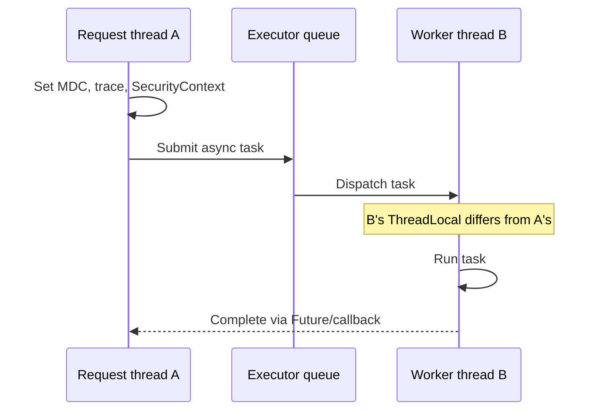

# Losing Log Context, Tracing, or Authentication Across Thread Hops

A call protected by a circuit breaker can start on a request-handling thread and continue on another thread. This commonly happens when using `CompletableFuture`, `@Async`, `ThreadPoolBulkhead`, or a dedicated executor for blocking tasks. If context is stored in `ThreadLocal`, the new thread does not automatically inherit values from the original thread. Logs may lose correlation IDs, traces may split into separate traces, and authorization checks may no longer see `SecurityContext`.

In the **SPRING_CLOUD_CIRCUIT_BREAKER** module, you need to understand thread-hop boundaries so calls stay protected while preserving observability and execution identity. MDC, tracing context, security context, and Reactor Context are distinct context types; they should not be treated as a single `ThreadLocal` map. This article explains how to diagnose context loss, propagate each context type properly, and clean up after task completion.

## 1. Why Does Context Disappear Across Thread Hops?

Many libraries store data bound to the current thread:

- SLF4J MDC typically stores log fields such as `traceId`, `spanId`, and `correlationId` in `ThreadLocal`.
- Spring Security in Servlet applications typically stores `SecurityContext` via `SecurityContextHolder`, which defaults to a `ThreadLocal` strategy.
- OpenTelemetry holds the current context via context storage bound to an execution scope; many instrumentations propagate context automatically across supported APIs.
- Some internal libraries also store tenant, locale, or request metadata in `ThreadLocal`.

When thread A submits a task to an executor, thread B picks the task from the queue and executes it. Thread B has its own `ThreadLocal`; submitting a task does not automatically copy values from A to B. Thread B may have no context or may still hold leftover context from a previous task if a library failed to clean up properly.



Common results include controller logs having `traceId` while bulkhead worker logs lack it; traces containing only the caller span without downstream spans; or a service invoking a bean requiring the current user and receiving `null`/anonymous authentication.

## 2. Distinguish Between Context Types

No single propagation mechanism fits every kind of context.

| Context | Purpose | Common Mechanism | Key Considerations |
|---|---|---|---|
| MDC | Attach fields to logs | SLF4J MDC, typically `ThreadLocal`-based | Must capture and restore on the worker thread. |
| Trace/span context | Link spans in a distributed trace | OpenTelemetry Context or Micrometer Tracing/Observation | Prefer official instrumentation and context propagation for your stack. |
| Security context | Identity, authentication, and authorities | Spring Security `SecurityContextHolder` in Servlet; Reactor Context in WebFlux | Use Spring Security wrappers; never pass tokens via logs or global context. |
| Reactor Context | Pass metadata along subscriptions | Reactor `Context`/`ContextView` | Follows the subscriber, independent of a fixed thread. |
| Tenant/locale/request metadata | Business context | Explicit context API or dedicated accessor | Propagate only required values and bound their lifecycle. |

Losing MDC does not necessarily mean the trace is lost: tracing instrumentation may still hold the span context and restore MDC when logging. Conversely, seeing `traceId` in logs does not prove parent-child spans are linked properly. Inspect both logs and the tracing backend.

Similarly, `SecurityContext` is not a trace context. Do not use a trace ID to make authorization decisions, and never put bearer tokens or full authentication objects into MDC.

## 3. Identify Which Boundaries Actually Switch Threads

Not every resilience mechanism spawns or switches threads:

| Component | Switches to Another Thread? | Where to Check Propagation |
|---|---|---|
| Synchronous CircuitBreaker | Usually no; supplier runs on calling thread. | Executors or async APIs used inside the supplier. |
| SemaphoreBulkhead | Limits permits; does not switch threads. | No thread hop from the semaphore itself; hops can still occur in clients or callbacks. |
| ThreadPoolBulkhead | Yes; supplier executes in a dedicated thread pool. | Resilience4j `ContextPropagator` or an appropriate executor wrapper. |
| `CompletableFuture.*Async` | May use the common `ForkJoinPool` or a specified executor. | Executor and context capture at submission time. |
| Spring `@Async` | Runs via the configured `TaskExecutor`/executor. | `TaskDecorator` and Spring Security wrappers. |
| Reactor `publishOn`/`subscribeOn` | Can switch signals or subscriptions across schedulers. | Reactor Context and context propagation integrations. |
| Async HTTP client | Depends on client and instrumentation. | Client instrumentation, callback executors, and outbound header propagation. |

During investigation, log the thread name at request entry, before calling the breaker, inside the supplier, and inside callbacks. If the thread changes at `ThreadPoolBulkhead` or `thenApplyAsync`, that is the boundary to verify.

## 4. Common Symptoms and Causes

| Symptom | Possible Cause | How to Verify |
|---|---|---|
| Downstream logs lack `traceId` or `correlationId` | MDC was not captured onto the worker thread. | Compare MDC before submission and inside the task. |
| Trace shows two separate traces | Trace context was not propagated or instrumentation does not support the executor. | Check parent span ID and context at submission time. |
| Logs carry IDs from a previous request | Worker thread reused without clearing/restoring context. | Run two consecutive tasks on the same worker and compare MDC. |
| `SecurityContextHolder.getContext()` has no authentication | `SecurityContext` was not propagated to the new thread. | Check executor wrappers and authentication inside the worker. |
| Async request returns 401/403 despite authenticated ingress request | Outbound call or background task lacks required identity/credentials. | Distinguish internal security context from tokens sent to the target service. |
| Wrong tenant/locale across requests | Stale `ThreadLocal` retained or new context not captured. | Verify both capture and cleanup in `finally`. |
| Reactive logs lose metadata after a scheduler hop | Metadata stored in `ThreadLocal` instead of Reactor Context, or propagation integration not enabled. | Read `ContextView` at the subscriber and check instrumentation config. |

## 5. Propagate MDC Across Spring TaskExecutor Using TaskDecorator

With Spring's `ThreadPoolTaskExecutor`, a `TaskDecorator` can capture MDC at task submission time and set it on the worker. Always restore the previous state in `finally`, because worker threads are reused across tasks.

```java
import java.util.Map;

import org.slf4j.MDC;
import org.springframework.core.task.TaskDecorator;

public class MdcTaskDecorator implements TaskDecorator {

    @Override
    public Runnable decorate(Runnable task) {
        Map<String, String> captured = MDC.getCopyOfContextMap();

        return () -> {
            Map<String, String> previous = MDC.getCopyOfContextMap();
            try {
                if (captured == null) {
                    MDC.clear();
                } else {
                    MDC.setContextMap(captured);
                }
                task.run();
            } finally {
                if (previous == null) {
                    MDC.clear();
                } else {
                    MDC.setContextMap(previous);
                }
            }
        };
    }
}
```

Attach the decorator to the executor:

```java
import org.springframework.context.annotation.Bean;
import org.springframework.context.annotation.Configuration;
import org.springframework.scheduling.concurrent.ThreadPoolTaskExecutor;

import java.util.concurrent.Executor;

@Configuration(proxyBeanMethods = false)
public class AsyncExecutorConfiguration {

    @Bean("applicationTaskExecutor")
    public Executor applicationTaskExecutor() {
        ThreadPoolTaskExecutor executor = new ThreadPoolTaskExecutor();
        executor.setCorePoolSize(8);
        executor.setMaxPoolSize(16);
        executor.setQueueCapacity(100);
        executor.setThreadNamePrefix("application-async-");
        executor.setTaskDecorator(new MdcTaskDecorator());
        executor.initialize();
        return executor;
    }
}
```

`MdcTaskDecorator` handles only MDC. It does not automatically propagate OpenTelemetry context, `SecurityContext`, or Reactor Context. If your application needs those contexts, add dedicated mechanisms rather than blindly copying every `ThreadLocal`.

## 6. Propagate SecurityContext for Imperative Tasks

In Servlet applications, Spring Security provides executor wrappers to propagate `SecurityContext` upon task submission. You can wrap an `AsyncTaskExecutor` with `DelegatingSecurityContextAsyncTaskExecutor`:

```java
import org.springframework.core.task.AsyncTaskExecutor;
import org.springframework.scheduling.concurrent.ThreadPoolTaskExecutor;
import org.springframework.security.task.DelegatingSecurityContextAsyncTaskExecutor;
import org.springframework.context.annotation.Bean;
import org.springframework.context.annotation.Configuration;

@Configuration(proxyBeanMethods = false)
public class SecurityAsyncConfiguration {

    @Bean
    AsyncTaskExecutor securedTaskExecutor() {
        ThreadPoolTaskExecutor delegate = new ThreadPoolTaskExecutor();
        delegate.setCorePoolSize(8);
        delegate.setMaxPoolSize(16);
        delegate.setQueueCapacity(100);
        delegate.setThreadNamePrefix("secured-async-");
        delegate.initialize();

        return new DelegatingSecurityContextAsyncTaskExecutor(delegate);
    }
}
```

The wrapper captures context via Spring Security's mechanism, sets it while the task runs, and clears it afterward to prevent identity leaks across tasks on the same worker. Use this executor for tasks that must execute under the current user's identity.

Not every background task should run under the submitting user's privileges. For scheduled work or processing after a request finishes, explicitly decide whether to use a service account, system identity, or store an actor ID for auditing. Avoid retaining a request's `SecurityContext` in a long-running job where permissions may be revoked or sessions expire.

If both MDC and `SecurityContext` are needed, compose the decorator and wrapper intentionally. Check wrapper ordering and ensure each mechanism restores state in `finally`. Avoid writing a generic wrapper that copies all existing `ThreadLocal` entries from a thread.

## 7. Propagate Trace Context Across Executors

If using the OpenTelemetry API directly, capture the current context before submitting a task and wrap the `Runnable` with it:

```java
import io.opentelemetry.context.Context;

Context parentContext = Context.current();
executor.execute(parentContext.wrap(() -> {
    inventoryClient.refreshCache();
}));
```

`Context.current()` is read on the submitting thread. `wrap(...)` activates the context while the task runs and restores the previous context once the task finishes. This helps when an executor is not covered by automatic instrumentation.

In applications using Micrometer Tracing/Spring Boot Observability, prefer the context propagation provided by the stack, such as `ContextPropagatingTaskDecorator` in supported Spring Framework versions. This component relies on Micrometer Context Propagation and registered accessors. Verify your Spring Framework/Micrometer versions and tracer accessors; do not assume every tracing library propagates automatically just because a decorator was added.

If using the OpenTelemetry Java agent or auto-instrumentation, common executors and clients may already be instrumented automatically. Avoid double-wrapping context without understanding the effects. Inspect real traces to verify child spans have the right parent, trace IDs remain intact, and scopes close after tasks finish.

## 8. Context Propagation with Resilience4j ThreadPoolBulkhead

`ThreadPoolBulkhead` runs suppliers on Resilience4j's own internal executor. A `TaskDecorator` attached to an application `ThreadPoolTaskExecutor` does not automatically apply to ThreadPoolBulkhead's internal executor.

Resilience4j provides a `ContextPropagator` mechanism for `ThreadPoolBulkhead` in supported versions. This mechanism allows:

1. Retrieving context from the submitting thread before placing the task into the pool.
2. Setting the corresponding context on the worker before the supplier runs.
3. Clearing or restoring context after the task completes.

Exact APIs and configuration depend on the Resilience4j version pulled in by your BOM. Check `ThreadPoolBulkheadConfig` and `ContextPropagator` in your exact artifact before implementing; do not assume Spring's `TaskDecorator` covers Resilience4j's internal executor.

When using `ThreadPoolBulkhead`, check each context you need to propagate separately: MDC, tracing, and security are not necessarily handled by a single propagator. If a propagator handles only MDC, tracing may still be propagated by auto-instrumentation while `SecurityContext` is missing. Implement adapters for the exact accessors required and ensure `clear` executes even if the supplier throws an exception.

`SemaphoreBulkhead` does not create separate worker threads. If context is lost while using a semaphore, look for another thread-hop boundary inside the supplier, HTTP client, or callbacks rather than blaming the semaphore.

## 9. Reactor Context in WebFlux Applications

Reactor Context is tied to a subscription and flows across Reactor operators, even when signals switch schedulers. It is the appropriate place to store reactive metadata such as correlation IDs or data for reactive security; never rely on `ThreadLocal` as the source of truth inside a WebFlux chain.

Example writing and reading a correlation ID:

```java
import reactor.core.publisher.Mono;
import reactor.util.context.ContextView;

Mono<String> operation = Mono.deferContextual((ContextView context) -> {
    String correlationId = context.getOrDefault("correlationId", "unknown");
    return inventoryClient.refresh(correlationId);
}).contextWrite(context -> context.put("correlationId", "req-123"));
```

`deferContextual` reads the context at subscription time. `contextWrite` adds values to the subscriber context for upstream operators. Do not read Reactor Context at chain assembly time because subscription has not occurred yet.

Spring Security reactive uses Reactor Context to hold `SecurityContext`. Use Spring Security's reactive APIs such as `ReactiveSecurityContextHolder` and keep calls inside the reactive chain. Do not query Servlet-style `SecurityContextHolder` and assume it is populated on every WebFlux scheduler.

## 10. Bridging Between Reactor Context and ThreadLocal

Some legacy libraries only read MDC or `ThreadLocal`. Meanwhile, WebFlux applications carry context per subscription. When compatibility is required, use Micrometer Context Propagation or the Reactor integration supported by your Spring Boot/Reactor version to capture and restore registered accessors.

Do not blindly enable a global hook or copy the entire Reactor Context into `ThreadLocal` without understanding the blast radius. Global hooks can affect every publisher in the process and impact performance. Before enabling automatic context propagation, verify Reactor version support, which accessors are registered, and which libraries need the context.

If a reactive task calls an imperative blocking API, offload the blocking work onto an appropriate scheduler and propagate context through the chosen mechanism. Never call `block()` on the event loop merely to extract `SecurityContext`, traces, or MDC.

## 11. Authentication Context Is Not the Same as Copying Bearer Tokens

When a task hops threads and calls another service, determine how the target service authenticates requests:

- If using OAuth2 token relay, acquire or forward tokens using supported OAuth2/Spring Security mechanisms while respecting expiration.
- If using service-to-service authentication, background tasks may need a service account or client credentials rather than a user token.
- If only auditing is needed, store the actor ID or principal identifier per data policy; there is no need to retain full credentials.
- If a job runs after the request ends, do not assume the original token remains valid or permitted for use.

Never write access tokens, refresh tokens, cookies, or full `Authorization` headers into MDC, logs, trace attributes, or exception messages. Never store tokens in static `ThreadLocal`s or variables shared across workers. If credentials must be forwarded, use a security mechanism with an explicit lifecycle and ensure credentials from a prior request are never reused.

## 12. Common Mistakes When Implementing Propagation Manually

| Mistake | Consequence | How to Avoid |
|---|---|---|
| Copying only MDC while assuming all context propagated | Logs have IDs, yet security or traces remain missing. | Verify each context type separately. |
| Not clearing MDC in `finally` | Worker threads can carry IDs from an earlier request. | Restore previous context or clear if none existed. |
| Using only `TaskDecorator` on Spring executors when tasks run in ThreadPoolBulkhead | Decorator does not cover the internal executor. | Use an appropriate `ContextPropagator` for Resilience4j. |
| Copying `SecurityContext` manually without restoring | Risk of identity leakage across tasks. | Use Spring Security wrappers or adapters with cleanup. |
| Using `ThreadLocal` as a data source in WebFlux | Values disappear when schedulers switch threads. | Use Reactor Context and reactive security APIs. |
| Attaching trace IDs manually without propagating span context | Logs share an ID, yet traces lack parent-child relationships. | Propagate tracing Context via official instrumentation/APIs. |
| Passing user tokens into long-running jobs | Tokens expire or permissions are revoked. | Choose service identities or re-authenticate at execution time. |
| Failing to restore prior context | A new task's context can overwrite the worker/caller context. | Capture previous state and restore in `finally`. |

## 13. Diagnostic Procedure When Context Is Lost

When logs, traces, or authentication disappear after an asynchronous call, inspect in order:

1. **Identify the thread-hop point:** log the thread name before the supplier, inside the supplier, and inside callbacks.
2. **Identify what creates the thread:** `ThreadPoolBulkhead`, `@Async`, `CompletableFuture`, Reactor scheduler, or HTTP client callback.
3. **Classify the missing context:** MDC, trace/span, `SecurityContext`, Reactor Context, or custom metadata.
4. **Verify propagation on the right executor:** Spring `TaskDecorator`, Spring Security wrapper, OpenTelemetry/Micrometer context propagation, or Resilience4j `ContextPropagator`.
5. **Verify cleanup:** run two distinct requests sequentially on the same worker to detect leftover context.
6. **Verify outbound authentication:** confirm whether token relay, service account, or client credentials match the task's execution timing.
7. **Inspect the trace backend:** confirm child spans have the proper parent rather than checking only trace ID strings in logs.

Do not change every propagation mechanism at once. Write a controlled test, attach a synthetic context marker, run a task through the exact executor, and confirm the marker appears inside the worker and disappears once the task finishes.

## 14. Testing Against Context Leakage Across Worker Tasks

A thorough test verifies both context propagation and cleanup. For MDC, you can use a single-thread executor to force two tasks to run sequentially on the same worker:

```java
import static org.junit.jupiter.api.Assertions.assertEquals;
import static org.junit.jupiter.api.Assertions.assertNull;

import java.util.concurrent.ExecutorService;
import java.util.concurrent.Executors;
import java.util.concurrent.Future;
import java.util.concurrent.atomic.AtomicReference;

import org.junit.jupiter.api.AfterEach;
import org.junit.jupiter.api.Test;
import org.slf4j.MDC;
import org.springframework.core.task.TaskDecorator;

class MdcPropagationTest {
    private final ExecutorService delegate = Executors.newSingleThreadExecutor();

    @AfterEach
    void tearDown() {
        delegate.shutdownNow();
        MDC.clear();
    }

    @Test
    void propagatesAndThenClearsRequestContext() throws Exception {
        TaskDecorator decorator = new MdcTaskDecorator();
        AtomicReference<String> observed = new AtomicReference<>();

        MDC.put("correlationId", "request-A");
        Runnable decorated = decorator.decorate(
            () -> observed.set(MDC.get("correlationId"))
        );
        MDC.clear();

        Future<?> first = delegate.submit(decorated);
        first.get();
        assertEquals("request-A", observed.get());

        Future<String> second = delegate.submit(() -> MDC.get("correlationId"));
        assertNull(second.get());
    }
}
```

In this example, the decorator is applied on the test thread while MDC holds `request-A`; then MDC on the submitting thread is cleared before the task runs. The first task still observes the captured value. The second task runs on the same worker yet sees no `correlationId`, proving the decorator restored prior state instead of leaking the first request's context into the next task.

For tracing and security, add dedicated tests:

- Trace spans inside the worker share the same trace ID and have the submitting span as parent.
- Security wrappers propagate the expected principal.
- After the task, the worker no longer holds the completed request's `SecurityContext`.
- Cleanup still executes when the supplier throws an exception or is cancelled.
- Two requests with different principals/correlation IDs never observe each other's context.

## 15. Operational Checklist

- [ ] Identify the exact thread hop and the executor creating it.
- [ ] Capture MDC at submission time, set it on the worker, and restore/clear it after the task.
- [ ] Propagate trace context via OpenTelemetry/Micrometer or matching instrumentation.
- [ ] Use appropriate Spring Security wrappers for imperative `SecurityContext` if the task requires user identity.
- [ ] Use Reactor Context and reactive security APIs in WebFlux rather than Servlet `ThreadLocal`.
- [ ] Configure a dedicated `ContextPropagator` for `ThreadPoolBulkhead` if context must enter Resilience4j's executor.
- [ ] Do not assume `SemaphoreBulkhead` spawns new threads.
- [ ] Never log credentials to logs, MDC, or trace attributes.
- [ ] Test two consecutive tasks on the same worker to catch context leakage.
- [ ] Execute cleanup across success, exception, timeout, and cancellation paths.

When context vanishes across a thread hop, identify the exact executor and context type before applying a fix. MDC requires explicit capture and restore; tracing requires span context propagation; Spring Security requires appropriate wrappers or reactive APIs; Reactor Context follows subscriptions rather than threads. In particular, `ThreadPoolBulkhead` uses its own executor, so Spring decorators do not cover it automatically. Proper propagation and per-task cleanup preserve continuity for logs, traces, and authentication without leaking data across requests.
