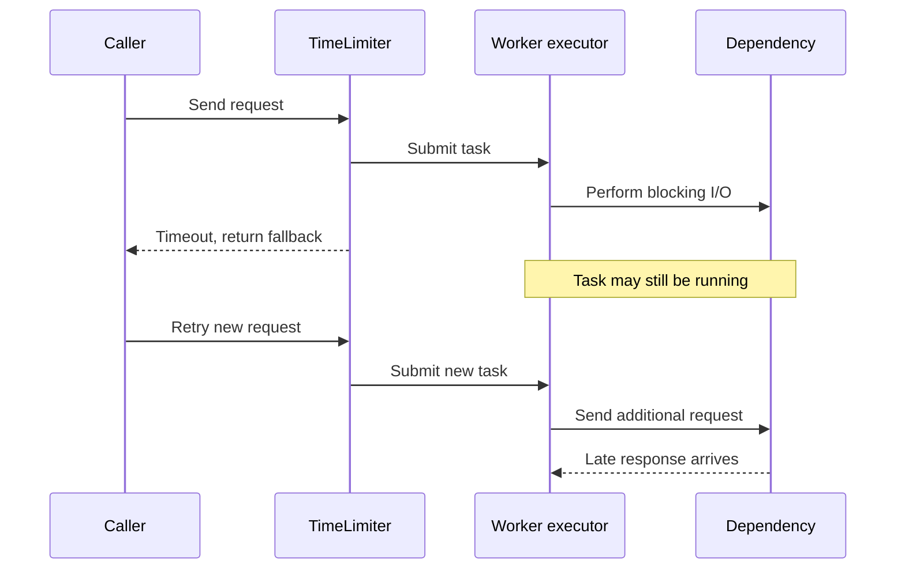

# Multi-Layer Retries, Task Leaks, and Secondary Overload from Fallbacks

Retries help a call recover from transient errors, yet nested retry layers can multiply the number of requests sent to a dependency. When timeouts only end the caller's wait while blocking tasks keep running, the system continues holding threads, connections, and queue slots for expired requests. If a fallback calls another service, retries further, or contends for the same resources, the fallback path itself can trigger a secondary overload.

With Spring Cloud Circuit Breaker, you must diagnose both the primary call path and the recovery path: retry, Circuit Breaker, TimeLimiter, Bulkhead, client timeouts, fallbacks, and message-layer redelivery. The goal is to keep total work within the system's deadlines and capacity while ensuring a transient error does not amplify into a cascading failure.

## 1. Identify the Three Amplification Patterns

### Multi-Layer Retries

A business request can traverse a gateway, services, HTTP clients, SDKs, and brokers. If each layer retries independently without knowing the policies of other layers, a single logical request can produce many executions at the final dependency.

If each layer permits `A` attempts (including the initial attempt), the maximum number of calls can approach the product of attempts across all layers:

\[
N_{backend} = \prod_{i=1}^{n} A_i
\]

For example, if the gateway allows 3 attempts, the service allows 3 attempts, and the HTTP client allows 2 attempts, one logical request can generate up to `3 × 3 × 2 = 18` requests to the backend. When a configuration specifies `maxAttempts: 3`, that value typically includes the initial call—meaning at most two retries; verify the semantics of the library in use.

### Tasks Still Running After Timeout

TimeLimiter can finish waiting on the caller side and request cancelling the Future. That does not guarantee the underlying blocking task or I/O has stopped. The caller has already returned a fallback, yet the worker keeps running, holding connections, or continuing writes. If the request is retried, a new task can start while the old task has not yet finished.

### Fallbacks Generating Secondary Load

A fallback may call a remote cache, database, backup service, or another endpoint. If many requests hit the fallback simultaneously, the backup source can receive a sudden traffic spike. Retrying inside the fallback, widespread cache misses, or unbounded queues make the situation worse.

## 2. Symptoms and Evidence to Collect

| Symptom | Observable Signal | Cause to Check |
| --- | --- | --- |
| Backend receives more requests than the gateway | Ratio of backend calls to logical requests rises sharply | Retries nested across gateway, service, client, or SDK |
| Latency grows exponentially | High p95/p99; requests wait across multiple backoff intervals | Multiple retry rounds; deadlines not propagated across layers |
| Timeouts rise yet threads stay busy | Caller returned timeout, but active workers/connections do not drop | Future cancellation failed to stop blocking work; client timeout longer than TimeLimiter |
| Queues and thread pools grow continuously | Queue depth, active threads, rejected tasks, or pending connections climb | Stale tasks piling up, oversized queues, slow dependency |
| Fallbacks spike alongside cache/database errors | Fallback dependency latency and connection pool usage climb | Fallback shares a failure domain or is invoked en masse |
| CPU/network climbs despite steady user traffic | Backend attempts, retry attempts, or broker redeliveries increase | One logical request spawns multiple executions |
| Circuit oscillates `OPEN`/`HALF_OPEN` | Failure rate and not-permitted calls fluctuate | Retries inflate error samples; probes compete with retry traffic |

Collect evidence across layers:

- Gateway: request ID, logical request count, upstream attempts, deadline, and response status.
- Service: retry attempts, retried exceptions, backoff durations, breaker ID, and fallback reason.
- HTTP client/SDK: request count, connect/read timeouts, connection pool state, and cancellation.
- Executor/Bulkhead: active workers, queue depth, queue wait, task completions, rejections, and tasks still running after timeout.
- Fallback: invocation count, latency, cache hit/miss, data freshness age, errors, and dependencies called by the fallback.
- Broker: delivery count, redeliveries, visibility timeout, dead-letter queue, and idempotency key.

Correlate traces by a single correlation ID. One logical request should show distinct spans for each attempt, fallback, and dependency—do not look only at aggregate backend request counts.

## 3. Calculate the Retry Budget and End-to-End Deadline

Retries must fit within the request's end-to-end deadline. Total duration includes not only attempt execution times, but also backoff intervals, queue waits, connection acquisition, and fallback execution.

\[
T_{total} = \sum_{i=1}^{A} T_i + \sum_{i=1}^{A-1} B_i + T_{queue} + T_{fallback}
\]

Where `A` is total attempts, `T_i` is the duration of each attempt, and `B_i` is the backoff interval between attempts. If an API deadline is 2 seconds, you cannot configure three 1-second attempts plus 500 ms backoffs and still expect timely responses.

Example budget:

| Component | Illustrative Budget |
| --- | ---: |
| Attempt 1 | max 400 ms |
| Backoff 1 | ~80 ms |
| Attempt 2 | max 400 ms |
| Backoff 2 | ~160 ms |
| Attempt 3 | max 400 ms |
| Fallback and serialization | max 200 ms |
| Total | ~1,640 ms, excluding queue/connect overhead |

The remaining margin up to the 2-second deadline covers queuing, connection setup, and jitter. If other layers also retry, account for attempts at those layers or disable duplicate retries.

Propagate deadlines or remaining time down to downstream services rather than letting each layer pick independent timeouts. Before starting a new attempt, check whether enough budget remains for a meaningful try. Once the deadline expires, stop retrying and switch to fallback or return a timeout.

## 4. Choose One Layer to Own the Retry Policy

Design explicitly which layer owns retry responsibility per dependency. Retrying in the service can work well because it understands business semantics, or in the HTTP client if handling generic network errors. A gateway may retry certain transient serving failures, provided it accounts for whether downstream services already retry.

| Layer | When Appropriate | What to Avoid |
| --- | --- | --- |
| Gateway/API client | Retrying transient upstream failures within the caller's deadline | Retrying all POST requests without idempotency |
| Business service | Has context on which errors are retryable and which outcomes are safe | Retrying an HTTP client that already has a large retry policy |
| HTTP client/SDK | Handling connection errors or protocol-level `Retry-After` | Retrying inappropriate statuses/errors without reporting attempt counts upward |
| Message broker | Redelivering when a consumer fails or misses ack | Infinite redelivery without DLQ, idempotency, or backoff |

Keep `maxAttempts` low and cap total duration. If multiple layers must retry, assign each layer an explicit sub-budget and telemetry to sum total attempts.

## 5. Retry Only Transient Errors and Safe Operations

Retries suit errors likely to resolve quickly, such as connection resets, transient network errors, HTTP 502/503/504, or 429 under a `Retry-After` policy. Classify errors according to the dependency contract.

- Do not retry input errors or unrecoverable business errors such as 400, 401, 403, or non-existent SKU 404, unless a specific contract dictates otherwise.
- Do not retry every `Exception` or `Throwable`; programming bugs, data mapping errors, and invariant violations rarely recover by re-executing.
- For 429, honor `Retry-After` if supported by the client and policy, still bounded by the overall deadline.
- For write operations, retry only with idempotency keys, deduplication, or guarantees that repeated execution causes no duplicate side effects.
- For payments or order creation, a timeout does not prove the server never executed the operation. Query status using the idempotency key before resending.

Retry policies should define explicit `retryExceptions` and `ignoreExceptions`. When combining Circuit Breaker with Retry, never retry `CallNotPermittedException`: it signals the breaker rejected the request, not a transient dependency failure.

## 6. Backoff, Jitter, and Retry Budgets

Never retry immediately on a fixed cadence when multiple instances experience an outage together. They can resend requests in lockstep, creating a thundering herd. Exponential backoff progressively widens wait intervals; jitter adds randomness to spread out retries.

Example exponential wait formula:

\[
B_k = \min(B_{max}, B_0 \times 2^{k-1})
\]

With `B_0 = 100 ms`, pre-jitter delays can be 100 ms, 200 ms, 400 ms. Configure jitter and maximum caps in the library rather than wrapping another retry loop around it.

Resilience4j example:

```yaml
resilience4j:
  retry:
    instances:
      inventory:
        maxAttempts: 3
        waitDuration: 100ms
        enableExponentialBackoff: true
        exponentialBackoffMultiplier: 2
        enableRandomizedWait: true
        randomizedWaitFactor: 0.5
        retryExceptions:
          - java.io.IOException
        ignoreExceptions:
          - com.example.inventory.InvalidSkuException
          - io.github.resilience4j.circuitbreaker.CallNotPermittedException
```

This is an illustrative policy example; verify supported properties in your Resilience4j version and replace exception types with your client's actual classes. Never let an exception be retried at one layer and retried again at an upper layer outside the budget.

A retry budget caps the proportion of requests allowed to retry relative to original requests over a window. Once the budget is exhausted, the system returns errors or fallbacks instead of amplifying load. You can enforce this with a token bucket or quota mechanism at the calling layer; compare retry attempt metrics against logical requests to monitor amplification.

## 7. Deliberately Order Retry and Circuit Breaker

Where the Circuit Breaker sits relative to Retry alters statistical meaning:

- **Circuit Breaker outside Retry:** the breaker observes one logical operation after Retry finishes. If an attempt fails yet a subsequent attempt succeeds, the breaker can record the logical operation as a success.
- **Retry outside Circuit Breaker:** each attempt passes through the breaker and can be recorded individually. The breaker can open mid-retry chain; in that case, Retry must ignore `CallNotPermittedException`.

Example using explicit Resilience4j APIs with Circuit Breaker outside Retry so the breaker evaluates the final outcome of the logical operation:

```java
Supplier<Inventory> remoteCall = () -> inventoryClient.getStock(sku);

Supplier<Inventory> retriedCall =
        Retry.decorateSupplier(retry, remoteCall);

Supplier<Inventory> protectedCall =
        CircuitBreaker.decorateSupplier(circuitBreaker, retriedCall);

try {
    return protectedCall.get();
} catch (CallNotPermittedException ex) {
    return fallbackForOpenCircuit(sku, ex);
} catch (Exception ex) {
    return fallbackForDependencyFailure(sku, ex);
}
```

In this example, one call to `protectedCall.get()` represents one logical operation; Retry executes internal attempts while Circuit Breaker observes the final outcome. This is a design choice, not a mandatory order for every application. If you need the breaker to count each attempt, reverse the decorator order and carefully ensure `CallNotPermittedException` is ignored.

With Spring AOP annotations, aspect order also affects which layer records exceptions and runs fallbacks. Do not rely on annotation order in source code; verify aspect order configuration in your version or use functional composition when explicit control is needed.

## 8. Timeouts Ending the Caller Without Stopping the Task

This is a common source of task leaks. A request may follow this sequence:



`Future.cancel(true)` requests interrupting the worker, but it cannot forcibly halt arbitrary code. An HTTP library, JDBC driver, or loop that ignores interrupts can keep running. With `CompletionStage`, completing the stage on timeout does not automatically cancel the underlying work unless the API provides corresponding cancellation hooks.

Signs of orphaned tasks:

- Timed-out requests climb while active worker counts do not fall.
- Thread dumps show many threads waiting on the same host/socket or connection pool.
- Queues hold tasks belonging to requests whose deadlines already expired.
- The backend keeps receiving requests after callers already returned timeouts.
- Pending connection pool acquires rise, and pools fail to drain even after upper-layer requests finish.

Configure timeouts directly on the HTTP client/driver, limit connection acquisition wait times, and enable client-supported cancellation. If the client supports request cancellation, wire `Future`/`CompletionStage` cancellation into that API. For CPU-bound tasks, check interrupt flags or cancellation tokens periodically.

Never create a new executor per request. Use Spring-managed executors with bounded lifecycle, workers, and queues; during shutdown, stop accepting new tasks, wait for a controlled grace period, and cancel remaining tasks per application policy.

## 9. Avoid Letting Queues and Thread Pools Hide Leaks

Unbounded thread pools or oversized queues can turn fast failures into prolonged latency while retaining expired requests. Monitor:

| Metric | Danger Sign |
| --- | --- |
| Active worker threads | Near maximum for extended periods |
| Queue depth | Rises continuously without dropping after traffic subsides |
| Queue wait time | Consumes most of the deadline before tasks even start |
| Rejected tasks | Spikes sharply, indicating exhausted capacity |
| Task duration | p95/p99 climbs or tasks run past deadlines |
| Connection pool pending | Requests wait for connections even after caller timeouts |

Bulkheads should cap concurrency and queues in line with dependency capacity. Once capacity is full, reject early and use a safe fallback or return an overload error. Never shunt tasks from a full queue into another unbounded queue.

With WebFlux, never execute blocking I/O on the event loop. If calling a blocking library is unavoidable, isolate it onto a dedicated blocking scheduler/executor with bounded concurrency. Cancelling a Reactor subscription can propagate cancellation upstream, though halting actual I/O still depends on the underlying publisher/client.

## 10. Fallbacks Causing Secondary Overload

Fallbacks are often viewed as a safety net, yet they consume resources and may have dependencies of their own. An unbounded fallback can create a second failure domain.

### Dangerous Fallback Patterns

- Fallbacks calling a backup service that shares a database, network, or connection pool with the primary dependency.
- Fallbacks retrying repeatedly while the backup service is also failing.
- Widespread cache misses causing every request to hit the database or origin cache simultaneously.
- Synchronous fallbacks waiting on remote I/O, holding request threads after the primary dependency timed out.
- Fallbacks spawning unbounded queues or async tasks to finish leftover work.
- Fallbacks re-throwing or routing through another Circuit Breaker back into the original service.

### Design Principles

- Prefer local cached/snapshot data verified for freshness and business correctness.
- Fallbacks must be fast, with their own timeouts, concurrency limits, and isolated queues if performing I/O.
- Do not retry fallbacks by default; if required, permit at most one attempt with a separate deadline and retry budget.
- Never call the primary dependency again from that dependency's own fallback.
- Distinguish `unavailable`, `unknown`, `stale`, and live data; never return fabricated values that look valid.
- Use single-flight/request coalescing or cache stampede protection to deduplicate concurrent loads for the same key when appropriate.
- When no reliable fallback source exists, fail fast with an appropriate error rather than generating secondary load.

Example fallback reading only from a local cache:

```java
private Inventory fallbackForDependencyFailure(String sku, Throwable cause) {
    return localInventoryCache.getIfPresent(sku)
            .filter(snapshot -> snapshot.isFreshAt(Instant.now()))
            .map(snapshot -> Inventory.stale(snapshot.value(), snapshot.updatedAt()))
            .orElseThrow(() -> new InventoryUnavailableException(
                    "Inventory is temporarily unavailable", cause));
}
```

This illustrative code assumes cache and freshness models suited to the application. If the cache lives over the network, it is itself a dependency: configure separate timeouts, Bulkheads, and observability. Never assume cache fallbacks are always cheap or always available.

## 11. Separate Telemetry for Logical Requests, Attempts, and Fallbacks

If you count only total HTTP requests, it is hard to tell whether traffic rose due to users or retries. Separate:

- `logical_requests`: initial business requests.
- `retry_attempts`: total retry attempts, excluding the initial attempt.
- `downstream_attempts`: actual requests sent to the dependency.
- `timed_out_tasks`: callers exceeding their deadline.
- `tasks_running_after_timeout`: tasks still running post-timeout if measurable by the application.
- `fallback_calls`: fallback invocations, tagged with a bounded reason such as `timeout`, `circuit_open`, `dependency_error`, `bulkhead_full`.
- `fallback_failures`: fallbacks that also failed.

Example Counters with bounded-cardinality tags:

```java
@Component
public class ResilienceOperationMetrics {
    private final MeterRegistry registry;

    public ResilienceOperationMetrics(MeterRegistry registry) {
        this.registry = registry;
    }

    public void recordRetry(String dependency, String layer) {
        registry.counter("app.retry.attempts",
                "dependency", dependency, "layer", layer).increment();
    }

    public void recordLogicalRequest(String dependency) {
        registry.counter("app.logical.requests",
                "dependency", dependency).increment();
    }

    public void recordDownstreamAttempt(String dependency) {
        registry.counter("app.downstream.attempts",
                "dependency", dependency).increment();
    }

    public void recordFallback(String dependency, String reason) {
        registry.counter("app.fallback.calls",
                "dependency", dependency, "reason", reason).increment();
    }
}
```

Never put request ID, user ID, SKU, exception message, or URLs with IDs into metric tags, because cardinality will explode per request. Use logs/traces to link a logical request to each attempt. Logs should include `attempt`, `maxAttempts`, `remainingDeadline`, `backoff`, `breakerId`, and `fallbackReason`.

## 12. Dashboards and Diagnostic Queries

Place the following signals side by side on dashboards:

1. Logical request rate vs. downstream attempt rate.
2. Ratio of `downstream_attempts / logical_requests` per dependency.
3. Retry attempts by layer and normalized exception class.
4. Timeout counts alongside active workers, queue depth, and pending connection pool acquires.
5. Fallback calls/failures alongside cache hits, cache age, and backup dependency latency.
6. Circuit Breaker state, failure rate, slow-call rate, and not-permitted calls.
7. Caller p95/p99, per-attempt latency, and final dependency latency.

Example PromQL if the application exports the corresponding custom counters:

```promql
sum by (dependency) (rate(app_downstream_attempts_total[5m]))
/
clamp_min(sum by (dependency) (rate(app_logical_requests_total[5m])), 0.001)
```

This query is illustrative; normalized meter names may differ. Verify scrape output and your registry's naming conventions before using it. If the attempts-to-request ratio rises while the logical request rate stays flat, check for nested retries.

Detecting tasks running after timeout requires custom instrumentation at the executor/client level, since not every library exports that metric. You can record timestamps at timeout and when the task actually completes, then track active tasks past their deadline.

## 13. Remediation Procedure When Retries and Fallbacks Amplify Load

### Step 1 — Contain Blast Radius

- Halt or shed non-essential traffic to the overloaded dependency per approved runbooks.
- Disable retries at layers identified as redundant if a safe configuration mechanism and authorized approval are available.
- Never retry `CallNotPermittedException`; never raise `HALF_OPEN` probe counts while the dependency remains unstable.
- Bound concurrency and queues; reject early when capacity is exhausted.

### Step 2 — Determine Actual Execution Counts

- Pick a correlation ID and count spans/attempts across gateway, service, client, and broker.
- Compute the product of `maxAttempts` across layers, checking whether each layer's count includes the initial attempt.
- Identify which retries fire before vs. after the Circuit Breaker and which exceptions are being retried.
- Check `Retry-After`, backoff, and jitter; determine whether multiple instances are retrying in lockstep.

### Step 3 — Find Tasks Alive After Timeout

- Compare timeout counts against active workers and queues.
- Capture thread dumps when authorized; look for threads blocked on sockets, connection pools, or locks.
- Verify HTTP client/driver timeouts and request cancellation support.
- Confirm whether tasks terminate after caller timeouts; inspect executor queues holding expired work.

### Step 4 — Inspect Fallback Paths

- Count fallbacks by reason and target dependency.
- Check whether fallbacks call remote services, retry, or share connection pools.
- Check cache misses/stampedes, stale data rates, and fallback failure counts.
- If a fallback is unsafe, switch to returning `unavailable` or shedding load per API contract.

### Step 5 — Recover Layer by Layer

- Keep one clear retry-owning layer, reduce `maxAttempts`, and set an appropriate deadline.
- Set client timeouts to release sockets/connections; verify cancellation works.
- Size Bulkheads/queues to real capacity rather than blindly enlarging them.
- Point fallbacks to local sources or verified minimal responses.
- Ramp traffic back up gradually and confirm attempts/request ratios, queues, timeouts, and fallbacks return to baseline.

## 14. Reproduction Test Scenarios

Use a mock server or stubbed dependency to inject controlled failures:

1. Enable retries on gateway, service, and HTTP client. Send one logical request, count requests at the mock server, and compare against the product of `maxAttempts`.
2. Disable retries on non-owning layers; re-run and confirm downstream attempts stay within budget.
3. Make the dependency slower than TimeLimiter while the client lacks cancellation support. Confirm the caller times out while the task keeps running; observe workers and the connection pool.
4. Enable supported client timeouts/cancellation; verify the task terminates and resources are released within expected bounds.
5. Make the fallback call a slow backup service; send concurrent requests and observe fallback concurrency, queue depth, retries, and backup latency.
6. Add cache hits or request coalescing; verify backup queries drop when multiple requests hit the same key.
7. Trip the Circuit Breaker to `OPEN`; verify `CallNotPermittedException` is not retried by Retry and the fallback sends no requests to the primary dependency.
8. Test idempotency when retrying writes; verify repeated requests do not create duplicate orders or transactions.
9. Test overall deadlines; verify no new attempts or remote fallbacks start when insufficient time remains.

## 15. Verification Criteria for Resolution

Do not close an incident merely because instantaneous error rates dipped. Observe over a sufficiently long window and confirm:

- The ratio of downstream attempts to logical requests returns within design limits.
- Retry attempts occur only for permitted transient errors; business errors and `CallNotPermittedException` are no longer retried.
- Caller timeouts and client timeouts align; no expired tasks remain piled up.
- Active workers, queue depth, queue wait, and pending connection pool acquires return to safe baselines.
- Fallback rates and fallback failures drop; backup dependencies no longer receive traffic spikes.
- Cache freshness stays within business bounds; no fabricated data is returned as verified data.
- The Circuit Breaker stabilizes, `HALF_OPEN` probes succeed, and it stops repeatedly re-opening.
- API SLIs/SLOs, p95/p99, and error budgets return to target.
- Updated retry policies, timeouts, and fallbacks have owners, documentation, and rollback plans.

## 16. Common Mistakes

- Configuring retries at gateway, service, and client without calculating total attempts.
- Mistaking `maxAttempts` for extra retries when it already includes the initial attempt.
- Retrying every exception, including business errors, programming bugs, or `CallNotPermittedException`.
- Using fixed backoff without jitter, causing multiple instances to retry simultaneously.
- Making total retry duration longer than the caller's deadline.
- Assuming `Future.cancel(true)` or stage timeouts definitely halt I/O.
- Using unbounded executors or queues to handle blocking tasks.
- Having fallbacks call another remote dependency without timeouts, Bulkheads, or retry budgets.
- Concurrent cache misses triggering a stampede on the database or backup service.
- Monitoring only HTTP statuses without counting logical requests, downstream attempts, lingering tasks, and fallback reasons.

## References

- [Resilience4j – Retry](https://resilience4j.readme.io/docs/retry): `maxAttempts`, wait duration, exponential backoff, jitter, exception predicates, and metrics.
- [Resilience4j – CircuitBreaker](https://resilience4j.readme.io/docs/circuitbreaker): states, sliding windows, rejected calls, and decorator composition.
- [Resilience4j – TimeLimiter](https://resilience4j.readme.io/docs/timeout): timeouts, Future cancellation, and `CompletionStage`.
- [Resilience4j – Bulkhead](https://resilience4j.readme.io/docs/bulkhead): concurrency limits, semaphore, and thread-pool bulkheads.
- [Spring Cloud CircuitBreaker – Resilience4J](https://docs.spring.io/spring-cloud-circuitbreaker/reference/spring-cloud-circuitbreaker-resilience4j.html): configuring Retry/TimeLimiter/Bulkhead via integration and factory.
- [Spring Framework – WebClient](https://docs.spring.io/spring-framework/reference/web/webflux-webclient.html): reactive HTTP client and non-blocking handling.
