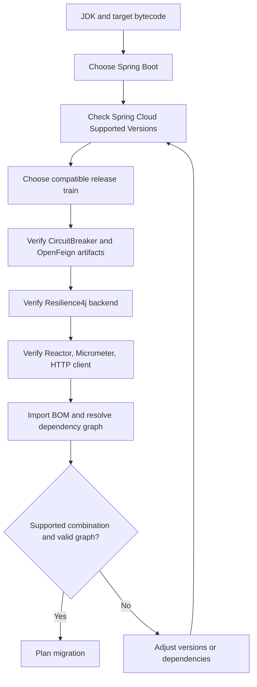
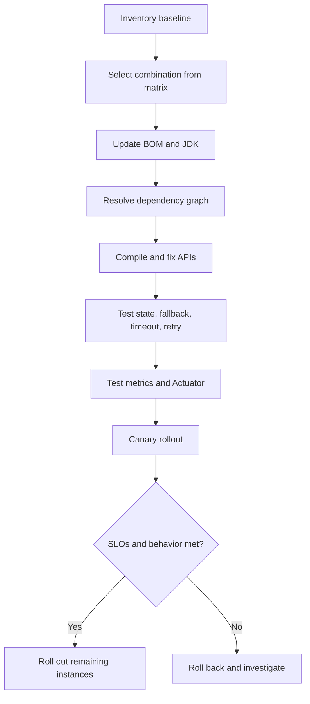

# Reading the Compatibility Matrix Before Upgrading Spring Cloud or Resilience4j

Upgrading Spring Boot, Spring Cloud, or Resilience4j simultaneously can alter multiple layers of an application: auto-configuration, Spring Cloud CircuitBreaker APIs, HTTP clients, Reactor, metrics, and how dependencies are version-managed. A project may compile successfully yet still use an unsupported version combination, or start up while silently changing fallback, timeout, and Circuit Breaker behavior.

Before modifying dependencies, consult the official compatibility matrix to select a supported combination of Spring Boot, Spring Cloud release train, JDK, and Resilience4j backend. Then cross-check it against the application's actual dependency graph. The matrix tells you which combinations are supported; the dependency graph tells you which artifacts and versions Maven or Gradle actually resolves.

## Components to Cross-Check

In an application using Spring Cloud CircuitBreaker with Resilience4j, there is more than one version pair to verify. Make a list of at least the following components:

| Component | What to Verify | Why It Matters |
|---|---|---|
| JDK | Minimum Java version and target bytecode | Newer libraries may require a higher JDK; build and runtime environments must align |
| Spring Boot | Managed Boot and Spring Framework versions | Determines the auto-configuration baseline, dependency management, and Jakarta baseline |
| Spring Cloud release train | Which train supports the Spring Boot version in use | Spring Cloud modules must belong to a train compatible with Boot |
| Spring Cloud CircuitBreaker | Artifact and version within the release train | Provides the factory abstraction and adapter for the Resilience4j backend |
| Resilience4j | Backend version and related modules | Configuration APIs, events, metrics, and Java requirements can change across major/minor releases |
| Reactor | Reactor Core version and reactive integration | Affects `Mono`, `Flux`, retry, timeout, and cancellation |
| OpenFeign or HTTP client | Version and Circuit Breaker integration mechanism | Affects proxies, fallbacks, timeouts, and how errors are wrapped |
| Micrometer/Actuator | Version and actual metric names | Dashboards and alerts may depend on metric names, tags, and health indicators |

A valid combination must satisfy the relationships across all components. For example, the Spring Cloud release train must support the chosen Spring Boot version; the Spring Cloud CircuitBreaker starter must belong to that train; and the Resilience4j backend must be within the version range supported by that starter and the current JDK.

## Reading the Matrix in Order

Do not start by picking the latest Resilience4j version and trying to force Spring libraries around it. Work from the application's foundation upward:

1. Identify the JDK used in build and production environments.
2. Choose a Spring Boot version within the project's support scope.
3. Open the Spring Cloud Supported Versions table and find the release train compatible with that Boot version.
4. Select a supported GA release of the Spring Cloud release train; check its support window and release notes.
5. Identify the Spring Cloud CircuitBreaker and OpenFeign versions managed by the train.
6. Check the Resilience4j version pulled in by the backend starter, along with its Java requirements and corresponding modules.
7. Check Reactor, Micrometer, and other integration libraries resolved within the same combination.
8. Inspect the dependency graph after importing the BOM to confirm the project actually resolves the selected versions.



The matrix typically shows release trains, supported Spring Boot ranges, and support status. Read the footnotes and release notes as well—do not rely on two version numbers simply looking close to each other. A snapshot, milestone, or release candidate may appear in development documentation but is not a production equivalent to a GA release.

## Compatibility Sources to Use

Prefer official, version-matched documentation:

- [Spring Cloud – Supported Versions](https://spring.io/projects/spring-cloud#overview): map Spring Cloud release trains to Spring Boot versions and support status.
- [Spring Cloud Release Notes](https://github.com/spring-cloud/spring-cloud-release/releases): review release train changes, upgraded dependencies, and compatibility notes.
- [Spring Cloud CircuitBreaker Reference](https://docs.spring.io/spring-cloud-circuitbreaker/reference/): check factory APIs, the Resilience4j backend, configuration, and reactive integration for the matching documentation version.
- [Resilience4j Documentation](https://resilience4j.readme.io/): verify Java requirements, configuration APIs, modules, and changes across versions.
- [Spring Boot Documentation](https://docs.spring.io/spring-boot/): verify Java requirements, dependency management, Actuator, and auto-configuration changes.

When a project uses an older release train, open the documentation for that specific train if available. Do not assume the `current` documentation accurately describes the APIs of the running version. For every choice, record the documentation URL or version number referenced in the change record so reviewers can verify it.

## Support Matrix vs. Dependency Graph

The matrix answers the question: "Is this combination supported by the vendor?" The dependency graph answers: "Which artifacts is the project currently resolving?" These two checks complement each other.

A dependency graph can show that an application is using:

- Spring Boot from the parent or BOM.
- Spring Cloud CircuitBreaker from the Spring Cloud BOM.
- Resilience4j pulled in transitively via the backend starter.
- A Reactor or Micrometer version selected by dependency management.
- Another library overriding a transitive version via its own dependency declaration.

Looking only at `pom.xml` or `build.gradle` can miss the final version selected after Maven or Gradle resolves conflicts. Conversely, looking only at the dependency tree can show that all artifacts resolve cleanly without telling you whether that combination is still within official support.

The following commands are inspection tools during migration; run them only in the project's build environment after identifying the changes to verify:

```bash
# Maven: inspect the dependency tree for relevant library groups
mvn dependency:tree -Dincludes=org.springframework.boot,org.springframework.cloud,io.github.resilience4j,io.projectreactor,micrometer

# Maven: inspect the effective POM after parent and BOM resolution
mvn help:effective-pom

# Gradle: inspect resolved dependencies for the runtime classpath
./gradlew dependencies --configuration runtimeClasspath

# Gradle: find why a specific version was selected
./gradlew dependencyInsight --dependency resilience4j-circuitbreaker --configuration runtimeClasspath
```

Examine the output for overridden versions, multiple coexisting versions, excluded dependencies, or modules from different release lines. A combination may compile due to binary compatibility yet still not be a tested or supported combination.

## Managing Versions with a BOM

In Maven, the Spring Boot parent usually manages Boot's baseline dependencies. Import the Spring Cloud BOM to manage Spring Cloud modules consistently. Take the `spring-cloud.version` value from the release train selected in the matrix; never assign an arbitrary version number.

```xml
<properties>
    <!-- Select a GA release train compatible with Spring Boot from the official matrix. -->
    <spring-cloud.version>SPRING_CLOUD_TRAIN_VERSION_FROM_MATRIX</spring-cloud.version>
</properties>

<dependencyManagement>
    <dependencies>
        <dependency>
            <groupId>org.springframework.cloud</groupId>
            <artifactId>spring-cloud-dependencies</artifactId>
            <version>${spring-cloud.version}</version>
            <type>pom</type>
            <scope>import</scope>
        </dependency>
    </dependencies>
</dependencyManagement>

<dependencies>
    <dependency>
        <groupId>org.springframework.cloud</groupId>
        <artifactId>spring-cloud-starter-circuitbreaker-resilience4j</artifactId>
    </dependency>
</dependencies>
```

`SPRING_CLOUD_TRAIN_VERSION_FROM_MATRIX` is a placeholder that must be replaced with a verified GA version; it is not a valid literal value to leave in a POM. If using WebFlux and requiring a reactive backend, check the matching reactive starter for your Spring Cloud CircuitBreaker version, such as `spring-cloud-starter-circuitbreaker-reactor-resilience4j`.

In Gradle, use a platform/BOM instead of pinning versions individually on each Spring Cloud module:

```kotlin
dependencies {
    implementation(platform("org.springframework.cloud:spring-cloud-dependencies:$springCloudVersion"))
    implementation("org.springframework.cloud:spring-cloud-starter-circuitbreaker-resilience4j")
}
```

If the application declares `io.github.resilience4j` modules directly, first inspect the version selected by the Spring Cloud CircuitBreaker starter. Only import the Resilience4j BOM or override the version when there is a clear reason and you have verified that the new combination is compatible. Two BOMs managing the same dependency group can introduce conflicts depending on import order or parent dependency management; always inspect the effective POM and dependency insight after making changes.

Do not pick the latest version of each artifact independently. A BOM keeps modules aligned within the same release line, but a BOM cannot make an unsupported release train compatible with a Spring Boot version from another train.

## Checking JDK Requirements and Platform Changes

The Java version is part of the matrix. Verify the compile JDK, toolchain, target bytecode, container image, and production JRE/JDK. If a newer library raises its Java baseline, the build may succeed on a developer machine while the production container still runs an older JDK and fails to start.

When upgrading from a Spring Boot generation using `javax.*` to one using Jakarta EE, inspect servlet, validation, persistence APIs, and integration libraries. Jakarta-related `javax.*` imports may need to move to `jakarta.*`; do not blindly bulk-replace every package starting with `javax`, as several Java SE packages remain valid. Verify that third-party starters and libraries support the corresponding Jakarta baseline.

For Resilience4j, check the Java requirements and API changes for the exact major version. For example, the Resilience4j 2.x line requires Java 17 or higher; when migrating from an older line, verify that both your toolchain and runtime meet this requirement. Never change only the version number in the BOM and assume all configuration APIs, events, and metrics remain unchanged.

## Checking Spring Cloud CircuitBreaker Artifacts

After choosing a release train, verify the specific artifacts your application uses:

| Requirement | Artifact to Verify |
|---|---|
| Common Circuit Breaker API and synchronous Resilience4j backend | `spring-cloud-starter-circuitbreaker-resilience4j` |
| Resilience4j backend for reactive streams | `spring-cloud-starter-circuitbreaker-reactor-resilience4j` |
| Feign client | `spring-cloud-starter-openfeign` and the corresponding version's Circuit Breaker integration |
| Metrics/health | Spring Boot Actuator, Micrometer, and the appropriate registry |

Do not add both the synchronous and reactive starters just to have all classes on the classpath. Choose based on the actual execution model and inspect the dependency tree to avoid pulling in unnecessary modules. If using Feign, verify the property for enabling the Circuit Breaker, how circuit names are generated, fallback/fallbackFactory wiring, and timeout behavior for that Spring Cloud OpenFeign version.

## Checking API and Configuration Changes Before Upgrading

The matrix only confirms version compatibility at the platform level. Migration still requires reading release notes and comparing every integration point used by the application:

| Area | What to Verify |
|---|---|
| Factory abstraction | Constructors, generic types, `create(...)`, `run(...)`, and customizers |
| Resilience4j config | Property names, data types, defaults, and precedence between properties and Java customizers |
| Circuit Breaker name | Resolvers, instance names, and keys in `resilience4j.circuitbreaker.instances` |
| Exception classification | `recordExceptions`, `ignoreExceptions`, predicates, and client exception wrappers |
| Fallback | Fallback signatures, fallback factories, and ordering with retry/error recovery |
| TimeLimiter | Timeouts, cancellation, and differences between `Future`, `CompletionStage`, and `Mono`/`Flux` |
| Bulkhead | Semaphore/thread-pool behavior, concurrency limits, and queues |
| Reactive | Subscription, retry, timeout, cancellation, and non-blocking event loop behavior |
| Metrics/Actuator | Metric names, tags, health indicators, and endpoint exposure |
| OpenFeign | Circuit Breaker enablement, fallback bean scope, and circuit name resolvers |

A minor change in decorator order can cause the sliding window to record a single final outcome instead of each individual attempt. A change in instance naming can prevent old configuration from matching, causing the circuit to fall back to default settings. Therefore, verify both the actual Circuit Breaker names and the effective configuration after upgrading.

## Phased Migration Workflow

### 1. Record the Current Baseline

Before making changes, record the currently resolved versions of JDK, Spring Boot, Spring Cloud release train, Spring Cloud CircuitBreaker, Resilience4j, Reactor, OpenFeign, and Micrometer. Save the dependency tree, effective POM, or dependency lockfile. Also capture current behavior: Circuit Breaker names, sliding windows, thresholds, timeouts, retries, fallbacks, and key metrics.

### 2. Choose a Supported Target Combination

Consult the official matrix to choose a compatible Spring Boot and Spring Cloud release train. Check support status, JDK requirements, and release notes. Confirm that the Spring Cloud CircuitBreaker Resilience4j backend is included in that train and that the Resilience4j version meets the project's Java baseline.

### 3. Upgrade Dependency Management First

Update the Boot parent/BOM and Spring Cloud BOM to the chosen combination. Remove individual version pins that are no longer needed. Do not override transitive Resilience4j versions before checking which version the starter manages. Then inspect the effective POM or dependency insight to verify the dependency graph.

### 4. Resolve Compilation and API Migration

Update imports, APIs, or configuration properties that changed according to the release notes. Handle Jakarta migration if applicable, and update the JDK/toolchain and build plugins. Avoid changing Circuit Breaker policies at the same time unless necessary; keep thresholds and timeouts unchanged initially so behavioral differences are easier to isolate.

### 5. Test Protection Behavior

Test success paths, exceptions, ignored exceptions, timeouts, slow calls, retries, fallbacks, `CLOSED` → `OPEN` → `HALF_OPEN` transitions, and rejected calls. Test both synchronous and reactive paths if the application uses both models. For Feign, confirm that fallback/fallbackFactory and circuit names still match configuration.

### 6. Test Operations and Observability

Compare metric names/tags, health indicators, event logs, and traces before and after migration. Verify that dashboards, alerts, and runbooks are not broken by renamed metrics or tags. Confirm that Actuator endpoints remain properly exposed and secured.

### 7. Canary Deployment and Rollback Path

Deploy to a small subset of instances and monitor error rates, latency, retries, fallbacks, Circuit Breaker states, and resource usage. Expand the rollout only when metrics stay within acceptable thresholds. Retain the pre-migration artifact version and configuration so rollback can happen quickly, and verify data/configuration compatibility if rolling back after runtime changes have occurred.



## Verifying Resilience4j Configuration After Migration

Do not stop at verifying that the application starts. Inspect representative configurations and verify that instances are created with the expected names:

```yaml
resilience4j:
  circuitbreaker:
    instances:
      catalog:
        slidingWindowType: COUNT_BASED
        slidingWindowSize: 20
        minimumNumberOfCalls: 10
        failureRateThreshold: 50
        slowCallDurationThreshold: 800ms
        slowCallRateThreshold: 50
        waitDurationInOpenState: 5s
        permittedNumberOfCallsInHalfOpenState: 3
  timelimiter:
    instances:
      catalog:
        timeoutDuration: 1500ms
```

The example above is illustrative and is not a universal set of values for every dependency. After migration, verify that the `catalog` instance actually uses the expected settings; if both properties and a Java customizer configure it, check the precedence rules for the running version. For dynamic per-request timeouts, confirm that the publisher or client applies the actual deadline rather than relying solely on a single instance-level fixed timeout.

Additionally, verify:

- `CircuitBreakerFactory` or `ReactiveCircuitBreakerFactory` is injected with the right backend.
- Generated Circuit Breaker names match the configuration keys and metrics.
- Technical exceptions are recorded; business exceptions are ignored or classified as designed.
- Retries do not retry `CallNotPermittedException`.
- Fallbacks execute only at the intended boundary and do not hide dependency failures from required metrics.
- `HALF_OPEN` admits only the configured number of probes; new replicas do not cause abnormal traffic bursts.
- Actuator/Micrometer still exports the required metrics after upgrading.

## Warning Signs of an Incorrect Version Combination

- Maven/Gradle reports missing methods or classes after dependencies resolve: APIs may be incompatible or a required module is missing from the classpath.
- The application fails to start during auto-configuration: check the Spring Boot and Spring Cloud train, classpath conditions, and overridden dependencies.
- `NoSuchMethodError` or `ClassNotFoundException`: usually indicates the runtime classpath contains modules from incompatible versions.
- A Spring Cloud starter pulls in an unexpected Resilience4j version: inspect the dependency tree, BOM, and directly declared dependencies.
- The Circuit Breaker runs with default configuration: check instance names, resolvers, and property keys.
- Metrics disappear or change names: check the Micrometer/Resilience4j versions and release notes before editing dashboards.
- Reactive requests block or cancellation changes: check the Reactor version, operator ordering, and TimeLimiter integration.
- Fallbacks are no longer invoked: check bean wiring, fallback signatures, proxies, and thrown exceptions.

Do not fix these errors by adding random version overrides. Trace which dependency introduces the incompatible version into the graph, then resolve it cleanly in the authoritative BOM or dependency declaration.

## Migration Decision Record Table

Before merging changes, record a table like this in the project's change request or migration documentation:

| Item | Before Upgrade | After Upgrade | Evidence |
|---|---|---|---|
| JDK | Current version | Target version | Toolchain and runtime image |
| Spring Boot | Current version | Selected version | Support matrix and release notes |
| Spring Cloud train | Current release train | Compatible train | Spring Cloud Supported Versions |
| CircuitBreaker starter | Current artifact/version | Target artifact/version | BOM and dependency tree |
| Resilience4j | Current version | Resolved version | Dependency insight and release notes |
| Circuit Breaker behavior | Thresholds, window, states | Post-migration behavior | Unit/integration tests |
| Fallback/Retry/TimeLimiter | Current behavior | Target behavior | Tests and traces |
| Metrics/Actuator | Current metrics and tags | Target metrics and tags | Metrics/Prometheus endpoint |
| Rollback | Previous artifact/config | Recovery procedure | Runbook and canary result |

Do not fill in target versions solely from a blog post or an undated configuration example. Document the official source, verification date, and reviewer so future upgrades can reuse the decision.

## Pre-Merge Checklist

| Question | Passing Criterion |
|---|---|
| Are Spring Boot and Spring Cloud a supported combination? | Verified against the official matrix and support status |
| Does the build/runtime JDK meet the baseline? | Toolchain, CI, and container images are all compatible |
| Does the BOM manage Spring Cloud modules? | No individual version pins without a documented reason |
| Is the Resilience4j version appropriate? | Actual resolved version verified in the dependency graph and release notes |
| Are there dependency graph conflicts? | No unexpected overrides or mismatched release-line modules |
| Have API and property changes been checked? | Checked factories, customizers, resolvers, and exception classification |
| Is protection behavior preserved? | State, sliding window, timeout, retry, and fallback tests pass |
| Are Reactive/Feign clients verified? | Tested according to the actual client type and execution model in use |
| Are metrics and Actuator working? | Dashboards, alerts, endpoints, and security verified |
| Is there a rollback plan? | Pre-migration artifact/config and canary procedure preserved |

Reading the compatibility matrix before upgrading helps you pick the right foundation instead of piecing together Spring Cloud and Resilience4j modules by guesswork. Combining the matrix with the dependency graph, release notes, and real behavioral testing ensures your migration preserves Circuit Breaker guarantees: opening at the right threshold, bounding wait times, executing fallbacks at the right moment, and providing reliable operational metrics.
