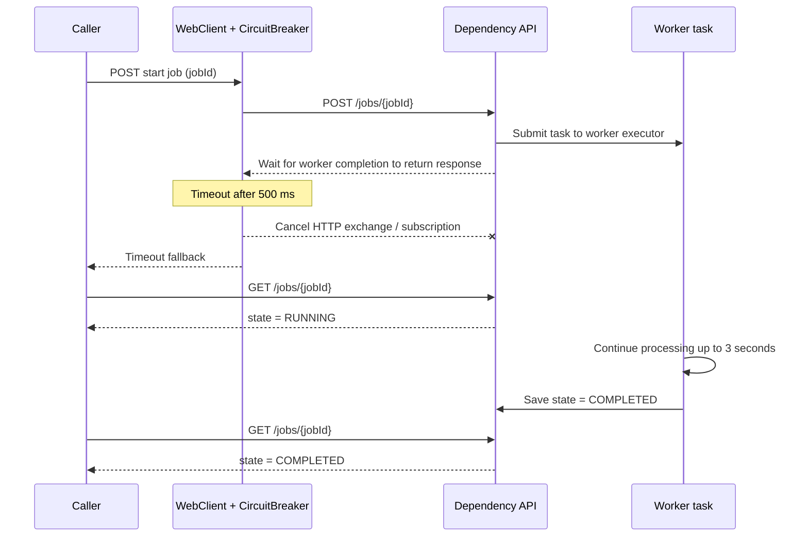

# Triggering a Timeout and Proving Actual Task State on the Dependency

A timed-out request on the caller side does not prove that work on the dependent service has stopped. A timeout may only end the caller's wait and cancel the HTTP exchange on the client side. The server may have already received the request, launched a background task, or forwarded work to a database, queue, or another service. If layers do not propagate cancellation signals down to the actual task, the work continues after the caller has already returned a fallback.

This hands-on practice builds two small applications: a **caller** using Spring WebFlux, WebClient, and Spring Cloud CircuitBreaker/Resilience4j; and a **dependency** that accepts requests, launches work on a separate worker executor, and tracks state by `jobId`. The caller sets a 500 ms timeout while the dependency takes 3 seconds to process. After the timeout, we query the dependency's status API to prove the job is still `RUNNING`, then verify it transitions to `COMPLETED`. Finally, we send an explicit cancellation command to show that stopping work must be wired to the actual worker.

## 1. Objectives and What Must Be Proven

After this lab, you can:

- Distinguish a caller timeout from a dependency timeout or cancellation.
- Place Reactor `timeout` inside the publisher protected by CircuitBreaker so the breaker records timeout failures.
- Create a background task decoupled from the HTTP response lifecycle.
- Use `jobId` to query task status after the caller has timed out.
- Prove with backend data that work keeps running and can complete after the caller stops waiting.
- Distinguish cancelling an HTTP response from actually cancelling a worker task.
- Design an explicit cancel endpoint and handle uncertain states for operations with side effects.

The key outcome of this lab is not merely seeing a `TimeoutException`. You must gather independent evidence from the dependency: the same `jobId` was recorded, has a `startedAt` timestamp, remains `RUNNING` after the caller times out, and then acquires a `finishedAt` timestamp and `COMPLETED` state.

## 2. Test Flow Diagram



In this lab's design, the dependency decouples `responseFuture` from `workerTask`. The HTTP response may be cancelled when the caller times out, but cancelling the response future does not call `workerTask.cancel(true)`. Therefore, the worker keeps running. This behavior is intentionally designed to illustrate the boundary between stopping waiting for a response and stopping the underlying work.

In real systems, outcomes also depend on the HTTP protocol, server runtime, framework, and how tasks are executed. HTTP/2 can reset a stream; HTTP/1.1 can close or drop a connection. The server might detect a client disconnect, yet detecting it does not automatically stop all child tasks. Each layer must be verified via state or traces.

## 3. Prepare the Two Applications

Create two Spring Boot applications in the lab environment:

| Application | Port | Role |
|---|---:|---|
| `dependency-service` | `8091` | Accepts jobs, runs workers in a separate executor, exposes status and cancel APIs |
| `caller-service` | `8080` | Calls dependency via WebClient, times out after 500 ms, and uses CircuitBreaker |

The dependency uses Spring WebFlux to return responses from `Mono.fromFuture`. The worker task runs on a separate `ThreadPoolTaskExecutor`, not on the event loop. The caller needs dependencies compatible with the project's Spring Boot/Spring Cloud release train, including WebFlux and Spring Cloud CircuitBreaker Reactor Resilience4j.

Example dependencies required in the caller:

```kotlin
dependencies {
    implementation("org.springframework.boot:spring-boot-starter-webflux")
    implementation("org.springframework.cloud:spring-cloud-starter-circuitbreaker-reactor-resilience4j")
}
```

The dependency service only needs WebFlux to expose reactive APIs and a Spring-managed executor for workers. Manage versions via compatible Spring Boot/Cloud BOMs; do not mix release trains or Resilience4j versions arbitrarily.

## 4. Build the Job State Model on the Dependency

Each task has a unique `jobId`. The dependency stores state so the caller can query it after the initiating request has ended.

```java
import java.time.Instant;

public record WorkSnapshot(
        String jobId,
        String state,
        Instant startedAt,
        Instant finishedAt) {
}
```

States used in the lab:

| State | Meaning |
|---|---|
| `QUEUED` | Job was accepted but the worker has not started yet |
| `RUNNING` | Worker has started processing |
| `COMPLETED` | Work finished |
| `CANCELLED` | Worker received interrupt/cancel signal and stopped cooperatively |
| `FAILED` | Work ended due to an error |
| `REJECTED` | Executor did not accept more work because limits were reached |

State must be stored on the dependency. Do not infer whether the backend finished or cancelled from the caller's fallback result.

## 5. Configure a Bounded Worker Executor

Never run long work on the WebFlux event loop. Create a separate executor with bounded threads and queue capacity:

```java
import org.springframework.context.annotation.Bean;
import org.springframework.context.annotation.Configuration;
import org.springframework.scheduling.concurrent.ThreadPoolTaskExecutor;

@Configuration
public class WorkerConfiguration {

    @Bean
    ThreadPoolTaskExecutor dependencyWorkExecutor() {
        ThreadPoolTaskExecutor executor = new ThreadPoolTaskExecutor();
        executor.setCorePoolSize(2);
        executor.setMaxPoolSize(4);
        executor.setQueueCapacity(20);
        executor.setThreadNamePrefix("dependency-work-");
        executor.setWaitForTasksToCompleteOnShutdown(true);
        executor.setAwaitTerminationSeconds(5);
        executor.initialize();
        return executor;
    }
}
```

Small pool and queue limits make the lab easy to observe. In production, choose bounds based on processing duration, CPU, connection pools, and backend capacity. An unbounded queue can turn timeouts into an accumulation of tasks whose callers are no longer waiting for results.

## 6. Create a Service Running Workers Independently of the HTTP Response

The key is keeping two separate handles:

- `responseFuture`: the result the HTTP controller awaits to return to the caller.
- `workerTask`: the actual work executing in the executor.

Cancelling `responseFuture` does not automatically cancel `workerTask`. Only the explicit cancel endpoint calls `workerTask.cancel(true)`.

```java
import java.time.Instant;
import java.util.concurrent.CompletableFuture;
import java.util.concurrent.ConcurrentHashMap;
import java.util.concurrent.Future;
import java.util.concurrent.FutureTask;
import java.util.concurrent.RejectedExecutionException;
import java.util.concurrent.ThreadPoolExecutor;

import org.springframework.scheduling.concurrent.ThreadPoolTaskExecutor;
import org.springframework.stereotype.Service;

@Service
public class DependencyWorkService {
    private final ThreadPoolTaskExecutor executor;
    private final ConcurrentHashMap<String, JobRecord> jobs =
            new ConcurrentHashMap<>();

    public DependencyWorkService(ThreadPoolTaskExecutor dependencyWorkExecutor) {
        this.executor = dependencyWorkExecutor;
    }

    public CompletableFuture<WorkSnapshot> start(String jobId, long durationMs) {
        if (durationMs < 1 || durationMs > 30_000) {
            throw new IllegalArgumentException("durationMs must be between 1 and 30000");
        }

        JobRecord record = new JobRecord(jobId);
        if (jobs.putIfAbsent(jobId, record) != null) {
            throw new IllegalArgumentException("jobId already exists: " + jobId);
        }

        CompletableFuture<WorkSnapshot> responseFuture = new CompletableFuture<>();
        record.responseFuture = responseFuture;

        FutureTask<Void> workerTask = new FutureTask<>(() -> {
            record.state = "RUNNING";
            record.startedAt = Instant.now();
            try {
                // Only simulates a long-running task in the lab.
                Thread.sleep(durationMs);
                record.state = "COMPLETED";
                record.finishedAt = Instant.now();
                responseFuture.complete(record.snapshot());
            } catch (InterruptedException error) {
                record.state = "CANCELLED";
                record.finishedAt = Instant.now();
                responseFuture.completeExceptionally(error);
                Thread.currentThread().interrupt();
            } catch (RuntimeException error) {
                record.state = "FAILED";
                record.finishedAt = Instant.now();
                responseFuture.completeExceptionally(error);
                throw error;
            }
            return null;
        });

        record.workerTask = workerTask;
        try {
            executor.execute(workerTask);
        } catch (RejectedExecutionException error) {
            record.state = "REJECTED";
            record.finishedAt = Instant.now();
            responseFuture.completeExceptionally(error);
        }
        return responseFuture;
    }

    public WorkSnapshot status(String jobId) {
        JobRecord record = jobs.get(jobId);
        if (record == null) {
            throw new JobNotFoundException(jobId);
        }
        return record.snapshot();
    }

    public boolean cancel(String jobId) {
        JobRecord record = jobs.get(jobId);
        if (record == null || record.workerTask == null) {
            return false;
        }
        return record.workerTask.cancel(true);
    }

    private static final class JobRecord {
        private final String jobId;
        private volatile String state = "QUEUED";
        private volatile Instant startedAt;
        private volatile Instant finishedAt;
        private volatile Future<?> workerTask;
        private volatile CompletableFuture<WorkSnapshot> responseFuture;

        private JobRecord(String jobId) {
            this.jobId = jobId;
        }

        private WorkSnapshot snapshot() {
            return new WorkSnapshot(jobId, state, startedAt, finishedAt);
        }
    }
}
```

`JobNotFoundException` is an application exception returned when a job is not found. In the sample code, you can define this exception and map it to HTTP 404 using `@RestControllerAdvice`.

Here, `FutureTask` is stored separately in `record.workerTask`; the `CompletableFuture` returned to the controller represents only the response. If Reactor cancels the subscription and cancels `responseFuture`, the worker task keeps running because no callback links cancelling the two handles. When the worker completes, `responseFuture.complete(...)` may return `false` because the future was already cancelled; the job state is still updated to `COMPLETED`.

`Thread.sleep` is used solely to create a repeatable delay in the lab. Do not use it to simulate production business processing. Real work should invoke appropriate I/O APIs and support cancellation according to the library's contract.

## 7. Expose Start, Status, and Cancel APIs

The dependency controller returns a `Mono` from the response future while providing an independent status endpoint:

```java
import org.springframework.http.ResponseEntity;
import org.springframework.web.bind.annotation.DeleteMapping;
import org.springframework.web.bind.annotation.GetMapping;
import org.springframework.web.bind.annotation.PathVariable;
import org.springframework.web.bind.annotation.PostMapping;
import org.springframework.web.bind.annotation.RequestMapping;
import org.springframework.web.bind.annotation.RequestParam;
import org.springframework.web.bind.annotation.RestController;

import reactor.core.publisher.Mono;

@RestController
@RequestMapping("/jobs")
public class DependencyWorkController {
    private final DependencyWorkService service;

    public DependencyWorkController(DependencyWorkService service) {
        this.service = service;
    }

    @PostMapping("/{jobId}")
    public Mono<WorkSnapshot> start(
            @PathVariable String jobId,
            @RequestParam(defaultValue = "3000") long durationMs) {
        return Mono.fromFuture(service.start(jobId, durationMs));
    }

    @GetMapping("/{jobId}")
    public WorkSnapshot status(@PathVariable String jobId) {
        return service.status(jobId);
    }

    @DeleteMapping("/{jobId}")
    public ResponseEntity<Void> cancel(@PathVariable String jobId) {
        return service.cancel(jobId)
                ? ResponseEntity.accepted().build()
                : ResponseEntity.noContent().build();
    }
}
```

When the HTTP subscription is cancelled, Reactor may cancel the `responseFuture` wrapped by `Mono.fromFuture`. The worker task remains independent. The `GET /jobs/{jobId}` endpoint reads state from the in-memory registry; it does not depend on the original response. Only the `DELETE` endpoint sends a cancel request to `workerTask`.

In production, you must handle process restarts, long-lived jobs, or status sharing across multiple replicas using a durable state store or dedicated job service. An in-memory map is only suitable for a single-instance lab.

## 8. Configure CircuitBreaker on the Caller

The caller uses WebClient to send the job start request. The 500 ms timeout is placed inside the publisher before passing it into `ReactiveCircuitBreaker.run`. Thus, the timeout becomes an error of the breaker-protected publisher and can be recorded into the failure rate.

```yaml
resilience4j:
  circuitbreaker:
    instances:
      dependencyWork:
        slidingWindowType: COUNT_BASED
        slidingWindowSize: 10
        minimumNumberOfCalls: 1
        failureRateThreshold: 100
        waitDurationInOpenState: 15s
        permittedNumberOfCallsInHalfOpenState: 1
```

In the lab, `minimumNumberOfCalls: 1` and `failureRateThreshold: 100` allow a single timeout recorded as a failure to open the breaker. This makes `OPEN` quick to observe; production typically requires a larger sample count and thresholds tuned to traffic.

## 9. Call the Dependency with Timeout Inside the Breaker

The caller creates a `WebClient` pointing to the dependency and uses the `dependencyWork` breaker:

```java
import java.time.Duration;
import java.util.concurrent.TimeoutException;

import org.springframework.cloud.client.circuitbreaker.ReactiveCircuitBreaker;
import org.springframework.cloud.client.circuitbreaker.ReactiveCircuitBreakerFactory;
import org.springframework.stereotype.Service;
import org.springframework.web.reactive.function.client.WebClient;

import reactor.core.publisher.Mono;

@Service
public class DependencyGateway {
    private final WebClient dependencyClient;
    private final ReactiveCircuitBreakerFactory<?, ?> breakerFactory;

    public DependencyGateway(
            WebClient.Builder builder,
            ReactiveCircuitBreakerFactory<?, ?> breakerFactory) {
        this.dependencyClient = builder
                .baseUrl("http://localhost:8091")
                .build();
        this.breakerFactory = breakerFactory;
    }

    public Mono<WorkSnapshot> start(String jobId) {
        Mono<WorkSnapshot> request = dependencyClient.post()
                .uri("/jobs/{jobId}?durationMs=3000", jobId)
                .retrieve()
                .bodyToMono(WorkSnapshot.class)
                .timeout(Duration.ofMillis(500));

        ReactiveCircuitBreaker breaker = breakerFactory.create("dependencyWork");
        return breaker.run(request, error -> {
            if (hasCause(error, TimeoutException.class)) {
                return Mono.just(new WorkSnapshot(
                        jobId, "CLIENT_TIMEOUT", null, null));
            }
            return Mono.error(error);
        });
    }

    public Mono<WorkSnapshot> status(String jobId) {
        // Status query goes directly so it can still investigate when the start breaker is OPEN.
        return dependencyClient.get()
                .uri("/jobs/{jobId}", jobId)
                .retrieve()
                .bodyToMono(WorkSnapshot.class);
    }

    public Mono<Void> cancel(String jobId) {
        return dependencyClient.delete()
                .uri("/jobs/{jobId}", jobId)
                .retrieve()
                .bodyToMono(Void.class);
    }

    private boolean hasCause(Throwable error, Class<? extends Throwable> type) {
        for (Throwable current = error; current != null; current = current.getCause()) {
            if (type.isInstance(current)) {
                return true;
            }
        }
        return false;
    }
}
```

`CLIENT_TIMEOUT` is the state observed by the caller, not the job state on the dependency. The fallback only says the caller stopped waiting. The actual state must be fetched from `status(jobId)`.

In this code, `status` and `cancel` are called directly so you can still investigate or send a cancellation command after the `dependencyWork` breaker has opened. In production, status/cancel also need timeout protection and load limits; a separate breaker can be used if appropriate, but you should not let the same open breaker block the channel needed to verify job status.

## 10. Expose Endpoints on the Caller

```java
import org.springframework.web.bind.annotation.GetMapping;
import org.springframework.web.bind.annotation.PathVariable;
import org.springframework.web.bind.annotation.PostMapping;
import org.springframework.web.bind.annotation.DeleteMapping;
import org.springframework.web.bind.annotation.RequestMapping;
import org.springframework.web.bind.annotation.RestController;

import reactor.core.publisher.Mono;

@RestController
@RequestMapping("/caller/jobs")
public class CallerController {
    private final DependencyGateway gateway;

    public CallerController(DependencyGateway gateway) {
        this.gateway = gateway;
    }

    @PostMapping("/{jobId}")
    public Mono<WorkSnapshot> start(@PathVariable String jobId) {
        return gateway.start(jobId);
    }

    @GetMapping("/{jobId}/dependency-status")
    public Mono<WorkSnapshot> status(@PathVariable String jobId) {
        return gateway.status(jobId);
    }

    @DeleteMapping("/{jobId}/dependency")
    public Mono<Void> cancel(@PathVariable String jobId) {
        return gateway.cancel(jobId);
    }
}
```

## 11. Run the Test: Caller Times Out While Job Keeps Running

Start the dependency on port 8091 and the caller on port 8080. Pick a unique `jobId` for each run, for example `lab-timeout-001`.

Send the start request:

```bash
curl -i -X POST http://localhost:8080/caller/jobs/lab-timeout-001
```

The caller waits at most 500 ms. The dependency is asked to run for 3,000 ms, so the caller is expected to receive a fallback snapshot with `state=CLIENT_TIMEOUT` after about half a second.

Immediately afterward, query status directly from the dependency through the caller:

```bash
curl -i http://localhost:8080/caller/jobs/lab-timeout-001/dependency-status
```

Expected result at roughly 600–900 ms from the start:

```json
{
  "jobId": "lab-timeout-001",
  "state": "RUNNING",
  "startedAt": "2026-11-24T10:00:00Z",
  "finishedAt": null
}
```

Wait until more than 3 seconds have elapsed in total, then query again:

```bash
curl -i http://localhost:8080/caller/jobs/lab-timeout-001/dependency-status
```

Expected result:

```json
{
  "jobId": "lab-timeout-001",
  "state": "COMPLETED",
  "startedAt": "2026-11-24T10:00:00Z",
  "finishedAt": "2026-11-24T10:00:03Z"
}
```

Exact timestamps will vary per run. The required evidence is the same `jobId`, a non-null `startedAt`, state `RUNNING` after the caller timed out, and then state transitioning to `COMPLETED` with `finishedAt` populated. This proves the caller timeout did not stop the worker task in this design.

## 12. Observe CircuitBreaker After Timeout

Because the timeout is placed inside the publisher passed to the breaker, `TimeoutException` can be recorded by the breaker as a failure. With the lab configuration of `minimumNumberOfCalls: 1` and a 100% failure threshold, after the first timeout the breaker can transition from `CLOSED` to `OPEN`.

You can observe this via Actuator/Micrometer if the application has enabled the registry and appropriate metrics endpoints. Check:

- Breaker ID `dependencyWork`.
- Current state (`CLOSED` or `OPEN`).
- Failed call count and timeout timestamp.
- Rejected call count (`not_permitted`) if start continues to be called while the breaker is `OPEN`.
- HTTP client metrics and job status on the dependency.

When the breaker is `OPEN`, the next `POST` call can be rejected before sending a new request. When that happens, the dependency creates no new job. However, an earlier job may still be running and the status endpoint still returns that job's state. This is why observing job status must be separated from the breaker-protected start path.

Do not use the `not_permitted` metric to conclude that the backend kept processing a request. `not_permitted` means the breaker rejected the supplier; the supplier did not execute on the blocked call.

## 13. Test Explicit Cancellation and Verify CANCELLED State

Create a second job, for example `lab-cancel-002`:

```bash
curl -i -X POST http://localhost:8080/caller/jobs/lab-cancel-002
```

After the caller times out, send the cancel command to the dependency:

```bash
curl -i -X DELETE http://localhost:8080/caller/jobs/lab-cancel-002/dependency
```

The cancel endpoint calls `FutureTask.cancel(true)`, requesting that the worker be interrupted. In the example, the worker is inside `Thread.sleep`, so it receives `InterruptedException`, updates state to `CANCELLED`, and records `finishedAt`.

Query status again:

```bash
curl -i http://localhost:8080/caller/jobs/lab-cancel-002/dependency-status
```

The expected outcome is `state=CANCELLED`. There may be a brief delay between the DELETE API returning and the worker updating its state; poll status until the terminal state appears.

Key differences:

| Action | Response future | Worker task | Backend state |
|---|---|---|---|
| Caller timeout | Stops waiting; response may be cancelled | Not automatically cancelled | Continues `RUNNING`, then `COMPLETED` |
| Explicit cancel endpoint | May have timed out earlier | Calls `cancel(true)` on the separate Future | `CANCELLED` if the worker cooperates with interrupts |

`Future.cancel(true)` only sends an interrupt request. It does not guarantee that an I/O library, database statement, or request already dispatched to another system will stop. For work that does not respond to interrupts, you need a dedicated cancel API or a cancellation token actively checked by the task.

## 14. What Evidence Is Enough to Conclude Work Stopped?

Do not conclude a job stopped merely because the caller received a timeout or the HTTP connection closed. Gather evidence where the work actually runs:

- A job registry or status database records `RUNNING`, `COMPLETED`, `CANCELLED`, or `FAILED`.
- `startedAt` and `finishedAt` show the execution interval.
- Worker logs carry the same `jobId` and corresponding state transitions.
- If the work forwarded tasks to a queue or another service, reconcile the state of that downstream task.
- If the work performed data writes, inspect the actual transaction/record state; an HTTP timeout does not prove an operation did not commit.

A `client disconnected` log only proves the server noticed the connection dropped. A `cancel requested` log only proves a cancellation request was sent. To prove work stopped, you must see the worker confirm cancellation and the terminal state no longer be `RUNNING`; for external operations, obtain state from the system performing that operation.

## 15. Limits of Cancellation Over HTTP

Cancellation is a cooperative signal across multiple layers:

1. Reactor timeout cancels the subscription on the caller side.
2. WebClient/HTTP client cancels the exchange or stream on the client side.
3. Server may detect client disconnect or stream reset.
4. Server framework may propagate the cancel signal to the publisher/handler.
5. Application must wire that signal to the worker task or child task.
6. Child task must support cancellation and confirm it has stopped.

The chain can break at any layer. A client cannot roll back a committed database transaction merely by closing a socket. A server may have already published a message to a queue; a consumer can keep processing even though the original HTTP request was cancelled.

For a blocking task:

- `Thread.interrupt()` can stop interruptible waits such as `Thread.sleep`.
- A JDBC driver may support `Statement.cancel()`, though you must verify the actual driver and database behavior.
- Sockets or native libraries may not react to interrupts as expected.
- `CompletableFuture.cancel(true)` is not a universal guarantee that running work has stopped.
- If the task has already sent a request to another service, you must use that service's API/contract to cancel or query status.

## 16. Safe Design for Operations with Side Effects

Suppose the dependency processes payments. The caller times out after 500 ms, but the payment service has already submitted the transaction to the bank and is awaiting a result. If the caller automatically retries as if the first attempt never happened, the user could be charged twice.

For operations with side effects:

- Use a stable idempotency key for a business operation.
- Persist `PENDING`, `COMPLETED`, `FAILED`, or `UNKNOWN` state in the authoritative store.
- Provide an API to query status by operation ID/job ID.
- Send a cancel command only if the business domain and target system support cancellation.
- If the outcome cannot be determined, return an unknown state and reconcile rather than retrying blindly.
- Use transactional outbox, deduplication, or compensation when the architecture requires cross-system consistency.

A circuit breaker helps stop new calls from continuing to flood a failing dependency. It does not roll back work that has already started and does not guarantee server-side task cancellation. Retries must also account for idempotency and overall deadlines.

## 17. Common Mistakes in This Lab

| Symptom | Possible cause | How to check |
|---|---|---|
| Caller times out but job is not found | Request never reached dependency, wrong job ID, or task was rejected | Check request receipt logs and `QUEUED/REJECTED` state |
| Status returns `RUNNING` longer than expected | Worker is stuck or actual duration is longer | Check worker threads, queue, and logs by job ID |
| Status transitions to `COMPLETED` after caller timeout | Worker is decoupled from response lifecycle | This is the expected result of the lab |
| Status does not become `CANCELLED` after DELETE | Worker ignores interrupts or cancel endpoint targets wrong task | Check `FutureTask.cancel`, threads, and cancellation handling |
| Breaker is open yet status is still queryable | Status endpoint uses a separate call path | This is intentional to preserve investigation capability |
| Breaker does not record timeout | Timeout placed outside breaker or exception ignored | Check Reactor `timeout` placement and record/ignore policy |
| Backend still receives many jobs after timeout | Caller retries or many new requests are still sent | Check retries, breaker state, and bulkheads |
| Two jobs with the same ID overwrite each other | Missing duplicate control | Use unique IDs and handle idempotency |

## 18. Extension Exercises

1. Change worker duration from 3,000 ms to 5,000 ms while keeping caller timeout at 500 ms. Record when the caller returns fallback and when the backend transitions to `COMPLETED`.
2. Change caller timeout to 2,000 ms while the worker runs for 3,000 ms. Verify the caller still times out before the job finishes.
3. Try `durationMs=300` with a 500 ms timeout. Verify the caller receives a successful response and status is already `COMPLETED`.
4. Submit two jobs concurrently with two different IDs. Verify each job's state is independent.
5. Resubmit the same `jobId`. Verify the dependency rejects the duplicate ID instead of creating a second task.
6. Call DELETE while a job is `RUNNING`. Verify the worker receives the interrupt and status transitions to `CANCELLED`.
7. Replace `Thread.sleep` with a simulated blocking operation that ignores interrupts. Observe why `cancel(true)` is insufficient to prove work stopped; then add a cancellation token checked periodically.
8. Trigger the breaker into `OPEN` after the first timeout. Send a second start request and verify the dependency receives no new job, while the first job's status remains queryable.
9. Try placing `timeout` outside `breaker.run(...)` and compare the exception/cancellation observed by the breaker with placing the timeout inside the protected publisher.

When recording results, capture `jobId`, request start time, caller timeout time, dependency status after timeout, task completion or cancellation time, and breaker state. Do not log only "request timeout" because that information does not reveal actual work status.

## 19. Lab Completion Checklist

- Caller has a 500 ms timeout while the worker is configured to run for 3 seconds.
- Timeout is inside the publisher passed to ReactiveCircuitBreaker.
- Breaker records the timeout according to test configuration.
- Dependency stores jobs by ID and exposes an independent status endpoint.
- After the caller times out, the dependency status is still `RUNNING`.
- After enough time elapses, status transitions to `COMPLETED` with `finishedAt` set.
- Explicit cancel targets the separate `workerTask`, not just the response future.
- `CLIENT_TIMEOUT` is distinguished from backend job state.
- Limits of interrupt/cancellation for I/O, databases, and downstream tasks are identified.
- Operations with side effects include idempotency keys and status query/reconciliation mechanisms.

A timeout only tells you that the caller stopped waiting. To know whether dependent work stopped, you must observe state where the work actually executes and verify whether cancellation signals propagate to workers or downstream systems. By separating the response future from the worker task, tracking `jobId`, and testing explicit cancellation, this lab demonstrates why a timed-out request can still complete on the backend, while showing that a circuit breaker protects against new calls without automatically stopping or rolling back work that has already started.
