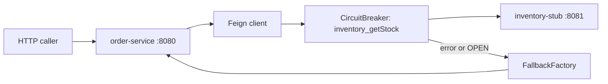

# Integrating Feign or Gateway and Verifying Named Configuration

In this hands-on practice, you will protect a call to an inventory service using Spring Cloud CircuitBreaker and Resilience4j, then verify that the circuit breaker received the exact configuration by name. The main section uses Spring Cloud OpenFeign because each client can declare its own fallback and you can inspect the breaker name generated from the client and method. At the end, there is a short alternative track for Spring Cloud Gateway.

The goal is to observe the entire lifecycle: successful calls, errors from the dependent service, fallback, the `OPEN` state, rejected calls, the `HALF_OPEN` phase, and recovery back to `CLOSED`. This lesson belongs to the **SPRING_CLOUD_CIRCUIT_BREAKER** module and focuses on integration and runtime configuration verification rather than merely adding a dependency and assuming the circuit breaker is working.

## 1. Expected Outcomes

After completing this practice, you can:

- Add the right Spring Cloud OpenFeign starter and Resilience4j provider according to the project BOM.
- Enable CircuitBreaker integration for Feign.
- Assign deterministic breaker names using `CircuitBreakerNameResolver`.
- Configure `slidingWindowSize`, `minimumNumberOfCalls`, failure thresholds, and open wait duration under the exact ID.
- Use `FallbackFactory` to distinguish execution failures from rejected calls.
- Generate controlled errors to open the breaker, then verify `HALF_OPEN` and recovery.
- Read actuator endpoints or metrics to confirm the runtime ID and active configuration.

## 2. Practice Architecture

We use two small applications:

| Application | Port | Role |
|---|---:|---|
| `inventory-stub` | 8081 | Simulated service returning success, 503 error, or slow response. |
| `order-service` | 8080 | Calls inventory via Feign protected by Resilience4j. |

The call flows along this path:



For easy outcome control, `inventory-stub` accepts a `mode` query parameter:

- `mode=ok`: returns normal stock data.
- `mode=error`: returns HTTP 503 so Feign throws an exception.
- `mode=slow`: waits longer than the slow call threshold before returning data.

In practice, the two applications can be split into two repositories or two Maven modules. The dependency configuration below lists only the required artifacts; let a compatible Spring Cloud BOM manage versions instead of assigning individual starter versions manually.

## 3. Prepare Dependencies for order-service

In `order-service`'s `pom.xml`, use a Spring Boot parent and a Spring Cloud release train compatible with your project's Java/Spring Boot versions. Declare the Spring Cloud BOM in `dependencyManagement`, then add the required dependencies:

```xml
<dependencyManagement>
    <dependencies>
        <dependency>
            <groupId>org.springframework.cloud</groupId>
            <artifactId>spring-cloud-dependencies</artifactId>
            <version>${spring-cloud.version}</version>
            <type>pom</type>
            <scope>import</scope>
        </dependency>
    </dependencies>
</dependencyManagement>

<dependencies>
    <dependency>
        <groupId>org.springframework.cloud</groupId>
        <artifactId>spring-cloud-starter-openfeign</artifactId>
    </dependency>
    <dependency>
        <groupId>org.springframework.cloud</groupId>
        <artifactId>spring-cloud-starter-circuitbreaker-resilience4j</artifactId>
    </dependency>
    <dependency>
        <groupId>org.springframework.boot</groupId>
        <artifactId>spring-boot-starter-actuator</artifactId>
    </dependency>
</dependencies>
```

If using a Micrometer Prometheus registry, add `micrometer-registry-prometheus` managed by Spring Boot dependency management. Do not add another circuit breaker provider concurrently without a clear reason; having multiple providers on the classpath can make it confusing which factory gets injected.

`inventory-stub` only needs `spring-boot-starter-web`. There is no need to add Resilience4j to the simulator application because the breaker sits on the caller side where the Feign call is made.

## 4. Create the Simulated Inventory Service

In `inventory-stub`, create the DTO:

```java
public record StockResponse(
    String sku,
    int available,
    boolean fallback,
    String source
) {}
```

Create a controller returning the three result modes:

```java
import org.springframework.http.HttpStatus;
import org.springframework.web.bind.annotation.GetMapping;
import org.springframework.web.bind.annotation.PathVariable;
import org.springframework.web.bind.annotation.RequestParam;
import org.springframework.web.bind.annotation.RestController;
import org.springframework.web.server.ResponseStatusException;

@RestController
public class InventoryStubController {

    @GetMapping("/inventory/{sku}")
    public StockResponse getStock(
            @PathVariable String sku,
            @RequestParam(defaultValue = "ok") String mode) {

        if ("error".equalsIgnoreCase(mode)) {
            throw new ResponseStatusException(
                HttpStatus.SERVICE_UNAVAILABLE,
                "Inventory is temporarily unavailable"
            );
        }

        if ("slow".equalsIgnoreCase(mode)) {
            try {
                Thread.sleep(1500);
            } catch (InterruptedException error) {
                Thread.currentThread().interrupt();
                throw new ResponseStatusException(
                    HttpStatus.SERVICE_UNAVAILABLE,
                    "Inventory request was interrupted",
                    error
                );
            }
        }

        return new StockResponse(sku, 25, false, "inventory-service");
    }
}
```

This simulator produces repeatable outcomes. `mode=error` returns 503; Feign turns error responses into exceptions by default through its error decoder. `mode=slow` holds the request for 1.5 seconds to test `slowCallDurationThreshold`.

## 5. Declare a Feign Client with a Fallback Factory

In `order-service`, create the client interface. Set `name` and `contextId` to the same value so the example has one clear identifier:

```java
import org.springframework.cloud.openfeign.FeignClient;
import org.springframework.web.bind.annotation.GetMapping;
import org.springframework.web.bind.annotation.PathVariable;
import org.springframework.web.bind.annotation.RequestParam;

@FeignClient(
    name = "inventory",
    contextId = "inventory",
    url = "${inventory.base-url}",
    fallbackFactory = InventoryFallbackFactory.class
)
public interface InventoryClient {

    @GetMapping("/inventory/{sku}")
    StockResponse getStock(
        @PathVariable("sku") String sku,
        @RequestParam(name = "mode", defaultValue = "ok") String mode
    );
}
```

Create the fallback factory:

Use Spring Cloud OpenFeign's `FallbackFactory`:

```java
import org.slf4j.Logger;
import org.slf4j.LoggerFactory;
import org.springframework.cloud.openfeign.FallbackFactory;
import org.springframework.stereotype.Component;

@Component
public class InventoryFallbackFactory
        implements FallbackFactory<InventoryClient> {

    private static final Logger log =
        LoggerFactory.getLogger(InventoryFallbackFactory.class);

    @Override
    public InventoryClient create(Throwable cause) {
        log.warn("Inventory client fallback triggered", cause);

        return (sku, mode) -> new StockResponse(
            sku,
            0,
            true,
            "temporarily-unavailable"
        );
    }
}
```

The fallback returns `fallback=true` so callers and tests distinguish fallback data from real data. In a real application, do not return `available=0` as if zero inventory were confirmed; the `fallback` flag or a dedicated status field must inform the business layer that data is currently unavailable. The log retains `cause` to distinguish HTTP 503, timeouts, and `CallNotPermittedException`.

Note: import only `org.springframework.cloud.openfeign.FallbackFactory`; do not use `feign.hystrix.FallbackFactory` from the legacy Hystrix integration.

## 6. Enable Feign CircuitBreaker and Deterministic Naming

In the main application, enable OpenFeign CircuitBreaker integration:

```java
import org.springframework.boot.SpringApplication;
import org.springframework.boot.autoconfigure.SpringBootApplication;
import org.springframework.cloud.openfeign.EnableFeignClients;

@SpringBootApplication
@EnableFeignClients
public class OrderServiceApplication {
    public static void main(String[] args) {
        SpringApplication.run(OrderServiceApplication.class, args);
    }
}
```

Define a resolver so breaker names follow a predictable convention:

```java
import feign.Target;
import java.lang.reflect.Method;
import org.springframework.cloud.openfeign.CircuitBreakerNameResolver;
import org.springframework.context.annotation.Bean;
import org.springframework.context.annotation.Configuration;

@Configuration(proxyBeanMethods = false)
public class FeignCircuitBreakerNamingConfiguration {

    @Bean
    CircuitBreakerNameResolver circuitBreakerNameResolver() {
        return (feignClientName, target, method) ->
            feignClientName + "_" + method.getName();
    }
}
```

With client `name="inventory"` and method `getStock`, the resolver produces the name `inventory_getStock`. Therefore, the Resilience4j configuration in the next section must use the exact ID `inventory_getStock`. If a project has overloaded methods with the same name, extend the resolver rule to avoid ID collisions, for example by including parameter types in the name.

If no custom resolver is declared, the default name may depend on the Spring Cloud OpenFeign version and the alphanumeric ID option. In that case, do not guess the name from `name` or `contextId`; read the actual name from events or metrics and configure under that exact name.

## 7. Configure Using the Exact Breaker Name

Create `application.yml` for `order-service`:

```yaml
server:
  port: 8080

inventory:
  base-url: http://localhost:8081

spring:
  cloud:
    openfeign:
      circuitbreaker:
        enabled: true
      client:
        config:
          inventory:
            connectTimeout: 300
            readTimeout: 2500
            loggerLevel: basic

resilience4j:
  circuitbreaker:
    instances:
      inventory_getStock:
        slidingWindowType: COUNT_BASED
        slidingWindowSize: 8
        minimumNumberOfCalls: 4
        failureRateThreshold: 50
        slowCallDurationThreshold: 800ms
        slowCallRateThreshold: 50
        waitDurationInOpenState: 10s
        permittedNumberOfCallsInHalfOpenState: 2
        registerHealthIndicator: true

management:
  endpoints:
    web:
      exposure:
        include: health,info,metrics,circuitbreakers,circuitbreakerevents
  endpoint:
    health:
      show-details: when_authorized
```

Explanation of values:

| Property | Value | Purpose |
|---|---:|---|
| `slidingWindowSize` | 8 | Retains up to the 8 most recent results in a count-based window. |
| `minimumNumberOfCalls` | 4 | Only evaluates rates once at least 4 results exist. |
| `failureRateThreshold` | 50 | Opens the circuit when failure rate reaches 50% or higher after enough samples. |
| `slowCallDurationThreshold` | 800 ms | Classifies calls taking 800 ms or longer as slow. |
| `slowCallRateThreshold` | 50 | Opens the circuit if slow call rate reaches 50% or higher after enough samples. |
| `waitDurationInOpenState` | 10 seconds | Wait period before allowing probes in `HALF_OPEN`. |
| `permittedNumberOfCallsInHalfOpenState` | 2 | Allows two probe calls. |

The name `inventory_getStock` must match the output of `CircuitBreakerNameResolver` exactly. If configuration is placed under `inventory` while the resolver generates `inventory_getStock`, the instance will not pick up the declared thresholds and may fall back to defaults.

Feign's `readTimeout` and `slowCallDurationThreshold` serve different purposes. `readTimeout` limits how long the client waits for a response; `slowCallDurationThreshold` merely classifies completed calls as slow for statistical tracking. Network timeouts must not be replaced by a slow call threshold.

## 8. Expose a Test Endpoint from order-service

Create a controller invoking the Feign client:

```java
import org.springframework.web.bind.annotation.GetMapping;
import org.springframework.web.bind.annotation.PathVariable;
import org.springframework.web.bind.annotation.RequestParam;
import org.springframework.web.bind.annotation.RestController;

@RestController
public class OrderAvailabilityController {
    private final InventoryClient inventoryClient;

    public OrderAvailabilityController(InventoryClient inventoryClient) {
        this.inventoryClient = inventoryClient;
    }

    @GetMapping("/orders/{sku}/availability")
    public StockResponse availability(
            @PathVariable String sku,
            @RequestParam(defaultValue = "ok") String mode) {
        return inventoryClient.getStock(sku, mode);
    }
}
```

Now every request to `/orders/{sku}/availability` passes through Feign and the `inventory_getStock` breaker.

## 9. Run Both Applications

Start `inventory-stub` on port 8081, then start `order-service` on port 8080. Verify both applications are ready before testing failures.

Test a successful call:

```bash
curl "http://localhost:8080/orders/SKU-1/availability?mode=ok"
```

Expected output looks like:

```json
{
  "sku": "SKU-1",
  "available": 25,
  "fallback": false,
  "source": "inventory-service"
}
```

The `fallback=false` field confirms the response came from the simulated inventory service.

## 10. Trip the Circuit Breaker to OPEN

Send four consecutive failing requests:

```bash
curl "http://localhost:8080/orders/SKU-1/availability?mode=error"
curl "http://localhost:8080/orders/SKU-2/availability?mode=error"
curl "http://localhost:8080/orders/SKU-3/availability?mode=error"
curl "http://localhost:8080/orders/SKU-4/availability?mode=error"
```

Because `minimumNumberOfCalls` is 4 and all four outcomes are recorded failures, the failure rate hits 100%, exceeding the 50% threshold. The circuit breaker transitions to `OPEN` after evaluating the window.

The fallback returns a response with `fallback=true`. Immediately send another request with `mode=ok`:

```bash
curl "http://localhost:8080/orders/SKU-5/availability?mode=ok"
```

The result will still be the fallback even though inventory is healthy. When the breaker is `OPEN`, the supplier is rejected before calling the target service. Check `inventory-stub` logs: no new request should appear while the circuit is open. This is how you distinguish a blocked call from a request that actually reached the dependency and failed.

## 11. Verify State and Instance Name

Check health:

```bash
curl "http://localhost:8080/actuator/health"
```

If the circuit breakers endpoint is exposed by the provider, inspect the list of instances:

```bash
curl "http://localhost:8080/actuator/circuitbreakers"
```

Inspect breaker events:

```bash
curl "http://localhost:8080/actuator/circuitbreakerevents/inventory_getStock"
```

Inspect call meters:

```bash
curl "http://localhost:8080/actuator/metrics/resilience4j.circuitbreaker.calls?tag=name:inventory_getStock"
```

Endpoint names and tags can vary depending on Actuator, Resilience4j, and Micrometer versions. If an endpoint does not appear, verify the Actuator dependency, Resilience4j provider, endpoint exposure settings, and actual meters rather than concluding the breaker was not created.

Signs to look for:

- The runtime breaker name is `inventory_getStock`.
- Error events correspond to the `mode=error` requests.
- A state transition event to `OPEN` appears.
- A `not permitted` event or metric appears when sending subsequent requests while `OPEN`.
- Actual call count reaching inventory does not increase during rejected calls.

If a different ID appears, check `CircuitBreakerNameResolver`, `name`, `contextId`, and the Feign method. Then fix the YAML instance key to match the runtime ID; do not add multiple near-duplicate keys hoping one sticks.

## 12. Wait for HALF_OPEN and Verify Recovery

After `waitDurationInOpenState: 10s`, the breaker can transition to `HALF_OPEN` on the next call. Send two successful requests:

```bash
curl "http://localhost:8080/orders/SKU-6/availability?mode=ok"
curl "http://localhost:8080/orders/SKU-7/availability?mode=ok"
```

Two requests are granted probe permission. If both succeed, the breaker can return to `CLOSED`. Verify the state transition event and send another request to confirm the supplier is called normally again.

If a probe request fails, the breaker can return to `OPEN` depending on the failure rate and probe count. During testing, wait for the exact duration and observe events rather than sending an uncontrolled burst of requests.

## 13. Test the Slow-Call Threshold

To test `slowCallDurationThreshold`, send `mode=slow` requests:

```bash
curl "http://localhost:8080/orders/SKU-8/availability?mode=slow"
curl "http://localhost:8080/orders/SKU-9/availability?mode=slow"
curl "http://localhost:8080/orders/SKU-10/availability?mode=slow"
curl "http://localhost:8080/orders/SKU-11/availability?mode=slow"
```

The stub waits 1.5 seconds, exceeding the 800 ms threshold. Once four samples are recorded, the slow-call rate reaches 100% and the breaker opens under `slowCallRateThreshold: 50`, even though every response succeeded over HTTP.

If requests hit Feign's read timeout before completing, outcomes are recorded as failures rather than completed slow calls. Therefore, `readTimeout` must be longer than the simulated response time when the goal is to test slow-call classification. In this lesson's config, read timeout is 2.5 seconds while the stub waits 1.5 seconds.

## 14. Alternative Track: Using Spring Cloud Gateway

If the requirement is to protect an ingress route rather than a Feign call, you can use the Gateway CircuitBreaker filter. With reactive Gateway, use the compatible reactive Resilience4j provider and configure the route:

```yaml
spring:
  cloud:
    gateway:
      routes:
        - id: inventory-route
          uri: http://localhost:8081
          predicates:
            - Path=/inventory/**
          filters:
            - name: CircuitBreaker
              args:
                name: inventoryGateway
                fallbackUri: forward:/fallback/inventory

resilience4j:
  circuitbreaker:
    instances:
      inventoryGateway:
        slidingWindowType: COUNT_BASED
        slidingWindowSize: 10
        minimumNumberOfCalls: 5
        failureRateThreshold: 50
        waitDurationInOpenState: 10s
```

In the Gateway track, `name: inventoryGateway` is the circuit breaker name used by the filter; Resilience4j configuration must sit under `instances.inventoryGateway`. Create an internal fallback endpoint matching `forward:/fallback/inventory` and ensure that endpoint does not forward back into the same route and cause a loop.

Do not apply Feign's `CircuitBreakerNameResolver` configuration to Gateway filters. The two integrations determine IDs differently: Feign typically builds names from client/method; Gateway uses the name declared in filter args. To verify, read events and metrics under the exact name `inventoryGateway`.

## 15. Common Mistakes

| Symptom | Possible cause | How to fix |
|---|---|---|
| Feign still calls downstream after fallback is declared | `spring.cloud.openfeign.circuitbreaker.enabled` is not enabled or provider is missing. | Check property, dependencies, and factory bean. |
| Circuit breaker uses default configuration | YAML key does not match runtime ID. | Read ID from events/metrics and fix instance name. |
| No `OPEN` event after four errors | Not enough samples, exception not recorded, or request goes through a different breaker. | Check `minimumNumberOfCalls`, error decoder, and ID. |
| HTTP 503 counted as success | Client/custom decoder returns a normal response instead of throwing an exception. | Check `ErrorDecoder` and exception mapping. |
| Fallback called but breaker never opens | Fallback handles error before breaker observes it or another breaker is used. | Check wrapper placement and instance name. |
| `mode=slow` triggers timeout errors instead of slow calls | Feign read timeout is shorter than stub response delay. | Increase read timeout in test or reduce delay. |
| Breaker never recovers | `waitDurationInOpenState` has not elapsed, probe failed, or inspecting wrong instance. | Read state transitions and send the permitted number of probes. |
| Gateway does not use `inventoryGateway` config | Name in filter args differs from instance key. | Synchronize `name` and instance ID. |

## 16. Extension Exercises

After completing the main flow, try the following changes and record the results:

1. Change `minimumNumberOfCalls` from 4 to 6. Send five errors and confirm the breaker has not evaluated yet; send the sixth error and observe the state.
2. Change `failureRateThreshold` from 50 down to 25. Create a window with one failure and three successes; determine when the breaker opens.
3. Add a second Feign method for a write operation, assign a separate breaker name, and configure different thresholds. Confirm that opening the read breaker does not automatically open the write breaker.
4. Update `FallbackFactory` to log the cause type, distinguishing Feign exceptions from `CallNotPermittedException`.
5. Modify `CircuitBreakerNameResolver`, then verify the new ID appears in events/metrics and YAML has the matching key.
6. Disable CircuitBreaker integration, re-run failing requests, and observe the difference; then re-enable it to confirm fallback and state transitions.

## 17. Completion Checklist

- [ ] Both applications start and communicate over HTTP.
- [ ] Feign client is registered with `@EnableFeignClients`.
- [ ] `spring.cloud.openfeign.circuitbreaker.enabled` is enabled.
- [ ] `FallbackFactory` returns a result clearly marked as fallback.
- [ ] `CircuitBreakerNameResolver` generates the deterministic ID `inventory_getStock`.
- [ ] YAML uses the exact key `resilience4j.circuitbreaker.instances.inventory_getStock`.
- [ ] Four consecutive failures satisfy the opening criteria under the sample config.
- [ ] The next request is rejected without calling `inventory-stub`.
- [ ] Events/metrics show the exact breaker ID and `OPEN` state.
- [ ] After wait duration, two successful probes return the breaker to `CLOSED`.
- [ ] Slow-call test distinguishes slow responses from timeouts.
- [ ] If testing Gateway, filter name and instance ID match.

When integrating Feign or Gateway, the critical step is identifying the exact circuit breaker name produced by the integration and placing Resilience4j configuration under that exact ID. In the Feign exercise, the resolver produces `inventory_getStock`; in the Gateway track, the filter declares `inventoryGateway`. Verify through events, actuator, and metrics while watching actual requests hitting the dependency to prove `OPEN` blocked calls and `HALF_OPEN` permitted only the configured number of probes. This is how you validate end-to-end that Spring Cloud CircuitBreaker genuinely protects the intended application boundary.
