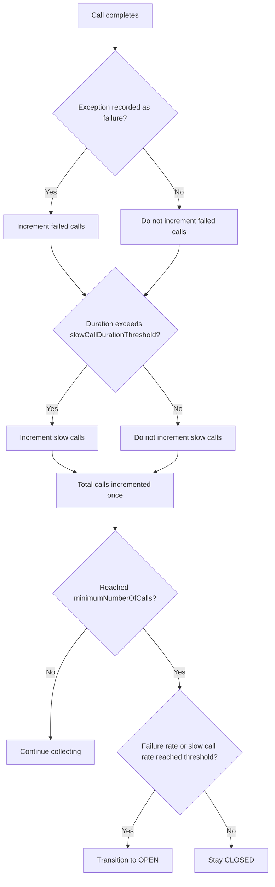

# How Calls That Are Both Slow and Failed Are Recorded

In Spring Cloud Circuit Breaker using Resilience4j, each call is evaluated along two independent dimensions: whether the outcome is a failure and whether the execution duration exceeds the slow call threshold. Therefore, a call that ends in an error after running for too long can simultaneously be counted as **one failed call** and **one slow call**.

These two labels serve two different rates in the circuit breaker. They do not turn one request into two requests in the statistical window: the total call count still increases by one. Properly understanding how this is recorded helps read metrics, select thresholds, and explain why the breaker transitions to `OPEN`.

## Outcome and duration are two separate evaluations

When a protected call completes, the circuit breaker receives the execution duration along with the call outcome. Resilience4j evaluates:

- **Failure outcome:** whether the exception is recorded as a failure by configuration or predicate.
- **Slow outcome:** whether the execution duration exceeds `slowCallDurationThreshold`.

The two conditions are not mutually exclusive. A call can succeed fast, succeed slow, fail fast, or fail slow.

| Scenario | Increments total calls | Increments failed calls | Increments slow calls |
|---|---:|---:|---:|
| Successful and fast | 1 | 0 | 0 |
| Successful yet slow | 1 | 0 | 1 |
| Failed yet fast | 1 | 1 | 0 |
| Failed and slow | 1 | 1 | 1 |

For example: the payment service takes 1.8 seconds and then throws `TimeoutException`. If `slowCallDurationThreshold` is 1 second and that exception is recorded as a failure, this call contributes one unit to total calls, one unit to failed calls, and one unit to slow calls. It is not counted as two calls in the denominator.

## How the sliding window aggregates outcomes

Resilience4j supports two statistical window types:

- `COUNT_BASED`: the window holds outcomes of up to the N most recent calls. When a new call arrives and the window is full, the oldest outcome is evicted from the aggregation.
- `TIME_BASED`: the window is divided into time buckets; each bucket stores aggregated statistics for calls in the corresponding time interval. As the window slides, expired old buckets are removed from current statistics.

Each recorded call contributes to the total call count exactly once. If the outcome is classified as a failure, the failure counter increases by one. If the duration exceeds the slow threshold, the slow call counter also increases by one. An outcome that is both failed and slow increments both specialized counters in the same window update.

The rates are calculated separately:

\[
\text{Failure rate} = \frac{\text{Failed calls}}{\text{Total recorded calls}} \times 100\%
\]

\[
\text{Slow call rate} = \frac{\text{Slow calls}}{\text{Total recorded calls}} \times 100\%
\]

Because a single call can belong to both groups, do not add failure rate and slow call rate together to derive a combined error rate. The two rates share the same denominator, yet they can have overlapping elements.

### Example of overlap

Suppose the current window has 10 recorded calls. Among them are 3 failed calls, 4 slow calls, and 1 call belonging to both groups.

| Group | Number of calls | Rate |
|---|---:|---:|
| Total calls | 10 | 100% |
| Failed calls | 3 | 30% |
| Slow calls | 4 | 40% |
| Both failed and slow | 1 | 10% |

The call that is both failed and slow has already been counted in both the failed group and the slow group. The number of calls belonging to at least one of the two groups is 3 + 4 - 1 = 6, not 7. However, the circuit breaker does not need to calculate a unified rate from 6: it compares the 30% failure rate against `failureRateThreshold` and the 40% slow call rate against `slowCallRateThreshold` separately.

## Condition for the circuit breaker to transition to OPEN

Resilience4j only evaluates rates after reaching the minimum number of calls specified by `minimumNumberOfCalls`. Once enough samples are collected, the breaker transitions to `OPEN` if **the failure rate reaches its threshold or the slow call rate reaches its threshold**. Either condition being true is enough.

For example, with `failureRateThreshold: 50` and `slowCallRateThreshold: 40`, the window in the example above has a 30% failure rate and a 40% slow call rate. The breaker opens because the slow call rate has met its threshold, even though the failure rate remains below its threshold. Whether the slow calls succeeded or failed does not change how these two rates are compared.



The diagram illustrates a typical call being recorded in the window. For a call that is both failed and slow, both the `failed calls` increment branch and the `slow calls` increment branch are executed, while `total calls` is incremented only once.

## Illustrative configuration in Spring Boot

The following configuration creates a count-based window of the 10 most recent calls. The breaker needs at least 5 recorded calls before evaluating rates; calls running longer than one second are marked as slow.

```yaml
resilience4j:
  circuitbreaker:
    instances:
      paymentGateway:
        slidingWindowType: COUNT_BASED
        slidingWindowSize: 10
        minimumNumberOfCalls: 5
        failureRateThreshold: 50
        slowCallRateThreshold: 40
        slowCallDurationThreshold: 1s
        waitDurationInOpenState: 10s
        recordExceptions:
          - java.io.IOException
          - java.util.concurrent.TimeoutException
        ignoreExceptions:
          - com.example.payment.InvalidPaymentRequestException
```

In this example, a `TimeoutException` lasting longer than one second is recorded in both groups: failed and slow. `InvalidPaymentRequestException` is configured to be ignored, so it is not recorded as either a failed or successful outcome in the window. When using `recordExceptions`, ensure the exceptions that should be treated as failures are in the list or handled by the corresponding `recordExceptionPredicate`. Exceptions ignored by `ignoreExceptions` do not participate in aggregation.

The exception names in the configuration are illustrative examples; replace them with the actual exception types thrown by your dependent service client. In particular, a timeout only increments the failure counter when the circuit breaker classifies it as a failure. It only increments the slow call counter when the duration measured by the breaker exceeds `slowCallDurationThreshold`.

## Reading metrics and handling real-world scenarios

When observing the circuit breaker, examine total calls, failed calls, slow calls, failure rate, and slow call rate separately. Do not assume that every failed call is slow or that every slow call fails. For example, an HTTP 200 response after 2.5 seconds may belong only to the slow group; a connection error occurring after 50 milliseconds may belong only to the failure group.

If the breaker opens due to slow call rate, inspect dependency latency, client wait times, load, and resource limits. If the breaker opens due to failure rate, check exception types, network errors, application errors, and retry policies. For calls that are both failed and slow, look at both aspects: the service neither provides a successful result nor completes without tying up significant caller wait time.

Checklist during testing:

1. Invoke a fast successful request and confirm only total calls increases.
2. Invoke a successful request that exceeds the duration threshold and confirm slow calls increases.
3. Invoke a fast failing request and confirm failed calls increases.
4. Invoke a failing request after exceeding the duration threshold and confirm both failed and slow counters increase, while total calls increases by one.
5. Test an ignored exception and confirm it does not increase the failure rate or slow call rate in the window.
6. Generate enough samples per `minimumNumberOfCalls`, then verify the breaker opens when either rate meets its threshold.

In a real application, combine metrics with Resilience4j state transition events to know whether the breaker opened due to failure rate or slow call rate. This helps choose the right remediation: handling dependency errors, optimizing latency, adjusting timeouts, or tuning thresholds based on actual traffic characteristics.
