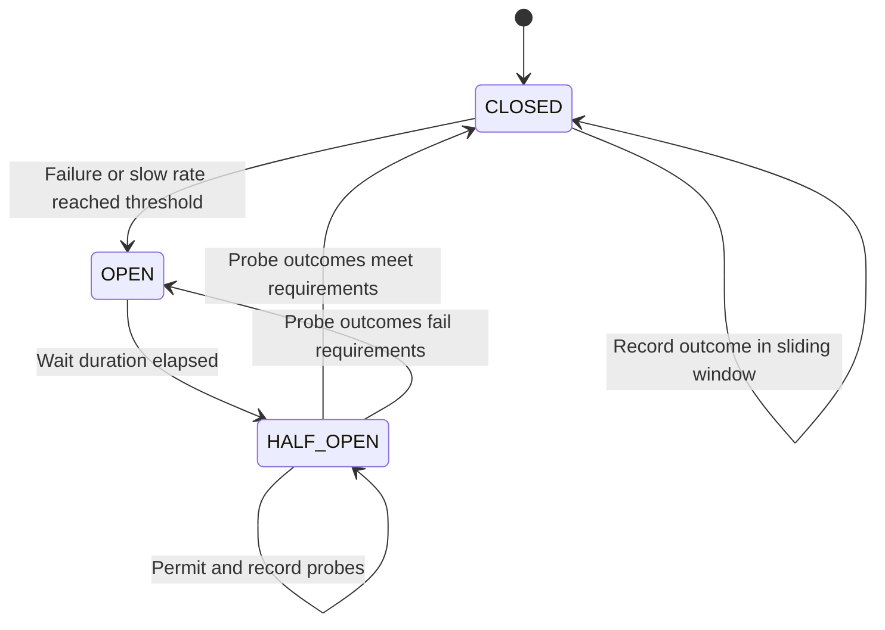

# Sampling in HALF_OPEN Differs from the Window in CLOSED

## Objectives

A Circuit Breaker uses call outcomes to decide when to cut off traffic to a dependent service and when traffic can be allowed back. However, how samples are collected in `CLOSED` and `HALF_OPEN` serves two different decisions. `CLOSED` monitors normal traffic using a sliding window; `HALF_OPEN` limits a small group of trial calls to test recovery.

After this lesson, you will be able to:

- Explain how the sliding window records call outcomes in `CLOSED`.
- Distinguish `slidingWindowSize`, `minimumNumberOfCalls`, and `permittedNumberOfCallsInHalfOpenState`.
- Calculate the failure rate and slow call rate within a window or a trial round.
- Choose appropriate sample counts, read metrics, and design tests to observe state transitions.

## Two sampling mechanisms, two purposes

In `CLOSED`, the service is receiving normal traffic. The Circuit Breaker continuously records call outcomes into a sliding window to evaluate the service's health over a recent set of samples. The sliding window ensures decisions reflect current conditions instead of being permanently skewed by errors that happened long ago.

In `HALF_OPEN`, the Circuit Breaker has just finished its wait duration in `OPEN` and wants to test whether the service has recovered. It permits only a limited number of trial calls. The outcomes of that trial round are used to decide whether to close the circuit or return to `OPEN`. This is a bounded check, not a window continuously sliding over normal traffic.

| Aspect | `CLOSED` | `HALF_OPEN` |
|---|---|---|
| Purpose | Monitor health during normal serving. | Test the service after it was tripped. |
| Recorded samples | Calls processed by the Circuit Breaker in the most recent window. | Permitted trial calls in the recovery check round. |
| How samples are bounded | Sliding window by call count or by time. | Maximum number of calls configured for a trial round. |
| Key configuration | `slidingWindowType`, `slidingWindowSize`, `minimumNumberOfCalls`. | `permittedNumberOfCallsInHalfOpenState`, `maxWaitDurationInHalfOpenState`. |
| Decision | If failure or slow call threshold is reached, transition to `OPEN`. | If trial outcomes reach thresholds, return to `OPEN`; if acceptable, transition to `CLOSED`. |

Overall flow:



Key takeaway: `slidingWindowSize` does not control how many probes run in `HALF_OPEN`, and `permittedNumberOfCallsInHalfOpenState` does not control the window size in `CLOSED`.

## Sliding window in CLOSED

Resilience4j supports two window types:

- `COUNT_BASED`: the window holds outcomes of up to the N most recent calls. For example, `slidingWindowSize: 20` means evaluating over up to the 20 most recent outcomes.
- `TIME_BASED`: the window covers the last N seconds. For example, `slidingWindowSize: 10` means evaluating over the last 10 seconds; outcomes are aggregated by time intervals within the window.

`minimumNumberOfCalls` specifies the minimum number of samples that must be recorded before the Circuit Breaker computes rates to compare against thresholds. This property avoids making decisions from just the first few calls. It is especially important for services with low traffic.

The two commonly used rates are:

\[
\text{Failure rate} = \frac{\text{failed calls}}{\text{recorded calls}} \times 100\%
\]

\[
\text{Slow call rate} = \frac{\text{slow calls}}{\text{recorded calls}} \times 100\%
\]

A call is considered slow when its duration equals or exceeds `slowCallDurationThreshold`. The Circuit Breaker can transition to `OPEN` when the failure rate reaches `failureRateThreshold` or the slow call rate reaches `slowCallRateThreshold`, after the minimum number of samples has been collected. Exceptions configured to be ignored are not treated as ordinary failures when calculating thresholds.

Count-based window configuration example:

```yaml
resilience4j:
  circuitbreaker:
    instances:
      inventory:
        slidingWindowType: COUNT_BASED
        slidingWindowSize: 20
        minimumNumberOfCalls: 10
        failureRateThreshold: 50
        slowCallRateThreshold: 60
        slowCallDurationThreshold: 1s
        waitDurationInOpenState: 10s
```

In this example, the window can hold up to the 20 most recent outcomes, yet the Circuit Breaker begins evaluating rates once at least 10 calls are recorded. If 5 of the first 10 calls fail, the failure rate is 50% and reaches the configured threshold; the circuit can transition to `OPEN` right at that point. It does not need to wait for all 20 calls before evaluating.

As more calls arrive, a `COUNT_BASED` window keeps the most recent outcomes and gradually evicts older outcomes from the window. With `TIME_BASED`, older outcomes leave the scope as their corresponding time interval slides out of the window. Thus, an old burst of errors can gradually cease to have an effect once the service operates stably again.

## Trial sampling in HALF_OPEN

Once `OPEN` completes its wait duration, the Circuit Breaker transitions to `HALF_OPEN` automatically if configured or upon the next call. Resilience4j uses `permittedNumberOfCallsInHalfOpenState` to limit the number of calls permitted through during the trial round.

Example:

```yaml
resilience4j:
  circuitbreaker:
    instances:
      inventory:
        waitDurationInOpenState: 10s
        permittedNumberOfCallsInHalfOpenState: 4
        maxWaitDurationInHalfOpenState: 6s
        failureRateThreshold: 50
        slowCallRateThreshold: 50
        slowCallDurationThreshold: 1s
```

Here, at most four calls are permitted in a `HALF_OPEN` round. Additional requests arriving while the probes are executing are rejected because no permits remain. Once enough outcomes are available to evaluate, the Circuit Breaker compares the failure rate and slow call rate against the configured thresholds:

- If the rates are below the thresholds, the circuit transitions back to `CLOSED` and normal traffic resumes.
- If the failure rate or slow call rate meets or exceeds its threshold, the circuit returns to `OPEN` and starts a new wait duration.

`maxWaitDurationInHalfOpenState` limits how long the Circuit Breaker can stay in `HALF_OPEN`. A value of `0` means no time limit is set. When set to a positive duration, this configuration prevents staying in the trial state too long if calls do not complete. Coordinate this duration with call timeouts so probes have a chance to return outcomes before the limit expires.

The probe count is the quota for a single recovery check round. It is not a sample count accumulated over many minutes or ordinary traffic. Once a trial round ends and the circuit returns to `OPEN` or `CLOSED`, the next decision belongs to a new state phase.

## Example calculating rates in both states

Suppose the configuration has `failureRateThreshold: 50` and `slowCallRateThreshold: 50`.

In `CLOSED`, configure `slidingWindowSize: 20` and `minimumNumberOfCalls: 10`. When the window currently has 10 recorded samples:

| Outcomes in 10 calls | Failure rate | Evaluation result |
|---|---:|---|
| 2 failures, 1 slow call | 20% failed, 10% slow | Threshold not reached yet. |
| 5 failures, 0 slow calls | 50% failed, 0% slow | Failure threshold reached, transition to `OPEN`. |
| 1 failure, 6 slow calls | 10% failed, 60% slow | Slow call threshold reached, transition to `OPEN`. |

After the wait duration, suppose the circuit transitions to `HALF_OPEN` with `permittedNumberOfCallsInHalfOpenState: 4`. The four probes form the sample for this check round:

| Outcomes of 4 probes | Failure rate | Slow call rate | Evaluation result |
|---|---:|---:|---|
| 0 failed, 0 slow | 0% | 0% | Acceptable, can return to `CLOSED`. |
| 1 failed, 1 slow | 25% | 25% | Both rates below threshold, can return to `CLOSED`. |
| 2 failed, 0 slow | 50% | 0% | Failure threshold reached, return to `OPEN`. |
| 0 failed, 2 slow | 0% | 50% | Slow call threshold reached, return to `OPEN`. |

This example shows that `minimumNumberOfCalls: 10` does not force `HALF_OPEN` to wait for 10 probes. The number of probes is determined by `permittedNumberOfCallsInHalfOpenState: 4`. Similarly, `slidingWindowSize: 20` does not mean the Circuit Breaker must send 20 trial calls.

The calculations above assume all samples are counted toward their respective rates. In a real application, compute using the outcomes the Circuit Breaker actually records; ignored exceptions and calls rejected for lacking a permit are handled separately and should not be manually added to failure samples.

## Choosing window size and probe count

There is no single right value for every service. Choose based on traffic, volatility, and the load the dependent service can handle.

**For the sliding window in CLOSED:**

- Use `COUNT_BASED` when you want decisions based on the number of most recent calls, especially when traffic is relatively steady.
- Use `TIME_BASED` when you want the window to represent an actual time interval, especially when traffic varies heavily by hour or in bursts.
- Choose `minimumNumberOfCalls` large enough to avoid overreacting to a few random samples, yet small enough for the Circuit Breaker to recognize incidents in a timely manner.
- Ensure the window can hold enough samples to reach `minimumNumberOfCalls`; also balance incident detection speed against acceptable latency.

**For probes in HALF_OPEN:**

- Choose a small probe count to reduce load on a newly recovering service.
- Choose enough samples so a single outcome does not dominate the decision too strongly.
- Set reasonable timeouts so probes do not hold permits indefinitely.
- Verify the dependent service's capacity when multiple application instances transition to `HALF_OPEN` simultaneously. Each instance has its own Circuit Breaker, which can generate a larger total probe volume than expected if all probe at once.

For example, if there are 8 application instances and each permits 4 probes, up to 32 concurrent probes could hit the dependent service when all circuit breakers transition to `HALF_OPEN` together. Therefore, per-instance probe count must be considered alongside the deployed instance count, load-balancing mechanism, and recovery capacity of the target service.

## Factors that alter the meaning of samples

**Retry:** the placement of Retry relative to the Circuit Breaker determines whether one probe represents a single attempt or an entire retry sequence. If every retry attempt goes through the Circuit Breaker, it can consume extra permits and be recorded as a separate call. Limit retries and coordinate backoff with timeouts so you do not amplify load during recovery.

**Timeout:** a call exceeding the timeout can be recorded as a failure or a slow call depending on integration and configuration. Setting a timeout longer than the system can wait causes probes to tie up resources for long periods; setting it too short can cause a healthy service experiencing brief latency to be judged unhealthy.

**Fallback:** fallback runs after the Circuit Breaker handles an error outcome. A fallback returning valid data to the caller does not turn the call to the dependent service into a success in the Circuit Breaker's samples. When analyzing metrics, distinguish fallback outcomes from the original outcomes of dependency calls.

**Bulkhead:** calls rejected due to exhausted Bulkhead permits reflect resource limits within the application. Decide explicitly whether this exception should affect the health error rate of the dependent service; it can be configured as an ignored exception if it does not reflect an error in the target service.

## Monitoring and verification

With Spring Boot Actuator and Micrometer integrated, you can observe Resilience4j metrics such as:

- `resilience4j.circuitbreaker.state`: current state of the instance.
- `resilience4j.circuitbreaker.calls`: call count by outcome and call type.
- `resilience4j.circuitbreaker.failure.rate`: calculated failure rate.
- `resilience4j.circuitbreaker.slow.call.rate`: slow call rate.
- `resilience4j.circuitbreaker.buffered.calls`: number of outcomes stored in the window.
- `resilience4j.circuitbreaker.not.permitted.calls`: number of calls rejected because the Circuit Breaker did not grant permission.

Metric names and tags may vary by library version, registry, and configuration. Inspect the actual metrics exported by the application before writing dashboard queries or alerts. While in `HALF_OPEN`, combine state with permitted calls, rejected calls, and probe outcomes to understand why the circuit closed again or reopened.

A controlled test can be carried out as follows:

1. Start the dependent service in a healthy state and send enough requests to populate samples in `CLOSED`.
2. Intentionally make the service return errors or respond slowly; confirm the rate in the sliding window reaches the threshold and the Circuit Breaker transitions to `OPEN`.
3. Send additional requests while the circuit is `OPEN`; confirm they fail fast and no longer reach the dependent service.
4. Restore the service, wait for `waitDurationInOpenState` to elapse, and trigger `HALF_OPEN`.
5. Send several nearly concurrent requests; confirm that permitted calls do not exceed `permittedNumberOfCallsInHalfOpenState` and excess requests are rejected.
6. Let probes succeed and then repeat with intentional errors or latency; observe the circuit returning to `CLOSED` or `OPEN` respectively according to thresholds.

Record call counts, outcomes, latency, and state at each step. Use the same load scenario when varying `slidingWindowSize`, `minimumNumberOfCalls`, or probe count to compare incident detection capability and load generated during recovery.

## Common mistakes

- **Using `slidingWindowSize` to adjust the probe count:** use `permittedNumberOfCallsInHalfOpenState` for the trial round.
- **Assuming `minimumNumberOfCalls` applies to HALF_OPEN:** this property sets the minimum samples to evaluate the sliding window in `CLOSED`; probe count has its own configuration.
- **Choosing a window that is too small:** a few random errors can spike the rate and open the circuit.
- **Choosing a window that is too large:** an incident may take a long time or many calls to reach the threshold, making protection react slowly.
- **Allowing too many probes:** a recovering service may immediately receive a heavy burst of load, especially with multiple application instances.
- **Allowing too few probes:** too small a sample may not represent service quality; a single outcome can easily dominate the rate.
- **Ignoring timeouts and retries:** probes may hold permits for too long or generate more requests than intended.
- **Reading fallbacks as target service successes:** fallbacks improve responses for the caller, but do not erase the original failure outcomes recorded by the Circuit Breaker.

The sliding window in `CLOSED` answers the question “is the normally operating service healthy across recent samples?”. Probes in `HALF_OPEN` answer the question “is the recently tripped service healthy enough to receive traffic again?”. When both mechanisms are properly configured for their distinct purposes, the Circuit Breaker both detects incidents during operation and tests recovery under controlled load.
