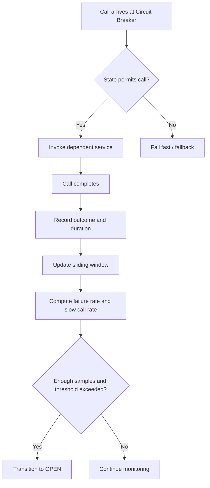

# The Statistical Window Is Not a Concurrent Call Limit

In Spring Cloud CircuitBreaker with the Resilience4j backend, `slidingWindowSize` defines the scope of call outcomes used to compute the failure rate and slow call rate. This parameter controls how the Circuit Breaker observes the health of a dependent service. It does not limit how many requests execute concurrently, does not cap thread counts, and does not queue calls on its own.

This distinction is critical when a dependent service responds slowly. A statistical window of size 20 does not mean only 20 calls are permitted to run concurrently. If you need to cap active calls, use a Bulkhead. Circuit Breaker and Bulkhead solve two different problems and can be combined.

## What is a sliding window used for?

The Circuit Breaker records the outcomes of completed calls, then uses the samples in the sliding window to calculate:

- **Failure rate:** the percentage of calls classified as failed under the Circuit Breaker's error recording policy.
- **Slow call rate:** the percentage of calls whose execution duration is greater than or equal to `slowCallDurationThreshold`.

Once the minimum number of samples is reached and either rate exceeds its corresponding threshold, the Circuit Breaker can transition from `CLOSED` to `OPEN`. In `OPEN`, new calls fail fast. After the wait duration, the circuit transitions to `HALF_OPEN` to evaluate a small number of trial calls.

An in-flight call does not yet have a final outcome and therefore has not contributed a complete sample to the window. Only when the call completes does Resilience4j record its duration and outcome. The statistical window therefore describes observed outcomes within a scope, not the number of requests currently active in the system.

## Two types of sliding windows

Resilience4j supports two window types:

| Type | Meaning of `slidingWindowSize` | How the window slides | Suitable when |
|---|---|---|---|
| `COUNT_BASED` | Number of most recent recorded calls | Each new outcome is added; when exceeding size, the oldest sample is evicted | You want to evaluate based on a fixed number of recent calls |
| `TIME_BASED` | Number of most recent seconds | The window retains statistics by time slices within the configured number of seconds | You want to evaluate over a relatively fixed time span even as traffic varies |

For example, with `COUNT_BASED` and `slidingWindowSize: 20`, the window aggregates up to the 20 most recent outcomes. If 100 calls complete, the latest 20 outcomes represent the window at that moment. Size 20 does not cap concurrency at 20 calls; 100 calls may still have overlapped in execution before outcomes were recorded.

With `TIME_BASED` and `slidingWindowSize: 10`, the window represents the last 10 seconds. If the service receives high request volume in 10 seconds, the window can aggregate outcomes from many calls. If traffic is low, the window may hold only a few samples. The number 10 here is seconds, not calls.



The diagram shows the window being updated from call outcomes. Controlling the number of active calls is a separate mechanism, covered in the Bulkhead section.

## `minimumNumberOfCalls` is a sample threshold, not a concurrency limit

`minimumNumberOfCalls` specifies the minimum number of samples required in the window before the Circuit Breaker computes the failure rate and slow call rate to decide whether to open the circuit. Before reaching enough samples, the circuit does not yet have sufficient configured data to apply rate thresholds.

Suppose a `COUNT_BASED` configuration has `slidingWindowSize: 20` and `minimumNumberOfCalls: 10`. After 4 completed calls, the Circuit Breaker does not yet compute rates to decide whether to open the circuit. Once at least 10 samples are in the window, it can compute rates and compare them against thresholds. This does not mean waiting for 10 concurrent calls, nor does it mean only 10 calls are allowed to run.

In practice, choose `minimumNumberOfCalls` so it is achievable within the window and matches the service's traffic. Too high a value can make the circuit react slowly on low-request services; too low a value gives a handful of outcomes disproportionate influence over the rates. For a count-based window, do not set the minimum sample count higher than the maximum number of samples the window can hold.

## Circuit Breaker configuration example

The YAML snippet below configures a Circuit Breaker named `catalog`. The count window tracks the 20 most recent calls; at least 10 samples are needed before calculating rates. The circuit opens if the failure rate reaches 50% or the slow call rate reaches 50% per the configured thresholds.

```yaml
resilience4j:
  circuitbreaker:
    instances:
      catalog:
        slidingWindowType: COUNT_BASED
        slidingWindowSize: 20
        minimumNumberOfCalls: 10
        failureRateThreshold: 50
        slowCallDurationThreshold: 2s
        slowCallRateThreshold: 50
        waitDurationInOpenState: 10s
        permittedNumberOfCallsInHalfOpenState: 3
```

If you want to evaluate over the last 10 seconds, change the window type and give the size a time-based meaning:

```yaml
resilience4j:
  circuitbreaker:
    instances:
      catalog:
        slidingWindowType: TIME_BASED
        slidingWindowSize: 10
        minimumNumberOfCalls: 10
        failureRateThreshold: 50
        slowCallDurationThreshold: 2s
        slowCallRateThreshold: 50
```

In the second example, `slidingWindowSize: 10` is 10 seconds. `minimumNumberOfCalls: 10` is still the minimum number of call samples that must be observed in that window. The two parameters have different units and roles.

In Spring Cloud CircuitBreaker, the properties above are configured for the Resilience4j backend by instance name. Make sure the name the application uses to create the Circuit Breaker matches `catalog`, and verify actual instance and group configuration when multiple configuration levels exist. Whether using `CircuitBreakerFactory` or Spring Cloud CircuitBreaker's reactive API, the window remains a statistical configuration of the Circuit Breaker; synchronous or reactive invocation does not turn the window size into a concurrency limit.

## Limiting concurrent calls with Bulkhead

A Bulkhead limits the number of calls that can execute concurrently against a resource or dependent service. With Resilience4j, a Semaphore Bulkhead uses `maxConcurrentCalls` to cap how many calls are granted concurrent permission. `maxWaitDuration` defines how long a call waits to acquire a permit; setting a short wait duration or zero enables failing fast when capacity is full.

For example, combining the Circuit Breaker above with a Bulkhead for `catalog`:

```yaml
resilience4j:
  circuitbreaker:
    instances:
      catalog:
        slidingWindowType: COUNT_BASED
        slidingWindowSize: 20
        minimumNumberOfCalls: 10
        failureRateThreshold: 50
        slowCallDurationThreshold: 2s
        slowCallRateThreshold: 50
        waitDurationInOpenState: 10s
        permittedNumberOfCallsInHalfOpenState: 3
  bulkhead:
    instances:
      catalog:
        maxConcurrentCalls: 8
        maxWaitDuration: 100ms
```

The two configurations have distinct meanings:

- `slidingWindowSize: 20` observes up to the 20 most recent outcomes to evaluate call quality.
- `maxConcurrentCalls: 8` limits at most 8 calls granted concurrent execution permission by the Bulkhead for that instance.
- `maxWaitDuration: 100ms` lets a call wait at most 100 milliseconds to acquire a Bulkhead permit; if no permit is obtained, the call is rejected by the Bulkhead mechanism.

Therefore, in this example, the number of calls protected by the Bulkhead can be capped at 8, while the Circuit Breaker window still retains up to 20 outcomes. Changing `slidingWindowSize` from 20 down to 5 does not reduce Bulkhead concurrency from 8 to 5. To change the number of concurrent calls, adjust `maxConcurrentCalls`.

A Bulkhead can be implemented as a semaphore or a thread-pool bulkhead. A semaphore limits concurrent access without creating its own thread pool. A thread-pool Bulkhead isolates calls on a dedicated pool and queue, so both pool size and queue capacity must be configured. Choose the type suited to your execution model, especially when working with WebFlux and reactive calls; avoid blocking the event loop with synchronous waits.

The Circuit Breaker also has `permittedNumberOfCallsInHalfOpenState` to cap the number of trial calls permitted specifically in the `HALF_OPEN` state. This is a probe limit during recovery, not a general concurrency limit while the circuit is `CLOSED`. If you need to limit active calls under normal operating conditions, configure a Bulkhead.

## Distinguishing from timeouts and rate limiters

Protection mechanisms are often combined, yet they control different quantities:

| Mechanism | What does it control? | Configuration example / meaning |
|---|---|---|
| Circuit Breaker sliding window | Sample scope used to calculate failure and slow call rates | Last 20 outcomes or last 10 seconds |
| Bulkhead | Number of calls active concurrently | At most 8 calls granted permission |
| TimeLimiter / timeout | Maximum wait time for an asynchronous call | After 2 seconds, complete according to timeout policy |
| RateLimiter | Number of call permissions granted per time period | For example, at most 50 permissions per second |

A timeout is not a concurrency limit: a timed-out call may continue consuming resources on the target system if cancellation is unsupported or not propagated. A RateLimiter controls the rate at which permissions are issued over time, yet does not guarantee that concurrently running calls stay below a fixed cap when processing times fluctuate. Bulkhead is the direct mechanism for setting a concurrency limit.

## Real-world scenario: a slow dependent service

Suppose the product API calls the `catalog` service. Each request can take 3 seconds when the dependent service is overloaded. If the API receives 60 requests in a short span, many calls can wait for responses simultaneously. Configuring a Circuit Breaker with a 20-sample window tracks the outcomes and durations of completed calls. It can open the circuit when the failure rate or slow call rate exceeds thresholds, yet does not by itself limit how many calls are currently waiting.

If you add a Bulkhead with `maxConcurrentCalls: 8`, at most 8 calls are permitted concurrently. Calls exceeding the limit wait up to the configured `maxWaitDuration` or are rejected. At the application layer, the rejected branch needs an appropriate fallback, such as returning cached data or a try-again-later message. Once the Circuit Breaker transitions to `OPEN`, new calls also fail fast without calling `catalog`.

When designing decorator ordering, ensure error behavior and fallbacks match the API in use. If you need to observe Circuit Breaker rejections separately from Bulkhead permit-exhaustion errors, record metrics or events by cause. That helps the operations team know whether the system is blocking calls because the dependent service has a high error rate or because the concurrency limit was reached.

## How to verify the behavior

You can verify both concepts with a controlled test:

1. Configure a `COUNT_BASED` Circuit Breaker with `slidingWindowSize: 5`, `minimumNumberOfCalls: 5`, and a Bulkhead with `maxConcurrentCalls: 2`.
2. Generate multiple concurrent requests to a mock call with a long response time, such as 1 second.
3. Measure active calls at the mock service. With a semaphore Bulkhead, concurrently permitted calls do not exceed 2; remaining calls wait or are rejected according to `maxWaitDuration`.
4. After calls complete, observe the Circuit Breaker metrics. Outcomes enter the window of the 5 most recent samples; this window does not determine the limit of 2 in the concurrency step.
5. Produce enough failure or slow call samples to exceed thresholds, then verify the Circuit Breaker transitions to `OPEN` and new calls fail fast.

When reading dashboards or logs, ask two separate questions: “How many samples is the Circuit Breaker using to evaluate the service?” and “How many calls are currently allowed to execute at the same time?”. The first relates to `slidingWindowType`, `slidingWindowSize`, and `minimumNumberOfCalls`; the second relates to Bulkhead. Separating these two questions prevents tuning the wrong parameter when the system is under overload.
