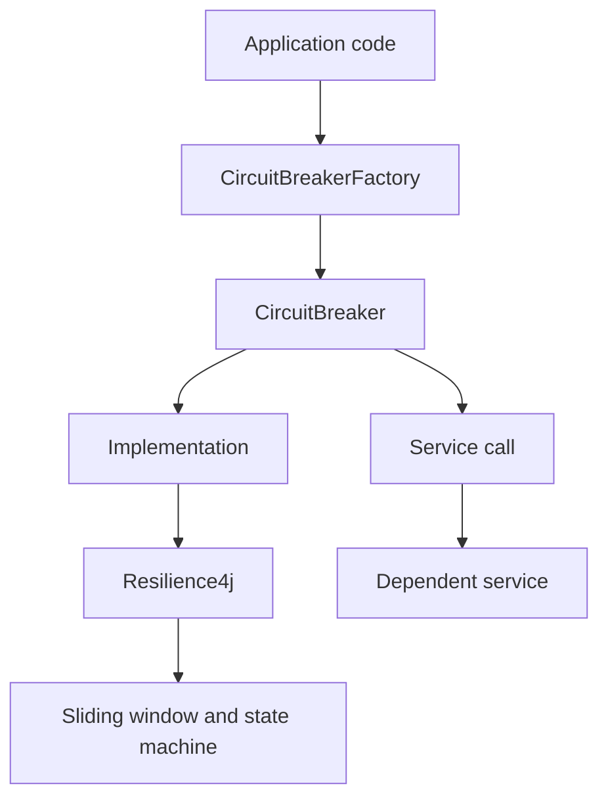

# CircuitBreakerFactory and CircuitBreaker Contracts

Spring Cloud CircuitBreaker provides a common API layer so application code can invoke services through a circuit breaker without directly depending on the API of a specific implementation library. The two central components of the synchronous API are `CircuitBreakerFactory` and `CircuitBreaker`: the factory provides breakers by identifier, and the breaker wraps a call and decides how to handle failures or an open circuit.

In the Spring Cloud Circuit Breaker module, Resilience4j is the commonly used implementation. By clearly understanding the boundary between the common Spring Cloud API and the Resilience4j-specific API, an application can keep its service-calling code simple, configure policies per dependency, and still access advanced capabilities when needed.

## 1. Position of the Common API in the Architecture

A remote service call typically consists of three parts: application code describing the work to be executed, a circuit breaker layer protecting that work, and an implementation performing statistics tracking and state transitions. Spring Cloud CircuitBreaker places an abstraction layer between the application code and the implementation.



Application code requests the factory to create or provide a breaker by name, then passes the call into the `run` method. The factory and breaker belong to the Spring Cloud Commons API. Resilience4j provides the concrete mechanisms such as `CLOSED`, `OPEN`, `HALF_OPEN`, sliding windows, events, metrics, and advanced configurations.

The common API layer helps keep business code less coupled to the implementation. However, the abstraction only guarantees the behaviors defined in the common contract. If the application needs to read state directly, register implementation-specific events, manually change state, or use a Resilience4j-specific option, that code will depend on the corresponding implementation.

## 2. The CircuitBreakerFactory Contract

`CircuitBreakerFactory` is the entry point for an application to obtain a breaker. The API has the following general form:

```java
public abstract class CircuitBreakerFactory<CONF, CONFB>
        extends AbstractCircuitBreakerFactory<CONF, CONFB> {
    public abstract CircuitBreaker create(String id);
}
```

The two type parameters `CONF` and `CONFB` are for the implementation's configuration mechanism. Typical application code does not need to instantiate or interact with them directly when it only wants to obtain a breaker to protect a call.

The most important method is `create(String id)`:

- `id` is the logical name of the breaker, usually representing a dependency or a group of calls that require their own protection policy.
- The return value is an object conforming to Spring Cloud's `CircuitBreaker` contract.
- The implementation uses `id` to associate the breaker with its corresponding configuration and per-instance observability data.

For example, `inventory` can be the breaker protecting calls to the inventory service, while `pricing` protects calls to the pricing service. Two separate IDs allow configuring failure thresholds, timeouts, and fallbacks according to the characteristics of each dependency.

```java
import org.springframework.cloud.client.circuitbreaker.CircuitBreaker;
import org.springframework.cloud.client.circuitbreaker.CircuitBreakerFactory;
import org.springframework.stereotype.Service;

@Service
public class InventoryGateway {
    private final InventoryClient inventoryClient;
    private final CircuitBreakerFactory<?, ?> circuitBreakerFactory;

    public InventoryGateway(
            InventoryClient inventoryClient,
            CircuitBreakerFactory<?, ?> circuitBreakerFactory) {
        this.inventoryClient = inventoryClient;
        this.circuitBreakerFactory = circuitBreakerFactory;
    }

    public InventoryView find(String sku) {
        CircuitBreaker breaker = circuitBreakerFactory.create("inventory");
        return breaker.run(
                () -> inventoryClient.find(sku),
                failure -> InventoryView.unavailable(sku)
        );
    }
}
```

`InventoryClient` and `InventoryView` are application types in this example. The key point is that the calling code only needs to know the factory, the ID, and the `run` contract; it does not need to know which data structures Resilience4j uses to calculate the failure rate.

You should not create a new factory on every request. The factory is typically managed by Spring as a bean and injected into the components that need it. Each call can retrieve the breaker by its corresponding ID; instance management and specific configuration are handled by the implementation.

## 3. The CircuitBreaker Contract

Spring Cloud's `CircuitBreaker` provides two basic synchronous call overloads:

```java
import java.util.function.Function;
import java.util.function.Supplier;

public interface CircuitBreaker {
    <T> T run(Supplier<T> toRun);

    <T> T run(
            Supplier<T> toRun,
            Function<Throwable, T> fallback
    );
}
```

The two functional interfaces used from Java are:

- `Supplier<T>` describes the work to be performed and produces a result of type `T`.
- `Function<Throwable, T>` receives the failure cause and produces an alternative result of the same type `T`.

The `run` method routes the work through the breaker. When the breaker permits it, the supplier is executed and the result is returned to the caller. The implementation records the outcome to update statistics. When the breaker is open or the supplier raises an error, the call can enter the fallback branch if the overload with a fallback is used.

The two overloads serve two different policies:

| Method | Behavior on error |
|---|---|
| `run(toRun)` | Does not define an alternative result; the error is propagated to the caller according to the implementation's behavior |
| `run(toRun, fallback)` | Invokes the fallback function to produce an alternative result for errors that the breaker routes to the handling branch |

The fallback must return the exact same type `T` that the primary call is expected to return. For example, if a call to fetch inventory returns `InventoryView`, the fallback must also produce `InventoryView`. You should not return an object with an incorrect business meaning just to avoid an exception.

A fallback is part of the error-handling flow, not proof that the service call succeeded. If the fallback itself throws an error, that error may continue propagating up to the calling layer. Therefore, fallbacks should be simple, resource-bounded, and avoid calling back into the same failing dependency.

## 4. Distinguishing Supplier Failures from Rejected Calls

There are at least two situations in which handling code does not receive a normal result:

1. **Supplier failure:** the call to the target service is executed but throws an exception, such as a connection error, timeout, or server error.
2. **Breaker rejects the call:** the breaker is in `OPEN` state, so the supplier is not executed. With Resilience4j, this case is typically represented by `CallNotPermittedException`.

Both cases can enter the fallback of the `run(toRun, fallback)` overload, but their operational meanings differ. A supplier failure indicates that a call attempt was made and failed; a breaker rejection indicates that the protection policy blocked the call before accessing the dependency.

When classification is needed, the fallback can record the cause and return an appropriate degraded result:

```java
public InventoryView fallback(String sku, Throwable failure) {
    // Log or record metrics by failure type here if needed.
    // Do not conclude inventory is 0 when the data could not be read.
    return InventoryView.unavailable(sku);
}
```

If code needs to specifically inspect `CallNotPermittedException` or an HTTP client-specific exception, that logic depends on the library or client. This classification should be placed in an appropriate adapter/gateway while keeping the fallback result type accurately reflecting the data state. Do not catch every `Throwable` and return default data without preserving the cause, as doing so can hide programming bugs or business logic errors.

## 5. Factory ID and Per-Instance Configuration

The ID passed to `create` links the call in code to the breaker's configuration. For example, a Resilience4j configuration can declare an `inventory` instance in `application.yml`:

```yaml
resilience4j:
  circuitbreaker:
    instances:
      inventory:
        slidingWindowType: COUNT_BASED
        slidingWindowSize: 20
        minimumNumberOfCalls: 10
        failureRateThreshold: 50
        slowCallDurationThreshold: 2s
        slowCallRateThreshold: 60
        waitDurationInOpenState: 10s
        permittedNumberOfCallsInHalfOpenState: 3
```

When the code calls `circuitBreakerFactory.create("inventory")`, the `inventory` ID allows the implementation to select the corresponding configuration. If the name in code and the configured instance name do not match, the application may fall back to the default configuration or the implementation's fallback configuration behavior, depending on the version and integration setup. Therefore, keep IDs consistent across source code, configuration, and dashboards.

Spring Cloud CircuitBreaker with Resilience4j also allows configuration through factory customizers. This approach is suitable when you need to declare policies in Java, apply default configurations, or fine-tune a specific instance. The exact builder details and configuration types depend on the Resilience4j implementation in use; application code should not assume that every factory supports the same extended configuration API.

A useful design principle is to name IDs after the dependency or policy being protected, such as `inventory`, `pricing`, or `recommendation`. Do not generate arbitrary IDs per request or per user ID, as that can cause the number of breakers to grow uncontrollably and make configuration and metrics hard to manage.

## 6. Boundary Between the Common API and the Native Resilience4j API

Two `CircuitBreaker` types share the same name but belong to different packages and serve different purposes:

| Component | Package | Purpose |
|---|---|---|
| Spring Cloud API | `org.springframework.cloud.client.circuitbreaker.CircuitBreaker` | Common contract for wrapping synchronous calls with `run` |
| Resilience4j API | `io.github.resilience4j.circuitbreaker.CircuitBreaker` | Native API for accessing Resilience4j-specific state, metrics, events, and behaviors |

In application code using Spring Cloud CircuitBreaker, make sure to import the Spring Cloud type:

```java
import org.springframework.cloud.client.circuitbreaker.CircuitBreaker;
import org.springframework.cloud.client.circuitbreaker.CircuitBreakerFactory;
```

If you need to register listeners for state-transition events or read native metrics, you can use the Resilience4j API at an appropriate integration layer. For example, the native breaker provides access to its state and event publisher. However, you cannot directly substitute a native object where `org.springframework.cloud.client.circuitbreaker.CircuitBreaker` is expected; the two types do not share the same contract.

The common API does not guarantee methods such as `getState()`, `getMetrics()`, `getEventPublisher()`, `transitionToOpenState()`, or `transitionToClosedState()`. If business code calls those methods directly, it becomes coupled to Resilience4j and will require adjustments if the implementation is changed.

## 7. What the Common Contract Does Not Guarantee on Its Own

The name `CircuitBreaker` can easily lead users to assume that all resilience features are provided by a single object. In reality, the common contract only wraps the call and lets you supply a fallback. Other mechanisms must be configured at the appropriate layer:

| Need | Role of the common API | Components typically configured separately |
|---|---|---|
| Trip calls when failure rate is high | `run` routes the call through the breaker | Implementation's circuit breaker configuration |
| Fallback | `run` overload accepting `Function<Throwable, T>` | Business logic inside the fallback |
| Timeout | Not guaranteed by the `run` signature alone | HTTP client, `TimeLimiter`, or request deadline |
| Limiting concurrent calls | Not represented by the two `run` overloads | Bulkhead or client resource limits |
| Retry | Not automatically defined by the `CircuitBreaker` contract | Separate retry policy with bounded attempts and backoff |
| Reading detailed metrics and events | Not part of the minimal synchronous contract | Actuator/Micrometer and the implementation's native API |

In particular, `run` is a synchronous API taking a `Supplier<T>`. If the supplier calls a synchronous HTTP client, the current thread still has to wait for the result. This signature neither spawns a new thread nor sets a timeout on the call. You must configure timeouts on the HTTP client or use a `TimeLimiter` mechanism appropriate for the task type and implementation.

Similarly, a circuit breaker does not automatically retry when the supplier fails. Retry and circuit breaker can be combined, but the order of application affects the number of failures recorded and the actual number of calls reaching the backend. You must clearly determine whether retry sits inside or outside the breaker, bound total execution time, and avoid retrying non-idempotent operations.

## 8. The Reactive API Is a Separate Contract

Applications using `WebClient` and Reactor should use the corresponding reactive API instead of calling `block()` to turn an asynchronous flow into a synchronous call. Spring Cloud provides separate `ReactiveCircuitBreakerFactory` and `ReactiveCircuitBreaker` contracts.

```java
import org.springframework.cloud.client.circuitbreaker.ReactiveCircuitBreaker;
import org.springframework.cloud.client.circuitbreaker.ReactiveCircuitBreakerFactory;
import org.springframework.stereotype.Service;
import org.springframework.web.reactive.function.client.WebClient;
import reactor.core.publisher.Mono;

@Service
public class ReactiveInventoryGateway {
    private final WebClient webClient;
    private final ReactiveCircuitBreakerFactory<?, ?> factory;

    public ReactiveInventoryGateway(
            WebClient.Builder builder,
            ReactiveCircuitBreakerFactory<?, ?> factory) {
        this.webClient = builder.baseUrl("http://inventory-service").build();
        this.factory = factory;
    }

    public Mono<InventoryView> find(String sku) {
        ReactiveCircuitBreaker breaker = factory.create("inventory");
        Mono<InventoryView> request = webClient.get()
                .uri("/inventory/{sku}", sku)
                .retrieve()
                .bodyToMono(InventoryView.class);

        return breaker.run(
                request,
                failure -> Mono.just(InventoryView.unavailable(sku))
        );
    }
}
```

The reactive breaker works with `Mono<T>`, and the fallback also returns `Mono<T>`. Errors must be propagated to the breaker so the implementation can record the outcome. If every error is converted into a success value inside the publisher before the breaker can observe it, failure statistics may not accurately reflect the dependency's health.

Do not use the synchronous `CircuitBreakerFactory` to protect a publisher by calling `block()` on a reactive pipeline. Use the proper reactive factory and configure timeouts on the underlying HTTP client. Canceling a subscription does not always mean the underlying I/O operation stops immediately; make sure you understand the behavior of the client being used.

## 9. Testing the Contract at the Application Layer

Because calling code depends on the factory and breaker abstractions, you can test the gateway with a fake or mock factory to verify that the application supplies the right supplier and fallback. Testing at this layer focuses on how the application uses the contract; testing Resilience4j's state transition behavior should be done at a separate integration layer.

Key cases to verify include:

1. When the supplier succeeds, the gateway returns the exact result from the client.
2. When the supplier fails and a fallback is present, the gateway returns a degraded result of the expected type while preserving necessary cause information.
3. When the breaker rejects the call, the fallback is handled according to the defined policy and no unintended new HTTP call is made.
4. When no fallback is provided, the error is propagated to the calling layer so it can decide how to handle it.
5. The ID passed to the factory matches the ID in configuration and is observed consistently in the runtime environment.

At the Resilience4j integration layer, you should also test sliding window thresholds, `minimumNumberOfCalls`, state transitions, `OPEN` wait duration, `HALF_OPEN` probe calls, and how metrics/events are emitted. You should not use a unit test mocking `CircuitBreakerFactory` to conclude that the implementation's state machine works properly.

## 10. Workflow for Using the API in a Gateway

When implementing a gateway to protect a dependency, you can follow these steps:

1. Inject the Spring-provided `CircuitBreakerFactory` into the service-calling gateway or adapter.
2. Choose a stable ID for the dependency to protect, such as `inventory`.
3. Obtain the breaker via `factory.create(id)` and place the remote call inside `run`.
4. Choose the overload with or without a fallback based on business requirements; ensure the fallback returns the correct type and does not mask mandatory data.
5. Declare configuration for the exact ID using `application.yml` or an implementation customizer.
6. Configure timeout, retry, bulkhead, and metrics on their respective components; do not assume they come automatically from `run`.
7. Test both how the gateway uses the common contract and the actual state machine of the implementation.

The `CircuitBreakerFactory` and `CircuitBreaker` contracts establish a clear boundary between business code and call-protection mechanisms. The factory identifies the breaker, `run` wraps the supplier, and the fallback provides a way to respond when the call cannot complete normally. When advanced capabilities are needed, the application can extend them at the Resilience4j integration layer while keeping clear which parts belong to the common API and which depend on the implementation.
