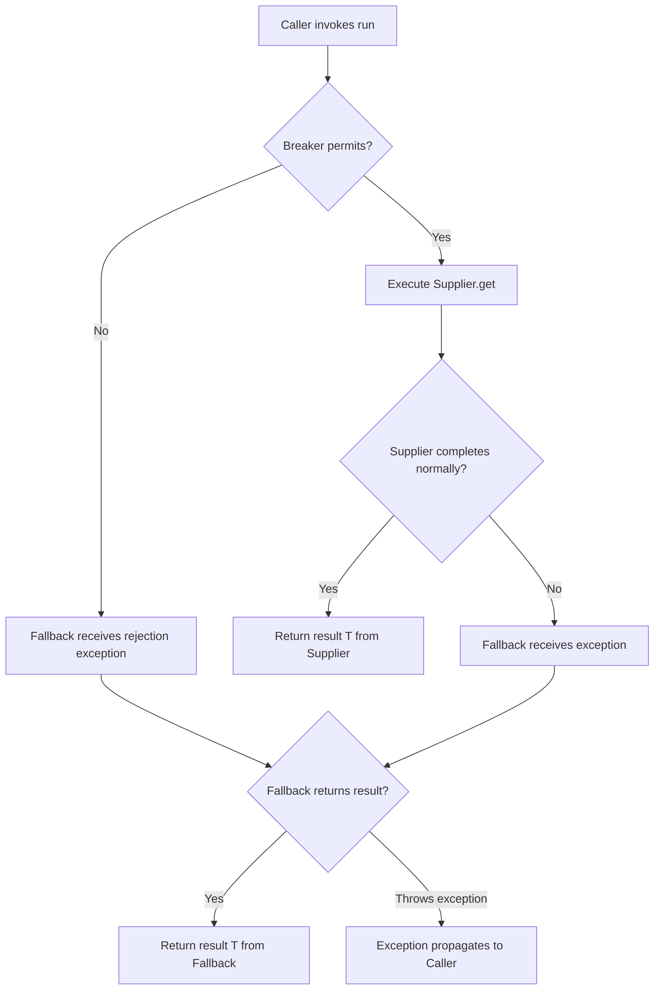

# Executing a Supplier with run and Reading the Result

Spring Cloud Circuit Breaker provides a common API for wrapping a synchronous call in a circuit breaker. With this API, `CircuitBreaker.run(Supplier<T>)` executes a task that takes no arguments and returns a result of type `T` to the calling code. The overload `run(Supplier<T>, Function<Throwable, T>)` allows providing a fallback function to produce an alternative result when the call fails or the breaker rejects execution.

The key point to understand is that `run` both executes the `Supplier` and returns the result of that execution. The application reads the result via a normal return value, such as `Product product = circuitBreaker.run(...)`; the API does not return a separate result wrapper containing both status and data.

## Supplier and the Return Value of run

`Supplier<T>` is a functional interface in `java.util.function`. Its single method is `get()`, which takes no arguments and returns a value of type `T`. The lambda can capture external variables to construct the request, such as a product ID, URL, or authentication details.

```java
Supplier<Product> request = () -> catalogClient.findProduct(productId);
Product product = circuitBreaker.run(request);
```

In this example, `request` is a task with return type `Product`. When `run` permits execution, the circuit breaker invokes `request.get()`. If the supplier returns a `Product`, that exact object is returned from `run` and assigned to the variable `product`.

The data type `T` must match across the supplier, the fallback, and the receiving variable. For example, if the supplier returns `Product`, the fallback must also return `Product`. This allows downstream processing to use the result with static typing without casting.

## Creating a Circuit Breaker from the Factory

In Spring Cloud Circuit Breaker, an application typically obtains an instance from `CircuitBreakerFactory` using an ID. This ID identifies the circuit breaker to use and is used by the integrated backend to apply the corresponding configuration.

```java
import org.springframework.cloud.client.circuitbreaker.CircuitBreaker;
import org.springframework.cloud.client.circuitbreaker.CircuitBreakerFactory;
import org.springframework.stereotype.Service;

import java.util.function.Supplier;

@Service
public class CatalogService {

    private final CircuitBreakerFactory<?, ?> circuitBreakerFactory;
    private final CatalogClient catalogClient;

    public CatalogService(
            CircuitBreakerFactory<?, ?> circuitBreakerFactory,
            CatalogClient catalogClient) {
        this.circuitBreakerFactory = circuitBreakerFactory;
        this.catalogClient = catalogClient;
    }

    public Product findProduct(String productId) {
        CircuitBreaker circuitBreaker =
                circuitBreakerFactory.create("catalog");

        Supplier<Product> request =
                () -> catalogClient.findProduct(productId);

        return circuitBreaker.run(request);
    }
}
```

`create("catalog")` obtains the circuit breaker for catalog calls. The lambda `() -> catalogClient.findProduct(productId)` is held inside the supplier; the dependency call takes place when `run` executes the supplier. The return value from `run` is `Product`, so the `findProduct` method can return the result directly to the caller.

If no fallback is provided, exceptions thrown by the supplier or call-rejection exceptions when the breaker is `OPEN` are propagated to the caller. The caller can catch the exception at an appropriate layer to handle it, log it, or return an appropriate HTTP error.

## Using the run Overload with Fallback

When you want to return fallback data, pass an additional `Function<Throwable, T>`. This function receives the failure cause and returns a value of the same type `T` as the supplier.

```java
public Product findProduct(String productId) {
    CircuitBreaker circuitBreaker =
            circuitBreakerFactory.create("catalog");

    Supplier<Product> request =
            () -> catalogClient.findProduct(productId);

    return circuitBreaker.run(request, error -> {
        log.warn("Unable to retrieve product {} from catalog", productId, error);
        return Product.unavailable(productId);
    });
}
```

The execution flow can be understood as follows:

1. `run` asks the circuit breaker to execute the supplier.
2. If the supplier completes normally, the supplier's result is returned; the fallback is not invoked.
3. If the supplier throws an exception, or the breaker rejects the call because it is open, the fallback receives that exception.
4. The value returned by the fallback becomes the result of `run` and is returned to the caller.

The fallback can inspect the exception type to choose an appropriate behavior. For example, `CallNotPermittedException` indicates that the breaker did not allow the call to reach the dependent service; a timeout exception may indicate that the request was executed but did not complete in time. Depending on application policy, the fallback can return cached data, an object indicating temporary service unavailability, or another fallback value.

The fallback function may also throw an exception. In that case, the exception from the fallback is propagated to the caller. If the fallback returns `null`, `run` returns `null`; the caller must clearly decide whether that value is valid. Prefer an easily distinguishable result type and fallback convention to avoid mistaking fallback data for real data.

## Reading and Handling the Result After run

Because `run` returns `T`, the application processes the result just like a normal synchronous method call. For example:

```java
Product product = circuitBreaker.run(
        () -> catalogClient.findProduct(productId),
        error -> Product.unavailable(productId)
);

if (product.isAvailable()) {
    return ProductResponse.from(product);
}

return ProductResponse.unavailable(productId);
```

Here, the caller does not need to know whether the result came from the supplier or the fallback in order to proceed according to `Product`'s contract. If business logic needs to distinguish real data from fallback data, represent that information explicitly in the result type, such as via a `source` or `fallback` field.

Do not rely on the fact that the fallback ran to assume the circuit breaker recorded the call as a success. The fallback only provides an alternative result to the caller. The circuit breaker backend still evaluates the original execution according to its outcome and exception classification policy. A failed call can still increase the failure rate even though the application received fallback data.

## Relationship Between run, Timeout, and Breaker State

`run(Supplier<T>)` is a synchronous API. The supplier executes on the thread calling `run`, and the caller receives the result once the supplier finishes or the fallback returns a value. `run` itself does not enforce a deadline on an HTTP call. Configure timeouts on the HTTP client or an appropriate timeout mechanism so a hanging supplier can terminate.

When the circuit breaker is `CLOSED`, calls are allowed to execute and outcomes are recorded according to the backend configuration. When the breaker is `OPEN`, the supplier is skipped and the call can enter the fallback with a rejection exception. In `HALF_OPEN`, only the configured number of probe calls are allowed to reach the supplier; calls exceeding that quota are rejected and may be handled by the fallback.



The diagram shows the overload with a fallback. With the overload accepting only a supplier, the failure branch does not go through a fallback function and the exception propagates to the caller.

## Tips for Writing Suppliers and Fallbacks

- Place the dependency call inside the supplier lambda. If you call the service first and then pass the result into `run`, the circuit breaker does not protect that call.
- Do not catch exceptions inside the supplier and silently return a default value if you want the circuit breaker to record the call as a failure. When an exception is swallowed, the supplier completes normally and the breaker may treat it as a success.
- Keep the fallback short, predictable, and avoid calling back into the very service being protected. A fallback that calls the same service again can add load while the service is failing.
- Ensure the supplier and fallback have compatible return types. The fallback has no automatic business parameters; if it needs an ID or request data, the lambda can close over those variables from the enclosing scope.
- Do not use synchronous `run` to wrap a `Mono` or `Flux` chain by calling `.block()`. For reactive flows, use the `ReactiveCircuitBreaker` API to preserve asynchronous execution.

## Testing Practice

With a circuit breaker named `catalog`, test the following scenarios and observe the values received by the caller:

1. Have the supplier return a valid `Product`. Verify that `run` returns that exact object and the fallback does not run.
2. Have the supplier throw an exception. With the no-fallback overload, verify the caller receives the exception; with the fallback overload, verify the caller receives the fallback product.
3. Transition the breaker to `OPEN` and call `run`. Verify the supplier does not call the catalog service and the fallback receives a call-rejection exception.
4. Make the fallback throw an exception. Verify the exception propagates to the caller instead of being turned into a fallback result.
5. Set a client timeout shorter than the business maximum wait time. Verify the timeout terminates the supplier and is classified by the circuit breaker according to its exception configuration.

When interpreting results, distinguish three things: the value returned by `run`, the exception received by the caller, and the state/metrics of the circuit breaker. They are related but not identical. A fallback value may allow the caller's request to proceed, while metrics still reflect the dependent service's failures so the breaker can protect subsequent calls.
