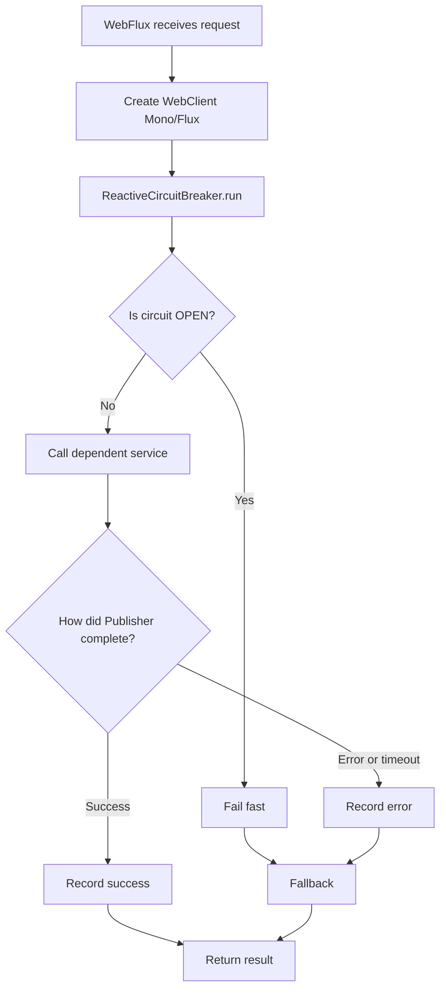

# ReactiveResilience4JCircuitBreakerFactory in WebFlux Applications

Spring WebFlux applications commonly call dependent services using `WebClient` and return `Mono` or `Flux`. To protect these calls with Resilience4j while preserving reactive execution flows, Spring Cloud CircuitBreaker provides `ReactiveResilience4JCircuitBreakerFactory`. The factory creates a `ReactiveCircuitBreaker`, a wrapper around Reactor publishers that records outcomes, rejects calls when the circuit is `OPEN`, and invokes a fallback when needed.

Within the Spring Cloud Circuit Breaker module, this mechanism enables a WebFlux service to continue responding in a controlled manner when inventory, payment, or profile services are slow or unavailable. The circuit only closes again after probe calls in `HALF_OPEN` indicate that the service has recovered.

## 1. Preparing reactive dependencies

The application needs Spring WebFlux and Spring Cloud's reactive Resilience4j starter. For example, with Gradle:

```groovy
dependencies {
    implementation 'org.springframework.boot:spring-boot-starter-webflux'
    implementation 'org.springframework.cloud:spring-cloud-starter-circuitbreaker-reactor-resilience4j'
    implementation 'org.springframework.boot:spring-boot-starter-actuator'
    implementation 'io.github.resilience4j:resilience4j-micrometer'
}
```

Manage the Spring Cloud version using the Spring Cloud BOM compatible with the Spring Boot version in use. The reactive starter coordinates are `org.springframework.cloud:spring-cloud-starter-circuitbreaker-reactor-resilience4j`; the `spring-cloud-starter-circuitbreaker-resilience4j` starter is for non-reactive integrations. Do not add both starters just to protect a WebFlux call.

When the reactive starter is on the classpath, Spring Cloud auto-configures the Resilience4j implementation and registers the `ReactiveResilience4JCircuitBreakerFactory` bean. Application code typically depends on the `ReactiveCircuitBreakerFactory` abstraction, making it less tightly coupled to a specific implementation. There is no need to instantiate the factory manually with `new`.

## 2. How do the factory and ReactiveCircuitBreaker work?

`ReactiveCircuitBreakerFactory.create(id)` creates a `ReactiveCircuitBreaker` bound to a stable ID, such as `inventory`. The `run` method accepts a `Mono` or `Flux` along with an optional fallback function. The fallback function receives the `Throwable` that caused the failure and must return a publisher of a compatible data type.



In `CLOSED`, calls are forwarded to the dependent service's publisher and outcomes are recorded in the sliding window. When the failure rate or slow call rate threshold is met, the circuit opens. In `OPEN`, new calls fail fast and can route to the fallback. After the wait duration, the circuit permits a limited number of calls in `HALF_OPEN`; the outcomes of those calls determine whether the circuit closes or opens again.

With Reactor, publishers typically only execute work upon subscription. Therefore, return the `Mono`/`Flux` for WebFlux to handle and let the Circuit Breaker wrap that publisher. Do not call `.block()` or manually `.subscribe()` inside a service/controller; these operations negate the benefits of non-blocking processing and make request lifecycle management harder to control.

## 3. Integrating with WebClient in a service

The following example protects a stock lookup call. The factory is injected via Spring Cloud's abstraction; the service creates a breaker with ID `inventory` once and reuses it across requests:

```java
import org.springframework.cloud.client.circuitbreaker.ReactiveCircuitBreaker;
import org.springframework.cloud.client.circuitbreaker.ReactiveCircuitBreakerFactory;
import org.springframework.beans.factory.annotation.Qualifier;
import org.springframework.stereotype.Service;
import org.springframework.web.reactive.function.client.WebClient;
import reactor.core.publisher.Mono;

@Service
public class InventoryGateway {
    private final WebClient webClient;
    private final ReactiveCircuitBreaker inventoryBreaker;

    public InventoryGateway(
            @Qualifier("inventoryWebClient") WebClient webClient,
            ReactiveCircuitBreakerFactory<?, ?> circuitBreakerFactory) {
        this.webClient = webClient;
        this.inventoryBreaker = circuitBreakerFactory.create("inventory");
    }

    public Mono<Stock> getStock(String sku) {
        Mono<Stock> request = webClient.get()
                .uri("/stock/{sku}", sku)
                .retrieve()
                .bodyToMono(Stock.class);

        return inventoryBreaker.run(
                request,
                error -> Mono.just(Stock.unavailable(sku))
        );
    }
}
```

Register a dedicated `WebClient` bean for the dependency so its base URL and HTTP settings are not mixed up with clients for other services:

```java
import org.springframework.beans.factory.annotation.Value;
import org.springframework.context.annotation.Bean;
import org.springframework.context.annotation.Configuration;
import org.springframework.web.reactive.function.client.WebClient;

@Configuration
public class InventoryWebClientConfiguration {
    @Bean("inventoryWebClient")
    WebClient inventoryWebClient(
            WebClient.Builder builder,
            @Value("${clients.inventory.base-url}") String baseUrl) {
        return builder.baseUrl(baseUrl).build();
    }
}
```

Example configuration values:

```yaml
clients:
  inventory:
    base-url: http://inventory-service
```

`Stock` is the example data type; `Stock.unavailable(sku)` represents an undetermined state according to the application's API contract.

For a WebFlux endpoint, return the publisher directly:

```java
@RestController
@RequestMapping("/inventory")
public class InventoryController {
    private final InventoryGateway inventoryGateway;

    public InventoryController(InventoryGateway inventoryGateway) {
        this.inventoryGateway = inventoryGateway;
    }

    @GetMapping("/{sku}")
    public Mono<Stock> getStock(@PathVariable String sku) {
        return inventoryGateway.getStock(sku);
    }
}
```

For multi-element streams, `Flux<T>` can be used in the same way:

```java
public Flux<StockEvent> getStockEvents(String sku) {
    Flux<StockEvent> events = webClient.get()
            .uri("/stock/{sku}/events", sku)
            .retrieve()
            .bodyToFlux(StockEvent.class);

    return inventoryBreaker.run(
            events,
            error -> Flux.empty()
    );
}
```

The breaker records outcomes based on the publisher lifecycle. For a finite `Flux`, the outcome is evaluated when the stream completes or emits an error. You should not wrap an infinite event stream or a long-lived streaming connection the same way as a short request-response call: the subscription may remain open and fail to produce completion signals to evaluate recovery. For long-lived streaming, design dedicated monitoring, reconnection, and timeout mechanisms as appropriate.

## 4. Per-ID configuration in application.yml

The ID passed to `create("inventory")` must match the instance name in the Resilience4j configuration. For example:

```yaml
resilience4j:
  circuitbreaker:
    instances:
      inventory:
        registerHealthIndicator: true
        slidingWindowType: COUNT_BASED
        slidingWindowSize: 20
        minimumNumberOfCalls: 10
        failureRateThreshold: 50
        slowCallRateThreshold: 70
        slowCallDurationThreshold: 800ms
        waitDurationInOpenState: 10s
        permittedNumberOfCallsInHalfOpenState: 3
        automaticTransitionFromOpenToHalfOpenEnabled: false

  timelimiter:
    instances:
      inventory:
        timeoutDuration: 2s
        cancelRunningFuture: true
```

In the example, the sliding window counts up to 20 outcomes and only evaluates the failure rate after at least 10 calls. When the failure rate reaches 50% or the slow call rate reaches 70%, the circuit can transition to `OPEN`. A call is considered slow when it exceeds 800 ms. After at least 10 seconds, up to three calls are permitted as probes in `HALF_OPEN`.

`TimeLimiter` sets a time limit on a single protected execution. It differs from `waitDurationInOpenState`: the timeout limits how long the current request waits for a result, whereas the open wait duration decides when recovery can be attempted after the breaker has opened. The Spring Cloud Resilience4j starter enables TimeLimiter by default; you should explicitly configure `timeoutDuration` according to the dependent service's SLA. You can disable TimeLimiter globally via `spring.cloud.circuitbreaker.resilience4j.disable-time-limiter: true` when there is a specific reason.

## 5. Configuration using Customizer

If Java-based configuration is needed, you can create a `Customizer` bean for `ReactiveResilience4JCircuitBreakerFactory`. The example below sets a dedicated timeout and Circuit Breaker for the `inventory` ID: 

```java
@Configuration
public class CircuitBreakerConfiguration {
    @Bean
    public Customizer<ReactiveResilience4JCircuitBreakerFactory> inventoryCustomizer() {
        return factory -> factory.configure(builder -> builder
                .circuitBreakerConfig(CircuitBreakerConfig.custom()
                        .slidingWindowSize(20)
                        .minimumNumberOfCalls(10)
                        .failureRateThreshold(50)
                        .waitDurationInOpenState(Duration.ofSeconds(10))
                        .build())
                .timeLimiterConfig(TimeLimiterConfig.custom()
                        .timeoutDuration(Duration.ofSeconds(2))
                        .build()),
                "inventory");
    }
}
```

The snippet requires importing `Customizer`, `ReactiveResilience4JCircuitBreakerFactory`, `CircuitBreakerConfig`, `TimeLimiterConfig`, `Duration`, and `Configuration`. Use properties or Customizers according to your project's configuration conventions. Properties configuration takes precedence over Java `Customizer`; if runtime values differ from the customizer bean, inspect `resilience4j.circuitbreaker.instances` and `resilience4j.timelimiter.instances` under the matching ID.

## 6. Error handling and fallback in reactive flows

A fallback is an alternative publisher used when the breaker rejects a call or the protected call produces an error. Return fallback data that honors the API contract, such as an undetermined stock status, the latest cached value, or a business exception that the calling layer can handle.

- The fallback function receives a `Throwable`; the cause may be a connection error, HTTP error, timeout, or `CallNotPermittedException` when the circuit is `OPEN`.
- A fallback can also emit an error. In that case, the fallback error propagates to the subscriber and WebFlux handles it according to the application's error mechanism.
- Do not turn every error into seemingly valid fake data. Distinguish between cached data, undetermined data, and unrecoverable errors.
- Do not call the same protected service again from inside the fallback; doing so can create a loop or keep putting load on a failing dependency.

`WebClient.retrieve()` turns HTTP 4xx/5xx responses into errors by default. Decide which errors reflect the health of the dependency and which are request-level business errors. You can customize `onStatus` or `recordExceptions`/`ignoreExceptions` policies so expected client errors do not unintentionally open the Circuit Breaker.

Do not place `onErrorResume` before the breaker to swallow errors if you want the breaker to record those errors. If upstream already converts an error into a successful result before entering `run`, the Circuit Breaker will no longer see the original error signal. Use the fallback function of `run`, or handle errors after the breaker has recorded the outcome.

## 7. Combining timeout, retry, and bulkhead

Protection mechanisms solve different problems:

| Mechanism | Role in WebFlux applications |
| --- | --- |
| Circuit Breaker | Stops sending requests when a dependency repeatedly fails or is slow; attempts limited recovery in `HALF_OPEN`. |
| TimeLimiter / timeout | Limits how long a single request waits for a result. |
| Retry | Retries transient errors according to a defined count and backoff interval. |
| Bulkhead | Limits the number of concurrent calls or amount of resources allocated to a dependency. |

Do not place Retry outside the Circuit Breaker unintentionally. Multiple attempts can amplify traffic while the service is recovering; you must clearly define whether each attempt is recorded by the Circuit Breaker and the total number of requests that can be generated. With WebFlux, keep the entire call path non-blocking; do not switch to blocking threads just to apply timeouts or bulkheads.

Spring Cloud CircuitBreaker can automatically apply Resilience4j Bulkhead if the `resilience4j-bulkhead` module is on the classpath. Spring Cloud documentation notes that the default is `FixedThreadPoolBulkhead`; you can switch to `SemaphoreBulkhead` using `spring.cloud.circuitbreaker.resilience4j.enableSemaphoreDefaultBulkhead: true` or disable Bulkhead integration with `spring.cloud.circuitbreaker.bulkhead.resilience4j.enabled: false`. Evaluate this configuration alongside the reactive load model and avoid running blocking operations on the event loop.

## 8. Monitoring state and metrics

To observe the breaker for ID `inventory`, track state transitions, successful/failed call counts, rejected call counts, timeouts, fallback counts, and dependency latency. Actuator provides a health endpoint; `resilience4j-micrometer` paired with Micrometer exports metrics for collection by monitoring systems.

Example enabling the health indicator for an instance:

```yaml
resilience4j:
  circuitbreaker:
    instances:
      inventory:
        registerHealthIndicator: true

management:
  endpoints:
    web:
      exposure:
        include: health,metrics
```

Only expose necessary Actuator endpoints and protect them with authentication/authorization in deployed environments. Health status is an operational signal; do not treat the endpoint returning `UP` as sole proof that fallbacks, timeouts, and state transitions are working properly.

## 9. Verifying with reactive scenarios

Run tests with a mock server or stub service to control responses and latency:

1. Return a successful response from the dependency. Call the WebFlux endpoint and verify the `Mono` returns real data; confirm there is no `.block()` or manual subscription inside the service.
2. Have the dependency return 5xx or drop the connection. Send enough minimum calls to exceed the threshold and confirm the breaker transitions to `OPEN`.
3. Send subsequent requests while the breaker is `OPEN`. Confirm the fallback returns the fallback result and the mock server receives no additional requests from rejected calls.
4. Make the dependency respond slower than `timeoutDuration`. Confirm the timeout is recorded as configured and the fallback result is returned in the proper reactive type.
5. After `waitDurationInOpenState`, restore the dependency to working order and send probe calls not exceeding `permittedNumberOfCallsInHalfOpenState`. Confirm the breaker returns to `CLOSED` when results meet requirements.
6. Repeat with failures on probe calls to confirm the breaker returns to `OPEN`; inspect metrics and logs under ID `inventory`.
7. Test 4xx responses separately to ensure business errors are not misclassified as dependency incidents.

With `StepVerifier`, you can verify publishers and fallbacks without calling `.block()`:

```java
StepVerifier.create(inventoryGateway.getStock("SKU-42"))
        .expectNextMatches(stock -> stock.isUnavailable())
        .verifyComplete();
```

To verify state transitions, combine `StepVerifier` with a mock server that counts requests, configure a small sliding window in tests, and observe instance states/metrics. Do not check only the fallback value; confirm requests were blocked at the right time and the dependent service was not called further.

## 10. Common mistakes

- Using the non-reactive starter when expecting to inject `ReactiveCircuitBreakerFactory`.
- Not using the same ID between `create("inventory")` and `resilience4j.circuitbreaker.instances.inventory` or `resilience4j.timelimiter.instances.inventory`.
- Calling `.block()` or `.subscribe()` inside a service/controller, breaking the reactive processing chain.
- Swallowing upstream errors with `onErrorResume` before the breaker observes them, making the failure rate lower than reality.
- Returning a fallback of a different type than the original publisher or letting the fallback keep calling the failing dependency.
- Setting the timeout too short so normal requests are counted as errors, or too long so resources are held for too long.
- Using a Circuit Breaker for infinite streams without accounting for subscription lifecycle and how recovery signals are evaluated.
- Failing to distinguish business HTTP errors from connection/5xx errors when configuring recorded exception types.

## References

- [Spring Cloud Commons – Circuit Breakers in reactive code](https://docs.spring.io/spring-cloud-commons/reference/spring-cloud-circuitbreaker.html): `ReactiveCircuitBreakerFactory` abstraction, `Mono`/`Flux`, and fallback.
- [Spring Cloud CircuitBreaker – Configuring Resilience4J Circuit Breakers](https://docs.spring.io/spring-cloud-circuitbreaker/docs/current/reference/html/spring-cloud-circuitbreaker-resilience4j.html): reactive starter, auto-configuration, Customizer, TimeLimiter, and Bulkhead.
- [Spring Cloud CircuitBreaker – Circuit Breaker Properties Configuration](https://docs.spring.io/spring-cloud-circuitbreaker/reference/spring-cloud-circuitbreaker-resilience4j/circuit-breaker-properties-configuration.html): instance configuration, group configuration, precedence order, and TimeLimiter.
- [Spring Framework – WebClient](https://docs.spring.io/spring-framework/reference/web/webflux-webclient.html): reactive, non-blocking HTTP client built on Reactor.
