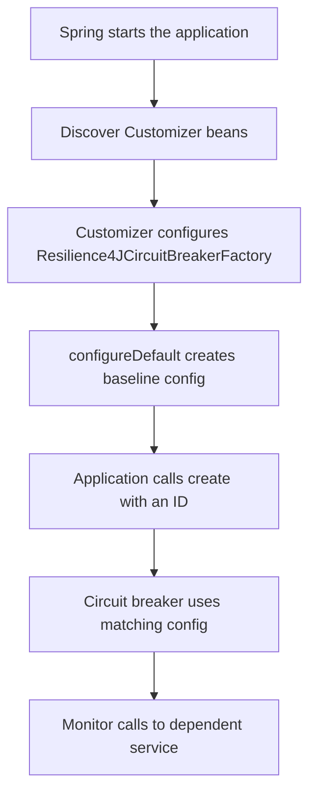

# Default Configuration with Customizer and configureDefault

When integrating Resilience4j via Spring Cloud CircuitBreaker, applications commonly create multiple circuit breakers for dependent services such as `inventory`, `payment`, or `shipping`. If every circuit breaker had to repeat the entire configuration, configuration code would become hard to maintain and services could easily end up with inconsistent protection policies. Spring Cloud CircuitBreaker allows declaring a baseline configuration using a `Customizer` and the `configureDefault` method, then applying dedicated configurations for identifiers that require different behavior.

A `Customizer` is a Spring bean used to customize the factory auto-configured by Spring Cloud CircuitBreaker. With Resilience4j, the imperative factory is `Resilience4JCircuitBreakerFactory`; the reactive factory is `ReactiveResilience4JCircuitBreakerFactory`. The `configureDefault` method accepts a function that creates a default circuit breaker configuration for the passed-in identifier. This enables centralizing default values in one place while retaining the ability to customize per dependency.

## 1. Role of Customizer and configureDefault

When an application injects `CircuitBreakerFactory` and calls `create("inventory")`, Spring Cloud CircuitBreaker uses the corresponding factory to create a circuit breaker with the identifier `inventory`. The factory is auto-configured by the Resilience4j starter. A `Customizer` bean lets the application adjust that factory during Spring context initialization.

The two components have distinct responsibilities:

- **`Customizer<T>`** represents a configuration operation on a factory of type `T`. Spring detects this bean and applies it to the corresponding factory.
- **`configureDefault(...)`** defines the baseline configuration used for circuit breakers created through the factory. The configuration function receives `id`, allowing a default configuration to be built based on the identifier.

With Resilience4j, `Resilience4JConfigBuilder` combines `CircuitBreakerConfig` and `TimeLimiterConfig` into a single configuration used by Spring Cloud CircuitBreaker. These two parts address different concerns: `CircuitBreakerConfig` specifies how outcomes are recorded and how circuit states transition; `TimeLimiterConfig` specifies the time limit for supported asynchronous calls.

Overview diagram:



Identifiers must be consistent between where the circuit breaker is created and where dedicated configuration is declared. For example, if code calls `create("inventory")`, the dedicated configuration must also be bound to the ID `inventory`.

## 2. Declaring default configuration using Customizer

The following example creates a baseline configuration bean for all circuit breakers created from the imperative factory:

```java
import java.time.Duration;

import io.github.resilience4j.circuitbreaker.CircuitBreakerConfig;
import io.github.resilience4j.timelimiter.TimeLimiterConfig;
import org.springframework.cloud.circuitbreaker.resilience4j.Resilience4JConfigBuilder;
import org.springframework.cloud.circuitbreaker.resilience4j.Resilience4JCircuitBreakerFactory;
import org.springframework.cloud.client.circuitbreaker.Customizer;
import org.springframework.context.annotation.Bean;
import org.springframework.context.annotation.Configuration;

@Configuration
public class CircuitBreakerConfiguration {

    @Bean
    public Customizer<Resilience4JCircuitBreakerFactory> defaultCircuitBreakerConfig() {
        return factory -> factory.configureDefault(id ->
            new Resilience4JConfigBuilder(id)
                .circuitBreakerConfig(CircuitBreakerConfig.custom()
                    .slidingWindowType(CircuitBreakerConfig.SlidingWindowType.COUNT_BASED)
                    .slidingWindowSize(20)
                    .minimumNumberOfCalls(8)
                    .failureRateThreshold(50)
                    .slowCallDurationThreshold(Duration.ofSeconds(2))
                    .slowCallRateThreshold(50)
                    .waitDurationInOpenState(Duration.ofSeconds(15))
                    .permittedNumberOfCallsInHalfOpenState(3)
                    .build())
                .timeLimiterConfig(TimeLimiterConfig.custom()
                    .timeoutDuration(Duration.ofSeconds(3))
                    .build())
                .build()
        );
    }
}
```

In the example, `configureDefault` accepts a function taking `id` and returns a configuration built with `Resilience4JConfigBuilder`. The illustrative values mean:

| Property | Value | Meaning |
|---|---:|---|
| `slidingWindowType` | `COUNT_BASED` | Evaluates based on the most recent calls. |
| `slidingWindowSize` | `20` | Retains up to 20 outcomes in the sliding window. |
| `minimumNumberOfCalls` | `8` | Requires at least 8 outcomes before evaluating rates. |
| `failureRateThreshold` | `50` | Opens the circuit when the failure rate reaches 50%. |
| `slowCallDurationThreshold` | `2 seconds` | Treats calls taking 2 seconds or longer as slow. |
| `slowCallRateThreshold` | `50` | Opens the circuit when the slow call rate reaches 50%. |
| `waitDurationInOpenState` | `15 seconds` | Wait time before the circuit breaker allows probes. |
| `permittedNumberOfCallsInHalfOpenState` | `3` | Maximum probe calls permitted in `HALF_OPEN`. |
| `timeoutDuration` | `3 seconds` | Time limit for asynchronous operations supported by TimeLimiter. |

The numbers above are only examples to illustrate the mechanism. Adjust them according to traffic volume, latency targets, and load tolerance of each dependent service. In particular, `TimeLimiter` does not replace connection and read timeouts on the HTTP client. For synchronous calls that can block threads, timeouts must still be configured at the client or network transport layer.

## 3. How configureDefault is applied

`configureDefault` creates the baseline configuration for the factory. When the application creates circuit breakers such as `inventory`, `payment`, and `shipping`, each circuit breaker can receive that default configuration set if no more specific configuration exists for the corresponding ID.

Example service using the factory:

```java
import org.springframework.cloud.client.circuitbreaker.CircuitBreakerFactory;
import org.springframework.stereotype.Service;

@Service
public class OrderService {
    private final CircuitBreakerFactory<?, ?> circuitBreakerFactory;
    private final InventoryClient inventoryClient;

    public OrderService(
            CircuitBreakerFactory<?, ?> circuitBreakerFactory,
            InventoryClient inventoryClient) {
        this.circuitBreakerFactory = circuitBreakerFactory;
        this.inventoryClient = inventoryClient;
    }

    public Stock getStock(String sku) {
        return circuitBreakerFactory.create("inventory").run(
            () -> inventoryClient.getStock(sku),
            error -> Stock.unavailable(sku)
        );
    }
}
```

The identifier `inventory` is used to create the circuit breaker. If no dedicated configuration has been declared for this ID, it uses the baseline configuration provided by `configureDefault`. The fallback handles cases where the primary call fails or is rejected by the circuit breaker; the fallback should clearly express an unavailable data state so callers do not mistake it for zero stock.

The `id` parameter in the `configureDefault` function is also useful when generating default values based on the circuit breaker name. However, if services have clearly distinct requirements for failure thresholds or timeouts, declare per-ID configurations so the intent is expressed directly and easy to review.

## 4. Combining default configuration with per-ID configuration

Not all dependencies share the same characteristics. An inventory service might tolerate a longer wait time than an authentication service; a payment service might require a stricter failure threshold and fallback policy. Spring Cloud CircuitBreaker allows calling `configure(...)` to set configuration for one or more specific IDs.

For example, keep the baseline configuration for other circuit breakers, while setting a smaller window and shorter timeout for `payment`:

```java
@Bean
public Customizer<Resilience4JCircuitBreakerFactory> paymentCircuitBreakerConfig() {
    return factory -> factory.configure(builder -> builder
        .circuitBreakerConfig(CircuitBreakerConfig.custom()
            .slidingWindowSize(10)
            .minimumNumberOfCalls(5)
            .failureRateThreshold(40)
            .waitDurationInOpenState(Duration.ofSeconds(20))
            .build())
        .timeLimiterConfig(TimeLimiterConfig.custom()
            .timeoutDuration(Duration.ofSeconds(2))
            .build()),
        "payment");
}
```

Here, `configure(...)` binds the configuration to the ID `payment`. The code creating the circuit breaker must use the exact same ID:

```java
var paymentCircuitBreaker = circuitBreakerFactory.create("payment");
```

When adding dedicated configurations, clearly determine which values need to change and which remain inherited from the baseline configuration in the manner supported by the Spring Cloud version in use. Do not assume every property omitted from a dedicated builder is always inherited as desired; read the full configuration and verify the behavior of the version in use.

Some projects choose centralized configuration using Java `Customizer`s, while others use `application.yml`. With Resilience4j properties configuration, shared configurations can be declared under `configs` and assigned to individual `instances`:

```yaml
resilience4j:
  circuitbreaker:
    configs:
      default:
        slidingWindowType: COUNT_BASED
        slidingWindowSize: 20
        minimumNumberOfCalls: 8
        failureRateThreshold: 50
        waitDurationInOpenState: 15s
    instances:
      inventory:
        baseConfig: default
      payment:
        baseConfig: default
        failureRateThreshold: 40
```

Properties are well suited when you want to change thresholds without modifying Java code. Java `Customizer` is suitable when configuration needs to be built programmatically, use conditional logic, or integrate with Spring configuration. In Spring Cloud CircuitBreaker versions that support both mechanisms, properties configuration takes precedence over Java `Customizer` configuration; check the documentation for the release train in use if multiple configuration sources affect the same ID.

## 5. Default configuration for reactive applications

For WebFlux applications, use the reactive starter and the `ReactiveResilience4JCircuitBreakerFactory` factory. Default configuration is also registered via a `Customizer` bean, though the factory type differs from imperative calls:

```java
import java.time.Duration;

import io.github.resilience4j.circuitbreaker.CircuitBreakerConfig;
import io.github.resilience4j.timelimiter.TimeLimiterConfig;
import org.springframework.cloud.circuitbreaker.resilience4j.ReactiveResilience4JCircuitBreakerFactory;
import org.springframework.cloud.circuitbreaker.resilience4j.Resilience4JConfigBuilder;
import org.springframework.cloud.client.circuitbreaker.Customizer;
import org.springframework.context.annotation.Bean;
import org.springframework.context.annotation.Configuration;

@Configuration
public class ReactiveCircuitBreakerConfiguration {

    @Bean
    public Customizer<ReactiveResilience4JCircuitBreakerFactory> reactiveDefaultConfig() {
        return factory -> factory.configureDefault(id ->
            new Resilience4JConfigBuilder(id)
                .circuitBreakerConfig(CircuitBreakerConfig.ofDefaults())
                .timeLimiterConfig(TimeLimiterConfig.custom()
                    .timeoutDuration(Duration.ofSeconds(3))
                    .build())
                .build()
        );
    }
}
```

Then the reactive service creates a circuit breaker by ID and preserves the `Mono` return type:

```java
import org.springframework.cloud.client.circuitbreaker.ReactiveCircuitBreakerFactory;
import org.springframework.stereotype.Service;
import reactor.core.publisher.Mono;

@Service
public class ReactiveInventoryService {
    private final ReactiveCircuitBreakerFactory<?, ?> circuitBreakerFactory;
    private final ReactiveInventoryClient inventoryClient;

    public ReactiveInventoryService(
            ReactiveCircuitBreakerFactory<?, ?> circuitBreakerFactory,
            ReactiveInventoryClient inventoryClient) {
        this.circuitBreakerFactory = circuitBreakerFactory;
        this.inventoryClient = inventoryClient;
    }

    public Mono<Stock> getStock(String sku) {
        return circuitBreakerFactory.create("inventory").run(
            inventoryClient.getStock(sku),
            error -> Mono.just(Stock.unavailable(sku))
        );
    }
}
```

Do not use `Resilience4JCircuitBreakerFactory` for a reactive factory or vice versa. Choose the starter, factory, and return types according to the application's execution model. In reactive flows, fallbacks must return the corresponding publisher and should not call `block()` to wait for results.

## 6. When should you use default configuration?

`configureDefault` is suitable for establishing a consistent baseline policy across dependencies with similar characteristics. For example, an application with multiple data-reading services can share the same window, failure threshold, and open wait duration. This helps development teams avoid leaving a circuit breaker without protection configuration.

Use a dedicated per-ID configuration when:

- A dependent service has significantly different latency targets.
- Transaction criticality requires a different failure threshold or handling approach.
- One dependency's traffic differs greatly from the rest, making the default window size unsuitable.
- A dependency requires its own timeout, fallback, or concurrency limit policy.

You should not create an overly sensitive default configuration just to cover every dependency. Conversely, an overly permissive configuration can allow calls to keep piling onto a failing service. Start with a well-reasoned baseline configuration, then add exceptions only when metrics and business requirements justify them.

## 7. Considerations on timeouts and recorded errors

`CircuitBreakerConfig` determines which outcomes are recorded as successes, failures, or slow calls. Properties such as `recordExceptions`, `ignoreExceptions`, `recordFailure`, or corresponding predicates can be used to refine error classification depending on the Resilience4j API in use.

For example, input validation errors sent by users usually do not indicate that the dependent service is broken. If those errors are recorded by the circuit breaker, the circuit might open even though the service is operating normally. Conversely, timeouts or connection failures are typically important signals for evaluating a dependency's health. Configure the exception list according to the client's contract rather than recording every exception indiscriminately.

`TimeLimiterConfig` specifies the wait duration for integrated asynchronous tasks. With HTTP clients, you still must configure connection timeouts, read timeouts, and related limits on the client itself. If you only configure TimeLimiter while the underlying HTTP request cannot be properly canceled, the network operation may continue consuming resources after the caller has timed out. Verify the cancellation and resource-release capabilities of the client in use.

Fallbacks must accurately reflect business semantics. For read operations, you can return a still-valid cache entry or a temporarily unavailable status. For write operations such as payments, never return a fake success result when it is unknown whether the transaction was processed. A circuit breaker only controls calls and reacts to failures; it does not guarantee the correctness of business transactions.

## 8. Testing Customizer configuration

Both the baseline configuration and per-ID configurations should be tested. An integration test scenario can proceed in the following sequence:

1. Start the Spring context with the declared `Customizer` beans.
2. Create a circuit breaker with ID `inventory` and verify successful calls are forwarded to the client.
3. Simulate enough failures to exceed `minimumNumberOfCalls` and `failureRateThreshold`; confirm the circuit breaker transitions to `OPEN`.
4. Call again while the circuit is `OPEN`; confirm the client is no longer invoked and the fallback is triggered.
5. Create the `payment` circuit breaker and confirm the per-ID configuration takes effect with its configured thresholds.
6. If reactive configuration is present, verify `Mono` returns the expected result or fallback without blocking execution threads.

When testing, do not just verify that the `Customizer` bean exists. Verify the actual runtime behavior of the circuit breaker, the number of times the client was invoked, state transitions, and fallback outputs. You can use a fake client or mock server to actively inject failures, delays, and recovery.

## 9. Common configuration errors

| Symptom | Cause to check |
|---|---|
| `Customizer` is not applied | Is the bean declared in the Spring context; does the generic type match the factory in use? |
| Cannot inject factory | Has the corresponding imperative or reactive Resilience4j starter been added; are Spring Boot and Spring Cloud versions compatible? |
| Dedicated configuration has no effect | Does the ID in `configure(...)` match the ID passed to `create(...)` exactly? |
| Default configuration behaves unexpectedly | Is there a properties configuration with the same ID taking higher precedence; are multiple beans configuring the same factory? |
| Timeout does not interrupt network calls | Does the HTTP client have its own timeout configured; does the asynchronous operation support cancellation? |
| Circuit breaker does not open on errors | Has `minimumNumberOfCalls` been reached; is the exception being ignored or not recorded? |
| Reactive service is blocked | Is `block()` being called or was the imperative factory mistakenly used inside a Reactor chain? |

When investigating, check the identifier first, then inspect the instance's effective configuration, recorded exception types, and window settings. If both Java `Customizer` and YAML properties exist, determine which configuration source wins under the current Spring Cloud version instead of adjusting values in multiple places at once.

## 10. Principles for organizing configuration

Place `Customizer` beans in a clearly named configuration class within the application's component scan scope. Use a centralized default configuration for standard circuit breakers; separate per-ID configuration when a dependency requires a distinct policy. Bean names should describe their scope, such as `defaultCircuitBreakerConfig` or `paymentCircuitBreakerConfig`.

Do not manually recreate the factory if the starter already auto-configures it. Do not declare multiple competing default configurations without controlling their order of application. Avoid putting secrets, URLs, or environment-specific details into a `Customizer`; environment-varying values should be managed through externalized configuration.

During rollout, document the rationale behind choosing `slidingWindowSize`, `minimumNumberOfCalls`, failure thresholds, slow call thresholds, and open wait durations. Monitor metrics after release to see whether the baseline configuration suits actual traffic or if per-dependency overrides are needed. `Customizer` and `configureDefault` help organize configuration consistently; actual protection effectiveness still depends on choosing proper thresholds, timeouts, fallbacks, and operational observability.
