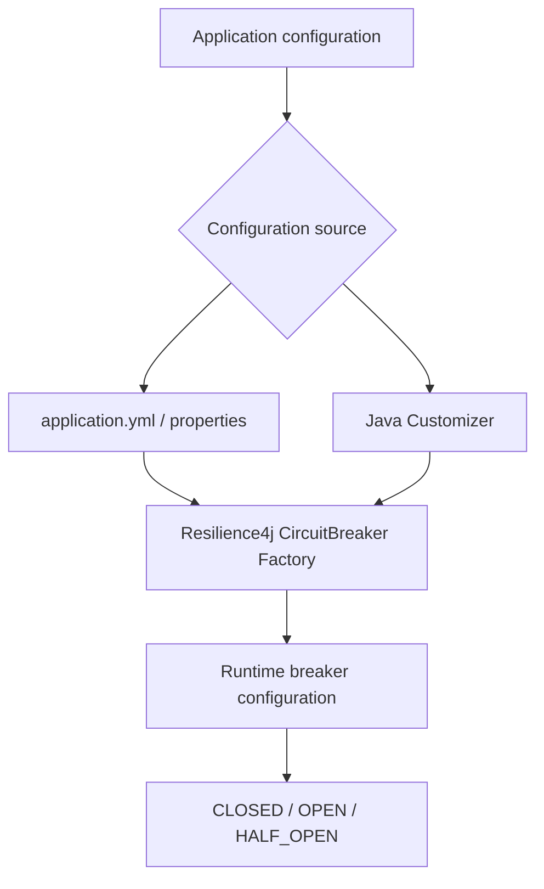

# Precedence of Property Configuration vs. Java Customizer

Spring Cloud CircuitBreaker allows configuring circuit breakers via properties in `application.yml` or via a Java `Customizer`. Both approaches can define policies for Resilience4j, but when a breaker is configured through both paths, **property configuration takes precedence over Java Customizer**. Therefore, if the same instance has values in YAML and in a customizer, the application should expect the values from property configuration.

This rule matters when a project has default configuration in Java and then adds environment-specific or per-service YAML. Without understanding this precedence order, developers might modify the customizer and see no change in runtime behavior because properties are overriding that configuration.

## 1. Two configuration paths

Spring Cloud CircuitBreaker provides a common API for applications to invoke services through a breaker. Resilience4j is the implementation that collects statistics, performs state transitions, and enforces thresholds. Policies for Resilience4j can be supplied through two main paths:

- **Property configuration:** declared in `application.yml`, `application.properties`, or other Spring Boot property sources. This approach fits environment-specific configuration and can be changed without editing Java code.
- **Java Customizer:** declared as a `Customizer` bean to configure the factory, default values, or specific IDs. This approach fits when configuration needs to be constructed in code, use expressions, or depend on application startup logic.



These two paths do not have equal priority. When property configuration and Java Customizer both define configuration for a breaker, Spring Cloud CircuitBreaker prioritizes property configuration. Do not design under the assumption that the two sets of values will always be merged field by field.

## 2. Configuring via Java Customizer

To configure the Resilience4j factory in Java, an application can declare a `Customizer<Resilience4JCircuitBreakerFactory>` bean. The following example sets a default policy for breakers created by the factory:

```java
import java.time.Duration;

import org.springframework.cloud.circuitbreaker.resilience4j.Resilience4JCircuitBreakerFactory;
import org.springframework.cloud.circuitbreaker.resilience4j.Resilience4JConfigBuilder;
import org.springframework.cloud.client.circuitbreaker.Customizer;
import org.springframework.context.annotation.Bean;
import org.springframework.context.annotation.Configuration;

import io.github.resilience4j.circuitbreaker.CircuitBreakerConfig;
import io.github.resilience4j.timelimiter.TimeLimiterConfig;

@Configuration
public class CircuitBreakerJavaConfiguration {

    @Bean
    public Customizer<Resilience4JCircuitBreakerFactory> defaultBreakerConfig() {
        return factory -> factory.configureDefault(id ->
                new Resilience4JConfigBuilder(id)
                        .circuitBreakerConfig(CircuitBreakerConfig.custom()
                                .slidingWindowSize(30)
                                .minimumNumberOfCalls(10)
                                .failureRateThreshold(50)
                                .build())
                        .timeLimiterConfig(TimeLimiterConfig.custom()
                                .timeoutDuration(Duration.ofSeconds(2))
                                .build())
                        .build());
    }
}
```

In this example, `configureDefault` provides default configuration for IDs without a more specific configuration. `CircuitBreakerConfig` defines the circuit breaker parameters, while `TimeLimiterConfig` sets the wait timeout for tasks supported by TimeLimiter. The two mechanisms have distinct purposes: failure rate controls opening the circuit, whereas TimeLimiter limits the wait time of a task.

To set a policy for a specific ID, the factory supports `configure`:

```java
@Bean
public Customizer<Resilience4JCircuitBreakerFactory> inventoryBreakerConfig() {
    return factory -> factory.configure(builder -> builder
            .circuitBreakerConfig(CircuitBreakerConfig.custom()
                    .slidingWindowSize(20)
                    .minimumNumberOfCalls(8)
                    .failureRateThreshold(40)
                    .build())
            .timeLimiterConfig(TimeLimiterConfig.custom()
                    .timeoutDuration(Duration.ofMillis(800))
                    .build())
            .build(), "inventory");
}
```

Here, the Java configuration is bound to the ID `inventory`. Calling code must use the same ID when creating the breaker:

```java
CircuitBreaker breaker = circuitBreakerFactory.create("inventory");
InventoryView result = breaker.run(
        () -> inventoryClient.find(sku),
        error -> InventoryView.unavailable(sku)
);
```

These Java examples illustrate the configuration API of the Resilience4j factory. They must be used with compatible versions of Spring Cloud and the Resilience4j starter in the project. `Resilience4JConfigBuilder` belongs to package `org.springframework.cloud.circuitbreaker.resilience4j`; when writing complete configuration, import this builder along with the types used in the examples.

## 3. Configuring via properties

Property configuration is appropriate when you want to centralize policies in the application's configuration files. Resilience4j supports shared configurations under `configs` and per-instance configurations under `instances`.

```yaml
resilience4j:
  circuitbreaker:
    configs:
      default:
        slidingWindowType: COUNT_BASED
        slidingWindowSize: 50
        minimumNumberOfCalls: 10
        failureRateThreshold: 50
        waitDurationInOpenState: 10s
      inventoryPolicy:
        slidingWindowType: COUNT_BASED
        slidingWindowSize: 20
        minimumNumberOfCalls: 8
        failureRateThreshold: 40
        waitDurationInOpenState: 15s
    instances:
      inventory:
        baseConfig: inventoryPolicy
        slowCallDurationThreshold: 1s
        slowCallRateThreshold: 50
      pricing:
        baseConfig: default
        slowCallDurationThreshold: 1500ms
        slowCallRateThreshold: 60
  timelimiter:
    configs:
      default:
        timeoutDuration: 3s
    instances:
      inventory:
        timeoutDuration: 800ms
      pricing:
        timeoutDuration: 2s
```

In this configuration:

- `configs.default` is a shared configuration named `default`.
- `configs.inventoryPolicy` is a dedicated shared configuration for the inventory policy group.
- `instances.inventory` corresponds to the breaker with ID `inventory` and inherits `inventoryPolicy` via `baseConfig`.
- Properties declared directly under `instances.inventory` supplement or override the corresponding values from the shared configuration according to Resilience4j's configuration mechanism.
- `timelimiter.instances.inventory` sets the timeout for the TimeLimiter with the same ID.

`baseConfig` is a configuration reuse mechanism within Resilience4j's property system. It is not syntax for selecting a Java Customizer. Distinguish inheritance between `configs` and `instances` from the precedence rule between properties and Java Customizer.

## 4. Precedence rule when both approaches configure the same breaker

The rule to remember is that property configuration takes precedence over Java Customizer configuration. For example, Java Customizer sets `failureRateThreshold` of `inventory` to 40, while the `inventory` instance property sets it to 60. When that property is loaded for the instance, the property value is used.

| Situation | Configuration that takes precedence |
|---|---|
| Only Java Customizer | Java Customizer |
| Only property configuration | Property configuration |
| Both Java Customizer and properties configure the same instance | Property configuration |
| Java Customizer sets defaults, properties declare instance configuration | Properties for that instance |
| Properties declare only some instances, leaving others undeclared | Java Customizer can still provide default configuration where no matching properties exist, depending on factory configuration and integration version |

Do not assume that properties and customizers are simply merged field by field in every scenario. Inspect the effective configuration of the exact ID and configuration type, especially when an ID has both `CircuitBreaker` and `TimeLimiter`.

Conflict example:

```java
factory.configure(builder -> builder
        .circuitBreakerConfig(CircuitBreakerConfig.custom()
                .failureRateThreshold(40)
                .build())
        .build(), "inventory");
```

```yaml
resilience4j:
  circuitbreaker:
    instances:
      inventory:
        failureRateThreshold: 60
```

When both configurations above apply to the `inventory` instance, the property `failureRateThreshold: 60` has higher precedence than the value 40 in Java Customizer. Reading the Java code alone, a developer might think the breaker opens at 40%; yet at runtime it will follow the loaded property.

## 5. Distinguishing precedence across property sources

The rule that properties take precedence over Java Customizer is a Spring Cloud CircuitBreaker integration rule. It does not replace Spring Boot's precedence order among property sources.

In a Spring Boot application, a value can come from `application.yml`, a profile file such as `application-prod.yml`, environment variables, command-line arguments, or other property sources. Spring Boot has its own precedence order to resolve the final value in `Environment`. Once Spring Boot resolves property sources, the property configuration is passed into the circuit breaker integration and takes precedence over Java Customizer per the rule above.

For example, if `application.yml` sets the failure threshold to 50 and the production profile sets it to 65, the effective value across files depends on active profiles and Spring Boot's property source order. If Java Customizer also sets 40, the customizer does not override the property value loaded by Spring Boot.

Therefore, when investigating runtime configuration, check both layers:

1. Which property value did Spring Boot select from the active configuration sources?
2. Given that property value, is Spring Cloud CircuitBreaker applying higher precedence over Java Customizer?

Do not merely search for the string `failureRateThreshold` in one YAML file or one `@Configuration` class and conclude that is the runtime value.

## 6. Configuration scope and IDs must be consistent

The factory creates breakers by ID. The ID in code, in YAML `instances`, and in the customizer must match so configuration applies to the intended object.

| Calling code | Property configuration | Java Customizer |
|---|---|---|
| `create("inventory")` | `instances.inventory` | `configure(..., "inventory")` |
| `create("pricing")` | `instances.pricing` | `configure(..., "pricing")` |
| `create("recommendation")` | `instances.recommendation` | `configure(..., "recommendation")` |

If code calls `create("inventory")` while configuration declares `instances.stock`, the `stock` instance does not automatically apply to `inventory`. The breaker may fall back to the implementation's default configuration. A name mismatch can cause a configuration that appears enabled to go unused in practice.

Name IDs after services or call groups sharing the same reliability requirements, such as `inventory`, `pricing`, and `recommendation`. Avoid putting user IDs, order IDs, or per-request varying values into IDs because that can cause the number of breakers to grow uncontrollably.

## 7. When to choose YAML vs. Java Customizer?

Properties are usually the convenient choice when policies need to vary by deployment environment. Operations teams can adjust thresholds, wait durations, or timeouts per profile without modifying source code. Shared configurations under `configs` also help multiple instances inherit a baseline policy.

Java Customizer fits when configuration is tightly coupled to initialization logic or requires building configuration objects in Java. It is also useful for defining shared default values when no instance-specific properties exist. However, if a policy is already managed via properties, avoid repeating the same values in a customizer because the two places can drift and cause confusion during troubleshooting.

An easy-to-operate organization is:

- Use Java Customizer for truly shared default configuration or cases requiring Java logic.
- Use properties for per-environment and per-instance policies.
- Keep ID naming consistent across gateways, YAML, customizers, and metrics.
- Document where the authoritative value for each parameter lives so anyone making changes knows where to edit.
- After making changes, verify runtime behavior rather than merely confirming the application starts cleanly.

There is no need to declare the same value in both YAML and Java without a clear reason. Keeping a single authoritative configuration source for each parameter makes reviews and operations much more predictable.

## 8. Checking the effective configuration

When a breaker behaves differently from expectations, check in the following order:

1. Confirm the calling code uses the right ID in `create(id)`.
2. Look up `resilience4j.circuitbreaker.instances.<id>` and any shared configuration referenced by `baseConfig`.
3. Check active Spring Boot property sources, including profiles, environment variables, and startup arguments if any.
4. Locate any `Customizer<Resilience4JCircuitBreakerFactory>` bean with default or ID-specific configuration for that ID.
5. Apply the precedence rule: property configuration wins over Java Customizer when both define a policy for the breaker.
6. Separately check `TimeLimiter` configuration, because timeouts have their own namespace and configuration instances.
7. Observe breaker state, sample counts, failure rate, slow calls, and wait durations in the running environment.

Actuator and Micrometer can help observe state, metrics, and health indicators when properly configured. However, runtime metrics do not always show the full origin of every configuration value. If you need to identify the source of a property, check Spring Boot `Environment` or an appropriate configuration endpoint secured according to the application's operational policy.

## 9. Common configuration mistakes

| Symptom | Possible cause | How to resolve |
|---|---|---|
| Modified Java Customizer but runtime threshold does not change | Properties are overriding Java configuration | Check `instances.<id>` and active property sources |
| A breaker does not receive the desired configuration | ID in `create(id)` differs from ID in YAML or customizer | Standardize instance names and check the ID in the gateway |
| Multiple instances unexpectedly have different policies | `baseConfig` inheritance or instance overrides were overlooked | Check shared configuration and fields declared directly on the instance |
| Timeout does not change despite editing circuit breaker config | Timeout belongs to TimeLimiter or the HTTP client, not the same parameter as failure threshold | Check `resilience4j.timelimiter.instances.<id>` and client timeouts |
| Running configuration differs from local | Profile, environment variables, or deployment config source is overriding | Check Spring Boot Environment in the target environment |

A common mistake is confusing `waitDurationInOpenState` with call timeout. `waitDurationInOpenState` determines how long the breaker stays `OPEN` before allowing probing; HTTP client or TimeLimiter timeouts limit how long a single call may execute. These two parameters do not replace each other and can be configured in separate sections.

## 10. Rules of thumb

When a breaker has configuration from both properties and Java Customizer, remember that properties take precedence. Use `configs` and `instances` to organize Resilience4j policies in YAML; use `configureDefault` and `configure` to set defaults or Java policies on the factory. Ensure IDs in code and configuration match, and distinguish Spring Boot property source precedence from Spring Cloud CircuitBreaker's rule that properties beat Java Customizer.

After configuring, verify the effective values and behavior in the actual deployment environment. This avoids situations where Java code displays one threshold while the running application uses another property value, and keeps `CLOSED`, `OPEN`, `HALF_OPEN` policies and timeouts explainable and controllable when failures occur.
