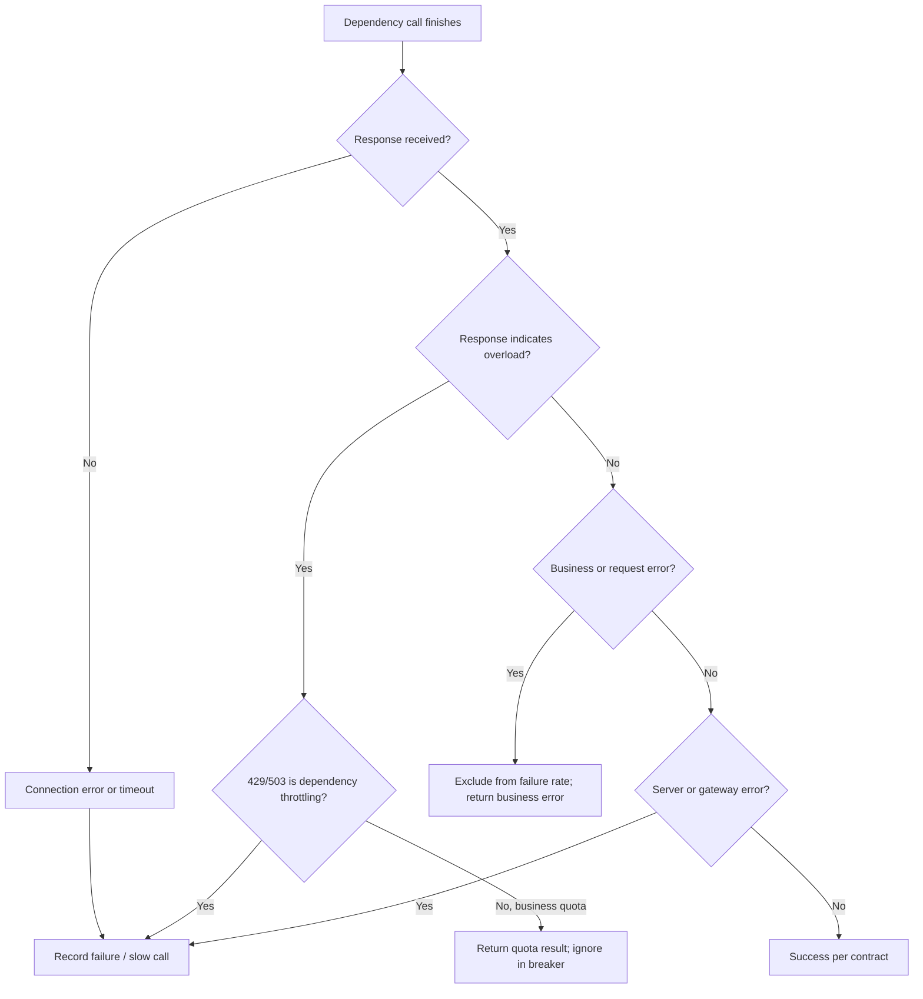

# Distinguishing Infrastructure Errors, Overload, and Business Errors

A Circuit Breaker in Spring Cloud needs to know whether a call failed because a dependency has lost availability, because the dependency is overloaded, or because a business request was rejected. These three categories of situations may all surface as exceptions or HTTP responses, yet they require different handling. If classified incorrectly, the breaker may open while the service is still healthy, or remain closed while the dependency is experiencing an outage.

In the `SPRING_CLOUD_CIRCUIT_BREAKER` module, we use Spring Cloud CircuitBreaker with Resilience4j to track call outcomes. Accurate classification ensures the sliding window reflects the true quality of the dependency, allows CLOSED/OPEN/HALF_OPEN state transitions to happen at the right time, and helps the application choose the appropriate fallback, retry, timeout, or business error response.

## 1. Three Outcome Categories to Distinguish

A call to a dependent service typically produces one of three outcome categories:

| Category | Symptoms | Examples | Meaning for Circuit Breaker |
|---|---|---|---|
| Infrastructure error | Connection or processing from the dependency does not complete normally | Connection refused, DNS failure, socket timeout, HTTP 502/503/504, 5xx server errors | Usually needs to be recorded as a failure so the breaker detects dependency degradation |
| Overload | The dependency or processing resources no longer have enough capacity to accept additional work | HTTP 429/503 due to throttling, full queues, thread pool exhaustion, bulkhead rejection | Needs load shedding or early rejection; may count as a failure if the signal comes from the protected dependency |
| Business error | The request is processed and returns a valid result according to business rules | Product not found, insufficient stock, order already canceled, invalid data | Usually should not increase the breaker's failure rate |

The key distinction is that a business outcome is not necessarily a failed service call. For example, an inventory service replying "insufficient stock" means the inventory service received and processed the request successfully; the business condition to place the order was simply not met. The breaker should record that the dependency responded, while the business layer decides that the order cannot proceed.

Conversely, if the inventory service does not respond due to a refused connection, timeout, or server error, the application has not received a reliable business answer. This is a signal about the dependency's availability and usually needs to be recorded as a failure.

## 2. Identifying Infrastructure Errors

Infrastructure errors typically arise at network, protocol, or dependent-service process boundaries. Common signs include:

- Failure to resolve DNS or establish a TCP connection.
- Connection refused, connection reset, or TLS handshake failure.
- Read timeout, response timeout, or request timeout.
- The dependency closes the connection before returning a full response.
- HTTP 5xx such as 500, 502, 503, or 504 caused by server-side or gateway processing errors.
- Dependency restarts, lost database connectivity, or inaccessible backing services.

These errors can recur over a period of time. If the application keeps sending requests and waiting indefinitely, threads, connection pools, and memory can become exhausted. The Circuit Breaker tracks these outcomes through a sliding window. When the failure rate or slow call rate exceeds its threshold after the minimum number of calls, the breaker transitions from CLOSED to OPEN and rejects new calls for the wait duration.

Not every 5xx error shares the same root cause. HTTP 500 may stem from a server-side processing bug; 502 typically relates to a gateway receiving an invalid response; 503 may indicate the service is temporarily unavailable; 504 usually means a gateway did not receive a timely response. To the breaker, they are generally signs that the dependency cannot deliver a result on time. Investigating the detailed root cause still requires service-side logs and traces.

Timeouts must be configured at the HTTP client or via a `TimeLimiter` mechanism. The Circuit Breaker can only evaluate an outcome after a call finishes or times out. Without a wait time limit, a hanging call can hold resources for too long before the breaker receives a failure.

## 3. Identifying Overload Conditions

Overload occurs when incoming workload exceeds current processing capacity. The service may still be running and reachable, yet latency increases, queues grow, requests are rejected, or resources gradually deplete.

Overload can occur in multiple places:

- **Overloaded dependency:** the service rejects requests, returns 429 or 503, or responds slowly because CPU, memory, connection pools, or queues are near their limits.
- **Overloaded caller service:** the application no longer has threads, connections, or processing slots to send more requests.
- **Platform limits:** an API gateway, load balancer, external provider, or account quota restricts the request rate.
- **Bulkhead rejection:** the application proactively rejects new calls because concurrent executions have reached the limit.

You need to distinguish where the overload signal originates. If the dependency returns HTTP 503 due to capacity exhaustion, this is a dependency failure and should usually count toward the breaker. If a local bulkhead rejects the request before the call to the dependency even begins, that is a self-protection action by the application itself. This local rejection should not be counted as a dependency failure.

HTTP 429 must be evaluated against the API contract. It may mean the dependency is throttling due to exceeding a rate limit; in that case, it is an overload or capacity-limit signal. However, 429 can also represent a user or account business quota. If a customer has exhausted their allocated quota, that may be a valid product-policy outcome and should not trip the breaker. Read the response body, headers such as `Retry-After`, and the API documentation to determine its meaning before classifying.

Handling overload often requires combining multiple mechanisms:

- **Circuit Breaker:** stop sending new requests to a dependency that is consistently failing or responding slowly.
- **Bulkhead:** limit concurrent calls and isolate resources per dependency.
- **Rate Limiter:** cap request rates according to policy.
- **Timeout:** bound the wait time for each call.
- **Backpressure or load shedding:** slow down intake or reject early when the system lacks capacity.

Retry is not the default answer for overload. If many clients simultaneously retry immediately after a 429 or 503, traffic can surge and make the situation worse. If the API allows retries, respect `Retry-After`, use backoff with jitter, cap the number of attempts, and ensure the operation is safe to repeat.

## 4. Identifying Business Errors

A business error is an outcome returned after the system has processed a request and determined that business conditions were not satisfied. These outcomes are normally expected in the application's regular flow.

Examples:

- Product ID does not exist.
- Ordered quantity exceeds available stock.
- Account has insufficient balance.
- Order has already been canceled or completed.
- User does not meet purchasing eligibility criteria.
- Request violates state or business transition rules.

If the service returns these outcomes consistently and according to contract, the dependency is still healthy. Do not count these outcomes in the Circuit Breaker's failure rate. Instead, return a business error or appropriate response to the caller.

Certain other client errors also do not reflect dependency health: requests missing required fields, malformed payloads, failed authentication, or insufficient permissions. However, you must distinguish caller-caused errors from internal integration errors. For instance, an HTTP 401/403 from a downstream service could mean the application's credentials expired or permissions are misconfigured. That is an integration error requiring alerts and configuration fixes; it is not necessarily a sign of overload or transient unavailability. Do not turn it into a user-facing business error or silently ignore it.

## 5. Classifying HTTP Status Codes by Meaning

HTTP status codes are a useful signal, though not sufficient on their own to decide the error category. The same status code can carry different meanings depending on the API contract and where it originates.

| Status | Common Meaning | How to Treat with Circuit Breaker |
|---|---|---|
| 400 Bad Request | Invalid request | Usually a client/validation outcome; do not count as a dependency failure |
| 401 Unauthorized | Missing or invalid credentials | Investigate credentials; usually not treated as an availability incident |
| 403 Forbidden | Insufficient permissions | Handle per authorization policy; do not miscount as an infrastructure error |
| 404 Not Found | Resource does not exist | Usually a valid business outcome |
| 409 Conflict | State or data conflict | Handle according to business rules |
| 422 Unprocessable Content | Syntactically valid payload failing processing rules | Usually a business error |
| 408 Request Timeout | Server did not receive the full request within the allotted time | Treat as a timeout; understand at which layer the timeout occurred |
| 429 Too Many Requests | Rate limit or quota | Classify per contract: overload/throttling or business quota |
| 500 Internal Server Error | Server-side processing error | Usually counted as a failure |
| 502 Bad Gateway | Gateway received an invalid upstream response | Usually counted as a failure |
| 503 Service Unavailable | Service temporarily unavailable or overloaded | Usually counted as a failure |
| 504 Gateway Timeout | Gateway waited too long for upstream | Usually counted as a failure/slow call |

Avoid writing a simplistic rule like "ignore all 4xx, record all 5xx as errors" across every system. For example, 429 may be a business quota; 401 may be a service-to-service credential failure; 408 may originate at different layers. Translate responses into meaningful outcome types inside the client adapter before applying Circuit Breaker policies.

## 6. Classifying Exceptions in Resilience4j

Resilience4j allows configuring which exceptions are counted as failures or ignored. Two commonly used configuration groups are:

- `ignoreExceptions(...)`: these exceptions are counted as neither success nor failure in the sliding window.
- `recordExceptions(...)`: specifies which exception types are recorded as failures. When using this list, non-matching exceptions may be treated as successes, so you must explicitly identify every error type that needs to be recorded.
- `recordException(predicate)` and `ignoreException(predicate)`: use predicates when flexible classification by exception type or internal exception details is required.

If you only need to exclude a few known business outcomes, `ignoreExceptions` is usually clearer because other exceptions continue following the default policy. If you use `recordExceptions`, be careful not to accidentally treat a newly emerging infrastructure error as a success simply because it is not yet in the list.

Example breaker configuration for a catalog service:

```java
import java.time.Duration;

import io.github.resilience4j.circuitbreaker.CircuitBreakerConfig;
import io.github.resilience4j.circuitbreaker.CircuitBreakerConfig.SlidingWindowType;

CircuitBreakerConfig catalogConfig = CircuitBreakerConfig.custom()
    .slidingWindowType(SlidingWindowType.COUNT_BASED)
    .slidingWindowSize(20)
    .minimumNumberOfCalls(10)
    .failureRateThreshold(50)
    .slowCallDurationThreshold(Duration.ofSeconds(2))
    .slowCallRateThreshold(50)
    .ignoreExceptions(
        ProductNotFoundException.class,
        InvalidProductQueryException.class,
        InsufficientStockException.class
    )
    .build();
```

In this example, product-not-found errors, invalid query requests, and insufficient stock are business outcomes ignored in breaker statistics. Timeouts, connection errors, and other infrastructure exceptions are still counted by default. This configuration is only appropriate when business exceptions are well-classified and only thrown by protected calls as expected.

You can bind the configuration to an ID using Spring Cloud CircuitBreaker:

```java
@Bean
Customizer<Resilience4JCircuitBreakerFactory> catalogCircuitBreaker() {
    return factory -> {
        CircuitBreakerConfig catalogConfig = CircuitBreakerConfig.custom()
            .slidingWindowType(SlidingWindowType.COUNT_BASED)
            .slidingWindowSize(20)
            .minimumNumberOfCalls(10)
            .failureRateThreshold(50)
            .slowCallDurationThreshold(Duration.ofSeconds(2))
            .slowCallRateThreshold(50)
            .ignoreExceptions(
                ProductNotFoundException.class,
                InvalidProductQueryException.class,
                InsufficientStockException.class
            )
            .build();

        factory.configure(builder -> builder
            .circuitBreakerConfig(catalogConfig),
            "catalog-read");
    };
}
```

The ID `catalog-read` must match the ID passed to `factory.create("catalog-read")`. If you want to reuse the configuration across multiple places, you can extract `catalogConfig` into a separate configuration bean.

## 7. Standardizing Errors at the Client Adapter

A clean way to organize error handling is to translate HTTP client responses and exceptions into meaningful internal exceptions. That way, calling services do not need to know the details of each HTTP library.

Illustrative example with WebClient:

```java
import org.springframework.stereotype.Component;
import org.springframework.web.reactive.function.client.WebClient;
import org.springframework.web.reactive.function.client.WebClientResponseException;

@Component
public class CatalogClient {
    private final WebClient webClient;

    public CatalogClient(WebClient webClient) {
        this.webClient = webClient;
    }

    public ProductDetails fetchProduct(String productId) {
        try {
            return webClient.get()
                .uri("/products/{id}", productId)
                .retrieve()
                .bodyToMono(ProductDetails.class)
                .block();
        } catch (WebClientResponseException ex) {
            int status = ex.getStatusCode().value();

            if (status == 404) {
                throw new ProductNotFoundException(productId, ex);
            }

            if (status == 429 || status == 503) {
                throw new CatalogOverloadedException(status, ex);
            }

            if (status >= 500) {
                throw new CatalogUnavailableException(status, ex);
            }

            if (status == 401 || status == 403) {
                throw new CatalogCredentialException(status, ex);
            }

            throw new CatalogRequestRejectedException(status, ex);
        }
    }
}
```

This is a synchronous example to illustrate response classification; calling `block()` is only appropriate at a synchronous boundary. In a WebFlux application, keep the reactive publisher and map errors using `onErrorMap` or an equivalent mechanism rather than calling `block()` on an event loop.

The example above classifies 404 as a business outcome, 429/503 as throttling or overload, other 5xx as availability errors, 401/403 as credential errors, and remaining status codes as rejected requests. Actual rules must follow the API contract. For example, a 429 caused by account quota may need to map to a business quota error; a 503 may be scheduled maintenance; a 400 may result from the client adapter serializing data incorrectly. Do not apply a status-code table mechanically.

Because Resilience4j records exceptions inside a protected call as failures by default, `CatalogCredentialException` and `CatalogRequestRejectedException` in this example will also be counted unless excluded by policy. If they represent misconfigured credentials or requests rejected by contract, consider adding them to `ignoreExceptions` so they do not skew the failure rate, while raising separate alerts for credential or integration errors. Only ignore well-understood types rather than broadly ignoring all 4xx exceptions.

When `WebClient` is configured with `retrieve()`, 4xx/5xx status codes throw `WebClientResponseException` by default. If you use `onStatus(...)`, explicitly map status codes to dedicated exceptions so the Circuit Breaker receives the right error types.

## 8. Classifying When Clients Return Results Instead of Throwing Exceptions

Some clients do not throw exceptions when the server returns 4xx/5xx, returning a response object containing the status instead. In that case, the Circuit Breaker can be configured with `recordResult` to determine which results must count as failures.

Example with an internal result type:

```java
CircuitBreakerConfig responseConfig = CircuitBreakerConfig.custom()
    .slidingWindowSize(20)
    .minimumNumberOfCalls(10)
    .failureRateThreshold(50)
    .recordResult(result -> {
        if (!(result instanceof CatalogResponse response)) {
            return false;
        }

        int status = response.statusCode();
        return status == 429
            || status == 502
            || status == 503
            || status == 504;
    })
    .build();
```

The predicate returns `true` when the result should be recorded as a failure. Other results are treated as successes from the Circuit Breaker's perspective, even if they represent business outcomes like product not found. This is only suitable when the remaining status codes are genuinely valid responses from the dependency. Where possible, normalize outcomes into strongly typed exceptions so policies remain easier to read and test.

Do not simultaneously use `recordResult` to flag error status codes while another layer converts those same status codes into exceptions if that makes a single call's classification ambiguous. Choose one consistent model: response-based or exception-based.

## 9. Local Overload and the Role of Bulkhead

Not every request rejection is the dependency's fault. A Bulkhead can reject a call when its concurrency limit is reached. This is a proactive protection mechanism of the calling application.

For example, an application allows at most 20 concurrent calls to a reporting service. Once all 20 slots are occupied, the 21st call is rejected immediately with a Bulkhead exception. The dependency itself may still be operating normally; the application is protecting its own threads and connections.

When handling bulkhead rejections:

- Return an overload error or retry-later status appropriate for the API contract.
- Record dedicated metrics for bulkhead rejections and slot utilization.
- Do not count local rejections as dependency failures inside the breaker.
- Do not immediately retry at the same layer while the bulkhead remains full.
- Consider load shedding, request throttling, or tuning concurrency after measurement.

When combining Bulkhead and Circuit Breaker, decorator ordering and where exceptions originate can affect how outcomes are recorded. Verify clearly which calls actually reach the dependency and which exceptions are produced by the local protection layer. Metrics should separate breaker failures, breaker not-permitted calls, and bulkhead rejections.

## 10. Impact on Fallback and Breaker State

Fallback is a way to provide an alternative result when a protected call fails or the breaker is OPEN. It does not change the meaning of the original outcome in breaker statistics.

Examples:

- Timeout reading catalog: breaker records a failure; fallback tries cache.
- Product does not exist: breaker ignores the business exception; caller receives 404 or a not-found result.
- Dependency returns 503 due to overload: breaker records a failure; fallback may serve cache if the data is still valid.
- Bulkhead full: call is rejected locally; the application returns an overload error without blaming the dependency.
- Payment gateway unresponsive: breaker protects the system, but fallback must report an indeterminate or incomplete transaction status; never return a fake success.

When a fallback uses cache, indicate that data may be stale and enforce an age limit. When no safe fallback exists, return a clear service-unavailable error. Do not use a catch-all fallback to turn every exception into a successful response, as that hides programming bugs, credential errors, and business outcomes.

## 11. Result Classification Decision Flow

The following diagram illustrates how to classify outcomes before updating Circuit Breaker statistics:



If an exception is thrown before the request leaves the application, such as local validation or bulkhead rejection, classify it by its origin rather than assuming it is a dependency failure.

## 12. Observing and Testing Classification

After configuration, verify not only breaker state but also metrics for each outcome category. Key metrics and logs to monitor include:

- Counts of successful calls, failures, slow calls, ignored exceptions, and calls rejected while the breaker is OPEN.
- Counts of dependency responses with 429, 503, and other 5xx errors.
- Counts of timeouts, connection errors, and bulkhead rejections.
- Fallback rate, cache hit rate, age of fallback data, and final outcomes received by callers.
- p95/p99 latency, pending request count, and thread/connection pool utilization.

Test scenarios should cover at least:

1. Call for an existing product: dependency returns data and the breaker records a success.
2. Call for a nonexistent product: business outcome is returned; breaker failure rate does not increase.
3. Simulate timeout or connection refused: breaker records a failure.
4. Simulate 503 from dependency overload: breaker records a failure and fallback executes if configured.
5. Simulate 429: confirm classification matches the API's rate-limit or quota semantics.
6. Saturate the bulkhead: requests are rejected locally and bulkhead metrics increment without blaming the dependency.
7. Call again while the breaker is OPEN: requests fail fast without generating additional requests to the dependency.

Do not rely solely on exception logs for verification. Cross-check sliding window metrics, breaker state, and actual requests reaching the dependency. If the breaker opens solely on 404 errors, business exceptions may not be ignored yet. If the breaker fails to open during repeated dependency timeouts, check timeout settings, exception configuration, and `minimumNumberOfCalls`.

## Conclusion

Infrastructure errors indicate that a dependency cannot deliver a normal outcome; overload indicates that a component has hit a capacity limit; business errors indicate that a request was processed but did not meet business conditions. The Circuit Breaker should reflect dependency availability failures and performance degradation, while business errors are returned per contract and local overload is handled by resource limits such as Bulkhead. Classify responses and exceptions in the client adapter, carefully inspect the semantics of 429/503, track separate metrics per mechanism, and only use fallbacks when the alternative outcome remains business-valid.
