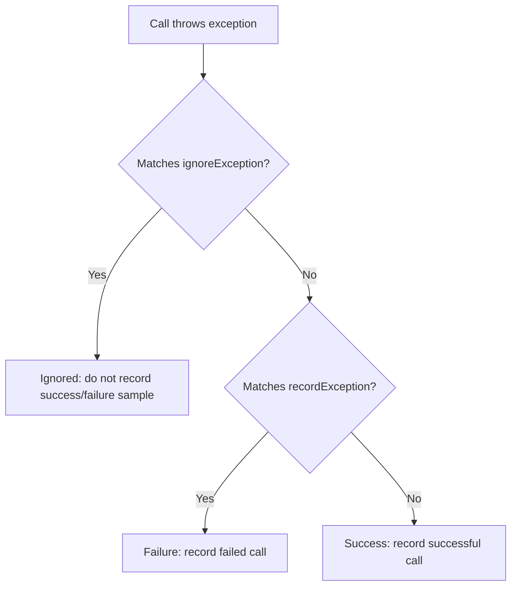

# Distinguishing Ignored Exceptions from Calls Counted as Success

In Resilience4j, the Circuit Breaker classifies the outcome of each call to update its sliding window and compute the failure rate. When a call throws an exception, that exception may be recorded as a failure, ignored completely, or—if it does not match the failure-recording policy—counted as a successful call. These three cases affect the decision to open the circuit differently.

The key point to remember is that **ignoring an exception is not the same as counting the call as a success**. An ignored exception increments neither the success count nor the failure count in the statistical window. An exception that is not ignored and does not match the failure-recording list or predicate is counted as a success. In both cases, the exception still propagates outward for the calling layer to handle; the Circuit Breaker only decides how to track it statistically.

## Three Classification Outcomes

For each completed call, the Circuit Breaker must decide how to process the outcome:

| Outcome | How the Circuit Breaker Records It | Impact on Sliding Window |
|---|---|---|
| Exception recorded as an error | Failure | Increments failed call count and can raise the failure rate |
| Exception ignored | Ignored | Increments neither success nor failure count; excluded from rate calculation |
| Exception neither ignored nor recorded as an error | Success | Increments successful call count; can lower the failure rate |

Consider an inventory API example: `IOException` may indicate the dependent service hit a connection error and should count as a failure. `ProductNotFoundException` may be a normal business outcome when a SKU does not exist; if you do not want this case to trip the Circuit Breaker, ignore that exception. An exception like `IllegalStateException`, if absent from the record list when the active policy only records specific exception types, can be counted as a success unless it is also in the ignore list.

## Default Rules and Precedence

By default, Resilience4j treats any exception thrown from a protected call as a failure. You can alter this behavior with two configuration groups:

- `recordExceptions` or `recordException`: defines which exceptions count as failures.
- `ignoreExceptions` or `ignoreException`: defines which exceptions count as neither successes nor failures.

Once a `recordExceptions` list is declared, exceptions not matching that list are treated as successes, except for those matching `ignoreExceptions`. The ignore rule takes precedence: if an exception matches both the record condition and the ignore condition, it is ignored and does not increase the failure rate.

You can follow the rules in this order:



If custom `recordExceptions` or `recordException` is not configured, the default policy records all exceptions as failures except ignored ones. When using custom predicates, test both `true` and `false` branches to avoid accidentally turning a technical error into a success.

## Configuring via application.yml

Spring Cloud CircuitBreaker with the Resilience4j backend supports declaring per-instance classification policies in `application.yml`. For example, the `inventory` Circuit Breaker records connection and timeout errors while ignoring two business exceptions:

```yaml
resilience4j:
  circuitbreaker:
    instances:
      inventory:
        slidingWindowType: COUNT_BASED
        slidingWindowSize: 20
        minimumNumberOfCalls: 10
        failureRateThreshold: 50
        waitDurationInOpenState: 10s
        recordExceptions:
          - java.io.IOException
          - java.util.concurrent.TimeoutException
        ignoreExceptions:
          - com.example.inventory.ProductNotFoundException
          - com.example.inventory.InvalidSkuException
```

With this configuration:

- `IOException` and `TimeoutException` count as failures.
- `ProductNotFoundException` and `InvalidSkuException` are ignored, even if they might match another failure-recording condition.
- Any other exception matching neither list counts as a success because `recordExceptions` was specified.

Class names in YAML must be the fully qualified names of the exceptions actually thrown out of the protected call. If an HTTP client wraps the original error in another exception, classify according to the exception the Circuit Breaker actually receives. Inspect the root `cause` when necessary, but avoid overly broad predicates that could ignore connection errors or timeouts.

## Configuring in Java with Resilience4j

You can set the same policy using `CircuitBreakerConfig`:

```java
import java.io.IOException;
import java.util.concurrent.TimeoutException;

import io.github.resilience4j.circuitbreaker.CircuitBreakerConfig;

CircuitBreakerConfig config = CircuitBreakerConfig.custom()
    .slidingWindowSize(20)
    .minimumNumberOfCalls(10)
    .failureRateThreshold(50)
    .recordExceptions(IOException.class, TimeoutException.class)
    .ignoreExceptions(
        ProductNotFoundException.class,
        InvalidSkuException.class)
    .build();
```

When integrating through Spring Cloud CircuitBreaker, you can apply the configuration to a specific ID using a factory customizer:

```java
import org.springframework.cloud.client.circuitbreaker.Customizer;
import org.springframework.cloud.circuitbreaker.resilience4j.Resilience4JCircuitBreakerFactory;
import org.springframework.context.annotation.Bean;

@Bean
Customizer<Resilience4JCircuitBreakerFactory> inventoryCircuitBreakerPolicy() {
    return factory -> factory.configure(
        builder -> builder.circuitBreakerConfig(config),
        "inventory");
}
```

Place the `config` variable in a configuration bean or construct it directly inside the customizer as appropriate for your application. Properties configuration may take precedence over Java customizers; when actual behavior differs from examples, check the effective instance and group configuration.

## Using Predicates When Class Lists Are Not Enough

Exception lists work well when the policy depends solely on exception types. If you need to check additional conditions, you can use predicates:

```java
CircuitBreakerConfig config = CircuitBreakerConfig.custom()
    .recordException(throwable ->
        throwable instanceof IOException
            || throwable instanceof TimeoutException)
    .ignoreException(throwable ->
        throwable instanceof ProductNotFoundException
            || throwable instanceof InvalidSkuException)
    .build();
```

The `recordException` predicate returns `true` when the exception should count as a failure. The `ignoreException` predicate returns `true` when the exception should be excluded from statistics. If both return `true`, the ignore rule takes precedence.

Avoid writing predicates like "ignore every exception except a few types" if the application has multiple clients or multiple exception-wrapping layers. List the exceptions representing dependency errors, business errors, and programming bugs; then test each type to verify the policy reflects their true meaning.

## Ignoring an Exception Does Not Mean Application-Level Success

Circuit Breaker classification only affects statistics and state decisions. It does not swallow exceptions, synthesize return values, or replace fallback logic.

Suppose `ProductNotFoundException` is configured to be ignored. When `inventoryClient.find("SKU-404")` throws this exception:

1. The Circuit Breaker counts the call as neither a failure nor a success in the sliding window.
2. The exception still propagates out of the protected call.
3. The calling layer can catch the exception, translate it to HTTP 404, return an appropriate business result, or run a configured fallback.

With `CircuitBreaker.run(supplier, fallback)`, fallback invocation is driven by the exception emitted from the call and the wrapper mechanics of the API in use. Excluding an exception from the failure rate does not automatically prevent the fallback from running. Therefore, design fallbacks around error semantics and separately test the execution path of ignored exceptions.

Example illustrating business outcome handling in a service:

```java
Inventory find(String sku) {
    return circuitBreakerFactory.create("inventory").run(
        () -> inventoryClient.find(sku),
        error -> {
            if (error instanceof ProductNotFoundException) {
                throw new InventoryNotFoundException(sku, error);
            }
            return inventoryCache.find(sku)
                .orElseThrow(() -> new InventoryUnavailableException(sku, error));
        });
}
```

In this example, the business exception is still translated into an appropriate error for the caller. Dependency failures can fall back to cache. Adjust return types and exceptions to match your application's actual contract.

## Impact on the Sliding Window and Circuit-Opening Threshold

Suppose the Circuit Breaker has received 10 calls:

- 4 calls throw `IOException` and are recorded as failures.
- 3 calls throw `ProductNotFoundException` and are ignored.
- 3 calls return normal results and are recorded as successes.

The sliding window only has 7 counted samples: 4 failures and 3 successes. The failure rate is roughly 57.1% (4 failures out of 7 samples). The three ignored exceptions are not added to the denominator. If `minimumNumberOfCalls: 5` and `failureRateThreshold: 50` are configured, the circuit has enough samples and the error rate exceeds the threshold, so it can transition to `OPEN`.

If ignored exceptions were mistakenly counted as successes, the denominator would become 10 and the failure rate would be miscalculated as 40%. That misclassification could prevent the Circuit Breaker from opening even when the failure rate among calls that genuinely matter is high.

Conversely, if a business exception like `ProductNotFoundException` were counted as a failure, requests looking up nonexistent SKUs could drive up the failure rate and open the circuit even while the inventory service is healthy. Classify according to what an exception means for dependency health, not merely whether Java threw an exception.

## Observing and Testing Classification Policies

In production, monitor successful, failed, rejected call counts, and ignored-exception events if your Resilience4j version emits those events. Do not infer that every ignored exception is a recovered error; callers may still receive and handle them as business errors.

A useful test suite should cover the following cases:

| Scenario | Expected Configuration | Result to Verify |
|---|---|---|
| Service throws `IOException` | Present in `recordExceptions` | Failure count increments; failure rate updates |
| Service throws `ProductNotFoundException` | Present in `ignoreExceptions` | Neither success nor failure count increments; exception still reaches caller/fallback |
| Service throws an exception in neither list | `recordExceptions` is declared | Counted as a success |
| An exception matches both record and ignore | Present in both conditions | Ignore takes precedence; counted as neither failure nor success |
| Service returns a normal result | No exception | Success count increments |

After testing each category individually, generate a mixed sequence of outcomes to verify the failure rate and the exact point where the Circuit Breaker transitions to `OPEN`. Also confirm that fallbacks and HTTP responses still honor the contract. This catches common misconfigurations: a business exception accidentally counted as an infrastructure error, or a timeout accidentally counted as a success.

## Common Configuration Mistakes

- **Putting business exceptions in `recordExceptions`:** drives up the failure rate when users supply invalid input or look up nonexistent resources. Consider ignoring them if they do not reflect dependency health.
- **Using `ignoreExceptions` for infrastructure errors:** causes timeouts or connection errors to vanish from metrics, delaying circuit opening while the dependency is broken.
- **Declaring `recordExceptions` and forgetting the rest count as success:** exceptions outside the list are not automatically ignored.
- **Assuming ignore swallows the exception:** callers can still receive the exception and fallbacks can still run.
- **Misclassifying wrapped exceptions:** clients may throw `ResourceAccessException` instead of `IOException`; base rules on the actual exception type received by the Circuit Breaker.

A sound policy separates errors indicating an unhealthy dependency from valid business outcomes and input errors. By clearly distinguishing ignored exceptions from calls counted as successes, the sliding window reflects dependency health more accurately and the Circuit Breaker opens at the right moment.
