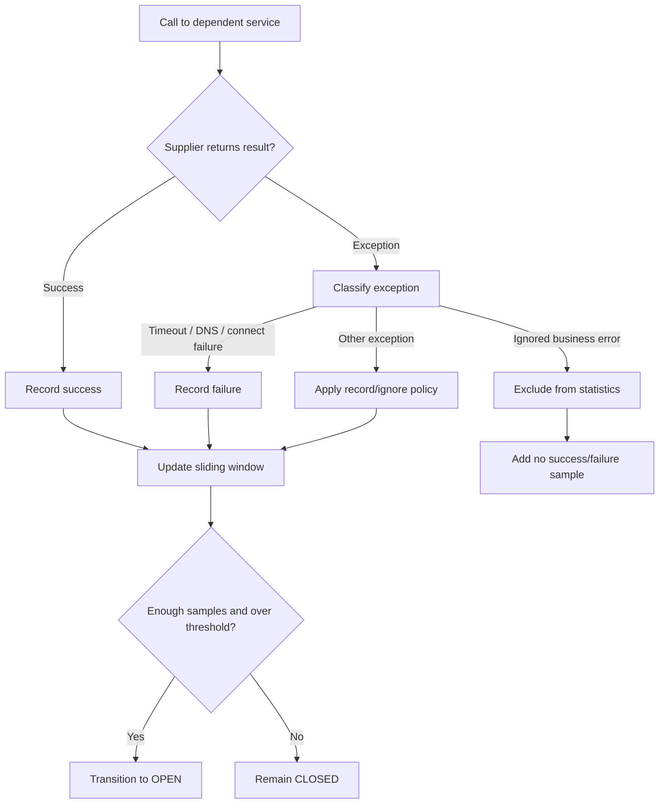

# Handling Timeouts, Connection Refused, and Name Resolution Errors

When a Spring Cloud service calls a dependent service, network failures typically surface as exceptions from the HTTP client. The circuit breaker needs to classify these outcomes accurately to assess dependency health and decide when to transition from `CLOSED` to `OPEN`. Three common failure categories are timeouts, connection refused, and domain name resolution errors. Each can prevent a call from completing, yet their causes and handling differ.

The crucial point is that the exception seen by application code is not always the original network exception. The HTTP client, framework, or Reactor may wrap the error inside another exception. Consequently, configuring the circuit breaker based on a single exception class can miss real failures. You must understand the underlying cause chain (*cause chain*), distinguish infrastructure errors from business errors, and ensure retries/fallbacks match the side effects of the call.

## 1. Classifying the Three Network Error Groups

### Timeout

A timeout occurs when a phase of the call exceeds its allowed wait time. Several forms can occur:

- **Connect timeout:** failed to establish a connection to the server within the allotted time. For example, the server did not respond during the TCP handshake.
- **Read/response timeout:** the connection was established, but response data did not arrive in time.
- **Task-level timeout:** a `TimeLimiter` or asynchronous mechanism stops waiting and throws `java.util.concurrent.TimeoutException`.
- **HTTP timeout response:** the server or gateway returns an HTTP code such as 408 or 504. This is an HTTP response, distinct from a client-side timeout.

Possible exceptions include `java.net.SocketTimeoutException`, `java.util.concurrent.TimeoutException`, and HTTP client-specific exceptions. With Reactor Netty, connect or read timeouts may be represented by Netty or Reactor Netty exception types.

A timeout does not prove the target server failed to execute the operation. For example, a payment service might have already recorded a transaction, with the response lost or arriving past the deadline. If the client automatically retries a transaction-creation operation without an idempotency key, a duplicate transaction may be created.

### Connection Refused

Connection refused (*connection refused*) usually happens when the client reaches the target address, but no process is listening on the requested port, or a network component actively rejects the connection. In Java, this typically appears as `java.net.ConnectException` with a message such as `Connection refused`.

Common causes include:

- The target service has not started yet or is restarting.
- The target application is not listening on the port the client is calling.
- Host/port configuration or service discovery points to the wrong endpoint.
- A pod or instance has stopped, yet endpoint information has not updated.
- A network policy or proxy rejects the connection.

This error generally indicates the client could not establish a connection to the endpoint. It differs from a read timeout: in a read timeout, the connection may already be established and the client is waiting for response data.

### Name Resolution Error

A name resolution error (*name resolution failure*) happens when the client cannot translate a hostname into an IP address. In Java, the typical exception is `java.net.UnknownHostException`.

Possible causes include:

- Misspelled service name or hostname.
- DNS record has not been created, expired, or is unreachable.
- The DNS resolver inside the container or node is failing.
- Incorrect namespace, search domain, or service discovery configuration.
- The endpoint only exists in one environment while the application runs in another.

DNS errors typically occur before the client opens a TCP connection. Therefore, repeatedly retrying the same invalid hostname will not recover. If the resolver encounters a transient glitch, a retry with backoff may succeed; if the service name is invalid, fix the configuration or service discovery.

## 2. Comparing Causes and Initial Remediation

| Error Group | Common Exception | Where It Occurs | Initial Remediation Direction |
|---|---|---|---|
| Connect timeout | `ConnectTimeoutException` or client-specific exception | During connection setup | Check endpoint, network path, and ability to accept connections |
| Read/response timeout | `SocketTimeoutException`, client timeout | After connecting, while waiting for response | Check backend latency, load, and deadlines; verify whether the operation may have completed |
| Task timeout | `java.util.concurrent.TimeoutException` | When `TimeLimiter` or async mechanism expires | Check time budget and task cancellation behavior |
| Connection refused | `ConnectException` | When opening connection to host/port | Check target process, port, readiness, and endpoint discovery |
| DNS resolution failure | `UnknownHostException` | Before connecting to an IP address | Check hostname, DNS resolver, and service discovery |
| HTTP 408/504 | Client HTTP response exception | HTTP response received from server or gateway | Classify status per service contract and identify which layer generated the timeout |

The exception names in this table are common forms, not an exhaustive list for every HTTP client. A single failure can be wrapped in multiple layers. For example, `RestTemplate` often wraps I/O errors in `org.springframework.web.client.ResourceAccessException`; `WebClient` can emit `WebClientRequestException` with the network exception as its cause. Inspect the exact client you use and the actual cause chain when handling errors.

## 3. Why Must You Inspect the Cause Chain?

The circuit breaker records the exception that the supplier propagates outward. That exception may be a framework wrapper rather than the raw network exception.

For example, with a synchronous client, a connection error might have the following structure:

```text
ResourceAccessException
  caused by ConnectException: Connection refused
```

With a reactive client, a request error might look similar:

```text
WebClientRequestException
  caused by UnknownHostException: inventory-service
```

If you only declare `ConnectException` in the recorded-exceptions list while the exception actually reaching the breaker is `ResourceAccessException`, exact-class matching may fail to recognize the inner root error. There are two approaches:

1. Record the wrapper class emitted by the HTTP client—such as `ResourceAccessException` or `WebClientRequestException`—if all errors of that class should count as dependency failures.
2. Use a predicate that walks the cause chain to classify by root exception when you need to distinguish timeouts, DNS errors, and connection refused.

Do not rely solely on exception message text like `"Connection refused"` or `"UnknownHostException"`. Messages vary across operating systems, runtimes, and HTTP clients. Classifying by exception type and cause chain is much more reliable.

## 4. Configuring Recorded Exceptions with Resilience4j

Resilience4j allows specifying which exceptions count as failures and which should be ignored. You can declare them in `application.yml`:

```yaml
resilience4j:
  circuitbreaker:
    instances:
      inventory:
        slidingWindowType: COUNT_BASED
        slidingWindowSize: 20
        minimumNumberOfCalls: 10
        failureRateThreshold: 50
        waitDurationInOpenState: 10s
        permittedNumberOfCallsInHalfOpenState: 3
        recordExceptions:
          - java.net.SocketTimeoutException
          - java.util.concurrent.TimeoutException
          - java.net.ConnectException
          - java.net.UnknownHostException
          - java.net.NoRouteToHostException
          - org.springframework.web.client.ResourceAccessException
          - org.springframework.web.reactive.function.client.WebClientRequestException
        ignoreExceptions:
          - com.example.inventory.InvalidSkuException
```

This example illustrates declaring exceptions by class. The Spring types only fit if the application uses the corresponding HTTP client and your library version provides those classes. Tailor the list to the actual exceptions thrown by the supplier.

When `recordExceptions` is used, Resilience4j only records exceptions matching the configured list as failures; non-matching exceptions may be treated as successes according to configuration rules. `ignoreExceptions` specifies exceptions counted as neither failures nor successes. If an exception matches both record and ignore rules, the ignore rule takes precedence.

If `recordExceptions` is not declared, Resilience4j's default behavior records any thrown exception as a failure except those configured to be ignored. Adding a `recordExceptions` list therefore changes the classification policy rather than merely appending a few extra error types to the default.

### Distinguishing Infrastructure Errors from Business Errors

Not every exception should open the circuit breaker. An `InvalidSkuException` or input validation error typically does not indicate the inventory service is degrading. Counting such business errors toward the failure rate can trip the breaker while the backend operates normally.

Conversely, timeouts, connection errors, and DNS failures usually indicate the dependency cannot be called successfully. These errors should generally be recorded so the circuit breaker can protect the calling service.

HTTP status codes must also be classified according to the business contract:

- HTTP 5xx usually reflects server or gateway errors and is typically treated as a dependency failure.
- HTTP 404 may be a valid business outcome, such as a nonexistent SKU; do not assume every 404 is an infrastructure outage.
- HTTP 400 or 422 usually relates to input data and should generally not contribute to the failure rate.
- HTTP 429 may signal the backend is throttling traffic. Depending on the contract, it may be an overload signal to record or a rate-limiting response handled via retry with `Retry-After`.
- HTTP 408 or 504 usually relates to timeouts, though you must identify whether the server, gateway, or client produced the response.

## 5. Classifying by Cause Chain Using a Predicate

When client wrappers vary by library or you need to distinguish multiple error categories, predicates let you inspect the root exception. The example below illustrates a predicate recognizing common connectivity errors:

```java
import java.net.ConnectException;
import java.net.NoRouteToHostException;
import java.net.SocketTimeoutException;
import java.net.UnknownHostException;
import java.util.concurrent.TimeoutException;
import java.util.function.Predicate;

public final class NetworkFailurePredicates {
    private NetworkFailurePredicates() {
    }

    public static boolean isNetworkFailure(Throwable error) {
        for (Throwable cause = error;
             cause != null;
             cause = cause.getCause()) {
            if (cause instanceof SocketTimeoutException
                    || cause instanceof TimeoutException
                    || cause instanceof ConnectException
                    || cause instanceof UnknownHostException
                    || cause instanceof NoRouteToHostException) {
                return true;
            }
        }
        return false;
    }

    public static Predicate<Throwable> networkFailurePredicate() {
        return NetworkFailurePredicates::isNetworkFailure;
    }
}
```

You can use this predicate when building `CircuitBreakerConfig`:

```java
CircuitBreakerConfig config = CircuitBreakerConfig.custom()
        .slidingWindowSize(20)
        .minimumNumberOfCalls(10)
        .failureRateThreshold(50)
        .recordException(NetworkFailurePredicates::isNetworkFailure)
        .build();
```

This snippet assumes the application has imported `io.github.resilience4j.circuitbreaker.CircuitBreakerConfig` and passes `config` into the appropriate registry or factory. The predicate returns `true` for errors considered failures. Unmatched exceptions must be considered under application policy; if a specific business exception needs to be ignored, configure a dedicated ignore rule and verify predicate evaluation order.

The example predicate above checks only standard Java types. If the client uses proprietary exceptions such as `ConnectTimeoutException`, `ReadTimeoutException`, or other wrappers, add those types after inspecting actual cause chains. Avoid treating every `IOException` identically if the application needs to distinguish network failures from local read/write errors.

## 6. How Errors Are Recorded in CircuitBreaker

When the breaker is `CLOSED`, the supplier runs and its outcome is recorded in the sliding window. An exception classified as a failure increments the error count in the window. Once `minimumNumberOfCalls` is met and the error rate hits `failureRateThreshold`, the breaker can transition to `OPEN`.

If an exception is ignored, it counts as neither a failure nor a success in statistics. This differs from an exception that misses `recordExceptions` in a configuration explicitly listing recorded types; an unmatched exception may be treated as a successful call. Choose policies intentionally, as misclassification can artificially depress the error rate.

For example, suppose a window has a minimum of 10 calls and a 50% failure threshold. If 5 calls fail with timeout or connection refused and 10 samples are recorded, the breaker can open. If 5 other errors are ignored `InvalidSkuException` instances, they add neither success nor failure samples. If they were counted as successes instead, the failure rate would change and could delay circuit opening.



## 7. Combining Error Classification with Fallback

Fallback allows a gateway to return a degraded result when a call fails or the breaker is open. However, the fallback should accurately reflect the error category and data state.

For example, when the inventory service is unreachable, the gateway can return an `UNAVAILABLE` status:

```java
public InventoryView find(String sku) {
    return circuitBreakerFactory.create("inventory").run(
            () -> inventoryClient.find(sku),
            failure -> {
                log.warn("Inventory lookup failed for sku {}", sku, failure);
                return InventoryView.unavailable(sku);
            }
    );
}
```

`UNAVAILABLE` means something different from `OUT_OF_STOCK`. During a DNS error or connection refused, the application does not know the actual inventory. Returning a quantity of 0 may cause the business layer to wrongly reject orders. If cache is available, you can serve stale data, but surface the last-updated timestamp and stale indicator so users and upstream systems interpret it accurately.

A fallback should also avoid calling the same failing endpoint again. If a fallback calls the inventory service via another unbounded client, the system still adds load to the failing dependency. Fallbacks should perform local operations, query cache, or return a pre-designed degraded status.

If different behavior is needed by cause, inspect `failure` inside the fallback:

- Timeout: return a temporary data-unavailable status and record latency.
- Connection refused: log that the endpoint is rejecting connections; check readiness or service discovery.
- Unknown host: log the name resolution failure and alert on DNS configuration.
- Business error: return the corresponding business response rather than turning it into dependency unavailability.

Avoid catching `Throwable` and returning a generic default without preserving the cause. That pattern hides programming bugs like `NullPointerException`, misconfigurations, or data contract violations.

## 8. Retries and Timeouts Need Clear Budgets

Retries can help when failures are likely transient, but retries do not replace a circuit breaker. If the backend is overloaded, unbounded retries multiply request volume and make recovery harder.

| Error | Retryability | Notes |
|---|---|---|
| Connect timeout | Limited retries possible | Use backoff and jitter; check endpoint and network |
| Read timeout | Use caution | Server may already have executed the operation; require idempotency for side-effecting operations |
| Connection refused | Retry after a short wait if service is starting | If port is wrong or no listener exists, continuous retries will not help |
| Unknown host | Limited retries only if transient DNS issue suspected | Misconfigured hostname requires config fix, cannot be cured by retries |
| HTTP 429 | Follow contract and `Retry-After` | Limit retries and respect server throttling policy |
| HTTP 5xx | Can retry certain transient failures | Do not blindly retry non-idempotent operations |

Timeouts must fit within the overall request deadline. For example, if a user-facing request allows only 2 seconds, do not set a 2-second connect timeout, 2-second read timeout, and multiple retries. The combined time across attempts, backoff, and other processing steps will exceed the deadline.

With Resilience4j, `TimeLimiter` can cap the wait time of a `Future` or supported asynchronous task. HTTP clients also need separate connect and response timeouts. When a timeout occurs, check whether the underlying task is actually cancelled or merely no longer awaited; cancelling a `Future` does not always halt underlying I/O.

The nesting order of retry and circuit breaker affects metrics. If retry is inside the breaker, a single execution of the breaker's supplier can trigger multiple network calls while the breaker observes only the final outcome of the retry sequence. If the breaker is inside the retry, each attempt passes through the breaker and is recorded individually. Pick the nesting order based on your statistical goals and load limits, then test with real failures.

## 9. Monitoring and Diagnostics by Error Type

An aggregate failure rate indicates the breaker is encountering errors, yet does not explain whether they stem from timeouts, DNS, or connection refused. Add logs, metrics, and traces to pinpoint root-cause categories.

Signals to monitor include:

- Counts and rates of `SocketTimeoutException`, `TimeoutException`, `ConnectException`, `UnknownHostException`, or their wrappers.
- Transition counts from `CLOSED` to `OPEN` and `OPEN` to `HALF_OPEN`.
- Failure rate and slow call rate per breaker ID.
- Connection time, response wait time, and total request latency.
- Counts of fallbacks, retries, and calls rejected while the breaker is open.
- DNS health, endpoint discovery, pod readiness, and connection pool health.

Avoid putting dynamic hostnames, user IDs, or high-cardinality values into metric labels. Use bounded labels like breaker ID, error category, and dependent service name. Detailed logs can preserve the exception and cause chain, while avoiding sensitive data or credentials in URLs and headers.

Quick diagnostic pointers:

- Many `UnknownHostException`s: inspect hostname, DNS resolver, namespace, and service discovery.
- Many `ConnectException: Connection refused` errors: inspect target process, listening port, readiness, and the endpoint chosen by the client.
- Many connect timeouts: inspect network path, firewalls, system load, and connection setup times.
- Many read timeouts: inspect backend processing latency, deeper dependencies, queues, thread pools, and connection pools.
- Breaker opens while backend looks healthy: check exception wrappers, record/ignore policy, miscounted business errors, and per-replica metrics.

## 10. Testing Outcome Classification

To be certain the breaker reacts properly, test raw exceptions, client wrappers, and fallback outcomes. Create the following test scenarios in a test environment:

1. **Timeout:** make the endpoint respond slower than the read timeout and verify the error is recorded as a failure.
2. **Connection refused:** call a host/port with no listener and verify the supplier emits an appropriate exception or a wrapper containing `ConnectException`.
3. **DNS failure:** use an unresolvable hostname in tests and verify the cause chain contains `UnknownHostException`.
4. **Business error:** trigger an ignored exception and confirm it does not raise the failure rate.
5. **Breaker OPEN:** generate enough failure samples to open the circuit, then verify the supplier is not called and the fallback executes.
6. **Recovery:** restore the endpoint, wait for the breaker to enter `HALF_OPEN`, send the permitted probe calls, and verify the breaker closes on good outcomes.

In each scenario, check the sample count in the sliding window, failure rate, breaker state, and fallback count. When using `recordExceptions`, test both listed and unlisted exceptions to confirm the policy does not accidentally treat business errors as successes. When using Spring or Reactor wrappers, verify the actual exception reaching the breaker rather than just the exception the test expects.

## 11. Workflow When Encountering Network Errors

When a dependency call fails, follow this procedure:

1. Capture the outer exception and full cause chain to identify the root error.
2. Classify the error as connect timeout, read timeout, task timeout, connection refused, DNS failure, or HTTP response error.
3. Inspect the hostname, port, endpoint discovery, target service health, and network path matching that error type.
4. Decide whether the error should count toward the failure rate or be ignored under the business contract.
5. Choose a fallback reflecting unavailable data, stale data, or a valid business outcome.
6. Only retry likely transient failures with bounded attempts and total time budgets; guard side-effecting operations with idempotency.
7. Monitor metrics by error group and circuit breaker state to confirm the system stops calling when necessary and recovers cleanly.

Timeouts, connection refused, and DNS failures can all break a remote call, yet each points to a different failure boundary. By classifying exceptions accurately along the cause chain, the circuit breaker records dependency health precisely, avoids tripping on business errors, and enables fallbacks to return honest outcomes. Combined with timeouts, bounded retries, and error-typed observability, Spring Cloud applications prevent network failures from cascading into systemic outages.
