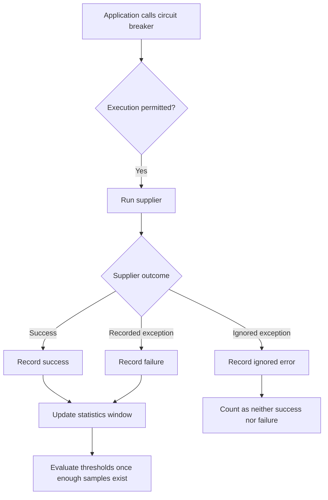
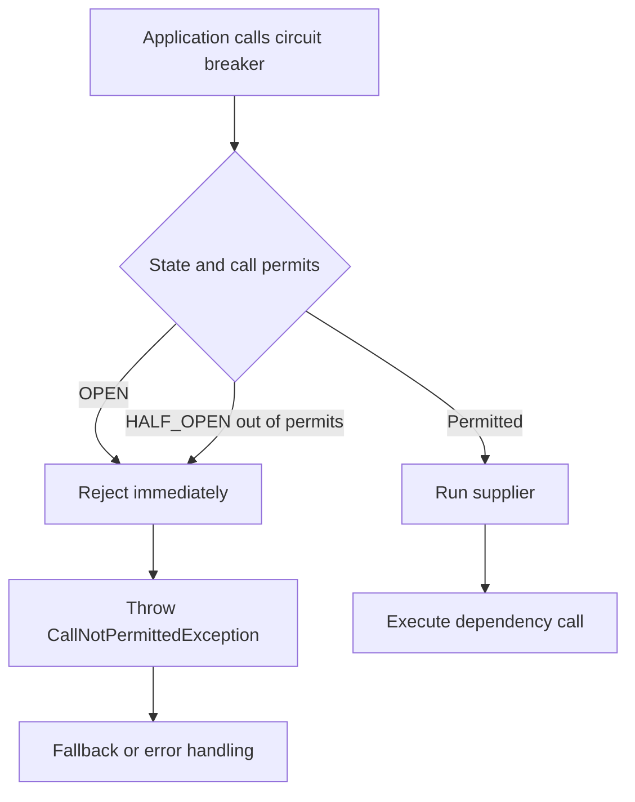

# Distinguishing Execution Errors from Immediately Rejected Calls

When a call protected by a circuit breaker fails, you need to determine whether the error occurred while calling the dependent service or whether the circuit breaker rejected the call before that call ever started. Both cases can lead to the same fallback, yet their operational meaning and statistical accounting are completely different.

In Spring Cloud CircuitBreaker using Resilience4j, errors originating from the supplier—such as timeouts, connection errors, or invalid service responses—are the result of an execution that started. Conversely, when the circuit breaker is `OPEN` or has exhausted its permitted calls in `HALF_OPEN`, it can reject the call immediately with `CallNotPermittedException`. In that case, the supplier does not run and the dependent service receives no additional request from this call.

Properly distinguishing these two outcome types helps development teams read metrics accurately, configure appropriate fallbacks, and avoid pointless retries while the circuit breaker is protecting the system.

## 1. Two Situations with Similar External Symptoms but Different Nature

Suppose `OrderService` calls an inventory service through a circuit breaker with ID `inventory`. Two common situations occur:

**Execution-time error:** the circuit breaker permits the call to proceed, the supplier calls `InventoryClient`, and the inventory service fails to respond or returns an error. The supplier ran and threw an exception. Resilience4j classifies the exception according to the failure-recording configuration, then updates window statistics.

**Immediately rejected call:** the circuit breaker is `OPEN`, or no probe permits remain in `HALF_OPEN`. The circuit breaker does not grant execution permission to the supplier and throws `CallNotPermittedException`. `InventoryClient` is not called this time. This is a protective rejection outcome, not a new failure from the inventory service.

| Characteristic | Execution-Time Error | Immediately Rejected Call |
|---|---|---|
| Does the supplier run? | Yes | No |
| Does the dependent service receive a request? | Possibly, depending on which step failed | Receives no request from the rejected call |
| Examples | `SocketTimeoutException`, connection error, HTTP error converted to exception by client | `CallNotPermittedException` |
| What state is the circuit breaker in? | Usually `CLOSED` or a probe call in `HALF_OPEN` | `OPEN` or out of permits in `HALF_OPEN` |
| Affects dependent-call error statistics? | Yes, if the exception is configured to be recorded | Not counted as a new execution failure in the circuit breaker's failure rate |
| Handling goal | Investigate dependency health and response | Honor the circuit-breaking decision; return a fallback or controlled error |

The key takeaway is that `CallNotPermittedException` does not prove the dependent service just failed. It signals that the circuit breaker actively blocked the call to avoid adding further load to the dependency.

## 2. Processing Flow When the Supplier Actually Runs

In the `CLOSED` state, the circuit breaker normally grants execution permission to the supplier. The supplier invokes the client and returns a result or throws an exception. Resilience4j records the outcome according to `CircuitBreakerConfig`.



For example, the inventory service times out:

```java
public Stock getStock(String sku) {
    return circuitBreakerFactory.create("inventory").run(
        () -> inventoryClient.getStock(sku),
        error -> Stock.unavailable(sku)
    );
}
```

If `inventoryClient.getStock(sku)` throws `SocketTimeoutException` or the corresponding HTTP client exception, the supplier ran. Under Resilience4j's default configuration, exceptions are generally recorded as failures. You can adjust this rule via `recordExceptions`, `ignoreExceptions`, `recordException`, or the corresponding predicate.

Not every error HTTP response automatically becomes an exception. Some HTTP clients return a normal response object even when the status is 4xx or 5xx. If the supplier treats that response as a successful result, the circuit breaker may record a success unless the application converts the response into an exception or configures an appropriate result predicate. Therefore, verify client behavior and status-code mapping before concluding the circuit breaker misclassified an error.

## 3. Processing Flow When the Circuit Breaker Rejects the Call

When the circuit is `OPEN`, the circuit breaker denies permission to the supplier. Resilience4j throws `CallNotPermittedException` before executing the service-call section. In `HALF_OPEN`, the circuit breaker grants only up to `permittedNumberOfCallsInHalfOpenState` probe calls; calls exceeding remaining permits can also be rejected.



Example:

```java
import io.github.resilience4j.circuitbreaker.CallNotPermittedException;

public Stock getStock(String sku) {
    return circuitBreakerFactory.create("inventory").run(
        () -> inventoryClient.getStock(sku),
        error -> {
            if (error instanceof CallNotPermittedException) {
                return Stock.temporarilyUnavailable(sku);
            }
            return Stock.unavailable(sku);
        }
    );
}
```

The fallback in this example distinguishes a circuit-breaker rejection from an error occurring while the supplier ran. Both may return a temporarily-unavailable status, yet preserving distinct cause details improves logging, user messaging, and retry decisions.

When the circuit breaker rejects a call, do not bypass it to call the same service directly "for one more try." Doing so defeats the protection decision and can generate the exact load the circuit breaker is trying to prevent. If the business flow can wait, return an appropriate status or schedule a controlled retry later at an orchestration layer.

## 4. `CallNotPermittedException` and the Failure Rate

Resilience4j's failure rate is computed from execution outcomes recorded in the statistics window. `CallNotPermittedException` signifies that the circuit breaker did not allow the call to start. Because the supplier never ran, it is not a new dependency failure to add to the failure rate.

Resilience4j can still track rejections through a dedicated metric or event, typically represented as `not permitted` calls. This figure is very useful to know how many requests were blocked while the circuit was open or probe permits were exhausted. Do not add these rejection counts to dependent-service execution failures when analyzing the failure rate.

For example, suppose a window contains 20 execution outcomes: 12 failures and 8 successes. The failure rate is 60%. After the circuit opens, 100 more requests are rejected immediately. Those rejections increment the `not permitted` metric, but they do not turn the prior 20-sample failure rate into 100/120 or 112/120. They reflect traffic blocked by the circuit breaker, not 100 failed dependency calls.

In `HALF_OPEN`, only calls granted probe permits run the supplier and produce outcomes for the circuit breaker to decide whether to close or re-open. Requests denied permission because probe permits were exhausted are rejected calls, not failed probe outcomes.

## 5. Ignored Exceptions Are a Third Case to Distinguish

Beyond failures and rejections, Resilience4j also lets you configure certain exceptions as *ignored*. The supplier ran and threw an exception, yet the exception is classified as ignored. This case is counted as neither a success nor a failure in rate calculations.

For example, a business error caused by invalid input data may not reflect the inventory service's health. If this exception type is configured as ignored, it does not raise the circuit breaker's failure rate.

Configuration example:

```yaml
resilience4j:
  circuitbreaker:
    instances:
      inventory:
        recordExceptions:
          - java.net.SocketTimeoutException
          - java.io.IOException
        ignoreExceptions:
          - com.example.inventory.InvalidSkuException
```

When configuring `recordExceptions`, understand the classification rules of your Resilience4j version: specified exceptions are recorded as failures; non-matching exceptions may be treated as successes unless ignored or handled by another predicate. `ignoreExceptions` excludes exceptions from success/failure statistics. Verify predicate evaluation order and interactions if combining multiple classification mechanisms.

Do not ignore timeouts or connection errors just to lower the failure rate. Ignoring signals that indicate an unresponsive dependency can prevent the circuit breaker from opening when needed.

## 6. Fallback Receives Both Execution Errors and Rejections

Spring Cloud CircuitBreaker lets you pass a fallback function to `run(...)`. This function receives a `Throwable` and can be invoked either when the supplier fails or when the circuit breaker rejects the call. Therefore, do not assume every error entering a fallback originated from the dependent service.

One clean way to organize this is separating cause classification from response construction:

```java
import io.github.resilience4j.circuitbreaker.CallNotPermittedException;
import org.springframework.stereotype.Service;

@Service
public class InventoryService {
    private final CircuitBreakerFactory<?, ?> circuitBreakerFactory;
    private final InventoryClient inventoryClient;

    public InventoryService(
            CircuitBreakerFactory<?, ?> circuitBreakerFactory,
            InventoryClient inventoryClient) {
        this.circuitBreakerFactory = circuitBreakerFactory;
        this.inventoryClient = inventoryClient;
    }

    public Stock getStock(String sku) {
        return circuitBreakerFactory.create("inventory").run(
            () -> inventoryClient.getStock(sku),
            error -> fallback(sku, error)
        );
    }

    private Stock fallback(String sku, Throwable error) {
        if (error instanceof CallNotPermittedException) {
            return Stock.temporarilyUnavailable(sku);
        }
        return Stock.unavailable(sku);
    }
}
```

In production applications, you can classify timeouts, connection errors, 5xx errors, and business errors in greater detail. Preserve the original cause in logs or traces for investigation, while avoiding logging sensitive request payloads or credentials. If the fallback cannot produce a safe result, propagate the error up to an appropriate handler instead of faking success.

Fallback executes outside the protected call's recording boundary. A fallback return value does not turn a failed dependency call into a circuit breaker success. If the supplier ran and its exception was recorded as a failure, that failure remains counted; the fallback only decides how the application responds to the caller.

## 7. Testing to Prove Whether the Supplier Ran

You can use Mockito to verify how many times the client was called. Two test cases should prove:

1. When the supplier is permitted to run and the client throws an exception, the client was invoked and the fallback received the execution error.
2. When the circuit breaker is already `OPEN`, the next call is rejected and the client is not invoked again.

Illustrative example for the rejected case:

```java
import static org.mockito.Mockito.never;
import static org.mockito.Mockito.verify;

import io.github.resilience4j.circuitbreaker.CallNotPermittedException;
import org.junit.jupiter.api.Test;

class InventoryServiceTest {

    @Test
    void doesNotCallClientWhenCircuitBreakerIsOpen() {
        // Arrange: create the circuit breaker and transition it to the OPEN state.
        // Act: call InventoryService.getStock(...).
        // Assert: the fallback result indicates temporary unavailability.
        verify(inventoryClient, never()).getStock("SKU-1");
    }
}
```

The `Arrange` step must use the same circuit breaker instance used by the service, then satisfy the conditions to open the circuit or transition its state using an appropriate API or test fixture. Do not merely mock `CallNotPermittedException` at the service layer, as that does not prove the circuit breaker actually blocked the supplier.

For execution-time errors, verify the client was called the expected number of times and the circuit breaker recorded a failure if the exception matches the configured policy. You can inspect state via Resilience4j APIs or observe events/metrics. Avoid only asserting that the fallback returned an expected value without verifying whether the supplier ran.

## 8. Observing Metrics and Events

When integrating Micrometer and Actuator, monitor the following metric groups:

- Successful call count.
- Recorded failed call count.
- Rejected (`not permitted`) call count.
- Failure rate and slow call rate.
- Current state and state transition counts of the circuit breaker.

Exact meter names and tags depend on your Resilience4j, Micrometer, and binder versions and configuration. Query `/actuator/metrics` or your Prometheus endpoint to check the application's actual meter names. If rejected calls spike while the failure rate remains steady, the circuit is likely blocking a high volume of requests after opening. If the failure rate rises, investigate actual supplier executions and recorded exceptions.

Resilience4j also publishes events to observe outcomes such as success, error, ignored error, call not permitted, and state transitions. You can register an event consumer in an appropriate configuration to log or forward details to an observability backend. Rejection events help measure blocked traffic; error events help investigate execution outcomes.

Do not build alerts solely on `not permitted` counts without considering traffic volume and circuit state. During a major outage, high blocked-request counts can show that the circuit breaker is effectively shielding the system. Combine circuit breaker metrics with dependent service availability and latency to assess the full picture.

## 9. Retries and Handling Rejections

Retries can help with transient errors, yet you must establish the coordination order with the circuit breaker. If Retry wraps outside the circuit breaker, each attempt calls the circuit breaker; once the circuit is `OPEN`, subsequent attempts will all be rejected immediately. If Retry sits inside the circuit breaker, one protected execution can make multiple dependency calls before returning the final outcome to the circuit breaker. Both arrangements affect statistics and load differently.

In particular, never blindly or infinitely retry `CallNotPermittedException`. It signals that the circuit breaker has already rejected the call. Immediate retries just repeat the rejection and create unnecessary in-process overhead. If retrying is necessary, use backoff, cap attempts, and wait for an appropriate interval or recovery signal.

For execution errors, only retry recoverable errors on operations that are safe to repeat. Never retry non-idempotent write operations when you do not know whether the prior request was already processed. These rules are especially critical for payments, order creation, and inventory updates.

## 10. Workflow for Reading an Error in Production

When an alert or log shows a dependency call failed, analyze it in this sequence:

1. **Identify the root exception:** check whether it is `CallNotPermittedException`, timeout, connection error, HTTP error, or business exception.
2. **Check whether the supplier ran:** cross-check client logs/traces, mock call counts in tests, or client telemetry.
3. **Check circuit breaker state:** `CLOSED`, `OPEN`, or `HALF_OPEN`; check remaining probe permits if available.
4. **Compare metrics:** compare failed calls against not-permitted calls, failure rate, and slow-call rate.
5. **Inspect fallback:** confirm the fallback received the right cause and returned a business-meaningful outcome.
6. **Evaluate retries:** verify whether rejections or unsafe operations are being retried.

| Observed Signal | Initial Interpretation | Next Action |
|---|---|---|
| `CallNotPermittedException`, no new client requests | Circuit breaker rejected before running supplier. | Check `OPEN` state or permit limits in `HALF_OPEN`. |
| Timeout from HTTP client, request reached dependency | Supplier ran, but dependency responded too slowly or not at all. | Check latency, timeouts, and target service health. |
| Ignored business exception | Supplier ran, but outcome excluded from success/failure rate. | Confirm the ignore rule matches intent. |
| Fallback invoked with unclear cause | Fallback collapses multiple error types into one path. | Classify `Throwable` and add controlled logs/metrics. |
| `not permitted` rises while failure rate stays flat | Many requests blocked after circuit opened. | Evaluate protected traffic volume and dependency recovery. |

Distinguishing execution errors from immediately rejected calls clarifies what truly happened at the service boundary. With Spring Cloud CircuitBreaker and Resilience4j, treat `CallNotPermittedException` as a protection-mechanism signal, classify supplier exceptions according to the client contract, and track failures separately from blocked calls. This ensures fallbacks, retries, and alerts reflect true causes instead of obscuring actual system health.
