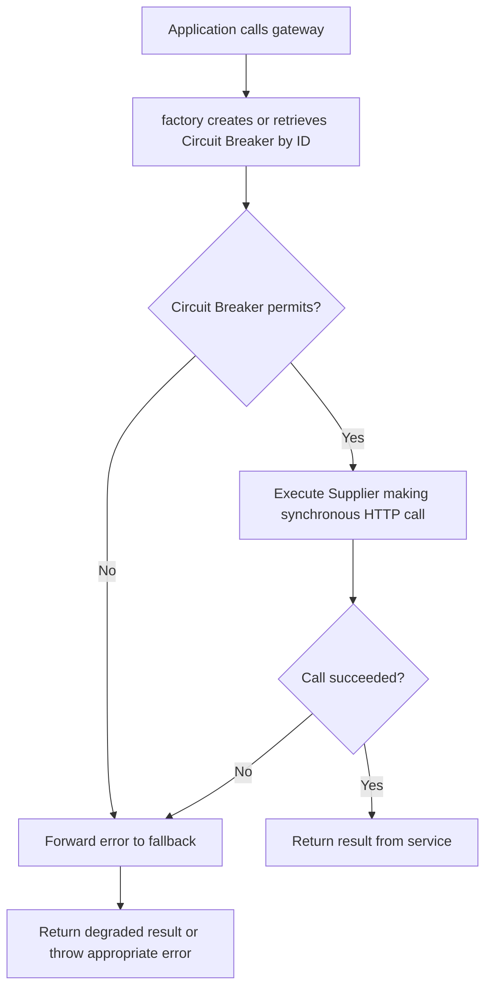

# Wrapping RestClient or RestTemplate Calls with factory.run

## Objectives

A synchronous HTTP call can hang, throw a connection error, or receive an error response from a dependent service. Spring Cloud CircuitBreaker provides `CircuitBreakerFactory` so an application can create a circuit breaker by name and use `run` to wrap the synchronous operation. As a result, service-calling code can apply a Circuit Breaker policy and fallback at the same boundary.

After this lesson, you can:

- Create a stable Circuit Breaker using `CircuitBreakerFactory`.
- Wrap `RestClient` or `RestTemplate` calls inside `factory.run`.
- Understand when the supplier is executed, when the fallback is invoked, and what result is returned.
- Configure Resilience4j by dependency ID and coordinate timeouts with HTTP client timeouts.
- Avoid turning business errors into infrastructure failures or masking errors with inappropriate fallbacks.

## Execution Flow of factory.run

For synchronous calls, the application creates a Circuit Breaker using `CircuitBreakerFactory`, then passes the operation to execute as a `Supplier<T>` into `run`:

```java
T result = circuitBreaker.run(
        () -> callRemoteService(),
        error -> fallbackResult());
```

The two functions serve different roles:

- The supplier contains the call to the dependent service. It is only executed when the Circuit Breaker permits the call to proceed.
- The fallback receives a `Throwable` if the supplier fails or the Circuit Breaker rejects the call, such as when the circuit is `OPEN`. The fallback must return a type `T` compatible with the supplier.

General processing flow:



When the circuit is `CLOSED`, the supplier is invoked and the outcome is recorded according to the implementation's policy. When failures reach the threshold, the circuit may transition to `OPEN`. In `OPEN`, the supplier is not executed; the fallback receives the rejection error and can return cached data or an unavailable state. When transitioning to `HALF_OPEN`, only a configured number of probe calls are permitted.

`run` is the common API integration point of Spring Cloud CircuitBreaker. Details such as the sliding window, failure rate threshold, TimeLimiter, and ignored exception types are provided by the specific implementation. This lesson uses Resilience4j in the configuration examples.

## Wrapping RestClient with factory.run

`RestClient` is Spring Framework's synchronous HTTP client API, introduced in Spring Framework 6.1. An application can configure the base URL when building the client and inject the client into a gateway.

```java
import org.springframework.context.annotation.Bean;
import org.springframework.context.annotation.Configuration;
import org.springframework.web.client.RestClient;

@Configuration
public class CatalogHttpConfiguration {
    @Bean
    RestClient catalogRestClient(RestClient.Builder builder) {
        return builder
                .baseUrl("http://catalog-service")
                .build();
    }
}
```

The gateway creates the Circuit Breaker once with a stable ID. On each method call, `run` accepts a supplier containing the HTTP request:

```java
import org.springframework.cloud.client.circuitbreaker.CircuitBreaker;
import org.springframework.cloud.client.circuitbreaker.CircuitBreakerFactory;
import org.springframework.stereotype.Service;
import org.springframework.web.client.RestClient;

@Service
public class CatalogGateway {
    private final RestClient restClient;
    private final CircuitBreaker catalogCircuitBreaker;

    public CatalogGateway(
            RestClient catalogRestClient,
            CircuitBreakerFactory<?, ?> circuitBreakerFactory) {
        this.restClient = catalogRestClient;
        this.catalogCircuitBreaker = circuitBreakerFactory.create("catalog", "catalog");
    }

    public Product findById(String id) {
        return catalogCircuitBreaker.run(
                () -> restClient.get()
                        .uri("/products/{id}", id)
                        .retrieve()
                        .body(Product.class),
                error -> Product.unavailable(id));
    }
}
```

`Product` and `Product.unavailable` are example application types. In practice, clearly define the unavailable state, the cached data source, and when the data was last updated. Avoid returning an object identical to a full result if the application cannot guarantee that the information is accurate.

In the example, the `catalog` ID represents the failure boundary for calls to the catalog service. Do not include a product ID or user ID in the circuit breaker ID. If each request uses a different ID, the Circuit Breaker will not accumulate statistics properly per dependency and metrics will become fragmented.

## Wrapping RestTemplate with factory.run

For existing applications using `RestTemplate`, wrapping the call works similarly. You can build the client with `RestTemplateBuilder` to set the root URI and HTTP client options.

```java
import org.springframework.boot.web.client.RestTemplateBuilder;
import org.springframework.context.annotation.Bean;
import org.springframework.context.annotation.Configuration;
import org.springframework.web.client.RestTemplate;

@Configuration
public class LegacyCatalogHttpConfiguration {
    @Bean
    RestTemplate catalogRestTemplate(RestTemplateBuilder builder) {
        return builder
                .rootUri("http://catalog-service")
                .build();
    }
}
```

The gateway can use the same factory abstraction:

```java
import org.springframework.cloud.client.circuitbreaker.CircuitBreaker;
import org.springframework.cloud.client.circuitbreaker.CircuitBreakerFactory;
import org.springframework.stereotype.Service;
import org.springframework.web.client.RestTemplate;

@Service
public class LegacyCatalogGateway {
    private final RestTemplate restTemplate;
    private final CircuitBreaker catalogCircuitBreaker;

    public LegacyCatalogGateway(
            RestTemplate catalogRestTemplate,
            CircuitBreakerFactory<?, ?> circuitBreakerFactory) {
        this.restTemplate = catalogRestTemplate;
        this.catalogCircuitBreaker = circuitBreakerFactory.create("catalog", "catalog");
    }

    public Product findById(String id) {
        return catalogCircuitBreaker.run(
                () -> restTemplate.getForObject(
                        "/products/{id}", Product.class, id),
                error -> Product.unavailable(id));
    }
}
```

`RestTemplate.getForObject` is a synchronous call. If the supplier fails, the Circuit Breaker records the outcome according to configuration and `run` passes the error to the fallback. When the circuit is `OPEN`, the supplier is not called; the fallback can still return a degraded result to the calling layer.

Do not wrap the same request multiple times with multiple Circuit Breakers targeting the same dependency. Choose a single clear protection boundary at the gateway or service adapter to avoid duplicate metrics and ambiguity over which fallback handled an error.

## Configuring Resilience4j by ID

When using Spring Cloud CircuitBreaker with Resilience4j, the ID passed to `create("catalog")` is used to look up the corresponding Circuit Breaker configuration. For example:

```yaml
resilience4j:
  circuitbreaker:
    instances:
      catalog:
        slidingWindowType: COUNT_BASED
        slidingWindowSize: 20
        minimumNumberOfCalls: 10
        failureRateThreshold: 50
        slowCallRateThreshold: 60
        slowCallDurationThreshold: 800ms
        waitDurationInOpenState: 10s
        permittedNumberOfCallsInHalfOpenState: 3
        ignoreExceptions:
          - com.example.catalog.ProductNotFoundException
  timelimiter:
    instances:
      catalog:
        timeoutDuration: 2s
        cancelRunningFuture: true
```

In this configuration:

- `slidingWindowSize: 20` uses the 20 most recent outcomes for evaluation in `CLOSED`.
- `minimumNumberOfCalls: 10` requires at least 10 samples before evaluating thresholds.
- `failureRateThreshold: 50` opens the circuit when the failure rate reaches 50% or higher once sufficient samples are collected.
- `slowCallRateThreshold: 60` opens the circuit if the slow call rate reaches 60% or higher.
- `slowCallDurationThreshold: 800ms` defines a slow call based on duration.
- `waitDurationInOpenState: 10s` sets the wait duration in `OPEN` before attempting recovery checks.
- `permittedNumberOfCallsInHalfOpenState: 3` limits the number of probe calls.
- `ignoreExceptions` excludes the listed business exceptions from the failure rate calculation. This example assumes the application already translates a not-found response into `ProductNotFoundException`.

The instance name `catalog` must match the ID in `circuitBreakerFactory.create("catalog")`. With Spring Cloud CircuitBreaker Resilience4j, if you need to select a TimeLimiter configuration by group, you can create it via `create("catalog", "catalog")`; the first ID identifies the Circuit Breaker and the second group name is used to look up the TimeLimiter configuration. Verify the method overloads and binding behavior for the Spring Cloud version in use.

## Circuit Breaker Timeout vs. HTTP Timeout

A Circuit Breaker and a timeout address two different concerns:

- The Circuit Breaker decides whether to permit a call to start based on its state and recorded outcomes.
- TimeLimiter bounds how long an operation is waited on, as supported by the integration.
- HTTP client timeouts bound waiting at the network layer, such as connection establishment time or time spent waiting for response data.

For synchronous calls, pay special attention to how the implementation executes the supplier. The Resilience4j integration may use an executor and TimeLimiter for certain synchronous call paths; however, timing out or canceling a future does not guarantee that the underlying socket or I/O operation stops immediately. Configure connect/read/response timeouts on the HTTP client to bound actual resources and test cancellation behavior with the client in use.

Do not set HTTP timeouts significantly longer than the deadline the application can wait; otherwise threads or connections may remain occupied after the caller has already received a fallback. Nor should you set timeouts too short, causing valid responses under normal load to be treated as failures. Choose timeouts based on the dependency's SLA and observed latency distribution.

## Semantically Correct Error Handling and Fallbacks

`RestClient.retrieve()` and `RestTemplate` typically throw exceptions for HTTP 4xx/5xx responses under their default error handlers. Connection or I/O errors are also represented as Spring Web exceptions. Not every exception proves that the dependent service is unavailable.

For example, a missing product may be a normal business outcome. If every HTTP 404 is treated as an infrastructure failure, a burst of requests for nonexistent product IDs could falsely trip the Circuit Breaker. You can translate HTTP errors into a dedicated business exception and configure Resilience4j to ignore that exception. An ignored exception does not increment the Circuit Breaker's failure rate, though it can still be passed to the fallback function of `run`; the fallback needs to classify it and preserve business semantics.

A fallback should distinguish at least the following cases:

| Cause | Recommended Handling |
|---|---|
| Circuit Breaker is `OPEN` | Return valid cached data or an unavailable dependency state. |
| Connection error or timeout | Return degraded data with an explicit status, or signal a temporary error to the caller. |
| HTTP 5xx | A fallback may be used if the service contract permits. |
| HTTP 404 or business error | Preserve the not-found outcome; do not turn it into unrelated cached data. |
| Programming or configuration error | Log and propagate the error to fix the root cause instead of masking it with a generic fallback. |

A fallback should not call the same failing service again through an unprotected path. If retries are needed, coordinate retry attempts, backoff, timeouts, and the Circuit Breaker to avoid multiplying request volume when the service is overloaded.

## Observing Synchronous Call Results

When integrating Resilience4j with Micrometer, you can observe metrics such as:

- `resilience4j.circuitbreaker.state`: the current state of the instance.
- `resilience4j.circuitbreaker.calls`: call counts by outcome.
- `resilience4j.circuitbreaker.failure.rate`: failure rate.
- `resilience4j.circuitbreaker.slow.call.rate`: slow call rate.
- `resilience4j.circuitbreaker.not.permitted.calls`: number of rejected calls.
- TimeLimiter metrics if the corresponding binder is enabled, to track timeouts.

Exact metric names and tags depend on the version, registry, and configuration. Inspect your application's actual metrics before building dashboards. Log the Circuit Breaker ID, logical endpoint, request duration, HTTP outcome, and whether the fallback was invoked. Avoid logging tokens, credentials, or sensitive data.

When you notice an increasing fallback rate, correlate rejected calls, failure rate, slow call rate, and HTTP latency together. If the Circuit Breaker is open yet the HTTP client still has many in-flight requests, check timeouts and I/O cancellation behavior. If the circuit opens due to 404 errors, verify exception classification and the ignored exceptions list.

## Verification Practice

Run these checks in a test environment with a catalog service whose responses you can control:

1. Start the application and the catalog service. Call `findById` with an existing product; verify that the supplier executes and returns the result.
2. Request a nonexistent ID. Verify that the application returns the proper not-found status and that the business error does not increase the infrastructure failure rate when configured as ignored.
3. Make the catalog service return HTTP 5xx or drop connections. Send enough calls to reach `minimumNumberOfCalls` and the failure threshold; observe the Circuit Breaker transition to `OPEN`.
4. Send additional requests while the circuit is `OPEN`. Confirm that the supplier makes no HTTP calls to the catalog service and the fallback returns the degraded state.
5. Restore the service, wait for `waitDurationInOpenState` to elapse, and send a request to trigger `HALF_OPEN` if automatic transition is not enabled.
6. Observe the permitted probe calls and confirm the circuit returns to `CLOSED` when probes succeed. Repeat with failing probes to confirm the circuit returns to `OPEN`.
7. Make the service respond slower than the timeout. Compare when the caller receives the result, the HTTP client state, remaining in-flight requests, and TimeLimiter metrics.

Record timestamps, instance ID, state, HTTP outcome, exceptions, fallback invocation, and latency. Do not generate load exceeding your test environment's capacity.

## Common Pitfalls

- **Creating a new ID per request:** fragments statistics and metrics; use a stable ID per dependency.
- **Placing the HTTP call outside the supplier:** if the HTTP request runs before `run`, the Circuit Breaker cannot block requests when `OPEN`.
- **Fallback returning fabricated data:** callers may treat degraded data as accurate; explicitly represent the degraded state and data source.
- **Treating all HTTP 4xx responses as service failures:** client input errors or not-found responses usually need separate classification.
- **Assuming the Circuit Breaker sets HTTP timeouts automatically:** a Circuit Breaker does not replace client connect/read timeouts.
- **Assuming future cancellation always stops I/O:** synchronous clients may continue holding connections or threads; configure timeouts at the HTTP layer.
- **Unbounded retries:** repeated attempts can amplify load and delay recovery.
- **Wrapping the same call in multiple circuit breakers:** makes metrics, state, and fallback ordering hard to interpret.

When using `RestClient` or `RestTemplate`, keep the entire HTTP call inside the `factory.run` supplier, choose an ID representing the dependency, and design fallbacks around the business contract. Combine Circuit Breaker configuration with HTTP-layer timeouts to bound both call volume and resource occupancy duration.
