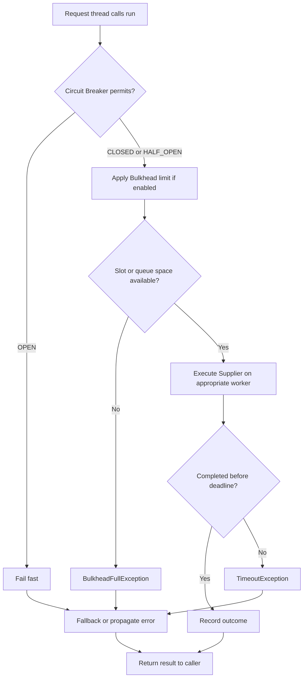

# Execution Flow with TimeLimiter or Thread-Pool Bulkhead

In synchronous calls, the method calling a dependent service typically runs on the same thread handling the incoming request. If the service responds slowly, that thread keeps waiting until the call finishes or the client times out on its own. Spring Cloud CircuitBreaker can combine Resilience4j's `TimeLimiter` and `ThreadPoolBulkhead` to bound waiting time and limit concurrent tasks.

These two mechanisms have distinct responsibilities. `TimeLimiter` sets a deadline for a single execution. `ThreadPoolBulkhead` isolates work onto a thread pool with a bounded number of threads and queue capacity. When used alongside a Circuit Breaker, the application can fail fast when the circuit is `OPEN`, cap load sent to the dependency, and return a fallback upon failure, timeout, or capacity exhaustion.

## 1. Preparing the Starter for Synchronous Calls

For Spring MVC applications or synchronous calling code, use the non-reactive starter:

```groovy
dependencies {
    implementation 'org.springframework.cloud:spring-cloud-starter-circuitbreaker-resilience4j'
    implementation 'org.springframework.boot:spring-boot-starter-actuator'
    implementation 'io.github.resilience4j:resilience4j-micrometer'
}
```

Manage the Spring Cloud version using the BOM compatible with your project's Spring Boot version. `spring-cloud-starter-circuitbreaker-resilience4j` provides the Resilience4j integration for the synchronous API. Do not switch to the Reactor starter just to get TimeLimiter or Bulkhead for synchronous calls.

Spring Cloud CircuitBreaker supports Bulkhead when `resilience4j-bulkhead` is on the classpath. If this module is present in the dependency tree, the Resilience4j integration wraps calls with a Bulkhead using default settings. You can disable this feature with `spring.cloud.circuitbreaker.bulkhead.resilience4j.enabled=false`.

## 2. Execution Flow of a Synchronous Call

The application creates a breaker by ID and then invokes `run` with a synchronous `Supplier<T>` and a fallback function:

```java
return circuitBreakerFactory.create("inventory").run(
        () -> inventoryClient.getStock(sku),
        error -> Stock.unavailable(sku)
);
```

Conceptually, the call passes through the following steps:



The exact nesting order of decorators depends on the Spring Cloud CircuitBreaker version and Bulkhead/TimeLimiter configuration. The diagram above illustrates each layer's responsibility for clarity; when investigating specific threads or exceptions, verify against your actual library version.

- **Circuit Breaker** checks state before permitting the call. When `OPEN`, it rejects the request without calling the dependency. When `HALF_OPEN`, only the configured number of probe calls are allowed through.
- **Bulkhead** caps how much work can run concurrently. A thread-pool Bulkhead submits tasks to a bounded worker pool and queue; when full, it rejects the task.
- **TimeLimiter** sets a deadline for execution. For synchronous calls, the integration can execute the `Supplier` via an `ExecutorService` and wait for the result within the deadline.
- **Fallback** receives errors such as dependency failures, timeouts, or Bulkhead capacity rejections, and produces a fallback result if the application supplies a fallback function.

The `run` API remains synchronous: the calling thread waits for the result or fallback before returning. Offloading execution to a worker thread does not turn the controller or service into an asynchronous API.

## 3. Example: Protecting a Synchronous HTTP Client

The following example uses `RestClient` to call the inventory service. Because this is a synchronous call, `getStock` returns `Stock` directly:

```java
import org.springframework.cloud.client.circuitbreaker.CircuitBreakerFactory;
import org.springframework.stereotype.Service;
import org.springframework.web.client.RestClient;

@Service
public class InventoryGateway {
    private final CircuitBreakerFactory<?, ?> circuitBreakerFactory;
    private final RestClient inventoryRestClient;

    public InventoryGateway(
            CircuitBreakerFactory<?, ?> circuitBreakerFactory,
            RestClient inventoryRestClient) {
        this.circuitBreakerFactory = circuitBreakerFactory;
        this.inventoryRestClient = inventoryRestClient;
    }

    public Stock getStock(String sku) {
        return circuitBreakerFactory.create("inventory").run(
                () -> inventoryRestClient.get()
                        .uri("/stock/{sku}", sku)
                        .retrieve()
                        .body(Stock.class),
                error -> Stock.unavailable(sku)
        );
    }
}
```

Register the client with the service's base URL:

```java
import org.springframework.beans.factory.annotation.Value;
import org.springframework.context.annotation.Bean;
import org.springframework.context.annotation.Configuration;

@Configuration
public class InventoryClientConfiguration {
    @Bean
    RestClient inventoryRestClient(
            RestClient.Builder builder,
            @Value("${clients.inventory.base-url}") String baseUrl) {
        return builder.baseUrl(baseUrl).build();
    }
}
```

```yaml
clients:
  inventory:
    base-url: http://inventory-service
```

`Stock` and `Stock.unavailable(sku)` are illustrative types to be replaced with your application's contract. The fallback should clearly represent an undetermined state or cached data, and should not return a fabricated stock quantity as though it were confirmed.

## 4. Configuring TimeLimiter by ID

Spring Cloud CircuitBreaker Resilience4j enables TimeLimiter by default for executions. You can configure the timeout duration and Future cancellation policy in `application.yml`:

```yaml
resilience4j:
  circuitbreaker:
    instances:
      inventory:
        slidingWindowType: COUNT_BASED
        slidingWindowSize: 20
        minimumNumberOfCalls: 10
        failureRateThreshold: 50
        waitDurationInOpenState: 15s

  timelimiter:
    instances:
      inventory:
        timeoutDuration: 2s
        cancelRunningFuture: true
```

The ID `inventory` must match the ID passed to `circuitBreakerFactory.create("inventory")`. In this example, an execution exceeding two seconds is timed out by TimeLimiter. If no instance configuration is provided, TimeLimiter uses Resilience4j's defaults.

`cancelRunningFuture: true` requests cancellation of the `Future` on timeout. This is a Future-level cancellation request; it does not guarantee that every HTTP library, JDBC driver, or blocking block of code immediately halts work. A call waiting on I/O may continue holding the worker thread if the client does not respond to interrupts or cancellation.

Therefore, you still must configure timeouts on the HTTP client or database driver. Client timeouts should align with the TimeLimiter deadline so sockets and connections are released properly. If TimeLimiter times out after two seconds while the HTTP client still waits 30 seconds, the worker thread may remain occupied long after the caller received its fallback.

### Enabling or Disabling TimeLimiter

TimeLimiter can be disabled globally:

```yaml
spring:
  cloud:
    circuitbreaker:
      resilience4j:
        disable-time-limiter: true
```

It can also be toggled per group or instance via `disable-time-limiter-map`:

```yaml
spring:
  cloud:
    circuitbreaker:
      resilience4j:
        disable-time-limiter-map:
          inventory: false
          legacy-report: true
```

Precedence for this map is instance first, then group, then the global setting. For example, `inventory: false` keeps TimeLimiter enabled for the `inventory` instance even when the global flag is disabled. Only disable TimeLimiter when an equivalent client timeout is in place and there is a clear operational reason.

## 5. Configuring ThreadPoolBulkhead

`ThreadPoolBulkhead` uses a fixed thread pool and a bounded queue. An instance-level configuration can be placed in `application.yml`:

```yaml
resilience4j:
  thread-pool-bulkhead:
    instances:
      inventory:
        coreThreadPoolSize: 4
        maxThreadPoolSize: 8
        queueCapacity: 20
        keepAliveDuration: 20ms
```

In this example, the pool starts with four threads, can scale up to eight threads, and holds at most 20 waiting tasks in the queue. When both workers and queue are exhausted, new calls are rejected rather than spawning unbounded threads.

Spring Cloud CircuitBreaker Resilience4j selects `FixedThreadPoolBulkhead` by default when Bulkhead integration is enabled and `resilience4j-bulkhead` is on the classpath. You can select `SemaphoreBulkhead` as the default implementation via:

```yaml
spring:
  cloud:
    circuitbreaker:
      resilience4j:
        enableSemaphoreDefaultBulkhead: true
```

`SemaphoreBulkhead` limits concurrent calls using a semaphore without creating a dedicated worker thread pool. When you need to isolate blocking calls from request threads, `FixedThreadPoolBulkhead` is generally the option to evaluate; a semaphore fits when the application wants concurrency limiting while keeping execution on the calling thread.

### Customizing in Java

You can configure `ThreadPoolBulkhead` using `Customizer<Resilience4jBulkheadProvider>`:

```java
import org.springframework.cloud.client.circuitbreaker.Customizer;
import org.springframework.cloud.circuitbreaker.resilience4j.Resilience4jBulkheadConfigurationBuilder;
import org.springframework.cloud.circuitbreaker.resilience4j.Resilience4jBulkheadProvider;
import io.github.resilience4j.bulkhead.ThreadPoolBulkheadConfig;

@Bean
Customizer<Resilience4jBulkheadProvider> inventoryBulkheadCustomizer() {
    return provider -> provider.configure(builder -> builder
            .threadPoolBulkheadConfig(ThreadPoolBulkheadConfig.custom()
                    .coreThreadPoolSize(4)
                    .maxThreadPoolSize(8)
                    .queueCapacity(20)
                    .build()),
            "inventory");
}
```

Properties take precedence over Java `Customizer`s. If both configure `inventory`, inspect property sources and runtime values to verify which settings are active.

## 6. What Happens When TimeLimiter and ThreadPoolBulkhead Are Both Enabled?

When both protect the same call, they enforce two different limits:

| Scenario | TimeLimiter | ThreadPoolBulkhead |
| --- | --- | --- |
| One request runs too long | Ends waiting and reports a timeout | Worker may stay occupied until the task actually stops |
| Many concurrent requests | Does not cap total running tasks by deadline alone | Caps worker count and queue capacity |
| Load exceeds capacity | May time out slow requests | Rejects new requests when pool and queue are full |
| Request completes quickly | Returns result before deadline | Frees worker/slot for other requests |

For example, suppose the pool has eight workers and a queue capacity of 20. If all eight workers are busy and the queue is full, the next task is rejected immediately. If an accepted task exceeds `timeoutDuration`, TimeLimiter returns a timeout error and the fallback can run. The executing worker is released only when the task finishes or actually responds to cancellation.

The executor used to run the `Supplier` when TimeLimiter is enabled and `ThreadPoolBulkhead`'s own executor can be two distinct pools. Thus, when both mechanisms are enabled, a call may cross multiple worker boundaries. Inspect thread names, queues, and limits of each pool; `configureExecutorService(...)` on the factory customizes the Circuit Breaker's executor, not `ThreadPoolBulkhead`'s own thread pool automatically.

When a thread-pool Bulkhead passes results via `Future` or `CompletableFuture`, the original exception is sometimes wrapped in `ExecutionException` depending on version and execution path. The fallback should log the exception along with its `cause` chain so the root cause is not lost; test the actual exception types with the exact Spring Cloud/Resilience4j version you deploy.

Do not inflate `queueCapacity` to mask a slow dependency. Large queues increase wait time and can cause many requests to expire before they even start executing. Size workers according to dependency capacity and host resources, size the queue according to acceptable wait time, and set timeouts according to SLA.

## 7. Thread Context When Work Moves to a Worker

When a call runs on another thread, data bound to the current thread may not automatically propagate to the worker. Common examples include logging MDC, `SecurityContext`, transaction context, and other values stored in `ThreadLocal`.

If the request needs to forward authentication details or a correlation ID to the client, configure an appropriate context propagation mechanism. Spring Cloud CircuitBreaker allows customizing the `ExecutorService` used for Circuit Breaker execution via `Resilience4JCircuitBreakerFactory.configureExecutorService(...)`. You can supply a context-aware executor or integrate the platform's context propagation support. `ThreadPoolBulkhead` maintains its own worker pool; verify how context propagation works for that pool in your Resilience4j version.

Do not assume an active transaction on the request thread will automatically participate on the worker thread. Avoid wrapping an operation requiring a synchronous transaction inside another thread pool without an explicit transaction design. For logging, rely on explicitly passed correlation IDs or context propagation rather than assuming the caller thread's MDC is present.

## 8. Fallback Handling and Error Classification

The fallback in `run` receives a `Throwable`. Causes reaching the fallback may include:

- Connection errors, HTTP errors, or exceptions thrown by the synchronous client.
- `TimeoutException` when execution exceeds TimeLimiter's deadline.
- Rejection errors when the Bulkhead is at full capacity.
- `CallNotPermittedException` when the Circuit Breaker is `OPEN`.

Not all errors carry the same meaning. Record timeouts, bulkhead rejections, circuit breaker rejections, and dependency errors separately so you know whether the system is slow, overloaded, or has an open circuit. If using `recordExceptions`, `ignoreExceptions`, or `recordFailurePredicate`, ensure expected business errors are not miscounted as dependency health failures.

A fallback must be fast, must not call back into the protected dependency, and must not mask data state. If the fallback itself fails, the fallback's exception is propagated to the caller. Do not return a plausible-looking default value when the application has no basis for that data.

## 9. Monitoring Protection Effectiveness

Add `spring-boot-starter-actuator` and `resilience4j-micrometer` to export Resilience4j metrics. At minimum, monitor:

- Circuit Breaker state and transitions among `CLOSED`, `OPEN`, and `HALF_OPEN`.
- Counts of succeeded, failed, timed-out, and Circuit Breaker-rejected calls.
- Bulkhead rejection counts, active worker count, queue size, and queued task count.
- Execution duration, dependency latency, and fallback invocation counts.

Metrics should carry appropriate IDs to distinguish each dependency. Actuator endpoints should expose only necessary metrics and be secured with authentication/authorization.

## 10. Verification Scenarios

Test with a mock client whose latency and concurrency you can control:

1. Have the dependency respond within the deadline. Verify `run` returns the real result and the worker/slot is released.
2. Make the dependency slower than `timeoutDuration`. Verify the caller receives the fallback or timeout error as designed.
3. Check the dependency-side task after a timeout. Verify whether client-side timeout/cancellation releases resources; do not assume canceling a `Future` automatically stops the socket or remote task.
4. Send enough concurrent requests to fill the worker pool and queue. Verify excess requests are rejected and handled properly by the fallback.
5. Make the dependency fail repeatedly so the Circuit Breaker transitions to `OPEN`. Verify subsequent requests are rejected before placing more load on the dependency.
6. Restore the dependency, wait for `waitDurationInOpenState`, and send probe calls. Verify the breaker transitions back to `CLOSED` when probes succeed.
7. Verify MDC, `SecurityContext`, or correlation IDs on worker threads if your application depends on propagating them.
8. Reconcile metrics and logs against actual request counts on the mock server to confirm no unexpected backlog of tasks remains.

## 11. Common Pitfalls

- Assuming TimeLimiter automatically stops every blocking call. `Future` cancellation does not guarantee an HTTP client or database driver stops I/O immediately.
- Setting `timeoutDuration` shorter than the dependency's normal latency, causing valid requests to time out continuously.
- Sizing the queue too large, causing requests to sit waiting before running and miss their deadlines.
- Raising worker counts beyond what the dependency can handle, worsening the outage.
- Forgetting that `run` is still synchronous and the caller thread waits for the result or fallback.
- Enabling Bulkhead without checking whether `resilience4j-bulkhead` and the intended implementation are selected.
- Failing to propagate MDC, `SecurityContext`, or required request context to worker threads.
- Watching only the Circuit Breaker without separately tracking timeouts and Bulkhead rejections.

## References

- [Spring Cloud CircuitBreaker – Configuring Resilience4J Circuit Breakers](https://docs.spring.io/spring-cloud-circuitbreaker/docs/current/reference/html/spring-cloud-circuitbreaker-resilience4j.html): synchronous starter, TimeLimiter, ExecutorService, Bulkhead, and metrics.
- [Spring Cloud CircuitBreaker – Bulkhead Pattern Supporting](https://docs.spring.io/spring-cloud-circuitbreaker/reference/spring-cloud-circuitbreaker-resilience4j/bulkhead-pattern-supporting.html): FixedThreadPoolBulkhead, SemaphoreBulkhead, and provider customization.
- [Spring Cloud CircuitBreaker – Circuit Breaker Properties Configuration](https://docs.spring.io/spring-cloud-circuitbreaker/reference/spring-cloud-circuitbreaker-resilience4j/circuit-breaker-properties-configuration.html): instance configuration, TimeLimiter, and enable/disable policies.
- [Spring Cloud CircuitBreaker – Bulkhead Properties Configuration](https://docs.spring.io/spring-cloud-circuitbreaker/reference/spring-cloud-circuitbreaker-resilience4j/bulkhead-properties-configuration.html): thread pool, semaphore, and property precedence.
- [Resilience4j – ThreadPoolBulkhead](https://resilience4j.readme.io/docs/bulkhead): concurrency limits, thread pool, and queue.
