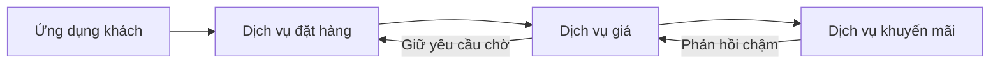

# Phụ thuộc từ xa, lỗi từng phần và hiệu ứng sụp đổ dây chuyền

Trong một hệ thống phân tán, một yêu cầu thường đi qua nhiều dịch vụ trước khi trả kết quả cho người dùng. Ví dụ, dịch vụ đặt hàng gọi dịch vụ tồn kho để kiểm tra số lượng, gọi dịch vụ thanh toán để tạo giao dịch và gọi dịch vụ vận chuyển để tính phí. Mỗi lời gọi qua mạng đều có thể chậm, mất kết nối hoặc trả lỗi. Một dịch vụ vẫn có thể hoạt động trong khi một dịch vụ phụ thuộc đã suy giảm; đó là **lỗi từng phần** (*partial failure*).

Vấn đề trở nên nghiêm trọng khi các dịch vụ tiếp tục chờ nhau. Hàng đợi và connection pool dần đầy, luồng xử lý bị giữ lại, thời gian phản hồi tăng và các dịch vụ vốn khỏe mạnh cũng bắt đầu thất bại. Hiện tượng lan truyền này được gọi là **sụp đổ dây chuyền** (*cascading failure*). Circuit breaker trong Spring Cloud, thường được triển khai bằng Resilience4j, giúp phát hiện một phụ thuộc đang thất bại hoặc phản hồi quá chậm, tạm ngừng gọi phụ thuộc đó và cho hệ thống cơ hội phục hồi.

## 1. Vì sao lời gọi dịch vụ từ xa dễ thất bại?

Lời gọi từ một dịch vụ sang dịch vụ khác khác với lời gọi một hàm trong cùng tiến trình. Nó phụ thuộc vào mạng, DNS, TLS, bộ cân bằng tải, máy chủ đích, giới hạn kết nối và khả năng xử lý của cả hai phía. Ngay cả khi mã nguồn không thay đổi, độ trễ và tỷ lệ lỗi vẫn có thể biến động theo tải hoặc theo sự cố hạ tầng.

Các dạng trục trặc thường gặp gồm:

- **Lỗi kết nối:** không phân giải được DNS, không thiết lập được TCP/TLS, kết nối bị đóng hoặc máy chủ đích không thể truy cập.
- **Hết thời gian chờ:** dịch vụ đích nhận yêu cầu nhưng xử lý quá lâu; phía gọi phải chờ đến khi timeout.
- **Lỗi phía máy chủ:** dịch vụ đích trả về HTTP 5xx, ném ngoại lệ hoặc khởi động lại giữa lúc xử lý.
- **Quá tải:** số yêu cầu vượt khả năng xử lý, khiến hàng đợi tăng, thread và connection pool cạn dần.
- **Lỗi dữ liệu hoặc nghiệp vụ:** phản hồi không hợp lệ, dữ liệu không tồn tại hoặc yêu cầu bị từ chối. Những trường hợp này cần được phân loại riêng vì không phải lỗi nào cũng nên làm circuit breaker mở.

Một dịch vụ có thể chỉ gặp lỗi ở một phần yêu cầu. Chẳng hạn, dịch vụ hồ sơ vẫn trả thông tin người dùng bình thường nhưng mọi yêu cầu lấy ảnh đại diện từ dịch vụ lưu trữ đều bị timeout. Đây là lỗi từng phần: toàn bộ hệ thống chưa ngừng hoạt động, nhưng một nhánh chức năng đã suy giảm.

Timeout cũng không đảm bảo thao tác ở phía dịch vụ đích đã dừng. Máy chủ có thể vẫn xử lý yêu cầu sau khi phía gọi đã bỏ cuộc. Vì vậy, nếu tự động gửi lại một yêu cầu tạo thanh toán hoặc tạo đơn hàng, hệ thống có nguy cơ thực hiện thao tác hai lần. Với thao tác có tác động phụ, cần thiết kế tính idempotent hoặc dùng khóa idempotency trước khi bật retry.

## 2. Lỗi từng phần biến thành sụp đổ dây chuyền như thế nào?

Giả sử luồng xử lý có ba dịch vụ: API đặt hàng gọi dịch vụ giá, sau đó dịch vụ giá gọi dịch vụ khuyến mãi.



Khi dịch vụ khuyến mãi tăng độ trễ, dịch vụ giá phải giữ các yêu cầu đang chờ. Những luồng xử lý và kết nối đó chưa thể phục vụ yêu cầu mới. Dịch vụ đặt hàng cũng phải chờ dịch vụ giá, khiến số yêu cầu đang xử lý tăng lên ở cả hai tầng.

Quá trình thường diễn ra theo chuỗi sau:

1. Dịch vụ C phản hồi chậm hoặc không phản hồi.
2. Dịch vụ B giữ thread, kết nối và bộ nhớ trong lúc chờ C.
3. Yêu cầu mới tiếp tục đến B; hàng đợi và connection pool tiến gần giới hạn.
4. Dịch vụ A chờ B, nên tài nguyên xử lý của A cũng bị chiếm dụng.
5. Người dùng gửi lại yêu cầu hoặc các tầng phía trên tự retry, làm lưu lượng đến B và C tăng thêm.
6. B hoặc A bắt đầu timeout dù bản thân chúng không có lỗi nội tại. Sự cố của C đã lan sang các dịch vụ phụ thuộc.

Có thể hình dung áp lực tài nguyên bằng quan hệ gần đúng giữa số yêu cầu đang xử lý, thông lượng và thời gian xử lý: L = λ × W. Với cùng thông lượng 100 yêu cầu mỗi giây, thời gian chờ trung bình 0,2 giây tương ứng khoảng 20 yêu cầu đang xử lý; nếu thời gian chờ tăng lên 5 giây, con số này tăng lên khoảng 500. Đây là ví dụ minh họa, nhưng nó cho thấy độ trễ tăng có thể làm nhu cầu tài nguyên tăng rất nhanh dù lưu lượng đầu vào không đổi.

Retry không giới hạn có thể làm tình hình tệ hơn. Nếu mỗi tầng thử lại ba lần, một yêu cầu ban đầu có thể tạo ra nhiều lời gọi ở tầng dưới. Khi dịch vụ đích đang quá tải, lượng retry lại tiếp tục làm tăng tải. Vì vậy, hệ thống cần giới hạn thời gian chờ, số lần thử lại và số lời gọi đồng thời, đồng thời có cơ chế ngắt lời gọi đến phụ thuộc đang suy giảm.

## 3. Các cơ chế hạn chế lỗi lan truyền

Circuit breaker là một phần của chiến lược phục hồi. Nó hoạt động hiệu quả hơn khi kết hợp với các giới hạn tài nguyên và thời gian phù hợp.

| Cơ chế | Vai trò | Điểm cần chú ý |
|---|---|---|
| Timeout | Giới hạn thời gian một lời gọi được phép chờ | Đặt timeout ở HTTP client và cân nhắc deadline tổng của yêu cầu |
| Retry | Thử lại lỗi tạm thời có khả năng tự phục hồi | Giới hạn số lần, dùng backoff và jitter; tránh retry thao tác không idempotent |
| Circuit breaker | Ngừng gọi nhanh một phụ thuộc đang lỗi hoặc quá chậm | Dùng thống kê đủ đại diện và cấu hình ngưỡng phù hợp với lưu lượng |
| Bulkhead | Giới hạn tài nguyên dành cho một phụ thuộc | Ngăn một dịch vụ chiếm hết thread hoặc số lời gọi đồng thời |
| Fallback | Cung cấp kết quả suy giảm khi phụ thuộc không dùng được | Chỉ trả dữ liệu thay thế khi nghiệp vụ cho phép; không che giấu lỗi dữ liệu quan trọng |

**Timeout** giới hạn thời gian chờ của từng lời gọi. Timeout ở tầng HTTP client vẫn cần được cấu hình vì circuit breaker không thay thế cấu hình kết nối và đọc dữ liệu. Nếu hệ thống có deadline tổng, timeout của lời gọi phụ thuộc phải nằm trong ngân sách đó để các bước còn lại vẫn có thời gian hoàn tất.

**Retry** phù hợp với lỗi tạm thời như một số lỗi kết nối hoặc phản hồi 503. Nên giới hạn số lần thử, dùng exponential backoff kèm jitter và tránh retry các lỗi nghiệp vụ không thể tự hết. Không nên để nhiều tầng độc lập cùng retry mà không có ngân sách chung.

**Bulkhead** cô lập tài nguyên. Ví dụ, nếu dịch vụ khuyến mãi chỉ được phép xử lý tối đa 20 lời gọi đồng thời, sự cố ở dịch vụ này không thể chiếm toàn bộ tài nguyên dành cho các phụ thuộc khác. Bulkhead giới hạn mức độ ảnh hưởng, còn circuit breaker quyết định khi nào nên tạm ngừng gọi phụ thuộc.

**Fallback** là cách phục vụ ở chế độ suy giảm. Một trang sản phẩm có thể hiển thị thông tin cơ bản đã lưu trong cache khi dịch vụ gợi ý không khả dụng. Ngược lại, hệ thống không nên tự trả về số dư bằng 0 hoặc xác nhận thanh toán thành công khi chưa kiểm tra được dữ liệu bắt buộc. Fallback cần thể hiện rõ dữ liệu không sẵn có hoặc dữ liệu cũ để tầng gọi có thể xử lý đúng.

## 4. Ba trạng thái của circuit breaker

Circuit breaker theo dõi kết quả các lời gọi đến một phụ thuộc và chuyển trạng thái dựa trên tỷ lệ lỗi hoặc tỷ lệ lời gọi chậm. Resilience4j cung cấp ba trạng thái vận hành chính:

| Trạng thái | Hành vi | Điều kiện chuyển trạng thái |
|---|---|---|
| `CLOSED` | Cho phép lời gọi đi đến dịch vụ đích và ghi nhận kết quả | Khi số mẫu đủ và tỷ lệ lỗi hoặc lời gọi chậm vượt ngưỡng, chuyển sang `OPEN` |
| `OPEN` | Từ chối nhanh lời gọi mới, thường phát sinh `CallNotPermittedException` | Sau thời gian chờ đã cấu hình, chuyển sang `HALF_OPEN` |
| `HALF_OPEN` | Chỉ cho phép một số lượng nhỏ lời gọi thăm dò | Nếu các mẫu thăm dò đạt yêu cầu thì về `CLOSED`; nếu tiếp tục lỗi hoặc chậm quá ngưỡng thì trở lại `OPEN` |

Ở trạng thái `CLOSED`, circuit breaker cho phép ứng dụng gọi phụ thuộc như bình thường. Nó ghi nhận thành công, thất bại và thời gian phản hồi trong sliding window. Khi thống kê cho thấy phụ thuộc có vấn đề, breaker mở mạch.

Ở trạng thái `OPEN`, lời gọi bị chặn ngay tại phía ứng dụng. Điều này tránh tiếp tục tiêu tốn thời gian chờ, thread và kết nối vào một phụ thuộc đang không đáp ứng. Ứng dụng có thể chuyển sang fallback nếu đã định nghĩa và nếu trường hợp lỗi cho phép.

Sau `waitDurationInOpenState`, breaker chuyển sang `HALF_OPEN`. Trạng thái này cho phép một số lời gọi thăm dò có giới hạn để kiểm tra dịch vụ đích. Nếu các lời gọi thăm dò cho thấy dịch vụ đã phục hồi, breaker đóng lại. Nếu tỷ lệ lỗi hoặc lời gọi chậm vẫn vượt ngưỡng, breaker mở lại và tiếp tục chờ.

Tùy cấu hình, việc chuyển từ `OPEN` sang `HALF_OPEN` có thể diễn ra tự động khi hết thời gian chờ hoặc khi có lời gọi tiếp theo đến kiểm tra trạng thái. Không nên hiểu `HALF_OPEN` là cho phép toàn bộ lưu lượng quay lại; số lời gọi thăm dò luôn bị giới hạn.

## 5. Sliding window và cách chọn ngưỡng

Circuit breaker cần một tập mẫu gần đây để đánh giá tình trạng phụ thuộc. Resilience4j hỗ trợ hai kiểu sliding window:

- **`COUNT_BASED`:** cửa sổ chứa số lượng lời gọi gần nhất, ví dụ 20 lời gọi. Khi có lời gọi mới, mẫu cũ nhất rời khỏi cửa sổ.
- **`TIME_BASED`:** cửa sổ bao phủ một khoảng thời gian, ví dụ 10 giây, và thống kê được tổng hợp theo các bucket thời gian.

`minimumNumberOfCalls` quy định số mẫu tối thiểu trước khi tính tỷ lệ để ra quyết định mở mạch. Cấu hình này tránh mở mạch chỉ vì một vài lỗi đầu tiên trong một cửa sổ còn quá ít dữ liệu. Ngược lại, nếu lưu lượng thấp và số mẫu tối thiểu quá cao, breaker có thể mất nhiều thời gian mới đánh giá được tình trạng phụ thuộc.

Ví dụ, cấu hình cửa sổ theo số lượng gồm 20 lời gọi, yêu cầu tối thiểu 10 mẫu và ngưỡng lỗi 50%. Khi đã có ít nhất 10 mẫu, nếu tỷ lệ lỗi trong cửa sổ đạt hoặc vượt 50%, breaker có thể chuyển sang `OPEN`. Nếu mới có 3 lời gọi và cả 3 đều lỗi, breaker vẫn chưa có đủ mẫu để áp dụng ngưỡng này.

Ngoài lỗi, Resilience4j có thể theo dõi **slow call**. Một lời gọi được xem là chậm khi thời gian thực thi vượt `slowCallDurationThreshold`. Nếu tỷ lệ lời gọi chậm đạt `slowCallRateThreshold`, breaker cũng có thể mở mạch dù nhiều lời gọi vẫn trả kết quả thành công. Đây là điểm quan trọng khi phụ thuộc chưa ngừng hoạt động hoàn toàn nhưng độ trễ đã đe dọa tài nguyên của các tầng gọi.

Các tham số thường cần cân nhắc gồm:

- `slidingWindowType` và `slidingWindowSize`: chọn kiểu cửa sổ và kích thước phù hợp với lưu lượng.
- `minimumNumberOfCalls`: tránh kết luận từ quá ít mẫu.
- `failureRateThreshold`: tỷ lệ lỗi cho phép trước khi mở mạch.
- `slowCallDurationThreshold` và `slowCallRateThreshold`: xác định lời gọi chậm và tỷ lệ chậm có thể chấp nhận.
- `waitDurationInOpenState`: thời gian nghỉ trước khi thử phục hồi.
- `permittedNumberOfCallsInHalfOpenState`: giới hạn số lời gọi thăm dò.

Không có một bộ ngưỡng phù hợp cho mọi dịch vụ. Một dịch vụ tra cứu cache có thể chấp nhận timeout ngắn và phục hồi nhanh; một dịch vụ thanh toán có thể cần quy tắc lỗi, fallback và thời gian thăm dò thận trọng hơn. Nên chọn giá trị dựa trên lưu lượng thực tế, mục tiêu độ trễ, mức độ quan trọng của dữ liệu và hành vi phục hồi của phụ thuộc.

## 6. Tích hợp Circuit Breaker với Spring Cloud và Resilience4j

Spring Cloud CircuitBreaker cung cấp một lớp trừu tượng để ứng dụng sử dụng circuit breaker mà không phải gắn chặt mã nghiệp vụ với một thư viện cụ thể. Resilience4j là một implementation phổ biến. Phiên bản Spring Cloud nên được quản lý bằng Spring Cloud BOM tương thích với phiên bản Spring Boot của dự án.

Với Gradle, thêm starter Resilience4j tương ứng:

```kotlin
dependencies {
    implementation("org.springframework.cloud:spring-cloud-starter-circuitbreaker-resilience4j")
}
```

Ví dụ dưới đây dùng `CircuitBreakerFactory` để bảo vệ lời gọi đồng bộ đến dịch vụ tồn kho. Đoạn mã sử dụng `RestClient` của Spring Framework 6.1 trở lên (thường đi cùng Spring Boot 3.2 trở lên); với phiên bản cũ hơn, có thể dùng HTTP client mà dự án đang hỗ trợ. Tên `inventory` liên kết lời gọi trong mã với cấu hình của breaker cùng tên.

```java
import org.springframework.cloud.client.circuitbreaker.CircuitBreakerFactory;
import org.springframework.stereotype.Service;
import org.springframework.web.client.RestClient;

@Service
public class InventoryGateway {
    private final RestClient restClient;
    private final CircuitBreakerFactory<?, ?> circuitBreakerFactory;

    public InventoryGateway(
            RestClient.Builder builder,
            CircuitBreakerFactory<?, ?> circuitBreakerFactory) {
        this.restClient = builder
                .baseUrl("http://inventory-service")
                .build();
        this.circuitBreakerFactory = circuitBreakerFactory;
    }

    public InventoryView find(String sku) {
        return circuitBreakerFactory.create("inventory").run(
                () -> restClient.get()
                        .uri("/inventory/{sku}", sku)
                        .retrieve()
                        .body(InventoryView.class),
                error -> InventoryView.unavailable(sku)
        );
    }
}
```

`run` nhận một hàm thực hiện lời gọi và một hàm fallback nhận nguyên nhân lỗi. Khi breaker đang `OPEN`, lời gọi đến dịch vụ tồn kho bị từ chối nhanh và fallback có thể cung cấp trạng thái không sẵn có. Khi breaker `CLOSED` hoặc đang cho phép thăm dò ở `HALF_OPEN`, hàm thực hiện lời gọi mới được chạy theo quy tắc của breaker.

Fallback trong ví dụ chỉ mang ý nghĩa minh họa. Kiểu `InventoryView` nên biểu diễn rõ trạng thái không xác định hoặc dữ liệu cũ; không nên biến lỗi kết nối thành kết luận rằng tồn kho bằng 0. Trong ứng dụng thực tế, cần phân loại ngoại lệ để lỗi nghiệp vụ như mã hàng không tồn tại không bị xử lý giống sự cố hạ tầng.

Có thể cấu hình instance bằng `application.yml`:

```yaml
resilience4j:
  circuitbreaker:
    instances:
      inventory:
        registerHealthIndicator: true
        slidingWindowType: COUNT_BASED
        slidingWindowSize: 20
        minimumNumberOfCalls: 10
        failureRateThreshold: 50
        slowCallDurationThreshold: 2s
        slowCallRateThreshold: 60
        waitDurationInOpenState: 10s
        permittedNumberOfCallsInHalfOpenState: 3
        automaticTransitionFromOpenToHalfOpenEnabled: true
```

Các con số trên chỉ là điểm khởi đầu để minh họa cách cấu hình. Chúng cần được điều chỉnh theo đặc tính của dịch vụ và được kiểm chứng bằng tải thực tế. Có thể bổ sung `recordExceptions` để chỉ định ngoại lệ được tính là lỗi và `ignoreExceptions` cho các ngoại lệ không nên tham gia thống kê. Ví dụ, lỗi kết nối và lỗi máy chủ thường đáng được ghi nhận; một số lỗi 4xx do đầu vào hoặc nghiệp vụ có thể cần bỏ qua. Riêng HTTP 429 cần được phân loại theo hợp đồng của dịch vụ vì nó có thể biểu thị giới hạn lưu lượng.

Circuit breaker không thay thế timeout ở HTTP client. Hãy cấu hình timeout kết nối và timeout đọc/phản hồi của `RestClient` hoặc HTTP client nền sao cho phù hợp với deadline của yêu cầu. Resilience4j cũng cung cấp `TimeLimiter` cho các luồng xử lý bất đồng bộ hoặc future; khả năng hủy tác vụ phụ thuộc vào executor và HTTP client được sử dụng. Không nên giả định rằng hủy future luôn dừng được một thao tác I/O đang chặn.

Bulkhead có thể được cấu hình riêng để giới hạn số lời gọi đồng thời:

```yaml
resilience4j:
  bulkhead:
    instances:
      inventory:
        maxConcurrentCalls: 20
        maxWaitDuration: 0
```

Trong cấu hình này, lời gọi vượt giới hạn đồng thời sẽ bị từ chối thay vì chờ vô hạn. Circuit breaker, timeout và bulkhead giải quyết ba khía cạnh khác nhau: tình trạng lỗi của phụ thuộc, thời gian chờ và lượng tài nguyên được phép sử dụng.

## 7. Bảo vệ lời gọi reactive

Với ứng dụng dùng `WebClient` và Reactor, nên dùng API reactive của Spring Cloud CircuitBreaker để giữ nguyên luồng bất đồng bộ. Không gọi `block()` chỉ để đưa một lời gọi reactive vào API đồng bộ.

```java
import org.springframework.cloud.client.circuitbreaker.ReactiveCircuitBreakerFactory;
import org.springframework.stereotype.Service;
import org.springframework.web.reactive.function.client.WebClient;
import reactor.core.publisher.Mono;

@Service
public class ReactiveInventoryGateway {
    private final WebClient webClient;
    private final ReactiveCircuitBreakerFactory<?, ?> circuitBreakerFactory;

    public ReactiveInventoryGateway(
            WebClient.Builder builder,
            ReactiveCircuitBreakerFactory<?, ?> circuitBreakerFactory) {
        this.webClient = builder
                .baseUrl("http://inventory-service")
                .build();
        this.circuitBreakerFactory = circuitBreakerFactory;
    }

    public Mono<InventoryView> find(String sku) {
        return circuitBreakerFactory.create("inventory").run(
                webClient.get()
                        .uri("/inventory/{sku}", sku)
                        .retrieve()
                        .bodyToMono(InventoryView.class),
                error -> Mono.just(InventoryView.unavailable(sku))
        );
    }
}
```

Trong luồng reactive, lỗi cần được truyền đến circuit breaker để breaker ghi nhận kết quả. Nếu chuyển mọi lỗi thành một giá trị thành công bằng `onErrorResume` bên trong publisher được bảo vệ, breaker có thể chỉ nhìn thấy kết quả thành công và không mở mạch dù dịch vụ đích đang lỗi. Hãy đặt xử lý fallback ở hàm fallback của circuit breaker hoặc ở vị trí mà breaker vẫn quan sát được lỗi gốc.

Timeout của `WebClient` cần được cấu hình ở HTTP client nền. Việc hủy subscription và việc dừng tác vụ I/O thực tế còn phụ thuộc vào client và thời điểm hủy. Cũng cần kiểm tra cách retry, timeout và circuit breaker được ghép trong pipeline để tránh thử lại ngoài ngân sách thời gian của yêu cầu.

## 8. Theo dõi và vận hành

Một circuit breaker được cấu hình đúng vẫn cần được quan sát trong môi trường chạy thật. Khi tích hợp Actuator và Micrometer, có thể xuất các chỉ số của Resilience4j để theo dõi trạng thái và kết quả lời gọi. Nên quan sát ít nhất:

- Số lời gọi thành công, thất bại, bị bỏ qua và bị từ chối vì breaker đang mở.
- Trạng thái hiện tại của từng circuit breaker và số lần chuyển trạng thái.
- Failure rate, slow call rate và số mẫu trong sliding window.
- Số lần fallback được gọi, timeout và lỗi từ HTTP client.
- Số lời gọi bị bulkhead từ chối, thời gian chờ và mức sử dụng thread/connection pool.

Tên metric cụ thể phụ thuộc phiên bản và cấu hình tích hợp, vì vậy cần kiểm tra endpoint metrics của ứng dụng sau khi bật Actuator/Micrometer. Nên gắn nhãn theo tên instance như `inventory`, nhưng tránh đưa mã người dùng, URL chứa định danh hoặc dữ liệu có độ đa dạng cao vào metric label.

Log sự kiện chuyển trạng thái giúp xác định thời điểm breaker mở, bắt đầu thăm dò và đóng lại. Khi điều tra sự cố, hãy đối chiếu các sự kiện này với trace của lời gọi từ xa, latency, tỷ lệ HTTP 5xx, timeout và mức sử dụng tài nguyên. Nếu breaker thường xuyên mở trong khi dịch vụ đích vẫn khỏe, hãy kiểm tra ngưỡng, phân loại ngoại lệ, timeout và chất lượng dữ liệu thống kê trước khi tăng ngưỡng một cách máy móc.

Các dấu hiệu cần chú ý gồm breaker ở `OPEN` kéo dài, tỷ lệ fallback tăng đột biến, nhiều lời gọi bị từ chối, slow call rate cao hoặc bulkhead liên tục từ chối yêu cầu. Cảnh báo nên phản ánh tác động tới chức năng người dùng và thời gian kéo dài của sự cố; một lần chuyển trạng thái ngắn chưa chắc đã cần xử lý khẩn cấp.

## 9. Quy trình thiết kế cho một phụ thuộc

Khi thêm circuit breaker cho một lời gọi dịch vụ, có thể thực hiện theo trình tự sau:

1. Xác định phụ thuộc từ xa, chức năng bị ảnh hưởng khi phụ thuộc lỗi và dữ liệu nào có thể dùng làm fallback.
2. Đặt timeout cho HTTP client theo deadline tổng của yêu cầu; xác định lỗi nào có thể retry và giới hạn số lần retry.
3. Chọn giới hạn bulkhead để một phụ thuộc không chiếm hết tài nguyên của dịch vụ gọi.
4. Chọn kiểu sliding window, kích thước, số mẫu tối thiểu, failure threshold và slow-call threshold dựa trên lưu lượng cùng mục tiêu độ trễ.
5. Chọn thời gian ở `OPEN` và số lời gọi thăm dò ở `HALF_OPEN` để phụ thuộc có thời gian phục hồi mà không nhận lại toàn bộ tải đột ngột.
6. Triển khai fallback phù hợp với nghiệp vụ, đồng thời giữ khả năng quan sát nguyên nhân lỗi.
7. Theo dõi metric và trace; thử nghiệm các tình huống timeout, HTTP 5xx, mất kết nối, quá tải và phục hồi để xác nhận hành vi của cả ba trạng thái.

Ví dụ, nếu dịch vụ gợi ý sản phẩm bị lỗi, trang sản phẩm vẫn có thể hiển thị thông tin chính và tạm ẩn khu vực gợi ý. Circuit breaker giúp ngừng gửi thêm yêu cầu vào dịch vụ gợi ý trong thời gian lỗi, bulkhead giữ giới hạn tài nguyên dành cho chức năng này, còn timeout bảo đảm trang không phải chờ quá lâu. Khi dịch vụ gợi ý phục hồi, các lời gọi thăm dò ở `HALF_OPEN` xác nhận khả năng hoạt động trước khi lưu lượng bình thường được khôi phục.

Thiết kế như vậy giúp một phụ thuộc chậm hoặc không khả dụng chỉ làm suy giảm phần chức năng liên quan trong giới hạn đã dự kiến, thay vì kéo theo toàn bộ chuỗi dịch vụ. Circuit breaker không sửa được dịch vụ đích và cũng không thay thế thiết kế chịu lỗi ở các tầng khác; nó cung cấp một cơ chế kiểm soát lời gọi để hệ thống có thể thất bại nhanh, phục hồi có kiểm soát và duy trì những chức năng còn hoạt động.
