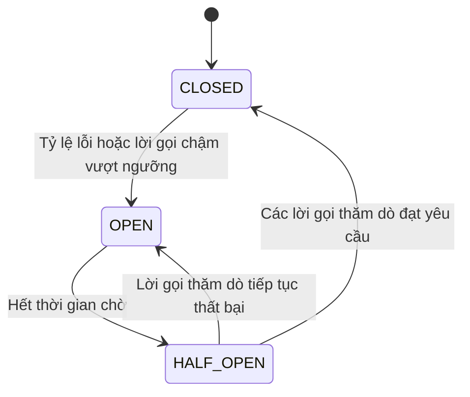

# Vai trò của Spring Cloud CircuitBreaker và thư viện hiện thực

Trong kiến trúc microservices, một yêu cầu thường đi qua nhiều dịch vụ. Ví dụ, dịch vụ đặt hàng có thể gọi dịch vụ tồn kho, thanh toán và vận chuyển. Nếu một dịch vụ phụ thuộc phản hồi rất chậm hoặc ngừng hoạt động, các lời gọi đang chờ có thể chiếm hết luồng xử lý và kết nối của dịch vụ gọi. Những yêu cầu mới tiếp tục dồn vào làm sự cố lan sang các dịch vụ vốn vẫn khỏe mạnh. Hiện tượng này thường được gọi là lỗi dây chuyền (*cascading failure*).

Circuit breaker giúp giới hạn tác động đó. Nó theo dõi kết quả của các lời gọi đến một phụ thuộc. Khi tỷ lệ lỗi hoặc lời gọi chậm vượt ngưỡng, circuit breaker tạm ngừng gửi yêu cầu đến phụ thuộc, trả kết quả dự phòng hoặc lỗi có kiểm soát, rồi thử lại một số lời gọi sau thời gian chờ. Trong hệ sinh thái Spring, **Spring Cloud CircuitBreaker cung cấp lớp API thống nhất để ứng dụng Spring sử dụng cơ chế này thông qua một thư viện hiện thực cụ thể**.

## 1. Spring Cloud CircuitBreaker giải quyết vấn đề gì?

Spring Cloud CircuitBreaker tách cách ứng dụng gọi circuit breaker khỏi chi tiết của thư viện đứng phía dưới. Nhờ đó, mã nghiệp vụ có thể dùng một cách gọi tương đối nhất quán, trong khi nhóm phát triển lựa chọn provider phù hợp với hệ thống.

Lớp tích hợp này hữu ích ở ba điểm:

- **Chuẩn hóa điểm gọi:** ứng dụng tạo circuit breaker theo một định danh, sau đó bọc lời gọi đến dịch vụ phụ thuộc bằng API của Spring Cloud CircuitBreaker.
- **Cho phép thay provider:** phần lớn mã gọi có thể giữ nguyên khi thay đổi thư viện hiện thực; cấu hình nâng cao và hành vi riêng của provider vẫn cần được rà soát.
- **Kết hợp với Spring:** provider được cấu hình qua cơ chế cấu hình của Spring Boot và có thể kết hợp với các thành phần quan sát, quản lý của ứng dụng.

Spring Cloud CircuitBreaker không tự thực hiện giao tiếp mạng, không thay thế HTTP client và cũng không tự sửa lỗi của dịch vụ phụ thuộc. Nó bao quanh lời gọi đã có để quyết định khi nào nên cho lời gọi đi qua, khi nào nên ngắt sớm và khi nào chuyển sang fallback. Vì vậy, nên đặt circuit breaker tại ranh giới gọi đến một phụ thuộc có thể gặp lỗi độc lập, chẳng hạn client gọi dịch vụ tồn kho hoặc thanh toán.

Ứng dụng thường dùng một trong hai API:

- `CircuitBreakerFactory` cho lời gọi đồng bộ hoặc kiểu imperative.
- `ReactiveCircuitBreakerFactory` cho luồng reactive, thường sử dụng Project Reactor.

Định danh như `inventory` hoặc `payment` giúp gắn lời gọi với cấu hình và số liệu của từng phụ thuộc. Nên chọn định danh theo dịch vụ hoặc nhóm thao tác có đặc tính lỗi tương đồng, thay vì dùng một circuit breaker chung cho mọi lời gọi ra ngoài.

## 2. Cơ chế CLOSED, OPEN và HALF_OPEN

Circuit breaker thường có ba trạng thái:

| Trạng thái | Cách xử lý | Khi nào chuyển trạng thái? |
|---|---|---|
| `CLOSED` | Cho phép lời gọi đến phụ thuộc và ghi nhận kết quả. | Chuyển sang `OPEN` khi các chỉ số lỗi hoặc lời gọi chậm đạt ngưỡng đã cấu hình. |
| `OPEN` | Ngắt sớm lời gọi, không tiếp tục gọi phụ thuộc trong thời gian chờ. Ứng dụng có thể trả fallback. | Sau thời gian chờ, chuyển sang `HALF_OPEN` để thăm dò khả năng phục hồi. |
| `HALF_OPEN` | Chỉ cho phép một số lượng giới hạn lời gọi thử nghiệm. | Nếu các lời gọi thử thành công theo chính sách, quay về `CLOSED`; nếu tiếp tục thất bại, trở lại `OPEN`. |

Luồng chuyển trạng thái có thể hình dung như sau:



Circuit breaker cần dữ liệu để quyết định có mở mạch hay không. Resilience4j hỗ trợ hai kiểu *sliding window* phổ biến:

- **Count-based window:** đánh giá một số lượng lời gọi gần nhất, ví dụ 20 lời gọi.
- **Time-based window:** đánh giá các lời gọi trong một khoảng thời gian, ví dụ 10 giây gần nhất.

Một số tham số quan trọng gồm kích thước cửa sổ, số lời gọi tối thiểu trước khi tính tỷ lệ, ngưỡng tỷ lệ lỗi, ngưỡng tỷ lệ lời gọi chậm, thời gian ở `OPEN` và số lời gọi được phép ở `HALF_OPEN`. Số lời gọi tối thiểu đặc biệt quan trọng: nếu lưu lượng còn quá thấp, circuit breaker có thể chưa đủ dữ liệu để đưa ra quyết định đáng tin cậy.

Lời gọi chậm cũng có thể được xem là tín hiệu lỗi. Ví dụ, một dịch vụ tồn kho vẫn trả HTTP 200 nhưng mất 8 giây để phản hồi; đối với luồng đặt hàng có giới hạn thời gian 2 giây, phản hồi đó vẫn có thể gây tắc nghẽn. Cần cấu hình ngưỡng lời gọi chậm phù hợp với mục tiêu độ trễ của ứng dụng.

## 3. Các thư viện hiện thực thường gặp

Spring Cloud CircuitBreaker là lớp tích hợp; hành vi thực tế phụ thuộc provider được chọn. Những lựa chọn thường gặp gồm:

| Provider | Đặc điểm | Khi cân nhắc |
|---|---|---|
| **Resilience4j** | Thư viện nhẹ, chia thành các mô-đun như CircuitBreaker, Retry, RateLimiter, Bulkhead và TimeLimiter; có tích hợp cho ứng dụng đồng bộ và reactive. | Lựa chọn phù hợp cho nhiều dự án Spring hiện đại cần cấu hình chi tiết, số liệu và nhiều cơ chế bảo vệ phối hợp. |
| **Spring Retry** | Cung cấp các chính sách thử lại và hỗ trợ chính sách circuit breaker trong hệ sinh thái Spring Retry. | Có thể cân nhắc khi dự án đã sử dụng Spring Retry và muốn tiếp tục dựa trên các chính sách của thư viện này. Cần kiểm tra các tính năng và giới hạn cụ thể của phiên bản đang dùng. |
| **Netflix Hystrix** | Giải pháp circuit breaker đời cũ, từng được dùng rộng rãi trong các hệ thống microservices. | Chủ yếu gặp trong hệ thống legacy cần duy trì tương thích. Không nên mặc định chọn cho dự án mới. |

Resilience4j thường là lựa chọn khởi đầu hợp lý khi xây dựng dịch vụ Spring mới. Nó cung cấp nhiều cơ chế có thể kết hợp: CircuitBreaker kiểm soát việc gọi phụ thuộc; Retry thử lại lỗi tạm thời; TimeLimiter giới hạn thời gian chờ của tác vụ bất đồng bộ; Bulkhead giới hạn mức đồng thời; RateLimiter giới hạn tốc độ gọi. Các cơ chế này có mục đích khác nhau và không nên bật tất cả theo mặc định. Đặc biệt, Retry có thể làm tăng tải lên một dịch vụ đang gặp sự cố nếu chính sách thử lại không được giới hạn.

API chung của Spring Cloud CircuitBreaker giúp mã ứng dụng ít phụ thuộc provider hơn, nhưng không làm mọi provider có cùng tính năng. Cấu hình chi tiết, cách tính lỗi, cách xử lý tác vụ bất đồng bộ và khả năng xuất số liệu vẫn có thể khác nhau. Khi cần một tính năng riêng của Resilience4j, nhóm phát triển nên xác định rõ phần mã hoặc cấu hình đó phụ thuộc Resilience4j.

## 4. Tích hợp Resilience4j với Spring Cloud CircuitBreaker

Với ứng dụng Maven, có thể thêm starter cho lời gọi đồng bộ:

```xml
<dependency>
    <groupId>org.springframework.cloud</groupId>
    <artifactId>spring-cloud-starter-circuitbreaker-resilience4j</artifactId>
</dependency>
```

Nếu ứng dụng dùng Project Reactor, thêm starter reactive tương ứng:

```xml
<dependency>
    <groupId>org.springframework.cloud</groupId>
    <artifactId>spring-cloud-starter-circuitbreaker-reactor-resilience4j</artifactId>
</dependency>
```

Nên quản lý phiên bản Spring Cloud bằng Spring Cloud BOM tương thích với phiên bản Spring Boot của dự án. Tránh tự chọn phiên bản starter riêng lẻ nếu BOM đã quản lý phiên bản đó.

Ví dụ sau bọc lời gọi đồng bộ đến dịch vụ tồn kho. `CircuitBreakerFactory` tạo circuit breaker có định danh `inventory`; hàm fallback nhận nguyên nhân lỗi và trả kết quả dự phòng cùng kiểu dữ liệu với lời gọi chính:

```java
import org.springframework.cloud.client.circuitbreaker.CircuitBreakerFactory;
import org.springframework.stereotype.Service;

@Service
public class InventoryService {
    private final CircuitBreakerFactory<?, ?> circuitBreakerFactory;
    private final InventoryClient inventoryClient;

    public InventoryService(
            CircuitBreakerFactory<?, ?> circuitBreakerFactory,
            InventoryClient inventoryClient) {
        this.circuitBreakerFactory = circuitBreakerFactory;
        this.inventoryClient = inventoryClient;
    }

    public Stock findStock(String sku) {
        return circuitBreakerFactory.create("inventory").run(
            () -> inventoryClient.findStock(sku),
            error -> Stock.unavailable(sku)
        );
    }
}
```

Trong ví dụ, khi mạch `inventory` ở `CLOSED`, lời gọi được chuyển đến `InventoryClient`. Khi circuit breaker từ chối lời gọi do đang `OPEN`, hoặc lời gọi chính phát sinh lỗi được provider ghi nhận, hàm fallback có thể được dùng để trả kết quả dự phòng. Ứng dụng thực tế nên ghi log hoặc gắn thông tin theo dõi cho `error`, đồng thời thiết kế `Stock.unavailable` sao cho bên gọi phân biệt được dữ liệu không sẵn có với số lượng tồn kho bằng không.

Có thể cấu hình instance `inventory` trong `application.yml` như sau:

```yaml
resilience4j:
  circuitbreaker:
    instances:
      inventory:
        slidingWindowType: COUNT_BASED
        slidingWindowSize: 20
        minimumNumberOfCalls: 10
        failureRateThreshold: 50
        slowCallDurationThreshold: 2s
        slowCallRateThreshold: 50
        waitDurationInOpenState: 15s
        permittedNumberOfCallsInHalfOpenState: 3
```

Đây là cấu hình minh họa: circuit breaker dùng cửa sổ 20 lời gọi, chỉ bắt đầu đánh giá sau ít nhất 10 lời gọi, mở mạch khi tỷ lệ lỗi đạt 50% hoặc tỷ lệ lời gọi chậm đạt 50%, chờ 15 giây rồi cho tối đa 3 lời gọi thăm dò. Các con số phải được điều chỉnh theo lưu lượng, độ trễ mục tiêu và mức độ quan trọng của phụ thuộc. Tên instance trong cấu hình cần khớp với định danh được tạo trong mã.

Resilience4j cũng có thể cấu hình các loại ngoại lệ được ghi nhận hoặc bỏ qua. Ví dụ, lỗi xác thực đầu vào do người dùng gửi thường không phản ánh tình trạng sức khỏe của dịch vụ tồn kho và không nên tự động làm mạch mở. Ngược lại, timeout hoặc lỗi kết nối đến dịch vụ phụ thuộc thường cần được xem xét như tín hiệu lỗi. Quy tắc cụ thể phải phản ánh hợp đồng của client và provider.

## 5. Fallback, timeout và bulkhead phối hợp như thế nào?

Fallback là hành vi thay thế khi lời gọi chính không thể cung cấp kết quả. Fallback tốt có thể trả dữ liệu cache còn đủ mới, thông tin mặc định có ý nghĩa hoặc trạng thái cho biết chức năng tạm thời không khả dụng. Không nên trả một kết quả có vẻ thành công nhưng sai bản chất. Với thao tác ghi như thanh toán hoặc tạo đơn hàng, fallback cần đặc biệt thận trọng để tránh báo thành công khi giao dịch chưa được xác nhận.

Circuit breaker và timeout bổ trợ cho nhau. Timeout giới hạn thời gian một lời gọi được phép chờ; circuit breaker theo dõi kết quả và ngăn tiếp tục gọi khi phụ thuộc có dấu hiệu không khỏe. Nếu client không có timeout, lời gọi có thể treo lâu và chiếm tài nguyên trước khi circuit breaker có đủ dữ liệu để mở mạch. Vì vậy, vẫn cần cấu hình timeout kết nối và phản hồi ở HTTP client. `TimeLimiter` của Resilience4j có thể bổ sung giới hạn thời gian cho các tác vụ bất đồng bộ phù hợp; nó không thay thế mọi loại timeout ở tầng mạng.

Bulkhead giới hạn số lời gọi đồng thời đến một phụ thuộc. Nếu dịch vụ báo cáo chậm, bulkhead có thể ngăn các lời gọi báo cáo chiếm hết luồng hoặc tài nguyên mà những chức năng khác cần dùng. Resilience4j có bulkhead dựa trên semaphore và thread pool; lựa chọn phụ thuộc vào mô hình thực thi và yêu cầu cách ly. Cần đặt giới hạn dựa trên năng lực thực tế của dịch vụ đích và tài nguyên của dịch vụ gọi.

Retry chỉ nên dùng cho lỗi có khả năng hồi phục và phải giới hạn số lần thử, khoảng chờ cùng thời gian tổng. Khi kết hợp Retry với CircuitBreaker, thứ tự bọc các cơ chế ảnh hưởng đến số lần gọi thực tế và cách circuit breaker thống kê thất bại. Cần chủ động thiết kế thứ tự, tránh retry liên tục khi mạch đã `OPEN` hoặc tạo thêm tải trong lúc dịch vụ đích đang quá tải.

## 6. Sử dụng trong ứng dụng reactive

Với WebFlux hoặc client trả về `Mono`, nên dùng starter reactive và `ReactiveCircuitBreakerFactory`. Ví dụ:

```java
import org.springframework.cloud.client.circuitbreaker.ReactiveCircuitBreakerFactory;
import org.springframework.stereotype.Service;
import reactor.core.publisher.Mono;

@Service
public class ReactiveInventoryService {
    private final ReactiveCircuitBreakerFactory<?, ?> circuitBreakerFactory;
    private final ReactiveInventoryClient inventoryClient;

    public ReactiveInventoryService(
            ReactiveCircuitBreakerFactory<?, ?> circuitBreakerFactory,
            ReactiveInventoryClient inventoryClient) {
        this.circuitBreakerFactory = circuitBreakerFactory;
        this.inventoryClient = inventoryClient;
    }

    public Mono<Stock> findStock(String sku) {
        return circuitBreakerFactory.create("inventory")
            .run(
                inventoryClient.findStock(sku),
                error -> Mono.just(Stock.unavailable(sku))
            );
    }
}
```

Fallback reactive cũng trả về `Mono` tương ứng. Không gọi `block()` trong luồng reactive chỉ để sử dụng circuit breaker đồng bộ, vì thao tác đó có thể chặn event loop và làm mất lợi ích của mô hình non-blocking. Hãy giữ lời gọi, xử lý lỗi và fallback trong cùng chuỗi reactive.

## 7. Theo dõi và vận hành

Một circuit breaker chỉ hữu ích khi nhóm vận hành biết nó đang ở trạng thái nào và vì sao trạng thái thay đổi. Khi tích hợp Spring Boot Actuator, Micrometer và cấu hình metrics phù hợp với provider, có thể theo dõi các chỉ số như:

- trạng thái hiện tại của từng circuit breaker;
- số lời gọi thành công, thất bại và bị từ chối sớm;
- tỷ lệ lỗi, tỷ lệ lời gọi chậm và số lời gọi trong cửa sổ;
- số lần chuyển trạng thái giữa `CLOSED`, `OPEN` và `HALF_OPEN`.

Nên gắn định danh circuit breaker với tên phụ thuộc để dashboard và cảnh báo có thể chỉ ra dịch vụ đang gặp vấn đề. Cảnh báo khi mạch mở kéo dài hoặc liên tục dao động giữa các trạng thái có thể giúp phát hiện sự cố và cấu hình ngưỡng chưa phù hợp. Chỉ mở các endpoint quản lý cần thiết và bảo vệ chúng theo chính sách bảo mật của hệ thống.

Khi kiểm thử, cần mô phỏng ít nhất ba tình huống: phụ thuộc phản hồi bình thường; phụ thuộc liên tục lỗi hoặc phản hồi quá chậm khiến mạch mở; phụ thuộc phục hồi để các lời gọi thăm dò ở `HALF_OPEN` đưa mạch về `CLOSED`. Đồng thời xác minh fallback trả đúng ý nghĩa nghiệp vụ, số lời gọi đến phụ thuộc giảm khi mạch mở và metrics phản ánh được trạng thái thực tế.

## 8. Cách lựa chọn và áp dụng

Khi bắt đầu tích hợp, hãy xác định phụ thuộc nào có thể gây lỗi dây chuyền và đặt circuit breaker tại lời gọi đến phụ thuộc đó. Chọn provider theo nhu cầu: Resilience4j là lựa chọn phổ biến cho dự án Spring hiện đại cần nhiều cơ chế bảo vệ; Spring Retry phù hợp hơn khi hệ thống đã dựa vào các chính sách của thư viện này; Hystrix thường chỉ còn là yêu cầu tương thích của hệ thống cũ.

Sau đó, cấu hình cửa sổ trượt, ngưỡng lỗi, ngưỡng lời gọi chậm và thời gian mở mạch dựa trên lưu lượng cùng mục tiêu độ trễ. Kết hợp timeout ở client, bulkhead khi cần giới hạn đồng thời và fallback có ý nghĩa nghiệp vụ. Cuối cùng, theo dõi trạng thái và số liệu trong môi trường thực tế để điều chỉnh. Circuit breaker là một phần của chiến lược chịu lỗi; nó không thay thế timeout, kiểm soát tải, xử lý lỗi nghiệp vụ hay khả năng phục hồi của chính dịch vụ phụ thuộc.
