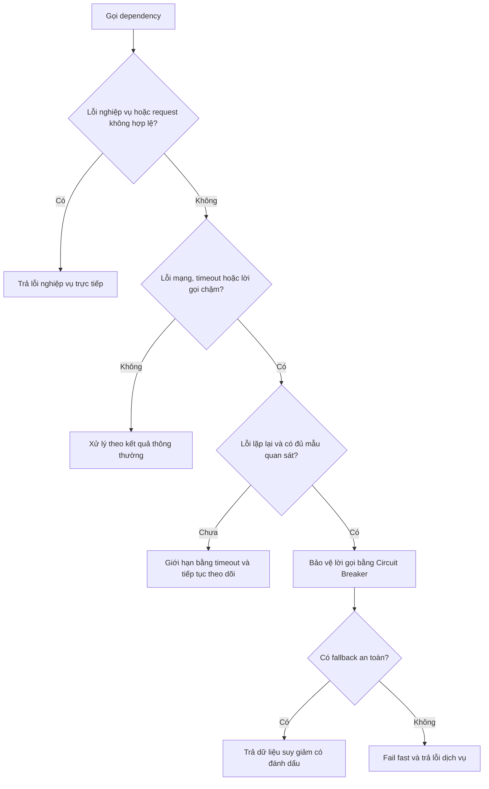

# Khi nào cần ngắt mạch và khi nào nên trả lỗi trực tiếp

Trong phần Tổng quan của module `SPRING_CLOUD_CIRCUIT_BREAKER`, ta tìm hiểu cách dùng Circuit Breaker trong Spring Cloud để bảo vệ ứng dụng khi một dịch vụ phụ thuộc phản hồi chậm hoặc tạm thời không khả dụng. Trọng tâm của bài là chọn đúng tình huống: khi nào nên ngắt mạch để chặn các lời gọi đang có nguy cơ làm cạn tài nguyên, và khi nào cần trả lỗi trực tiếp để giữ nguyên ý nghĩa nghiệp vụ.

Circuit Breaker thường được triển khai với Resilience4j thông qua Spring Cloud CircuitBreaker. Cơ chế này theo dõi kết quả gọi dịch vụ, chuyển giữa ba trạng thái CLOSED, OPEN và HALF_OPEN, đồng thời dùng sliding window để đánh giá tỷ lệ lỗi hoặc lời gọi chậm. Quyết định bật ngắt mạch cần dựa trên loại lỗi, tần suất, tác động lên tài nguyên và khả năng cung cấp kết quả thay thế an toàn.

## 1. Ngắt mạch giải quyết vấn đề gì?

Giả sử dịch vụ đặt hàng gọi dịch vụ danh mục để lấy thông tin sản phẩm. Khi danh mục hoạt động bình thường, mỗi lời gọi hoàn tất trong vài chục mili giây. Trong một đợt sự cố, danh mục mất nhiều giây mới phản hồi. Các request của dịch vụ đặt hàng phải chờ lâu, chiếm connection và thread. Nếu request mới vẫn tiếp tục gọi danh mục, số tác vụ chờ tăng lên. Những lời gọi retry liên tục còn có thể làm dịch vụ đang gặp sự cố chịu thêm tải.

Circuit Breaker theo dõi các lời gọi tới một dependency. Khi số liệu trong cửa sổ quan sát cho thấy tỷ lệ lỗi hoặc tỷ lệ lời gọi chậm vượt ngưỡng, breaker chuyển sang OPEN và từ chối lời gọi mới trong một khoảng thời gian. Ứng dụng có thể trả lỗi nhanh hoặc dùng fallback nếu có dữ liệu thay thế phù hợp. Sau thời gian chờ, breaker chuyển sang HALF_OPEN để thử một số lời gọi giới hạn. Nếu dependency phục hồi, breaker đóng lại; nếu vẫn lỗi, breaker mở lại.

Cần phân biệt rõ vai trò của cơ chế này:

- Circuit Breaker ngăn ứng dụng tiếp tục dồn request vào dependency đang có dấu hiệu mất khả năng phục vụ.
- Timeout giới hạn thời gian chờ cho một lời gọi. Breaker không thay thế timeout.
- Bulkhead giới hạn số lời gọi đồng thời để một dependency không chiếm hết tài nguyên dùng chung.
- Retry thử lại một lời gọi khi lỗi có khả năng tạm thời. Retry không thay thế breaker và có thể làm sự cố nặng hơn nếu không giới hạn.

Circuit Breaker không sửa được dependency, không bảo đảm request thành công và không tự quyết định dữ liệu fallback nào đúng về mặt nghiệp vụ.

## 2. Khi nào nên dùng Circuit Breaker?

Nên cân nhắc ngắt mạch khi lời gọi đi qua ranh giới mạng tới một dịch vụ độc lập và có khả năng gặp lỗi tạm thời hoặc suy giảm hiệu năng lặp lại. Các dấu hiệu thường gặp gồm:

- Dependency trả về lỗi 5xx, mất kết nối, reset connection hoặc timeout trong nhiều request liên tiếp.
- Độ trễ tăng cao khiến thread, connection pool hoặc tài nguyên xử lý của dịch vụ gọi bị giữ quá lâu.
- Lưu lượng đủ lớn để sliding window có thể thu thập số mẫu có ý nghĩa.
- Dependency có thể phục hồi sau một khoảng thời gian, vì vậy việc tạm ngừng gọi sẽ giúp hệ thống giảm áp lực trong lúc chờ.
- Ứng dụng có cách xử lý khi dependency không sẵn sàng: trả lỗi nhanh, dùng cache còn hợp lệ, bỏ qua phần dữ liệu không bắt buộc hoặc chuyển sang một nguồn dự phòng đã được thiết kế.

Ví dụ, trang chi tiết sản phẩm gọi thêm dịch vụ đánh giá để hiển thị điểm xếp hạng. Nếu dịch vụ đánh giá bị chậm, ứng dụng có thể mở breaker và hiển thị trang sản phẩm mà không có phần đánh giá, hoặc dùng dữ liệu cache kèm trạng thái cho biết dữ liệu có thể cũ. Đây là phần thông tin bổ sung; sự cố của nó không nhất thiết phải làm hỏng toàn bộ request.

Một ví dụ khác là dịch vụ tìm kiếm gọi dịch vụ gợi ý. Khi gợi ý không hoạt động, hệ thống vẫn có thể trả kết quả tìm kiếm chính. Circuit Breaker giúp ngừng gọi dịch vụ gợi ý trong thời gian nó suy giảm, nhờ đó luồng tìm kiếm chính ít bị ảnh hưởng hơn.

Breaker nên được đặt quanh lời gọi tới dependency cụ thể, với tên instance và cấu hình riêng phù hợp. Không nên gom các dịch vụ có độ tin cậy, lưu lượng hoặc ý nghĩa nghiệp vụ khác nhau vào cùng một breaker nếu điều đó khiến số liệu của dịch vụ này che lấp tình trạng của dịch vụ kia.

## 3. Khi nào nên trả lỗi trực tiếp?

Không phải mọi exception đều là tín hiệu cần mở Circuit Breaker. Một số lỗi là kết quả hợp lệ của nghiệp vụ hoặc do request không hợp lệ. Những lỗi này cần được trả về theo đúng ý nghĩa, không nên tính như sự cố của dependency.

| Tình huống | Cách xử lý phù hợp | Lý do |
|---|---|---|
| Request thiếu trường bắt buộc, sai định dạng hoặc không vượt qua validation | Trả lỗi validation trực tiếp | Request sai không cho biết dependency đang suy giảm |
| Người dùng chưa đăng nhập hoặc không đủ quyền | Trả lỗi xác thực/phân quyền trực tiếp | Đây là kết quả bảo mật và nghiệp vụ |
| Sản phẩm không tồn tại hoặc thao tác vi phạm quy tắc nghiệp vụ | Trả lỗi nghiệp vụ trực tiếp | Không nên biến kết quả hợp lệ này thành lỗi hạ tầng |
| Một lời gọi gặp lỗi đơn lẻ, lưu lượng quá thấp để có mẫu đáng tin cậy | Xử lý lỗi và timeout theo chính sách hiện có; theo dõi thêm | Breaker có thể không đem lại lợi ích nếu chưa đủ số mẫu |
| Dependency liên tục timeout hoặc trả 5xx | Dùng Circuit Breaker; fallback nếu an toàn, nếu không thì trả lỗi dịch vụ | Ngăn các lời gọi mới tiếp tục chờ một dependency đang suy giảm |
| Thông tin bổ sung có thể lấy từ cache còn hợp lệ | Dùng Circuit Breaker và trả dữ liệu cache có đánh dấu suy giảm | Có thể duy trì một phần trải nghiệm mà không giả vờ dữ liệu mới |
| Giao dịch bắt buộc như thanh toán hoặc giữ chỗ không thể hoàn tất | Có thể dùng breaker để fail fast, sau đó trả lỗi rõ ràng | Không được báo thành công khi chưa xác nhận giao dịch |

Một điểm quan trọng: “trả lỗi trực tiếp” không có nghĩa là luôn bỏ Circuit Breaker. Với một dependency bắt buộc như cổng thanh toán, breaker vẫn có thể bảo vệ hệ thống bằng cách từ chối sớm các lời gọi khi cổng thanh toán đang lỗi. Tuy nhiên, nếu không có phương án thay thế hợp lệ, ứng dụng phải trả trạng thái không khả dụng cho caller. Không được trả về kết quả giả như “đã thanh toán” chỉ để tránh hiển thị lỗi.

Ngược lại, lỗi 4xx do dữ liệu hoặc quy tắc nghiệp vụ thường không nên làm tăng failure rate của breaker. Hãy chuyển lỗi HTTP thành exception nghiệp vụ rõ ràng và cấu hình bỏ qua các exception đó khi tính tỷ lệ lỗi. Lỗi lập trình cục bộ, lỗi mapping hoặc lỗi cấu hình cũng cần được phân loại riêng; không nên để chúng bị hiểu nhầm là dependency đang mất khả năng phục vụ.

## 4. Quy trình chọn cách xử lý

Có thể dùng các câu hỏi sau trước khi thêm Circuit Breaker:

1. Lời gọi có đi tới dependency bên ngoài tiến trình hiện tại không? Nếu lỗi chỉ phát sinh trong validation hoặc xử lý nội bộ, breaker thường không phải công cụ phù hợp.
2. Lỗi có thể lặp lại do dependency chậm, mất kết nối hoặc quá tải không? Nếu đây là lỗi nghiệp vụ có chủ đích, hãy trả lỗi nghiệp vụ.
3. Lưu lượng có đủ để đánh giá một xu hướng không? Cần có minimum number of calls trước khi tỷ lệ lỗi có ý nghĩa.
4. Khi dependency không sẵn sàng, hệ thống có thể cung cấp dữ liệu thay thế mà không làm sai nghiệp vụ không? Nếu có, fallback có thể phù hợp. Nếu không, hãy fail fast và trả lỗi rõ ràng.
5. Caller cần biết điều gì? Phân biệt dữ liệu đầy đủ, dữ liệu suy giảm và thao tác chưa hoàn tất để caller có thể quyết định đúng.

Sơ đồ sau tóm tắt cách ra quyết định:



Ngay cả khi chưa đủ mẫu để mở breaker, timeout vẫn cần thiết để một lời gọi không chờ vô hạn. Khi breaker đã OPEN, các request mới có thể bị từ chối ngay; nếu không có fallback, hãy chuyển kết quả đó thành lỗi dịch vụ phù hợp với hợp đồng API.

## 5. CLOSED, OPEN, HALF_OPEN và sliding window

Circuit Breaker có ba trạng thái chính:

- **CLOSED**: lời gọi được chuyển tới dependency. Breaker ghi nhận kết quả thành công, thất bại và lời gọi chậm. Khi số mẫu đủ điều kiện và tỷ lệ vượt ngưỡng, breaker chuyển sang OPEN.
- **OPEN**: breaker từ chối lời gọi mới mà không gọi dependency. Với Resilience4j, lời gọi bị từ chối thường phát sinh `CallNotPermittedException`. Ứng dụng có thể trả lỗi nhanh hoặc thực hiện fallback.
- **HALF_OPEN**: sau thời gian chờ ở OPEN, breaker cho phép một số ít lời gọi thăm dò. Nếu tỷ lệ kết quả đạt điều kiện phục hồi, breaker trở về CLOSED. Nếu các lời gọi thăm dò tiếp tục lỗi hoặc quá chậm, breaker trở lại OPEN.

Sliding window là tập hợp kết quả gần đây dùng để tính tỷ lệ lỗi và lời gọi chậm. Resilience4j hỗ trợ hai kiểu:

- **COUNT_BASED**: quan sát một số lượng lời gọi gần nhất, chẳng hạn 20 lời gọi.
- **TIME_BASED**: quan sát kết quả trong một khoảng thời gian, chẳng hạn 10 giây gần nhất.

Các tham số thường cần hiểu khi cấu hình gồm:

| Tham số | Ý nghĩa |
|---|---|
| `slidingWindowType` | Chọn cửa sổ theo số lời gọi hoặc theo thời gian |
| `slidingWindowSize` | Số lời gọi hoặc số đơn vị thời gian của cửa sổ |
| `minimumNumberOfCalls` | Số mẫu tối thiểu trước khi tính tỷ lệ để quyết định mở breaker |
| `failureRateThreshold` | Ngưỡng phần trăm lỗi để chuyển sang OPEN |
| `slowCallDurationThreshold` | Thời gian từ đó một lời gọi được xem là chậm |
| `slowCallRateThreshold` | Ngưỡng phần trăm lời gọi chậm |
| `waitDurationInOpenState` | Thời gian breaker giữ trạng thái OPEN |
| `permittedNumberOfCallsInHalfOpenState` | Số lời gọi thăm dò được phép trong HALF_OPEN |

Ví dụ, với cửa sổ COUNT_BASED có kích thước 20 và minimum number of calls bằng 10, breaker cần ít nhất 10 kết quả trước khi dùng tỷ lệ để đánh giá. Nếu đặt ngưỡng lỗi 50%, các lỗi liên tiếp sau khi đã đủ mẫu có thể khiến breaker mở. Ngưỡng thực tế phải dựa trên lưu lượng và đặc tính của dependency; đặt cửa sổ quá nhỏ dễ phản ứng với biến động ngắn, còn cửa sổ quá lớn có thể phát hiện sự cố chậm.

Lời gọi chậm cũng có thể là dấu hiệu nguy hiểm dù chưa phát sinh exception. Vì vậy, hãy đặt cả ngưỡng tỷ lệ lỗi và tỷ lệ lời gọi chậm nếu độ trễ của dependency có thể làm cạn tài nguyên của dịch vụ gọi.

## 6. Tích hợp Spring Cloud CircuitBreaker với Resilience4j

Với ứng dụng Spring Boot dùng Gradle, có thể thêm starter Resilience4j của Spring Cloud CircuitBreaker. Hãy quản lý phiên bản bằng Spring Cloud BOM tương thích với phiên bản Spring Boot của dự án:

```kotlin
dependencies {
    implementation("org.springframework.cloud:spring-cloud-starter-circuitbreaker-resilience4j")
}
```

Spring Cloud CircuitBreaker cung cấp abstraction để tạo breaker theo tên. Ví dụ sau dùng breaker `productCatalog` quanh lời gọi lấy chi tiết sản phẩm. Nếu lời gọi thất bại do dependency, ứng dụng thử lấy dữ liệu từ cache. Nếu cache không có dữ liệu, ứng dụng ném lỗi dịch vụ không khả dụng để caller biết request không thể hoàn tất.

```java
import org.springframework.cloud.client.circuitbreaker.CircuitBreakerFactory;
import org.springframework.stereotype.Service;

@Service
public class ProductQueryService {
    private final CircuitBreakerFactory<?, ?> circuitBreakerFactory;
    private final ProductClient productClient;
    private final ProductCache productCache;

    public ProductQueryService(
            CircuitBreakerFactory<?, ?> circuitBreakerFactory,
            ProductClient productClient,
            ProductCache productCache) {
        this.circuitBreakerFactory = circuitBreakerFactory;
        this.productClient = productClient;
        this.productCache = productCache;
    }

    public ProductDetails findDetails(String productId) {
        return circuitBreakerFactory.create("productCatalog").run(
            () -> productClient.fetchDetails(productId),
            cause -> fallback(productId, cause)
        );
    }

    private ProductDetails fallback(String productId, Throwable cause) {
        if (cause instanceof ProductNotFoundException) {
            throw (ProductNotFoundException) cause;
        }

        return productCache.findUsable(productId)
            .orElseThrow(() ->
                new ProductCatalogUnavailableException(productId, cause));
    }
}
```

Ví dụ này giả định `ProductClient` chuyển phản hồi “không tìm thấy” thành `ProductNotFoundException`, còn `ProductCache.findUsable` chỉ trả dữ liệu đáp ứng chính sách độ mới của ứng dụng. Trong hệ thống thực tế, cần phân biệt rõ lỗi nghiệp vụ, lỗi xác thực và lỗi hạ tầng ở client. Không nên dùng một fallback chung để biến mọi exception thành dữ liệu thành công.

Cấu hình Resilience4j có thể đặt trong `application.yml`:

```yaml
resilience4j:
  circuitbreaker:
    instances:
      productCatalog:
        slidingWindowType: COUNT_BASED
        slidingWindowSize: 20
        minimumNumberOfCalls: 10
        failureRateThreshold: 50
        slowCallDurationThreshold: 2s
        slowCallRateThreshold: 50
        waitDurationInOpenState: 15s
        permittedNumberOfCallsInHalfOpenState: 3
        automaticTransitionFromOpenToHalfOpenEnabled: true
        ignoreExceptions:
          - com.example.ProductNotFoundException
```

Đây là cấu hình minh họa, không phải bộ ngưỡng phù hợp cho mọi hệ thống. Tên instance trong cấu hình phải trùng với tên truyền vào `create("productCatalog")`. Với lỗi nghiệp vụ khác, hãy bổ sung exception tương ứng vào chính sách bỏ qua hoặc cấu hình phân loại exception phù hợp. Không bỏ qua lỗi timeout hay lỗi kết nối nếu mục tiêu là để breaker phát hiện dependency đang suy giảm.

## 7. Thiết kế fallback mà không làm sai nghiệp vụ

Fallback chỉ có ích khi kết quả thay thế vẫn có ý nghĩa đối với caller. Một số lựa chọn thường gặp:

- Dùng cache có giới hạn độ cũ và trả kèm thời điểm cập nhật hoặc cờ cho biết dữ liệu là bản dự phòng.
- Bỏ qua một phần thông tin tùy chọn, chẳng hạn điểm đánh giá hoặc nội dung gợi ý, trong khi vẫn trả dữ liệu chính.
- Trả lỗi dịch vụ không khả dụng nhanh chóng nếu thao tác bắt buộc cần kết quả mới từ dependency.

Không nên trả dữ liệu giả để che sự cố. Ví dụ, khi không thể kiểm tra tồn kho, trả số lượng bằng 0 có thể khiến hệ thống từ chối một đơn hàng hợp lệ; trả số lượng rất lớn lại có thể khiến hệ thống nhận đơn không thể đáp ứng. Khi không có dữ liệu thay thế đáng tin cậy, hãy trả lỗi rõ ràng.

Fallback cũng không nên gọi lại chính dependency đang bị breaker bảo vệ, vì điều đó làm mất tác dụng ngắt mạch. Tránh đặt retry không giới hạn bên trong fallback. Nếu dùng cache, cần có chính sách về thời hạn, tính nhất quán và cách thông báo dữ liệu cũ cho caller.

## 8. Kết hợp timeout, bulkhead và retry

Circuit Breaker phát hiện xu hướng lỗi dựa trên kết quả quan sát được. Nếu lời gọi bị treo quá lâu mà không có timeout, breaker có thể không nhận được kết quả kịp thời để bảo vệ tài nguyên. Vì vậy, hãy cấu hình timeout ở HTTP client hoặc ở tầng reactive. Timeout cần phù hợp với ngân sách thời gian của request tổng thể và thời gian xử lý bình thường của dependency.

Bulkhead giới hạn số lời gọi đồng thời tới một dependency. Với semaphore bulkhead, ứng dụng giới hạn số request đang thực thi; với thread-pool bulkhead, ứng dụng cô lập công việc trong một pool riêng. Khi đạt giới hạn, lời gọi mới bị từ chối hoặc phải chờ theo chính sách đã đặt. Hãy giữ giới hạn và hàng đợi ở mức có chủ đích để dependency chậm không chiếm hết tài nguyên của ứng dụng.

Retry chỉ nên áp dụng cho lỗi tạm thời và thao tác có thể thử lại an toàn. Giới hạn số lần thử, dùng backoff và jitter, đồng thời bảo đảm tổng thời gian retry không vượt ngân sách request. Không retry một request đã bị breaker từ chối ở trạng thái OPEN. Với thao tác không idempotent như tạo thanh toán hoặc đặt hàng, cần có idempotency key hoặc cơ chế chống xử lý trùng trước khi cho phép retry.

Ba cơ chế này giải quyết các vấn đề khác nhau: timeout giới hạn thời gian chờ của một lời gọi, bulkhead giới hạn mức sử dụng tài nguyên đồng thời, còn Circuit Breaker ngừng gửi lời gọi mới khi số liệu cho thấy dependency đang suy giảm.

## 9. Lời gọi reactive

Với WebClient và Reactor, dùng `ReactiveCircuitBreakerFactory` để giữ luồng xử lý không chặn. Ví dụ dưới đây giới hạn thời gian gọi catalog và dùng cache khi dependency lỗi hoặc breaker đang OPEN:

```java
import java.time.Duration;
import org.springframework.cloud.client.circuitbreaker.ReactiveCircuitBreakerFactory;
import org.springframework.stereotype.Service;
import org.springframework.web.reactive.function.client.WebClient;
import reactor.core.publisher.Mono;

@Service
public class ReactiveProductQueryService {
    private final ReactiveCircuitBreakerFactory<?, ?> circuitBreakerFactory;
    private final WebClient webClient;
    private final ProductCache productCache;

    public Mono<ProductDetails> findDetails(String productId) {
        Mono<ProductDetails> request = webClient.get()
            .uri("/products/{id}", productId)
            .retrieve()
            .bodyToMono(ProductDetails.class)
            .timeout(Duration.ofSeconds(2));

        return circuitBreakerFactory.create("productCatalog").run(
            request,
            cause -> productCache.findUsableReactive(productId)
                .switchIfEmpty(Mono.error(
                    new ProductCatalogUnavailableException(productId, cause)))
        );
    }
}
```

Trong ứng dụng thực tế, hãy chuyển các phản hồi 4xx có ý nghĩa nghiệp vụ thành exception riêng và loại chúng khỏi thống kê lỗi của breaker. Cũng cần bảo đảm fallback reactive không gọi `block()` hoặc thực hiện I/O đồng bộ làm nghẽn event loop. Nếu cache không có dữ liệu dùng được, publisher nên kết thúc bằng lỗi phù hợp thay vì phát ra một giá trị giả.

## 10. Theo dõi hiệu quả bảo vệ

Sau khi triển khai, cần quan sát cả trạng thái breaker và tác động lên trải nghiệm request. Có thể dùng Micrometer cùng Spring Boot Actuator và hệ thống thu thập metric đang có của ứng dụng. Những tín hiệu hữu ích gồm:

- Trạng thái hiện tại của từng breaker: CLOSED, OPEN hay HALF_OPEN.
- Số lời gọi thành công, thất bại, chậm và bị từ chối khi breaker OPEN.
- Tỷ lệ lỗi, tỷ lệ lời gọi chậm và độ trễ của dependency.
- Số lần fallback được dùng, tỷ lệ cache hit và độ tuổi của dữ liệu dự phòng.
- Tỷ lệ request đầu cuối thành công, độ trễ p95/p99 và số lỗi mà caller thực sự nhận được.

Không nên chỉ nhìn vào số lần breaker mở. Một breaker mở có thể đang bảo vệ hệ thống đúng cách, nhưng fallback có thể thất bại hoặc caller vẫn nhận quá nhiều lỗi. Hãy đối chiếu trạng thái breaker với metric của dependency và request đầu cuối. Cảnh báo nên chú ý trạng thái OPEN kéo dài, tỷ lệ fallback tăng bất thường, hoặc HALF_OPEN liên tục quay lại OPEN.

Log cần ghi tên breaker, trạng thái, loại lỗi và request correlation ID nếu có. Khi breaker OPEN, nhiều request có thể bị từ chối liên tiếp; nên dùng metric và log có kiểm soát để tránh tạo một lượng log lỗi khổng lồ trong lúc sự cố.

## 11. Áp dụng vào các tình huống thường gặp

| Tình huống | Có nên dùng breaker? | Kết quả nên trả cho caller |
|---|---|---|
| Dịch vụ gợi ý sản phẩm thường xuyên timeout | Có | Kết quả chính kèm phần gợi ý bị lược bỏ hoặc cache có đánh dấu |
| Dịch vụ đánh giá sản phẩm trả 5xx liên tục | Có | Trang sản phẩm vẫn hiển thị nếu đánh giá là thông tin tùy chọn |
| Cổng thanh toán không phản hồi | Có thể dùng để fail fast | Báo thanh toán chưa hoàn tất/không khả dụng; không xác nhận thành công |
| Người dùng gửi mã sản phẩm không tồn tại | Không tính là lỗi breaker | Trả lỗi không tìm thấy theo hợp đồng API |
| Request thiếu thông tin bắt buộc | Không | Trả lỗi validation |
| Một dịch vụ nội bộ có lỗi mapping do code mới triển khai | Không nên xem đây là lỗi mạng của dependency | Trả lỗi phù hợp và sửa lỗi mapping |

Khi đánh giá một triển khai, hãy thử trả lời ba câu hỏi: breaker có mở khi dependency thực sự suy giảm không; request mới có được fail fast khi breaker OPEN không; và caller có nhận được kết quả đúng ý nghĩa khi fallback được dùng hoặc khi không có fallback không. Các câu trả lời này cho biết cơ chế đang bảo vệ hệ thống mà vẫn giữ đúng hợp đồng nghiệp vụ.

## Kết luận

Hãy dùng Circuit Breaker khi lời gọi tới dependency có xu hướng lỗi hoặc chậm lặp lại và việc tiếp tục chờ có thể làm ảnh hưởng đến tài nguyên hoặc các luồng xử lý khác. Hãy trả lỗi trực tiếp với validation, xác thực, lỗi nghiệp vụ và các tình huống không có kết quả thay thế an toàn. Với thao tác bắt buộc, breaker vẫn có thể giúp fail fast, nhưng phản hồi phải thể hiện rõ thao tác chưa hoàn tất. Phân loại exception đúng, đặt timeout, chọn sliding window phù hợp và theo dõi cả fallback lẫn kết quả đầu cuối sẽ giúp Circuit Breaker trong Spring Cloud phát huy đúng vai trò bảo vệ dịch vụ.

