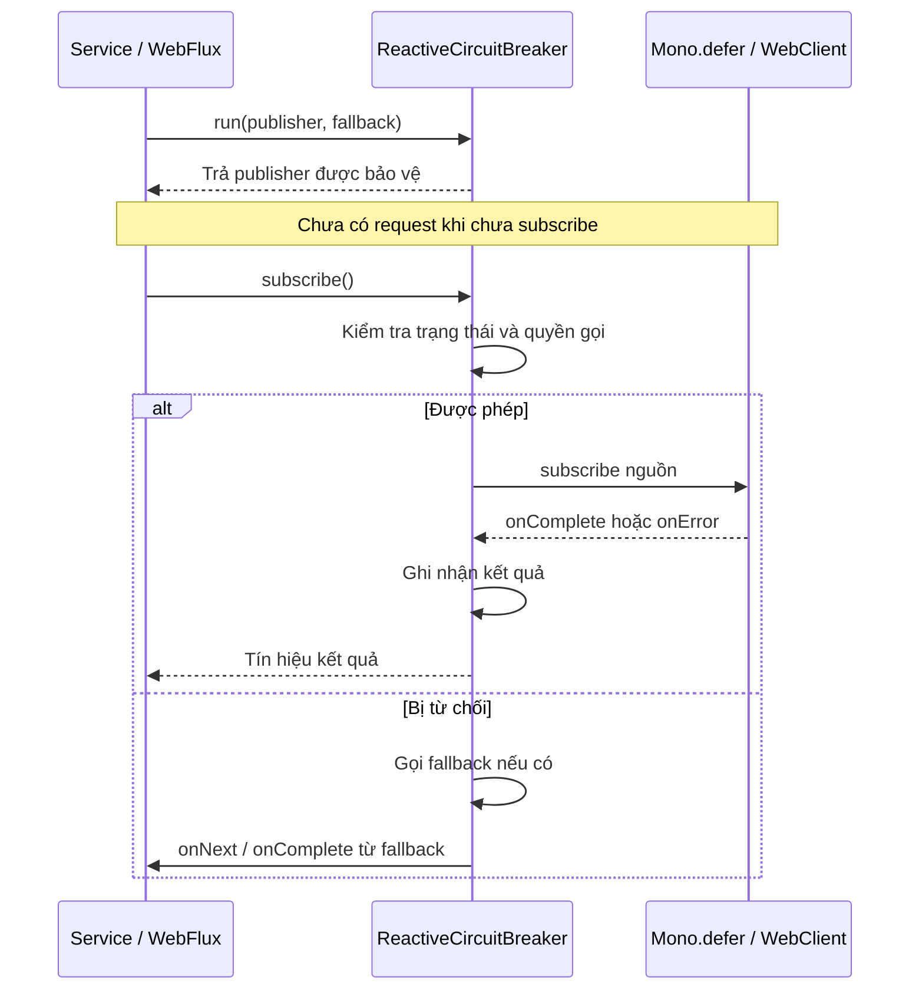

# Đánh giá lười và thời điểm đăng ký thực thi Mono hoặc Flux

Trong Reactor, `Mono` và `Flux` mô tả một chuỗi xử lý bất đồng bộ. Việc tạo publisher và việc thực thi publisher là hai thời điểm khác nhau. Khi ứng dụng ghép các operator như `map`, `flatMap`, `filter` hoặc đưa publisher qua Spring Cloud Circuit Breaker, pipeline thường mới chỉ được mô tả. Tác vụ bắt đầu khi có subscriber đăng ký.

Đặc tính này được gọi là **đánh giá lười** (lazy evaluation). Nó rất quan trọng khi bảo vệ lời gọi reactive tới dịch vụ phụ thuộc: circuit breaker phải quan sát lần thực thi thật, từ lúc publisher được subscribe đến khi hoàn tất hoặc phát sinh lỗi. Nếu lời gọi có side effect xảy ra trước subscription, circuit breaker có thể không bảo vệ đúng phần công việc đó.

## Hai giai đoạn: assembly và subscription

Reactor có thể được hiểu qua hai giai đoạn:

1. **Assembly:** ứng dụng tạo publisher và ghép các operator thành pipeline. Các phép biến đổi được khai báo, nhưng nguồn dữ liệu cold thông thường chưa phát sinh công việc.
2. **Subscription:** một subscriber đăng ký với publisher. Subscription kích hoạt nguồn cold, truyền tín hiệu `onSubscribe`, rồi dữ liệu đi qua pipeline bằng `onNext`, `onComplete` hoặc `onError`.

Ví dụ đơn giản:

```java
Mono<String> message = Mono.just("hello")
        .map(String::toUpperCase)
        .doOnNext(value -> log.info("Nhận được: {}", value));

// Tại đây pipeline đã được tạo, nhưng chưa có subscriber.

message.subscribe(); // Subscription kích hoạt pipeline.
```

`Mono.just("hello")` giữ một giá trị đã có sẵn. Operator `map` và `doOnNext` chạy khi có subscription. Với nguồn dữ liệu cold, mỗi subscription độc lập có thể kích hoạt một lần thực thi mới.

Trong ứng dụng Spring WebFlux, controller thường trả `Mono<T>` hoặc `Flux<T>` cho framework. WebFlux đăng ký publisher để ghi response khi xử lý request. Vì vậy, không cần tự gọi `subscribe()` trong controller hoặc service thông thường. Việc tự subscribe tạo một luồng thực thi tách khỏi vòng đời request và khiến việc quản lý lỗi, hủy request, context và backpressure khó kiểm soát hơn.

## Phân biệt tạo publisher và thực thi lời gọi

Một publisher có thể được tạo ở assembly time nhưng chỉ gọi nguồn bên trong khi subscription bắt đầu. Tuy nhiên, mã Java nằm ngoài publisher vẫn chạy ngay khi phương thức được gọi.

Ví dụ sau gọi phương thức blocking ngay trong lúc tạo pipeline:

```java
// loadProduct chạy ngay tại thời điểm dòng lệnh này được thực thi.
Mono<Product> eager = Mono.just(loadProduct(productId));
```

`Mono.just` nhận một giá trị đã được tính xong. Nó không trì hoãn lời gọi `loadProduct`. Nếu phương thức đó gọi HTTP blocking, truy vấn cơ sở dữ liệu hoặc thực hiện side effect, công việc đã xảy ra trước khi có subscription và nằm ngoài thời gian mà publisher reactive có thể quản lý.

Để trì hoãn một tác vụ đồng bộ tới lúc subscribe, có thể dùng `Mono.fromCallable`:

```java
Mono<Product> deferredBlocking = Mono.fromCallable(
        () -> loadProduct(productId)
);
```

Callable được gọi khi có subscription. Tuy vậy, `fromCallable` không biến một thao tác blocking thành non-blocking; nó chỉ trì hoãn thời điểm gọi. Nếu dùng tác vụ blocking trong ứng dụng reactive, cần đưa nó sang scheduler phù hợp và cân nhắc thay thế bằng client reactive.

Khi phương thức client trả về `Mono` hoặc `Flux`, dùng `defer` để trì hoãn cả việc gọi phương thức tạo publisher:

```java
Mono<Product> deferredReactive = Mono.defer(
        () -> catalogClient.findProduct(productId)
);

Flux<Product> deferredStream = Flux.defer(
        () -> catalogClient.findProducts(category)
);
```

`Mono.defer` và `Flux.defer` nhận một supplier tạo publisher mới cho mỗi subscription. Cách này hữu ích nếu việc gọi `catalogClient` có logic chuẩn bị request, đọc dữ liệu theo context hoặc tạo publisher có side effect. Với `WebClient`, publisher request thông thường vốn đã cold và request mạng chỉ được gửi khi subscribe; `defer` vẫn giúp trì hoãn lời gọi phương thức client và tạo publisher mới cho mỗi subscriber.

## Cold publisher và hot publisher

Không phải mọi publisher đều có cùng cách chia sẻ dữ liệu giữa subscriber.

| Đặc điểm | Cold publisher | Hot publisher |
|---|---|---|
| Bắt đầu phát dữ liệu | Thường bắt đầu khi có subscriber | Có thể phát dữ liệu trước khi subscriber đăng ký |
| Nhiều subscriber | Thường kích hoạt các lần thực thi riêng | Có thể cùng quan sát một nguồn đang phát |
| Ví dụ | `Mono.defer`, `Flux.defer`, request `WebClient` thông thường | `Sinks.Many`, publisher đã `connect` hoặc chia sẻ qua `share`/`publish` |

Cold publisher phù hợp với lời gọi HTTP cần thực hiện riêng cho từng request. Hot publisher hữu ích khi nhiều subscriber cần quan sát cùng một nguồn sự kiện hoặc luồng dữ liệu đang chạy. Khi dùng hot publisher với circuit breaker, cần hiểu rõ circuit breaker đang bảo vệ subscription nào và vòng đời của nguồn được chia sẻ ra sao; không mặc định rằng mỗi subscriber sẽ tạo một request phụ thuộc độc lập.

Ví dụ cold publisher thực thi hai lần cho hai subscriber:

```java
AtomicInteger calls = new AtomicInteger();

Mono<Integer> cold = Mono.defer(() ->
        Mono.just(calls.incrementAndGet())
);

cold.subscribe(value -> log.info("Subscriber A: {}", value));
cold.subscribe(value -> log.info("Subscriber B: {}", value));
// Kết quả lần lượt là 1 và 2.
```

Publisher được lưu trong biến `cold`, nhưng mỗi lần `subscribe()` kích hoạt supplier của `defer` một lần. Vì thế, không nên suy luận rằng tạo một đối tượng `Mono` đồng nghĩa với việc tác vụ chỉ chạy một lần.

## Kết hợp lazy publisher với ReactiveCircuitBreaker

Spring Cloud Circuit Breaker cung cấp `ReactiveCircuitBreaker` để bọc `Mono` hoặc `Flux`. Phương thức `run` nhận publisher và có thể nhận thêm fallback. Việc gọi `run` tạo publisher đã được bảo vệ; quá trình thực thi thực tế diễn ra khi publisher trả về được subscribe.

```java
import org.springframework.cloud.client.circuitbreaker.ReactiveCircuitBreaker;
import org.springframework.cloud.client.circuitbreaker.ReactiveCircuitBreakerFactory;
import org.springframework.stereotype.Service;
import reactor.core.publisher.Mono;

@Service
public class CatalogService {

    private final ReactiveCircuitBreakerFactory<?, ?> circuitBreakerFactory;
    private final CatalogClient catalogClient;

    public CatalogService(
            ReactiveCircuitBreakerFactory<?, ?> circuitBreakerFactory,
            CatalogClient catalogClient) {
        this.circuitBreakerFactory = circuitBreakerFactory;
        this.catalogClient = catalogClient;
    }

    public Mono<Product> findProduct(String productId) {
        ReactiveCircuitBreaker breaker =
                circuitBreakerFactory.create("catalog");

        Mono<Product> request = Mono.defer(
                () -> catalogClient.findProduct(productId)
        );

        return breaker.run(
                request,
                error -> Mono.just(Product.unavailable(productId))
        );
    }
}
```

Khi `findProduct` được gọi, phương thức tạo publisher và trả về cho caller. Chưa có request mạng nào được gửi chỉ vì phương thức service đã trả `Mono`. Khi WebFlux hoặc subscriber khác đăng ký, circuit breaker mới điều phối subscription; `Mono.defer` gọi client để tạo publisher request và request được thực thi theo subscription đó.

Nếu breaker đang `OPEN`, lời gọi được bảo vệ có thể bị từ chối và fallback tạo publisher kết quả thay thế. Nếu request được thực thi nhưng phát sinh lỗi, fallback cũng có thể xử lý lỗi đó. Fallback trả `Mono<Product>` để giữ nguyên kiểu reactive. Không gọi `subscribe()` bên trong fallback; hãy trả publisher cho chuỗi xử lý bên ngoài.

Với `Flux`, nguyên tắc tương tự:

```java
public Flux<Product> findProducts(String category) {
    ReactiveCircuitBreaker breaker =
            circuitBreakerFactory.create("catalog-search");

    Flux<Product> request = Flux.defer(
            () -> catalogClient.findProducts(category)
    );

    return breaker.run(
            request,
            error -> Flux.empty()
    );
}
```

Trong ví dụ, fallback trả `Flux.empty()` để biểu diễn không có dữ liệu thay thế. Đây là quyết định nghiệp vụ: nếu việc trả danh sách rỗng có thể bị hiểu nhầm là không có sản phẩm, hãy trả lỗi hoặc một kiểu response có trường trạng thái rõ ràng. Việc fallback biến lỗi thành một luồng hoàn tất bình thường cũng có nghĩa caller nhận một kết quả hợp lệ theo hợp đồng đã chọn, trong khi metric của circuit breaker vẫn phản ánh kết quả của nguồn được bảo vệ.

## Thời điểm đánh giá trạng thái và ghi nhận kết quả

Với publisher reactive, việc tạo pipeline không đồng nghĩa circuit breaker đã thực thi lời gọi hoặc ghi nhận kết quả. Cần có subscription để bắt đầu lần thực thi được bảo vệ. Khi subscription diễn ra:

1. Circuit breaker kiểm tra trạng thái và quyết định có cho phép subscription thực thi nguồn hay không.
2. Nếu được phép, publisher nguồn được subscribe và thực hiện công việc phụ thuộc.
3. Tín hiệu kết thúc thành công hoặc lỗi được chuyển qua operator circuit breaker để ghi nhận kết quả theo backend.
4. Nếu có fallback và lỗi được xử lý, publisher fallback phát kết quả thay thế tới caller.



Điều này giải thích vì sao một controller trả `Mono` nhưng không có subscriber thì không có request mạng, không có fallback được thực thi và cũng không có kết quả lời gọi để ghi nhận. Trong WebFlux bình thường, framework sẽ subscribe để xử lý response; nếu ứng dụng tự tạo publisher rồi bỏ đi, pipeline không chạy.

## Retry và nhiều lần subscription

Mỗi subscription vào cold publisher có thể tạo một lần gọi mới. Các operator như `retry` hoặc `retryWhen` có thể subscribe lại nguồn sau lỗi. Vị trí đặt retry so với circuit breaker ảnh hưởng số lần thực thi và số kết quả mà breaker quan sát.

Ví dụ:

```java
import reactor.util.retry.Retry;

Mono<Product> request = Mono.defer(
        () -> catalogClient.findProduct(productId)
);

return request
        .retryWhen(Retry.max(2))
        .transformDeferred(publisher -> breaker.run(
                publisher,
                error -> Mono.just(Product.unavailable(productId))
        ));
```

Trong cách sắp xếp này, circuit breaker bọc publisher đã có retry; nó quan sát kết quả cuối cùng của chuỗi retry. Nếu muốn mỗi lần thử được breaker đánh giá riêng, cần đặt circuit breaker bên trong publisher được retry và kiểm tra rõ hành vi của backend. Không thêm retry một cách máy móc: nhiều lần thử đồng thời có thể làm tăng tải lên dịch vụ đang suy giảm, và retry không nên vượt quá ngân sách timeout của request tổng thể.

## Kiểm tra thời điểm thực thi bằng StepVerifier

Có thể kiểm tra lazy evaluation mà không cần gửi request mạng thật bằng `AtomicInteger` và `StepVerifier`:

```java
import static org.junit.jupiter.api.Assertions.assertEquals;

import java.util.concurrent.atomic.AtomicInteger;

import reactor.core.publisher.Mono;
import reactor.test.StepVerifier;

AtomicInteger executions = new AtomicInteger();

Mono<Integer> publisher = Mono.defer(() ->
        Mono.just(executions.incrementAndGet())
);

// Assembly chưa thực thi supplier.
assertEquals(0, executions.get());

StepVerifier.create(publisher)
        .expectNext(1)
        .verifyComplete();

assertEquals(1, executions.get());

// Subscription thứ hai kích hoạt supplier lần nữa.
StepVerifier.create(publisher)
        .expectNext(2)
        .verifyComplete();

assertEquals(2, executions.get());
```

`StepVerifier.create(...).verifyComplete()` đăng ký và tiêu thụ publisher. Các assertion trước và sau subscription xác nhận supplier chỉ chạy khi có subscription và chạy lại cho subscription tiếp theo.

Để kiểm tra circuit breaker, có thể dùng một publisher giả lập phát lỗi và một fallback có bộ đếm riêng. Xác nhận fallback không chạy trước khi subscribe; sau khi subscribe, xác nhận publisher fallback phát đúng dữ liệu. Với trạng thái `OPEN`, xác nhận nguồn phụ thuộc không được gọi và fallback nhận lỗi từ chối. Với trạng thái `CLOSED`, xác nhận nguồn được gọi và kết quả được ghi nhận theo cấu hình.

## Những lỗi thường gặp

- **Gọi blocking trước `Mono.just`:** công việc đã chạy ở assembly time. Dùng client reactive hoặc trì hoãn tác vụ đồng bộ bằng `fromCallable` và scheduler phù hợp.
- **Tạo publisher rồi không subscribe:** không có công việc nào chạy. Trả publisher cho WebFlux hoặc một thành phần quản lý subscription.
- **Gọi `subscribe()` thủ công trong service:** tạo luồng thực thi tách khỏi caller, làm khó quản lý lỗi và hủy request. Hãy compose publisher và trả về.
- **Dùng `Mono.just(client.call())` khi `client.call()` đã thực hiện side effect:** side effect xảy ra ngay. Dùng `Mono.defer(() -> client.call())` nếu cần trì hoãn lời gọi phương thức.
- **Giả định một publisher chỉ chạy một lần:** cold publisher có thể thực thi lại cho mỗi subscriber. Dùng `cache` hoặc cơ chế chia sẻ chỉ khi muốn chia sẻ kết quả và đã hiểu vòng đời của dữ liệu.
- **Đặt retry không có chủ đích:** mỗi lần subscribe lại có thể tạo request mới. Xác định rõ breaker quan sát từng attempt hay kết quả cuối cùng của chuỗi retry.

Khi thiết kế luồng reactive có circuit breaker, hãy luôn xác định publisher được tạo ở đâu, subscription bắt đầu ở đâu, nguồn có cold hay hot, và operator bảo vệ đang bao quanh phần thực thi nào. Những điểm đó quyết định request thực sự chạy lúc nào, số lần dịch vụ phụ thuộc bị gọi và kết quả nào được circuit breaker ghi nhận.
