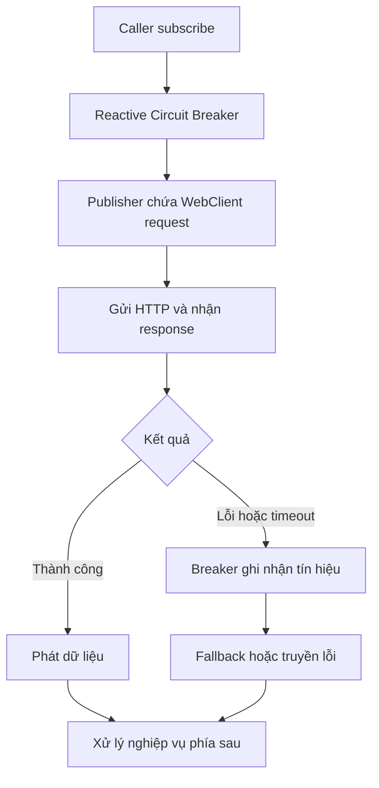

# Đặt ranh giới bao bên ngoài Publisher chứa lời gọi thật

Trong ứng dụng reactive dùng Spring Cloud CircuitBreaker, Circuit Breaker phải bao quanh Publisher thực hiện lời gọi tới dependency. Ranh giới này quyết định breaker quan sát được gì: thời gian phản hồi, tín hiệu hoàn tất, lỗi kết nối, timeout và trạng thái từ chối lời gọi. Nếu đặt breaker ở vị trí không chứa lời gọi mạng thực sự, ứng dụng có thể tưởng rằng dependency đang khỏe dù request bên ngoài vẫn thất bại.

Bài học thuộc chương **Luồng reactive** của module `SPRING_CLOUD_CIRCUIT_BREAKER`. Ta sẽ dùng `Mono`, `Flux`, `ReactiveCircuitBreaker` và Reactor để đặt ranh giới bảo vệ đúng chỗ, hiểu thời điểm Publisher được thực thi, tránh làm mất tín hiệu lỗi và giữ cho fallback không chặn event loop.

## 1. Publisher mô tả công việc, subscription mới kích hoạt công việc

Trong Reactor, `Mono<T>` mô tả một luồng có thể phát ra tối đa một phần tử, còn `Flux<T>` mô tả một luồng có thể phát ra không, một hoặc nhiều phần tử. Nhiều Publisher là lazy: việc tạo Publisher chỉ mô tả pipeline; công việc thực tế bắt đầu khi có subscriber đăng ký.

Ví dụ, `WebClient` trả về một `Mono` đại diện cho request HTTP:

```java
Mono<Product> request = webClient.get()
    .uri("/products/{id}", productId)
    .retrieve()
    .bodyToMono(Product.class);
```

Ở thời điểm tạo biến `request`, WebClient chưa nhất thiết gửi HTTP request. Khi Publisher được subscribe, Reactor mới thực thi pipeline và thực hiện I/O. Đây là lý do ta có thể truyền Publisher vào Circuit Breaker trước khi subscription xảy ra.

Spring Cloud CircuitBreaker cung cấp `ReactiveCircuitBreakerFactory` để tạo breaker theo ID. API reactive nhận Publisher `Mono` và trả về một `Mono` đã được bảo vệ:

```java
ReactiveCircuitBreaker breaker =
    reactiveCircuitBreakerFactory.create("catalog-read");

Mono<Product> protectedRequest = breaker.run(
    request,
    error -> fallback(productId, error)
);
```

Khi subscriber subscribe vào `protectedRequest`, lời gọi thực tế được thực thi trong ranh giới Circuit Breaker. Breaker có thể quan sát kết quả và áp dụng chính sách timeout, trạng thái OPEN hoặc fallback.

## 2. Đặt breaker bao quanh Publisher chứa lời gọi thật

Quy tắc quan trọng là Publisher được truyền vào `run` phải chứa chính lời gọi tới dependency. Ví dụ dưới đây đặt ranh giới đúng:

```java
@Service
public class ReactiveCatalogService {
    private final WebClient webClient;
    private final ReactiveCircuitBreakerFactory<?, ?> breakerFactory;
    private final CatalogCache catalogCache;

    public ReactiveCatalogService(
            WebClient webClient,
            ReactiveCircuitBreakerFactory<?, ?> breakerFactory,
            CatalogCache catalogCache) {
        this.webClient = webClient;
        this.breakerFactory = breakerFactory;
        this.catalogCache = catalogCache;
    }

    public Mono<Product> findProduct(String productId) {
        Mono<Product> remoteCall = Mono.defer(() ->
            webClient.get()
                .uri("/products/{id}", productId)
                .retrieve()
                .bodyToMono(Product.class)
        );

        ReactiveCircuitBreaker breaker =
            breakerFactory.create("catalog-read");

        return breaker.run(
            remoteCall,
            error -> catalogCache.findUsable(productId)
                .switchIfEmpty(Mono.error(
                    new CatalogUnavailableException(productId, error)))
        );
    }
}
```

Publisher `remoteCall` đại diện cho request HTTP và quá trình giải mã response. Nó được truyền trực tiếp vào `breaker.run`. Khi subscription xảy ra, breaker bảo vệ lời gọi đó; nếu request thất bại hoặc breaker đang OPEN, hàm fallback được gọi.

Ở đây dùng `Mono.defer` để tạo pipeline request khi có subscription. WebClient vốn đã lazy, nhưng `defer` còn hữu ích khi quá trình tạo Publisher có side effect hoặc phụ thuộc vào dữ liệu cần đọc tại thời điểm subscribe. Mỗi subscription tạo một lần thực thi mới của supplier. Vì vậy, không subscribe nhiều lần vào cùng một request nếu không chủ ý gửi nhiều request.

## 3. Vì sao phải đặt ranh giới ở bên ngoài lời gọi?

Hãy xem một số cách đặt sai ranh giới thường gặp.

**Tính kết quả trước rồi mới bọc bằng Mono**

```java
// Không phù hợp: lời gọi đồng bộ xảy ra trước Circuit Breaker.
Product product = blockingCatalogClient.fetch(productId);
Mono<Product> request = Mono.just(product);

return breaker.run(request, error -> fallback(productId, error));
```

Lời gọi đã xảy ra ở dòng `fetch`. Khi breaker nhận `Mono.just(product)`, nó chỉ thấy một Publisher phát ra giá trị có sẵn. Nếu lời gọi đồng bộ timeout hoặc ném exception, lỗi xảy ra trước khi breaker được thực thi nên breaker không ghi nhận được.

**Subscribe thủ công trước khi trả Publisher**

```java
// Không phù hợp: tạo một subscription nằm ngoài ranh giới bảo vệ.
Mono<Product> request = webClient.get()
    .uri("/products/{id}", productId)
    .retrieve()
    .bodyToMono(Product.class);

request.subscribe();

return breaker.run(request, error -> fallback(productId, error));
```

Lệnh `subscribe()` đầu tiên kích hoạt request độc lập ngoài breaker. Khi Publisher được subscribe lần nữa qua kết quả `run`, WebClient có thể gửi thêm một request khác. Kết quả là lời gọi đầu tiên không được bảo vệ, còn request thứ hai mới đi qua breaker.

**Bọc một Publisher không chứa lời gọi mạng**

```java
// Không phù hợp: breaker chỉ quan sát phép biến đổi cục bộ.
Mono<Product> result = Mono.just(productId)
    .map(this::buildPlaceholder);

return breaker.run(result, error -> fallback(productId, error));
```

Nếu lời gọi HTTP thực sự được thực hiện ở nơi khác, breaker này không thể bảo vệ dependency. Hãy di chuyển lời gọi vào Publisher được truyền cho `run`, hoặc áp dụng Circuit Breaker ngay tại adapter thực hiện I/O.

## 4. Chọn phạm vi Publisher được bảo vệ

Ranh giới bảo vệ nên bao gồm phần công việc thuộc dependency: tạo request, gửi request, nhận response và giải mã dữ liệu cần thiết để có kết quả từ dependency. Các bước xử lý nghiệp vụ cục bộ sau đó có thể nằm bên ngoài.

Ví dụ:

```java
public Mono<ProductView> findProductView(String productId) {
    Mono<Product> remoteCall = Mono.defer(() ->
        webClient.get()
            .uri("/products/{id}", productId)
            .retrieve()
            .bodyToMono(Product.class)
    );

    Mono<Product> protectedProduct = breakerFactory
        .create("catalog-read")
        .run(remoteCall, error -> fallback(productId, error));

    // Phần làm giàu dữ liệu cục bộ nằm sau ranh giới dependency.
    return protectedProduct.flatMap(product ->
        pricingService.loadLocalPrice(product)
            .map(price -> new ProductView(product, price))
    );
}
```

Với cách tổ chức này, breaker `catalog-read` theo dõi lời gọi catalog. Nếu `pricingService.loadLocalPrice` lỗi vì một bug hoặc vì một dependency khác, lỗi đó không bị gán nhầm cho catalog. Nếu pricing cũng là một dependency từ xa, hãy bảo vệ nó bằng một breaker có ID riêng.

Đừng đặt một Circuit Breaker duy nhất quanh toàn bộ pipeline của controller nếu pipeline gồm nhiều dependency không liên quan. Khi một bước cục bộ lỗi, breaker có thể ghi nhận lỗi cho dependency không gây ra sự cố. Hãy xác định ranh giới theo dependency và mục tiêu bảo vệ.

## 5. Không nuốt lỗi trước ranh giới bảo vệ

Một lỗi phổ biến khác là dùng `onErrorResume` để fallback trước khi Publisher đi vào Circuit Breaker:

```java
// Không phù hợp nếu muốn breaker ghi nhận lỗi gốc.
Mono<Product> remoteCall = webClient.get()
    .uri("/products/{id}", productId)
    .retrieve()
    .bodyToMono(Product.class)
    .onErrorResume(error -> catalogCache.findUsable(productId));

return breaker.run(remoteCall, error -> fallback(productId, error));
```

Ở đây, lỗi từ WebClient được chuyển thành một kết quả cache trước khi breaker quan sát nó. Nếu cache trả về sản phẩm, breaker chỉ thấy Publisher hoàn tất thành công. Failure rate và slow call rate vì thế không phản ánh đúng lỗi của dependency.

Hãy để lỗi đi qua ranh giới Circuit Breaker và khai báo fallback trong callback của `run`:

```java
Mono<Product> remoteCall = Mono.defer(() ->
    webClient.get()
        .uri("/products/{id}", productId)
        .retrieve()
        .bodyToMono(Product.class)
);

return breaker.run(
    remoteCall,
    error -> catalogCache.findUsable(productId)
);
```

Khi cần đổi loại exception mà không phục hồi lỗi, có thể dùng `onErrorMap` bên trong Publisher trước khi truyền vào breaker. Tín hiệu lỗi vẫn tiếp tục đi tới breaker, chỉ có kiểu exception được chuẩn hóa. Tránh dùng `onErrorComplete`, `onErrorReturn` hoặc một `onErrorResume` phục hồi thành công ở phía trước breaker nếu mục tiêu là ghi nhận lỗi gốc.

Fallback cũng có thể thất bại. Nếu cache không có dữ liệu, hãy trả về `Mono.error(...)` hoặc `Mono.empty()` theo hợp đồng API. Không trả dữ liệu giả để biến lỗi thành thành công. Một fallback an toàn cần giữ đúng ý nghĩa dữ liệu và cho caller biết khi kết quả là bản dự phòng nếu điều đó ảnh hưởng tới quyết định nghiệp vụ.

## 6. Đặt timeout để breaker nhận được tín hiệu chậm hoặc lỗi

Một Publisher có thể không phát tín hiệu kết thúc nếu dependency bị treo. Timeout giúp giới hạn thời gian chờ và tạo tín hiệu lỗi mà Circuit Breaker có thể quan sát.

Có thể đặt timeout trong Publisher được bảo vệ:

```java
Mono<Product> remoteCall = Mono.defer(() ->
    webClient.get()
        .uri("/products/{id}", productId)
        .retrieve()
        .bodyToMono(Product.class)
        .timeout(Duration.ofSeconds(2))
);

return breaker.run(
    remoteCall,
    error -> catalogCache.findUsable(productId)
);
```

Với cách này, timeout exception phát sinh bên trong Publisher truyền vào `run`, nên breaker có thể ghi nhận lần gọi thất bại. Cần chọn timeout dựa trên latency bình thường và ngân sách thời gian của request đầu cuối.

Spring Cloud CircuitBreaker với Resilience4j cũng hỗ trợ cấu hình TimeLimiter theo ID. Ví dụ:

```yaml
resilience4j:
  timelimiter:
    instances:
      catalog-read:
        timeoutDuration: 2s
```

Nếu đã cấu hình TimeLimiter cho ID, không nên đặt nhiều timeout khác nhau mà không có chủ đích. Một timeout ngoài ranh giới bảo vệ có thể hủy subscription và khiến breaker không nhận được exception theo cách mong đợi. Hãy xác định một nơi quản lý timeout chính, đồng thời cấu hình timeout ở HTTP client để giới hạn thời gian kết nối và đọc response.

Timeout ở Reactor và TimeLimiter có thể có hành vi cancellation khác nhau tùy phiên bản và cách tích hợp. Khi dùng cả hai, kiểm tra bằng thử nghiệm rằng breaker ghi nhận timeout, request HTTP thực sự được hủy hoặc dừng theo khả năng client, và không còn tác vụ nền chiếm tài nguyên ngoài dự kiến.

## 7. Giữ pipeline reactive, không block hoặc subscribe bên trong service

Một phương thức service reactive nên trả về Publisher cho tầng gọi. WebFlux hoặc tầng orchestration sẽ subscribe khi cần thực thi. Không gọi `block()` trong event loop và không gọi `subscribe()` thủ công bên trong service chỉ để khởi chạy công việc.

Các mẫu nên tránh:

```java
// Không dùng trong pipeline WebFlux.
Product product = remoteCall.block();

// Không tự tạo subscription tách khỏi chuỗi xử lý của caller.
remoteCall.subscribe();
```

Nếu dùng thư viện đồng bộ bắt buộc phải gọi blocking I/O, hãy cô lập nó trên scheduler phù hợp như `Schedulers.boundedElastic()` và kiểm soát concurrency. Tuy nhiên, nếu dependency có reactive client như WebClient, nên giữ lời gọi non-blocking từ đầu đến cuối.

Khi Publisher được subscribe nhiều lần, một cold Publisher như WebClient thường thực hiện request mới cho mỗi subscription. Nếu kết quả được chia sẻ hoặc cache, hãy hiểu rõ hành vi của `cache()`, `share()` và số subscriber. Một subscription ngoài Circuit Breaker có thể tạo một lời gọi không được bảo vệ; vì vậy giữ một luồng thực thi rõ ràng từ caller tới Publisher đã được bọc.

## 8. Bảo vệ Flux và luồng nhiều phần tử

API `ReactiveCircuitBreaker` của Spring Cloud tập trung vào `Mono`. Khi cần bảo vệ một `Flux` phát nhiều phần tử, có thể dùng Reactor operator của Resilience4j trực tiếp. Operator cần được áp dụng lên Publisher chứa lời gọi thật:

```java
import io.github.resilience4j.circuitbreaker.CircuitBreaker;
import io.github.resilience4j.reactor.circuitbreaker.operator.CircuitBreakerOperator;
import reactor.core.publisher.Flux;

public Flux<ProductEvent> streamProductEvents() {
    CircuitBreaker breaker = circuitBreakerRegistry
        .circuitBreaker("product-events");

    return webClient.get()
        .uri("/product-events")
        .retrieve()
        .bodyToFlux(ProductEvent.class)
        .transformDeferred(CircuitBreakerOperator.of(breaker))
        .onErrorResume(error -> eventCache.readAvailableEvents());
}
```

`transformDeferred` áp dụng operator khi subscription diễn ra, và Circuit Breaker bao quanh Publisher của WebClient. `onErrorResume` được đặt sau operator để breaker nhận tín hiệu lỗi trước khi fallback được thực hiện. Với `Flux`, cần xác định rõ ý nghĩa của một stream lỗi sau khi đã phát một số phần tử: fallback có thể tiếp tục bằng cache, kết thúc stream bằng lỗi hoặc phát một tín hiệu trạng thái suy giảm. Không nên âm thầm nối dữ liệu cũ vào luồng mới nếu thứ tự hoặc tính nhất quán quan trọng.

Khi stream có thể chạy lâu, cần cân nhắc semantics của timeout, cancellation và slow call. Circuit Breaker phù hợp nhất với các lời gọi có thời điểm hoàn tất để đo kết quả. Với stream vô hạn, một subscription có thể không bao giờ hoàn tất; cần thiết kế giới hạn thời gian, heartbeat, reconnect và giám sát riêng thay vì xem mỗi subscription như một request ngắn.

## 9. Phân biệt lỗi từ dependency và lỗi trong pipeline

Circuit Breaker nên đo lỗi của dependency mà nó bảo vệ. Không phải mọi lỗi phát ra từ một pipeline reactive đều là lỗi của dependency.

| Nơi phát sinh | Ví dụ | Có nên tính vào breaker của dependency? |
|---|---|---|
| Kết nối tới dependency | Connection refused, DNS lỗi, TLS handshake thất bại | Có |
| Dependency phản hồi lỗi | HTTP 5xx, throttling 503 theo hợp đồng API | Thường có |
| Dependency phản hồi chậm | Vượt timeout hoặc slow call threshold | Có |
| Kết quả nghiệp vụ hợp lệ | Không tìm thấy sản phẩm, thiếu hàng | Thường bỏ qua |
| Mapping cục bộ sau lời gọi | Bug chuyển Product sang ProductView | Không |
| Validation trước lời gọi | Mã sản phẩm sai định dạng | Không |
| Fallback cache không có dữ liệu | Cache miss sau khi dependency lỗi | Đây là lỗi fallback; không phải lỗi gốc mới của dependency |

Vị trí của các operator quyết định lỗi nào đi qua breaker. Đặt mapping hoặc business logic bên ngoài ranh giới nếu không muốn lỗi cục bộ ảnh hưởng tới thống kê dependency. Nếu một phép biến đổi là phần bắt buộc của giao thức dependency, chẳng hạn giải mã response không hợp lệ, có thể giữ nó bên trong ranh giới để ghi nhận dependency đã trả dữ liệu không dùng được.

## 10. Quan sát và kiểm thử ranh giới

Để xác nhận Circuit Breaker thật sự bao quanh lời gọi, cần kiểm tra hành vi khi có subscription và khi dependency phát ra các loại tín hiệu khác nhau.

Các tình huống nên thử:

1. **Thành công:** dependency trả dữ liệu; Publisher hoàn tất bình thường và breaker ghi nhận success.
2. **Lỗi kết nối:** dependency không thể kết nối; breaker ghi nhận failure và fallback được gọi.
3. **HTTP 5xx:** dependency trả lỗi máy chủ; lỗi được ánh xạ và đi qua breaker.
4. **Timeout:** dependency phản hồi chậm hơn giới hạn; Publisher phát timeout error và breaker ghi nhận theo cấu hình.
5. **Breaker OPEN:** lời gọi mới bị từ chối trước khi request HTTP được gửi; fallback hoặc lỗi được trả đúng hợp đồng.
6. **Lỗi nghiệp vụ:** dependency trả kết quả như không tìm thấy; exception được phân loại để không làm tăng failure rate nếu đây là kết quả hợp lệ.
7. **Lỗi cục bộ sau breaker:** mapping hoặc bước làm giàu dữ liệu lỗi; breaker của dependency không ghi nhận lỗi này.
8. **Nhiều subscription:** xác nhận mỗi subscription tạo số request dự kiến và không có subscription ngoài ranh giới.

Có thể theo dõi các metric như số lời gọi thành công, failure, slow call, not permitted, trạng thái breaker, số fallback, latency và số request thực tế tới dependency. Dùng correlation ID để đối chiếu log của service gọi và service được gọi. Nếu breaker báo thành công nhưng server downstream không nhận request, có thể Publisher không chứa lời gọi thực hoặc subscription không được thực hiện theo đường đi mong muốn.

Sơ đồ sau thể hiện ranh giới đúng:



## Kết luận

Hãy đặt Circuit Breaker bao bên ngoài Publisher chứa lời gọi dependency thực sự. Giữ lời gọi lazy bằng Reactor, để subscription đi qua Publisher đã được bảo vệ và tránh tạo subscription độc lập trước hoặc bên cạnh breaker. Đặt fallback trong callback của `run` để breaker quan sát lỗi gốc; đặt xử lý nghiệp vụ cục bộ sau ranh giới nếu lỗi đó không thuộc dependency. Timeout phải tạo tín hiệu mà breaker có thể quan sát, còn pipeline reactive cần tránh `block()` và `subscribe()` thủ công. Khi ranh giới được đặt đúng, các số liệu sliding window và trạng thái CLOSED/OPEN/HALF_OPEN mới phản ánh đúng sức khỏe của dependency.

