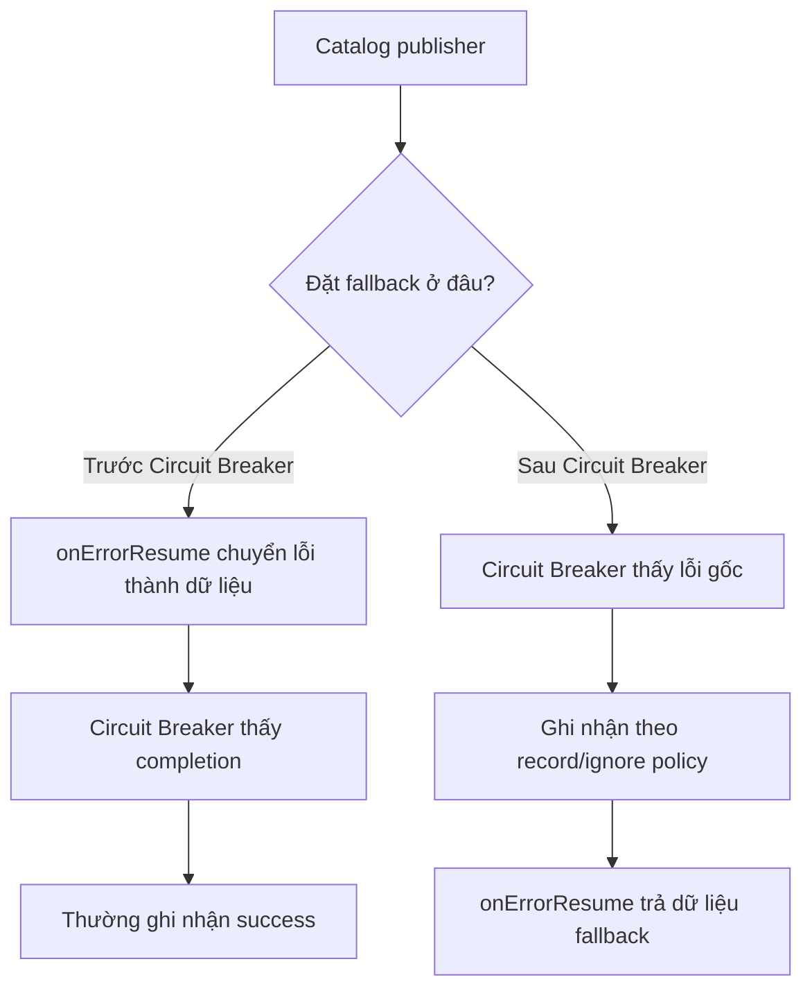

# Thứ tự onErrorResume, retryWhen, timeout và Circuit Breaker

Trong Spring Cloud CircuitBreaker reactive, thứ tự các toán tử Reactor quyết định lỗi nào được Circuit Breaker nhìn thấy, một lỗi được thử lại bao nhiêu lần và fallback có che mất lỗi khỏi thống kê hay không. `onErrorResume`, `retryWhen` và `timeout` đều thay đổi tín hiệu của một publisher. Đặt chúng trước hay sau `ReactiveCircuitBreaker.run(...)` có thể làm thay đổi số mẫu được ghi vào sliding window và thời điểm mạch chuyển sang `OPEN`.

Nguyên tắc quan trọng là: những thao tác mà Circuit Breaker cần đo lường phải nằm bên trong publisher được bảo vệ. Nếu `onErrorResume` biến lỗi thành kết quả bình thường trước khi publisher đi vào Circuit Breaker, mạch sẽ nhìn thấy một lần hoàn tất thành công. Nếu retry nằm bên trong Circuit Breaker, mạch thường ghi nhận kết quả cuối cùng của cả chuỗi thử lại; nếu retry nằm bên ngoài, mỗi lần đăng ký lại có thể trở thành một lần gọi được Circuit Breaker bảo vệ riêng.

## Reactive publisher được thực thi khi subscribe

Khác với lời gọi đồng bộ, `Mono` và `Flux` thường mô tả một luồng xử lý chưa chạy. Công việc bắt đầu khi có subscription. `retryWhen` thực hiện subscription mới cho publisher nguồn khi chính sách retry cho phép. Vì vậy, một request reactive có thể tạo nhiều lần gọi thực tế đến dịch vụ phụ thuộc.

Hãy dùng `Mono.defer(...)` hoặc `Flux.defer(...)` khi cần tạo lại client call cho mỗi lần subscribe. Cách này bảo đảm lời gọi được tạo lại khi retry thay vì tái sử dụng một publisher đã được tạo sẵn với side effect hoặc trạng thái dùng một lần.

```java
Mono<Product> source = Mono.defer(() -> catalogClient.find("SKU-100"));
```

Với Circuit Breaker, subscription cũng là thời điểm kiểm tra quyền gọi. Nếu mạch đang `OPEN`, subscription mới có thể bị từ chối bằng `CallNotPermittedException` mà không gọi đến dịch vụ phụ thuộc. Do đó, một retry mù quáng có thể chỉ lặp lại những lần bị từ chối nhanh.

## Vai trò của từng toán tử

| Toán tử | Chức năng | Tác động cần chú ý |
|---|---|---|
| `onErrorResume` | Thay tín hiệu lỗi bằng publisher dự phòng | Nếu đặt trước Circuit Breaker, lỗi ban đầu có thể bị biến thành completion và được tính như thành công |
| `retryWhen` | Subscribe lại nguồn theo chính sách retry | Vị trí quyết định Circuit Breaker ghi nhận từng lần thử hay chỉ kết quả cuối cùng |
| `timeout` | Phát `TimeoutException` nếu publisher không phát tín hiệu trong thời hạn | Đặt trong phạm vi bảo vệ để Circuit Breaker nhận và phân loại timeout |
| `ReactiveCircuitBreaker.run` | Bảo vệ publisher, ghi nhận kết quả và áp dụng fallback | Là ranh giới xác định lỗi và thời lượng nào được Circuit Breaker quan sát |

`onErrorResume` không phải là thao tác retry. Nó chuyển sang publisher khác khi nguồn lỗi. `retryWhen` không phải fallback. Nó subscribe lại nguồn theo chính sách. `timeout` tạo lỗi khi quá hạn; nó không tự quyết định thử lại hay trả dữ liệu dự phòng.

## Thứ tự `onErrorResume`: fallback trước hay sau Circuit Breaker?

### Đặt `onErrorResume` trước Circuit Breaker

```java
Mono<Product> result = Mono.defer(() -> catalogClient.find(sku))
    .onErrorResume(error -> cache.find(sku));

return circuitBreaker.run(result, error -> fallbackProduct(sku, error));
```

Khi `catalogClient` phát lỗi, `onErrorResume` chuyển sang cache. Nếu cache phát ra một `Product` rồi hoàn tất, publisher mà Circuit Breaker bảo vệ đã hoàn tất bình thường. Circuit Breaker ghi nhận kết quả này như một lần thành công; nó không nhìn thấy exception ban đầu để tăng failure rate. Cách đặt này phù hợp khi chủ ý muốn thống kê cả chiến lược dự phòng như một lần gọi thành công ở tầng ứng dụng, nhưng thường không phù hợp nếu mục tiêu là phát hiện dependency đang lỗi.

Nếu cache cũng lỗi, Circuit Breaker sẽ nhìn thấy lỗi cuối cùng từ publisher dự phòng. Khi đó, nó có thể phân loại lỗi cache thay vì lỗi ban đầu của catalog. Hãy cân nhắc điều này khi cache và dịch vụ phụ thuộc có chính sách lỗi khác nhau.

### Đặt `onErrorResume` sau Circuit Breaker

```java
Mono<Product> result = circuitBreaker.run(
    Mono.defer(() -> catalogClient.find(sku)),
    error -> Mono.error(error));

return result.onErrorResume(error -> fallbackProduct(sku, error));
```

Trong ví dụ này, Circuit Breaker nhận tín hiệu lỗi từ `catalogClient` trước khi `onErrorResume` bên ngoài chuyển sang fallback. Mạch có thể ghi nhận lỗi và cập nhật failure rate; caller vẫn nhận được dữ liệu dự phòng nếu fallback thành công.

Khi dùng overload `run(publisher, fallback)` của Spring Cloud CircuitBreaker, có thể cung cấp fallback ngay trong lời gọi. Fallback đó được áp dụng bởi lớp Circuit Breaker sau khi lỗi nguồn đã được quan sát. Nếu cần kiểm soát rõ thứ tự hoặc tách logic fallback theo từng loại lỗi, có thể để fallback phát lại lỗi bằng `Mono.error(error)` rồi xử lý bằng `onErrorResume` ở downstream như ví dụ trên.



## Thứ tự `retryWhen`: đếm từng lần thử hay chỉ kết quả cuối?

### Retry nằm bên trong Circuit Breaker

```java
Mono<Product> protectedCall = Mono.defer(() -> catalogClient.find(sku))
    .retryWhen(Retry.backoff(2, Duration.ofMillis(100))
        .filter(this::isRetryable)
        .onRetryExhaustedThrow((spec, signal) -> signal.failure()));

return circuitBreaker.run(protectedCall, error -> fallbackProduct(sku, error));
```

Ở đây, `retryWhen` nằm trong publisher mà Circuit Breaker bảo vệ. Circuit Breaker cấp quyền cho subscription của chuỗi retry và quan sát tín hiệu kết thúc cuối cùng. Nếu hai lần retry đều thất bại rồi lần cuối thành công, Circuit Breaker ghi nhận kết quả cuối là thành công cho subscription đó. Nếu hết retry mà vẫn lỗi, mạch ghi nhận một lần thất bại cho chuỗi đó. Các lần thử bên trong retry không tự tạo thêm mẫu Circuit Breaker riêng.

Đây là lựa chọn phù hợp khi muốn một thao tác nghiệp vụ có cơ hội tự phục hồi trước khi Circuit Breaker kết luận dependency thất bại. Cần đặt giới hạn retry và tổng thời gian hợp lý để không kéo dài request quá mức.

### Retry nằm bên ngoài Circuit Breaker

```java
Mono<Product> oneProtectedAttempt = circuitBreaker.run(
    Mono.defer(() -> catalogClient.find(sku)),
    error -> Mono.error(error));

return oneProtectedAttempt
    .retryWhen(Retry.backoff(2, Duration.ofMillis(100))
        .filter(this::isRetryable))
    .onErrorResume(error -> fallbackProduct(sku, error));
```

Ở đây, `retryWhen` downstream subscribe lại toàn bộ publisher được Circuit Breaker bảo vệ. Mỗi subscription lại yêu cầu quyền gọi và có thể tạo một mẫu riêng. Nếu hai lần đầu thất bại và lần thứ ba thành công, sliding window có thể nhận hai failure và một success. Cách này làm Circuit Breaker phản ứng nhanh hơn với từng lần thử, nhưng cũng khiến retry đóng góp nhiều mẫu lỗi hơn.

Không retry `CallNotPermittedException`. Khi Circuit Breaker đang `OPEN`, lỗi này cho biết mạch đã chủ động từ chối lời gọi. Thử lại liên tục không giúp dịch vụ phụ thuộc phục hồi và có thể tạo thêm tải cho ứng dụng. Predicate retry nên chỉ chọn các lỗi tạm thời mà việc thử lại có cơ hội thành công, ví dụ lỗi kết nối ngắn hạn hoặc timeout có kiểm soát.

`Retry.backoff(2, ...)` nghĩa là tối đa hai lần retry sau lần gọi ban đầu. Khi hết retry, Reactor có thể phát lỗi `RetryExhaustedException` bao ngoài lỗi cuối. Ví dụ dùng `onRetryExhaustedThrow((spec, signal) -> signal.failure())` để phát lại lỗi cuối, giúp Circuit Breaker hoặc fallback phân loại đúng kiểu exception. Nếu không dùng cách này, hãy kiểm tra `cause` trong predicate ghi nhận lỗi.

## Thứ tự `timeout`: thời hạn mỗi lần thử và thời hạn toàn bộ thao tác

Timeout có thể được đặt ở hai vị trí khác nhau trong chuỗi retry:

```java
// Mỗi lần thử có tối đa 1 giây.
Mono<Product> perAttemptTimeout = Mono.defer(() -> catalogClient.find(sku))
    .timeout(Duration.ofSeconds(1))
    .retryWhen(retryPolicy);

// Toàn bộ chuỗi retry có tối đa 3 giây.
Mono<Product> totalDeadline = Mono.defer(() -> catalogClient.find(sku))
    .retryWhen(retryPolicy)
    .timeout(Duration.ofSeconds(3));
```

Trong biểu thức thứ nhất, mỗi subscription vào nguồn có timeout một giây; khi timeout xảy ra, `retryWhen` có thể thử lại nếu predicate cho phép. Trong biểu thức thứ hai, timeout bao quanh cả chuỗi retry, gồm cả thời gian backoff giữa các lần thử. Đây là cách đặt deadline tổng thể cho một thao tác.

Để Circuit Breaker ghi nhận timeout, đặt publisher đã có timeout vào bên trong `run(...)`:

```java
Mono<Product> attempts = Mono.defer(() -> catalogClient.find(sku))
    .timeout(Duration.ofSeconds(1))
    .retryWhen(retryPolicy);

Mono<Product> bounded = attempts.timeout(Duration.ofSeconds(3));

return circuitBreaker.run(bounded, error -> fallbackProduct(sku, error));
```

Trong ví dụ này, cả timeout từng lần thử và deadline tổng đều phát sinh bên trong ranh giới Circuit Breaker. Mạch nhận tín hiệu timeout cuối cùng và phân loại nó theo chính sách `recordExceptions`/`ignoreExceptions` hoặc predicate đã cấu hình. Nếu đặt `.timeout(...)` ở downstream sau `circuitBreaker.run(...)`, timeout có thể hủy subscription upstream trước khi Circuit Breaker nhận một `TimeoutException`; khi đó không nên mặc định rằng timeout downstream đã được ghi nhận là failure.

Timeout chỉ giới hạn thời gian chờ của publisher ở phía ứng dụng. Khả năng hủy request ở client, transport và dịch vụ đích phụ thuộc vào implementation; timeout ở caller không bảo đảm công việc phía server đã dừng.

## Kết hợp bốn thành phần trong Spring Cloud CircuitBreaker

Ví dụ dưới đây áp dụng thứ tự thường dùng cho một API tra cứu sản phẩm: tạo publisher khi subscribe, đặt timeout mỗi lần thử, retry có chọn lọc, đặt deadline tổng, rồi bọc toàn bộ chuỗi bằng Circuit Breaker. Fallback được chạy sau khi Circuit Breaker đã quan sát lỗi cuối cùng.

```java
import java.io.IOException;
import java.time.Duration;
import java.util.concurrent.TimeoutException;

import org.springframework.cloud.client.circuitbreaker.ReactiveCircuitBreaker;
import org.springframework.cloud.client.circuitbreaker.ReactiveCircuitBreakerFactory;
import org.springframework.stereotype.Service;
import reactor.core.Exceptions;
import reactor.core.publisher.Mono;
import reactor.util.retry.Retry;
import io.github.resilience4j.circuitbreaker.CallNotPermittedException;

@Service
class CatalogService {

    private final ReactiveCircuitBreakerFactory<?, ?> circuitBreakerFactory;
    private final CatalogClient catalogClient;
    private final ProductCache productCache;

    CatalogService(
            ReactiveCircuitBreakerFactory<?, ?> circuitBreakerFactory,
            CatalogClient catalogClient,
            ProductCache productCache) {
        this.circuitBreakerFactory = circuitBreakerFactory;
        this.catalogClient = catalogClient;
        this.productCache = productCache;
    }

    Mono<Product> find(String sku) {
        ReactiveCircuitBreaker breaker = circuitBreakerFactory.create("catalog");

        Retry retryPolicy = Retry.backoff(2, Duration.ofMillis(100))
            .filter(this::isRetryable)
            .onRetryExhaustedThrow((spec, signal) -> signal.failure());

        Mono<Product> request = Mono.defer(() -> catalogClient.find(sku))
            .timeout(Duration.ofSeconds(1))
            .retryWhen(retryPolicy)
            .timeout(Duration.ofSeconds(3));

        return breaker.run(request, error -> fallback(sku, error));
    }

    private boolean isRetryable(Throwable error) {
        Throwable cause = Exceptions.unwrap(error);
        return !(cause instanceof CallNotPermittedException)
            && (cause instanceof IOException || cause instanceof TimeoutException);
    }

    private Mono<Product> fallback(String sku, Throwable error) {
        return productCache.find(sku)
            .switchIfEmpty(Mono.error(new CatalogUnavailableException(sku, error)));
    }
}
```

Trong ví dụ, `retryWhen` nằm bên trong `breaker.run`, vì vậy Circuit Breaker đánh giá kết quả cuối cùng của chuỗi retry cho mỗi subscription. Fallback của `run` chỉ được dùng khi chuỗi được bảo vệ kết thúc bằng lỗi hoặc Circuit Breaker từ chối quyền gọi. `fallback(...)` trả về `Mono` nên không chặn thread reactive.

Để kiểm tra chính sách này, giả sử lần gọi đầu tiên timeout, lần thử thứ hai vẫn timeout, lần thứ ba thành công trong deadline tổng. Circuit Breaker thấy một subscription kết thúc thành công. Nếu deadline tổng hết hoặc lần thử cuối phát lỗi, Circuit Breaker thấy một lỗi cuối và cập nhật sliding window theo chính sách phân loại. Khi mạch `OPEN`, factory từ chối subscription; predicate retry loại `CallNotPermittedException`, sau đó fallback có thể dùng cache.

## Cùng một lỗi nhưng đổi thứ tự sẽ đổi kết quả

| Chuỗi xử lý | Circuit Breaker nhìn thấy | Kết quả thống kê thường gặp |
|---|---|---|
| `source.onErrorResume(fallback)` rồi đưa vào `run` | Completion từ fallback | Success nếu fallback hoàn tất bình thường |
| `run(source, fallback)` | Lỗi nguồn trước khi fallback trả kết quả | Failure theo chính sách phân loại; caller có thể nhận fallback |
| `source.retryWhen(policy)` rồi đưa vào `run` | Kết quả cuối của chuỗi retry | Một kết quả cho subscription |
| `run(source).retryWhen(policy)` và lỗi được phát lại | Mỗi subscription bảo vệ riêng | Mỗi lần thử có thể tạo một mẫu riêng |
| `source.timeout(d)` rồi đưa vào `run` | Timeout phát ra bên trong publisher được bảo vệ | Timeout được phân loại theo cấu hình |
| `run(source).timeout(d)` | Timeout downstream có thể hủy nguồn | Không nên giả định Circuit Breaker ghi nhận `TimeoutException` |

Các dòng trong bảng giả định fallback không thay đổi tín hiệu trước ranh giới được nêu và retry chỉ tiếp tục khi predicate cho phép. Khi thay đổi thứ tự, hãy xác định lại publisher nào nằm bên trong `run(...)` và publisher nào chỉ xử lý tín hiệu sau khi Circuit Breaker đã kết thúc việc đo lường.

## Lưu ý với Flux và luồng có nhiều phần tử

Với `Flux`, Circuit Breaker bảo vệ một subscription của toàn bộ luồng. Nếu luồng phát nhiều phần tử rồi mới phát lỗi, lỗi xảy ra ở cuối vẫn có thể làm subscription được ghi nhận là thất bại; những phần tử đã phát ra trước đó không tự biến lần gọi thành công. Nếu `onErrorResume` bên trong ranh giới bảo vệ thay lỗi bằng một luồng dự phòng rồi hoàn tất, Circuit Breaker có thể nhìn thấy completion bình thường.

Retry trên `Flux` sẽ subscribe lại nguồn. Nếu nguồn đã phát một số phần tử trước khi lỗi, các phần tử đó có thể được phát lại sau retry. Với xử lý có side effect, ghi dữ liệu hoặc phát sự kiện, hãy dùng khóa idempotency, checkpoint hoặc thiết kế tiêu thụ chống trùng lặp. Không retry một luồng vô hạn như thể đó là một request hữu hạn; cần chính sách reconnect và backoff phù hợp với giao thức streaming.

## Kiểm thử thứ tự toán tử

Một bộ kiểm thử reactive nên xác nhận cả giá trị trả về lẫn số liệu Circuit Breaker:

1. **Fallback trước Circuit Breaker:** cho nguồn phát lỗi, fallback trả một giá trị. Xác nhận caller nhận giá trị dự phòng và mạch ghi nhận completion theo cách bố trí này.
2. **Fallback sau Circuit Breaker:** cho nguồn phát lỗi rồi downstream fallback trả giá trị. Xác nhận mạch ghi nhận failure trong khi caller vẫn nhận giá trị dự phòng.
3. **Retry bên trong:** cho hai lần thử lỗi rồi lần thứ ba thành công. Xác nhận một subscription của Circuit Breaker kết thúc thành công.
4. **Retry bên ngoài:** cho mỗi subscription được bảo vệ lỗi rồi subscription sau thành công. Xác nhận từng lần thử có thể tạo mẫu riêng.
5. **Timeout bên trong:** dùng publisher không phát tín hiệu trước thời hạn. Xác nhận timeout được Circuit Breaker phân loại theo cấu hình.
6. **Timeout bên ngoài:** đặt timeout sau `run(...)`, xác nhận cancellation và metrics theo phiên bản đang dùng; không giả định nó tương đương timeout bên trong.
7. **Mạch OPEN:** xác nhận `CallNotPermittedException` không bị retry lặp lại và fallback vẫn hoạt động.

Với Reactor Test, `StepVerifier` và publisher giả lập có thể điều khiển tín hiệu, thời gian và số lần subscribe. Dùng virtual time cho retry backoff và timeout để kiểm thử nhanh, ổn định mà không phải chờ thời gian thực. Sau mỗi kịch bản, kiểm tra số lần gọi client, số mẫu success/failure và trạng thái Circuit Breaker.

Khi debug một request reactive bị retry quá nhiều hoặc Circuit Breaker không mở dù dependency lỗi, hãy lần theo thứ tự từ publisher nguồn đến `run(...)`: xác định `onErrorResume` có nuốt lỗi trước mạch không, `retryWhen` có nằm bên trong hay ngoài mạch, timeout phát sinh ở đâu, và exception cuối cùng có khớp `recordException` hay `ignoreException` không. Chỉ cần một toán tử đặt sai phía cũng có thể làm thay đổi hoàn toàn dữ liệu mà Circuit Breaker dùng để bảo vệ dịch vụ.
