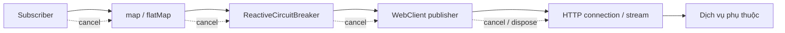
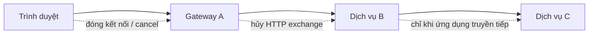

# Hủy subscription và giới hạn hủy tác vụ phía hệ thống phụ thuộc

Trong ứng dụng Spring Cloud dùng WebFlux và Reactor, một lời gọi HTTP thường được biểu diễn bằng `Mono` hoặc `Flux`. Công việc chỉ bắt đầu khi có subscription. Trong quá trình xử lý, subscriber có thể gửi tín hiệu hủy (`cancel`) khi người dùng rời trang, request phía trên hết thời gian chờ, một operator không còn cần dữ liệu hoặc một luồng xử lý bị thay thế. Reactor truyền tín hiệu hủy ngược về publisher để các thành phần có cơ hội dừng công việc và giải phóng tài nguyên.

Tuy nhiên, hủy subscription chỉ kiểm soát luồng reactive ở phía ứng dụng. Nó không bảo đảm mọi công việc đã được gửi tới dịch vụ phụ thuộc cũng dừng ngay. HTTP client có thể hủy trao đổi mạng hoặc đóng/reset stream, nhưng server có thể đã nhận yêu cầu và tiếp tục xử lý. Circuit breaker, timeout và cancellation vì vậy cần được thiết kế cùng nhau: ứng dụng phải biết timeout được tạo ở đâu, breaker quan sát tín hiệu nào và hệ thống đích có hỗ trợ hủy công việc hay không.

## 1. Subscription và cancellation trong Reactor

Reactor tuân theo mô hình Reactive Streams. Một publisher phát dữ liệu cho subscriber sau khi subscriber đăng ký. Với nguồn dữ liệu dạng `Mono`, luồng thường phát tối đa một giá trị rồi hoàn tất; `Flux` có thể phát nhiều giá trị. Subscriber có thể yêu cầu dữ liệu theo nhu cầu và gửi `cancel()` để báo rằng nó không cần thêm tín hiệu.

Ba tín hiệu kết thúc thường cần phân biệt là:

- `onComplete`: publisher hoàn tất bình thường.
- `onError`: publisher kết thúc vì lỗi.
- `cancel`: subscriber chủ động hủy subscription, không phải một tín hiệu lỗi được phát bằng `onError`.

Hủy là một hành động điều khiển luồng, không phải kết quả nghiệp vụ. Ví dụ, một trình duyệt đóng kết nối khi trang đang tải danh sách gợi ý. Gateway có thể hủy subscription của `WebClient`, nhưng điều đó không có nghĩa dịch vụ gợi ý đã trả về một kết quả thất bại. Tương tự, một request bị hủy không được xem như một phản hồi rỗng hoặc một phản hồi thành công.

Các operator như `take`, `next`, `switchMap`, `timeout` hoặc logic hủy từ subscriber có thể tạo ra cancellation ở upstream. Với `switchMap`, khi nguồn phát giá trị mới, inner publisher cũ có thể bị hủy vì kết quả cũ không còn được cần. Với `take(n)`, khi đã nhận đủ n phần tử, operator hủy upstream để tránh tiếp tục tạo dữ liệu.

## 2. Hủy truyền ngược qua chuỗi publisher

Trong một pipeline Reactor, subscriber ở cuối chuỗi có thể hủy subscription. Các operator trung gian truyền yêu cầu hủy về nguồn upstream và tới những publisher con mà chúng đang quản lý. Mục đích là ngăn tiếp tục tạo dữ liệu, dừng tác vụ có thể dừng và giải phóng tài nguyên.



Sơ đồ mô tả đường truyền cancellation trong pipeline phía client. Các operator và HTTP client có thể phản ứng bằng cách ngừng phát dữ liệu, hủy tác vụ đang chạy, hủy request mạng hoặc giải phóng connection/stream. Kết quả cụ thể phụ thuộc vào publisher và client được sử dụng.

Ví dụ, `WebClient` tạo publisher cho request HTTP:

```java
Mono<ProductView> request = webClient.get()
        .uri("/products/{id}", productId)
        .retrieve()
        .bodyToMono(ProductView.class);
```

Với cách viết trên, request chưa được gửi chỉ vì biến `request` được tạo. Khi có subscription, WebClient mới thực hiện trao đổi mạng. Nếu subscriber hủy trước khi có kết quả, WebClient có thể hủy việc đọc response và yêu cầu HTTP client nền dừng trao đổi tương ứng.

Nên dùng `Mono.defer` khi cần tạo publisher hoặc đọc trạng thái cho từng subscription:

```java
Mono<ProductView> request = Mono.defer(() ->
        webClient.get()
                .uri("/products/{id}", productId)
                .retrieve()
                .bodyToMono(ProductView.class)
);
```

`defer` trì hoãn việc tạo publisher con đến thời điểm subscribe. Nó hữu ích khi publisher được chia sẻ hoặc tái sử dụng, vì mỗi subscription sẽ chạy phần tạo nguồn theo cách mới. Dù dùng `defer` hay không, cần tránh thực hiện side effect đồng bộ ngay khi xây dựng pipeline trước lúc có subscription.

## 3. Cancellation không đồng nghĩa với lỗi

Một điểm quan trọng khi dùng circuit breaker reactive là phân biệt cancellation với exception. `onError` mang một lỗi mà publisher phát ra; `cancel` là subscriber yêu cầu dừng. Cancellation không tự tạo `TimeoutException`, `WebClientRequestException` hay một exception nghiệp vụ.

Do đó, không nên giả định rằng:

- `onErrorResume` sẽ chạy khi subscriber hủy.
- Hàm fallback của `ReactiveCircuitBreaker.run` sẽ chạy khi subscriber hủy.
- Một subscription bị hủy luôn được tính là một lần gọi thất bại trong sliding window.
- Cancellation luôn giải phóng mọi permit hoặc trạng thái nội bộ theo cùng một cách ở mọi phiên bản implementation.

Với Resilience4j reactive, kết quả thành công và lỗi được quan sát qua tín hiệu tương ứng của publisher. Cancellation không phải là một exception kết quả. Cách implementation xử lý việc hủy trong quá trình bảo vệ, đặc biệt khi đang ở `HALF_OPEN`, cần được xác minh theo phiên bản đang dùng nếu hệ thống phụ thuộc vào hành vi permit hoặc metric cụ thể. Không nên suy diễn số liệu cancellation từ failure rate.

Có thể quan sát cancellation bằng `doOnCancel` hoặc `doFinally`:

```java
Mono<ProductView> request = webClient.get()
        .uri("/products/{id}", productId)
        .retrieve()
        .bodyToMono(ProductView.class)
        .doOnCancel(() -> log.debug("Product request subscription cancelled"))
        .doFinally(signal -> log.debug("Product request finished: {}", signal));
```

`doOnCancel` chạy khi subscription bị hủy. `doFinally` chạy khi luồng kết thúc bằng complete, error hoặc cancel; tham số `SignalType` cho biết kiểu kết thúc. Đây là vị trí phù hợp để ghi nhận và giải phóng tài nguyên cục bộ. Không nên dùng `doOnError` như một cách duy nhất để theo dõi mọi trường hợp kết thúc, vì nó không nhận cancellation.

## 4. Đặt timeout ở đâu so với ReactiveCircuitBreaker?

Vị trí của `timeout` trong pipeline quyết định thành phần nào nhìn thấy `TimeoutException`. Reactor `timeout` phát lỗi timeout xuống downstream và hủy subscription upstream. Nếu timeout được đặt bên trong publisher truyền vào breaker, breaker có thể quan sát lỗi timeout như kết quả lỗi của lời gọi. Nếu timeout nằm bên ngoài publisher đã được breaker bảo vệ, timeout có thể hủy subscription của breaker và phát lỗi ở tầng phía ngoài; breaker có thể chỉ nhìn thấy cancellation.

### Timeout bên trong breaker

```java
public Mono<ProductView> find(String productId) {
    Mono<ProductView> request = Mono.defer(() ->
            webClient.get()
                    .uri("/products/{id}", productId)
                    .retrieve()
                    .bodyToMono(ProductView.class)
    ).timeout(Duration.ofSeconds(2));

    return reactiveCircuitBreakerFactory.create("catalog").run(
            request,
            error -> Mono.just(ProductView.unavailable(productId))
    );
}
```

Ở đây, `timeout` là một phần của publisher được đưa vào `run`. Khi quá hai giây mà không có tín hiệu, operator timeout hủy publisher HTTP ở upstream và phát `TimeoutException` đến breaker. Breaker có thể ghi nhận lỗi theo cấu hình và gọi fallback của nó.

### Timeout bên ngoài breaker

```java
public Mono<ProductView> find(String productId) {
    Mono<ProductView> request = Mono.defer(() ->
            webClient.get()
                    .uri("/products/{id}", productId)
                    .retrieve()
                    .bodyToMono(ProductView.class)
    );

    return reactiveCircuitBreakerFactory.create("catalog").run(
            request,
            error -> Mono.just(ProductView.unavailable(productId))
    ).timeout(Duration.ofSeconds(2));
}
```

Trong cách này, timeout ở ngoài breaker sẽ hủy subscription của publisher được breaker bảo vệ rồi phát `TimeoutException` ra downstream. Hàm fallback bên trong breaker không nhận được lỗi timeout do operator ở ngoài tạo ra. Breaker có thể quan sát cancellation thay vì một lỗi supplier. Nếu mục tiêu là đưa timeout vào failure rate của circuit breaker, cần đặt timeout trong publisher được bảo vệ hoặc cấu hình timeout ở lớp tích hợp theo đúng semantics của implementation.

Hai cách không tương đương. Hãy chọn vị trí timeout dựa trên mục tiêu: timeout nội bộ của lời gọi phụ thuộc nên được breaker đánh giá; deadline tổng của request có thể nằm ở lớp cao hơn và có thể hủy toàn bộ pipeline. Một ứng dụng có thể cần cả hai giới hạn, nhưng phải phân biệt rõ từng giới hạn và kiểm thử thứ tự phát tín hiệu.

## 5. ReactiveCircuitBreaker và fallback

Spring Cloud cung cấp `ReactiveCircuitBreakerFactory` để tạo breaker reactive theo ID. `ReactiveCircuitBreaker.run` nhận publisher cùng hàm fallback trả về publisher cùng kiểu dữ liệu.

```java
import java.time.Duration;

import org.springframework.cloud.client.circuitbreaker.ReactiveCircuitBreaker;
import org.springframework.cloud.client.circuitbreaker.ReactiveCircuitBreakerFactory;
import org.springframework.stereotype.Service;
import org.springframework.web.reactive.function.client.WebClient;

import reactor.core.publisher.Mono;

@Service
public class CatalogGateway {
    private final WebClient webClient;
    private final ReactiveCircuitBreakerFactory<?, ?> factory;

    public CatalogGateway(
            WebClient.Builder builder,
            ReactiveCircuitBreakerFactory<?, ?> factory) {
        this.webClient = builder.baseUrl("http://catalog-service").build();
        this.factory = factory;
    }

    public Mono<ProductView> find(String productId) {
        Mono<ProductView> request = Mono.defer(() ->
                webClient.get()
                        .uri("/products/{id}", productId)
                        .retrieve()
                        .bodyToMono(ProductView.class)
        ).timeout(Duration.ofSeconds(2));

        ReactiveCircuitBreaker breaker = factory.create("catalog");
        return breaker.run(
                request,
                error -> Mono.just(ProductView.unavailable(productId))
        );
    }
}
```

Trong ví dụ, timeout nằm bên trong publisher được bảo vệ. Lỗi timeout hoặc lỗi HTTP được phát thành `onError` và có thể được chuyển đến fallback. Nếu subscriber hủy subscription, fallback không được gọi chỉ vì có cancellation. Fallback cũng không nên thực hiện một request khác tới chính dịch vụ catalog đang gặp sự cố.

Nếu cần ghi log cancellation, có thể gắn `doOnCancel` ở vị trí phù hợp trong publisher:

```java
Mono<ProductView> request = Mono.defer(() ->
        webClient.get()
                .uri("/products/{id}", productId)
                .retrieve()
                .bodyToMono(ProductView.class)
).timeout(Duration.ofSeconds(2))
 .doOnCancel(() -> log.info("Catalog lookup cancelled: {}", productId));
```

Đặt `doOnCancel` trước hoặc sau một operator có thể ảnh hưởng đến subscription mà hook quan sát. Nếu cần đo cancellation của toàn bộ gateway, đặt hook ở lớp ngoài cùng của publisher trả về cho caller. Nếu cần đo cancellation riêng của HTTP exchange, đặt hook gần publisher của WebClient. Tránh ghi cùng một sự kiện ở nhiều lớp rồi cộng dồn như thể đó là nhiều request riêng.

## 6. HTTP client hủy request không bảo đảm server dừng xử lý

Khi WebClient nhận cancellation, Reactor Netty hoặc HTTP client nền có thể hủy request đang chờ, ngừng đọc response, giải phóng stream hoặc đóng kết nối tùy giao thức và trạng thái trao đổi. Điều này giúp giảm tài nguyên ở phía client. Tuy nhiên, có một ranh giới quan trọng giữa việc client ngừng chờ và việc server dừng công việc.

Giả sử gateway A gửi yêu cầu đến dịch vụ B. B nhận yêu cầu, bắt đầu xử lý và gửi tiếp yêu cầu đến dịch vụ C. Trong lúc B đang chờ C, người dùng đóng trình duyệt và A hủy subscription:

1. A hủy publisher WebClient và yêu cầu HTTP client dừng trao đổi.
2. B có thể phát hiện client đã ngắt kết nối hoặc stream đã bị reset.
3. B chỉ dừng công việc nếu framework và mã xử lý của B truyền cancellation đến các tác vụ đang chạy và các tác vụ đó hỗ trợ dừng.
4. Nếu B đã gửi yêu cầu đến C, B cần hủy subscription hoặc request tới C để cancellation tiếp tục lan truyền.
5. Nếu C đã thực hiện thao tác ghi dữ liệu hoặc xử lý không thể hủy, công việc có thể vẫn hoàn tất dù A không còn chờ kết quả.



HTTP/1.1 có thể yêu cầu client đóng kết nối hoặc bỏ response; HTTP/2 có thể reset một stream riêng. Server có thể nhận biết kết nối hoặc stream bị ngắt, nhưng việc phát hiện có thể trễ và không tự hủy mọi tác vụ đang thực thi. Một thread đang chạy mã blocking, một câu lệnh SQL đã gửi đến database hoặc một thông điệp đã đưa vào queue có thể tiếp tục sau khi HTTP client biến mất.

Vì vậy, cancellation là tín hiệu hợp tác. Mỗi tầng phải chủ động quan sát tín hiệu đó và truyền tới tác vụ con có thể hủy. Không được dùng cancellation như một cơ chế rollback cho thao tác đã thực hiện.

## 7. Tác vụ blocking và giới hạn hủy

Reactive pipeline không làm cho một tác vụ blocking trở nên có thể hủy tự động. Ví dụ, nếu một publisher dùng `Mono.fromCallable` để gọi thư viện JDBC blocking trên scheduler, việc hủy subscription có thể ngừng chờ ở Reactor nhưng câu lệnh JDBC đã chạy có thể tiếp tục trên thread hoặc database.

```java
Mono<OrderView> order = Mono.fromCallable(() -> blockingOrderRepository.find(orderId))
        .subscribeOn(Schedulers.boundedElastic());
```

`subscribeOn(boundedElastic())` giúp không chạy lời gọi blocking trên event-loop của WebFlux. Nó không đảm bảo lệnh truy vấn đã gửi tới database sẽ dừng khi subscriber hủy. Hành vi dừng phụ thuộc driver, thread interruption, API hủy statement và database.

Với tác vụ dài, nên thiết kế khả năng hủy tường minh:

- Dùng API non-blocking có hỗ trợ cancellation khi có thể.
- Nếu dùng JDBC hoặc thư viện blocking, kiểm tra driver có hỗ trợ `Statement.cancel()` hoặc cơ chế tương đương và kết nối nó với vòng đời tác vụ.
- Giữ tham chiếu tới handle của tác vụ nếu cần phát lệnh hủy, đồng thời bảo đảm xử lý race condition giữa hoàn tất và hủy.
- Đặt timeout ở cả client và server/database; timeout phía client không thay thế giới hạn thời gian thực thi ở phía server.
- Giải phóng tài nguyên trong `doFinally`, `using` hoặc cơ chế quản lý tài nguyên phù hợp, bảo đảm cleanup an toàn khi complete, error và cancel.

Không nên dùng `Thread.stop()` để dừng tác vụ. Nếu cần dùng interrupt, tác vụ phải hợp tác bằng cách kiểm tra cờ interrupt hoặc xử lý `InterruptedException`, và thư viện bên dưới phải có semantics phù hợp. Việc gọi `Future.cancel(true)` chỉ gửi yêu cầu interrupt; nó không bảo đảm thao tác I/O hoặc công việc ở database đã kết thúc.

## 8. Giới hạn hủy trong TimeLimiter và timeout

Resilience4j `TimeLimiter` có thể giới hạn thời gian chờ của `Future` hoặc `CompletionStage` tùy API được dùng. Cấu hình có thể yêu cầu hủy Future khi timeout. Tuy nhiên, `cancelRunningFuture` hoặc `Future.cancel(true)` vẫn phụ thuộc vào khả năng hợp tác của tác vụ và thư viện nền.

Trong ứng dụng reactive, Reactor `timeout` là một operator phát `TimeoutException` và hủy upstream. Với `WebClient`, cancellation có thể dừng trao đổi mạng phía client; với tác vụ blocking hoặc công việc đã được server nhận, không thể suy ra rằng mọi hoạt động đã dừng.

Nên phân biệt ba giới hạn thời gian:

| Giới hạn | Kiểm soát điều gì | Điều không được bảo đảm |
|---|---|---|
| Timeout ở HTTP client | Thời gian chờ kết nối hoặc phản hồi ở phía client | Server chưa thực hiện thao tác hoặc đã rollback |
| Reactor `timeout` | Thời gian publisher được phép không phát tín hiệu | Tất cả tác vụ bên dưới đã dừng hoàn toàn |
| TimeLimiter cho Future | Thời gian chờ tác vụ và có thể gửi yêu cầu cancel | Thread, socket, database hoặc server chắc chắn dừng |

Nếu hệ thống có deadline tổng 3 giây, cần chia ngân sách cho các lời gọi phụ thuộc, retry và xử lý nội bộ. Timeout riêng của một dịch vụ nên ngắn hơn deadline tổng để gateway còn thời gian tạo fallback và trả response. Khi timeout tổng xảy ra, cancellation có thể lan xuống các lời gọi còn đang chờ; nhưng các thao tác đã commit vẫn cần được xử lý bằng cơ chế nghiệp vụ.

## 9. Hủy tác vụ có tác động phụ và tính idempotent

Đối với thao tác chỉ đọc, việc server tiếp tục xử lý sau khi client hủy thường gây lãng phí tài nguyên. Đối với thao tác có tác động phụ như tạo đơn hàng, thanh toán, gửi email hoặc ghi nhận giao dịch, vấn đề nghiêm trọng hơn: client không nhận được response không có nghĩa thao tác chưa xảy ra.

Ví dụ, gateway gửi lệnh tạo đơn hàng đến dịch vụ Order. Order ghi dữ liệu thành công nhưng response bị mất. Người dùng bấm gửi lại vì giao diện báo timeout. Nếu server không có cơ chế nhận diện yêu cầu trùng, hệ thống có thể tạo hai đơn hàng.

Các biện pháp phù hợp gồm:

- **Idempotency key:** client gửi một khóa duy nhất cho thao tác logic; server lưu kết quả theo khóa và trả lại kết quả cũ khi nhận yêu cầu lặp.
- **Mã định danh nghiệp vụ:** dùng order ID hoặc payment intent ID có quy tắc duy nhất để phát hiện thao tác đã được tạo.
- **Trạng thái xử lý:** biểu diễn rõ `PENDING`, `COMPLETED`, `FAILED` hoặc `UNKNOWN` thay vì xem timeout là thất bại chắc chắn.
- **Đối soát:** với giao dịch tài chính, cung cấp API truy vấn trạng thái để client kiểm tra kết quả sau timeout.
- **Compensation:** nếu nghiệp vụ hỗ trợ, dùng quy trình bù trừ có kiểm soát thay vì giả định cancellation đã rollback thao tác.

Circuit breaker ngăn các lời gọi tiếp tục đi vào phụ thuộc đang lỗi; nó không cung cấp tính idempotent và không hủy giao dịch đã commit. Fallback cũng nên phản ánh trạng thái chưa xác định khi không thể biết thao tác đã hoàn thành hay chưa.

## 10. Quan sát cancellation và phân biệt với lỗi

Metric failure rate của circuit breaker không đủ để đo toàn bộ cancellation. Nên theo dõi cancellation riêng để biết hệ thống đang hủy bao nhiêu request, hủy ở tầng nào và có gây lãng phí công việc ở backend hay không.

Các tín hiệu hữu ích gồm:

- Số subscription kết thúc bằng `SignalType.CANCEL`.
- Số timeout được tạo bên trong publisher được bảo vệ và số timeout ở lớp ngoài.
- Số lần fallback chạy, số lần breaker từ chối lời gọi và số lỗi supplier.
- Số HTTP exchange bị cancel/dispose ở client, cùng latency trước khi hủy.
- Số tác vụ phía server tiếp tục chạy sau khi client ngắt kết nối, nếu server có khả năng đo.
- Số tác vụ blocking hoặc database query được yêu cầu hủy và số tác vụ thực sự kết thúc.

Ví dụ dùng `doFinally` để phân loại kết thúc:

```java
return gateway.find(productId)
        .doFinally(signal -> {
            if (signal == SignalType.CANCEL) {
                metrics.counter("catalog.subscription.cancelled").increment();
            }
        });
```

Metric nên gắn nhãn theo breaker ID, loại luồng hoặc tên dịch vụ có số lượng giá trị giới hạn. Tránh dùng request ID, user ID hoặc URL chứa định danh làm metric label vì sẽ tạo cardinality cao. Nếu cần liên kết một lần cancellation với trace, hãy dùng trace/span ID trong hệ thống tracing thay vì đưa chúng vào nhãn metric.

Log cancellation cần được diễn giải đúng. Một người dùng rời trang có thể tạo cancellation bình thường; không nhất thiết là sự cố. Ngược lại, tỷ lệ cancellation tăng cùng timeout, latency cao và backend quá tải có thể cho thấy người dùng bỏ cuộc vì request chậm. Hãy đối chiếu với trace và trạng thái dịch vụ phụ thuộc trước khi điều chỉnh ngưỡng circuit breaker.

## 11. Kiểm thử hành vi hủy

Nên kiểm tra cancellation bằng test reactive có thể điều khiển thời gian và subscription, thay vì chỉ kiểm tra exception timeout. Reactor Test cung cấp `StepVerifier` để mô phỏng request, cancel và xác nhận hành vi của publisher.

Ví dụ kiểm tra một publisher ghi nhận cancellation:

```java
AtomicBoolean cancelled = new AtomicBoolean();

Mono<String> source = Mono.<String>never()
        .doOnCancel(() -> cancelled.set(true));

StepVerifier.create(source)
        .thenCancel()
        .verify();

assertTrue(cancelled.get());
```

Trong kiểm thử tích hợp gateway, nên có các tình huống:

1. Subscriber hủy trước khi WebClient nhận response; xác nhận hook cancellation phía client được gọi.
2. Request hoàn tất trước khi cancel; xác nhận luồng kết thúc bình thường và không ghi nhận cancellation giả.
3. Timeout đặt bên trong breaker; xác nhận `TimeoutException` đến breaker và fallback chạy theo cấu hình.
4. Timeout đặt bên ngoài breaker; xác nhận timeout được phát ở lớp ngoài và fallback nội bộ của breaker không được giả định sẽ chạy.
5. Breaker ở `OPEN`; xác nhận publisher nguồn không được subscribe và fallback được xử lý theo API reactive.
6. Subscriber cancel trong lúc breaker ở `HALF_OPEN`; kiểm tra số permit và metric theo phiên bản Resilience4j đang dùng.
7. HTTP server thử nghiệm ghi nhận client disconnect; xác nhận server có hoặc không dừng công việc theo cơ chế được triển khai.
8. Tác vụ blocking hoặc database query; xác nhận lệnh hủy có hiệu lực thực tế và tài nguyên được giải phóng.

Kiểm thử cancellation ở Reactor không chứng minh backend đã dừng. Cần kiểm thử tích hợp ở cả client, server và tầng thực thi phụ thuộc nếu yêu cầu nghiệp vụ đòi hỏi dừng tác vụ end-to-end.

## 12. Quy trình thiết kế cancellation cho một lời gọi phụ thuộc

Khi xây dựng một gateway reactive có circuit breaker, hãy xác định rõ đường đi của subscription và trách nhiệm của từng tầng:

1. Tạo publisher lazy cho lời gọi bằng WebClient; tránh side effect trước subscription.
2. Đặt timeout riêng cho lời gọi phụ thuộc bên trong publisher được breaker bảo vệ nếu timeout đó phải được tính là lỗi của phụ thuộc.
3. Dùng `ReactiveCircuitBreakerFactory` và fallback có kết quả nghiệp vụ trung thực.
4. Xử lý cancellation riêng bằng `doOnCancel` hoặc `doFinally`; không xem cancellation là exception.
5. Xác nhận HTTP client có hủy exchange/stream đúng cách và giải phóng tài nguyên.
6. Với server nhận request, truyền cancellation đến các tác vụ con khi có thể; kiểm tra driver, database và thư viện blocking.
7. Bảo vệ thao tác có tác động phụ bằng idempotency, trạng thái nghiệp vụ và đối soát.
8. Theo dõi timeout, cancellation, fallback, breaker state và tác vụ backend còn chạy sau disconnect.

Hủy subscription giúp ứng dụng reactive ngừng chờ và yêu cầu các publisher upstream dừng công việc. Hiệu quả thực tế phụ thuộc vào từng operator, HTTP client, server và tác vụ phía dưới. Đặt timeout đúng phía trong hoặc ngoài circuit breaker quyết định breaker có quan sát lỗi timeout hay chỉ nhận cancellation. Khi hiểu rõ giới hạn đó và thiết kế cancellation hợp tác qua từng tầng, hệ thống Spring Cloud có thể giải phóng tài nguyên sớm, bảo vệ phụ thuộc bằng circuit breaker và tránh hiểu nhầm rằng một request đã bị hủy đồng nghĩa với giao dịch phía server đã bị dừng hoặc hoàn tác.
