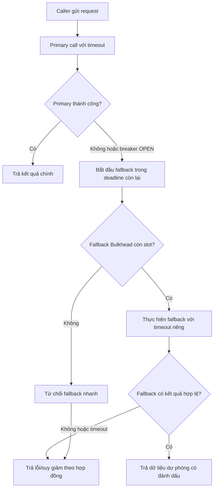

# Giới hạn thời gian và bảo vệ tài nguyên của fallback

Fallback giúp ứng dụng tiếp tục cung cấp một kết quả có ích khi dependency chính gặp lỗi hoặc Circuit Breaker đang OPEN. Tuy nhiên, fallback cũng là công việc cần tài nguyên. Nếu fallback chờ vô hạn, gọi một dịch vụ dự phòng đang quá tải hoặc được kích hoạt đồng thời bởi hàng nghìn request, nó có thể trở thành điểm nghẽn mới và gây lỗi dây chuyền giống dependency ban đầu.

Trong Spring Cloud CircuitBreaker với Resilience4j, cần thiết kế fallback với ngân sách thời gian, giới hạn đồng thời và nguồn dữ liệu có khả năng đáp ứng khi sự cố xảy ra. Bài này tập trung vào cách giới hạn thời gian cho cả lời gọi chính và fallback, bảo vệ tài nguyên fallback bằng Bulkhead, giữ pipeline reactive không chặn và theo dõi hiệu quả của phương án dự phòng.

## 1. Vì sao fallback cũng cần được bảo vệ?

Giả sử dịch vụ sản phẩm gọi Catalog Service để lấy thông tin. Khi Catalog Service lỗi, ứng dụng đọc cache hoặc gọi một replica dự phòng. Nếu 10.000 request cùng chuyển sang cache hoặc replica trong một thời điểm, lượng tải fallback có thể tăng đột biến.

Một fallback không được giới hạn có thể gây ra các vấn đề:

- **Chờ quá lâu:** request đã thất bại ở dependency chính nhưng vẫn giữ thread, connection hoặc subscription để chờ fallback.
- **Quá tải dây chuyền:** nhiều request cùng gọi một nguồn dự phòng, khiến nguồn này cũng mất khả năng phục vụ.
- **Tạo hàng đợi không giới hạn:** tác vụ fallback chờ slot hoặc chờ executor, làm độ trễ tăng và giữ tài nguyên.
- **Retry lặp lại:** fallback tiếp tục retry một dependency đang lỗi, làm tăng tải trong thời điểm hệ thống yếu nhất.
- **Fallback lồng nhau:** phương án dự phòng A gọi B, B lại gọi C; thời gian và số tài nguyên tiêu thụ khó dự đoán.
- **Che giấu sự cố:** fallback luôn trả một kết quả mặc định nhưng không ghi nhận việc nguồn chính và nguồn dự phòng đều thất bại.

Vì vậy, fallback phải có giới hạn riêng. Mục tiêu là kết thúc request trong ngân sách thời gian đã định, đồng thời giới hạn số công việc dự phòng có thể chạy cùng lúc.

## 2. Phân bổ ngân sách thời gian đầu cuối

Một request có ngân sách thời gian tổng do caller, gateway hoặc SLO quy định. Thời gian dành cho lời gọi chính và fallback phải nằm trong ngân sách này.

Có thể biểu diễn nguyên tắc bằng công thức:

```text
T_primary + T_fallback + T_response_margin <= T_request_deadline
```

Trong đó:

- `T_request_deadline`: thời gian tối đa caller chờ toàn bộ request.
- `T_primary`: thời gian tối đa dành cho dependency chính.
- `T_fallback`: thời gian tối đa dành cho phương án dự phòng.
- `T_response_margin`: phần thời gian dành cho mapping kết quả, ghi log cần thiết, serialize response và truyền về caller.

Ví dụ, API có deadline 1.500 ms. Có thể phân bổ 900 ms cho Catalog Service, 350 ms cho fallback cache hoặc nguồn dự phòng và giữ khoảng 250 ms cho phần xử lý còn lại. Các con số phải được đo từ latency thực tế; không sao chép nguyên xi vào production.

| Thành phần | Ngân sách minh họa |
|---|---:|
| Request đầu cuối | 1.500 ms |
| Gọi Catalog Service | 900 ms |
| Fallback | 350 ms |
| Mapping và trả response | 250 ms |

Không nên đặt timeout của fallback bằng timeout của request đầu cuối. Khi dependency chính đã dùng gần hết ngân sách, fallback dài sẽ khiến caller nhận response quá muộn. Cần tính cả thời gian retry nếu có: mỗi lần thử, backoff và fallback đều tiêu thụ cùng một deadline.

Trong hệ thống phân tán, nên truyền deadline hoặc remaining timeout qua các tầng thay vì mỗi tầng tự bắt đầu một bộ đếm mới. Nếu caller còn 300 ms, service không nên gọi dependency khác với timeout hai giây. Với HTTP client, cấu hình connect timeout, response/read timeout và tổng request timeout phù hợp với ngân sách còn lại.

## 3. Giới hạn thời gian cho dependency chính

Circuit Breaker cần nhận được kết quả của lời gọi để cập nhật sliding window. Nếu lời gọi không kết thúc, request có thể giữ tài nguyên trong thời gian dài. Vì vậy, đặt timeout tại HTTP client hoặc trong Publisher được bảo vệ.

Ví dụ với WebClient:

```java
Mono<Product> primaryCall = webClient.get()
    .uri("/products/{id}", productId)
    .retrieve()
    .bodyToMono(Product.class)
    .timeout(Duration.ofMillis(900));

return circuitBreakerFactory.create("catalog-read").run(
    primaryCall,
    error -> fallbackService.findProduct(productId)
);
```

Timeout nằm trong Publisher được truyền vào Circuit Breaker. Khi quá thời gian, Reactor phát timeout error và breaker có thể ghi nhận lần gọi thất bại theo cấu hình. Callback fallback được dùng để cung cấp kết quả thay thế.

Với client đồng bộ, cấu hình timeout trực tiếp trên HTTP client, JDBC driver hoặc SDK. Đừng giả định rằng mọi lời gọi đồng bộ được bọc bằng `CircuitBreakerFactory.run(Supplier)` tự động bị dừng bởi TimeLimiter. TimeLimiter của Resilience4j chủ yếu áp dụng cho các tác vụ bất đồng bộ tương thích như `CompletionStage`; timeout của I/O blocking vẫn cần được đặt ở chính client thực hiện I/O.

## 4. Đặt timeout riêng cho fallback

Fallback có thể là cache, replica, dịch vụ dự phòng hoặc một kết quả suy giảm đã định nghĩa. Mỗi loại có đặc tính thời gian khác nhau:

- Cache trong bộ nhớ thường rất nhanh, nhưng thao tác cache vẫn có thể chờ lock hoặc truy cập kho dữ liệu khác.
- Cache ngoài tiến trình như Redis vẫn có thể gặp network timeout.
- Replica hoặc dịch vụ thay thế là một dependency mạng khác và cần timeout riêng.
- Dữ liệu mặc định cục bộ có thể trả nhanh, nhưng chỉ hợp lệ nếu không làm sai ý nghĩa nghiệp vụ.

Ví dụ fallback reactive dùng cache, có giới hạn 250 ms:

```java
private Mono<ProductView> fallback(String productId, Throwable cause) {
    return cacheService.findUsable(productId)
        .timeout(Duration.ofMillis(250))
        .map(product -> ProductView.fromCache(product))
        .switchIfEmpty(Mono.error(
            new FallbackDataUnavailableException(productId)));
}
```

Nếu cache không phản hồi trong 250 ms, Publisher phát timeout error. Nếu cache không có dữ liệu, `switchIfEmpty` chuyển trường hợp đó thành lỗi rõ ràng. Tầng gọi có thể ánh xạ lỗi này thành response dịch vụ suy giảm phù hợp.

Có thể bổ sung một kết quả mặc định sau khi fallback cache thất bại, nhưng chỉ khi hợp đồng API cho phép:

```java
private Mono<ProductView> fallback(String productId, Throwable cause) {
    return cacheService.findUsable(productId)
        .timeout(Duration.ofMillis(250))
        .map(ProductView::fromCache)
        .switchIfEmpty(Mono.error(
            new FallbackDataUnavailableException(productId)))
        .onErrorResume(fallbackError ->
            Mono.just(ProductView.unavailable(productId)));
}
```

Ở đây `ProductView.unavailable` cần thể hiện rõ trạng thái dữ liệu không sẵn sàng. Không trả một sản phẩm giả, tồn kho giả hoặc giá trị khiến caller tưởng rằng dữ liệu đã được xác nhận. Nếu không có fallback an toàn, trả lỗi dịch vụ không khả dụng rõ ràng vẫn là kết quả đúng.

## 5. Giới hạn số fallback chạy đồng thời bằng Bulkhead

Timeout giới hạn thời gian một tác vụ được phép chờ; Bulkhead giới hạn số tác vụ được phép chạy cùng lúc. Hai cơ chế bổ sung cho nhau.

Resilience4j Bulkhead có thể dùng semaphore hoặc thread pool:

- **Semaphore Bulkhead:** giới hạn số lời gọi đồng thời. Khi đủ slot, lời gọi mới bị từ chối hoặc chờ trong khoảng tối đa đã cấu hình.
- **Thread Pool Bulkhead:** chạy tác vụ trong một pool riêng, có giới hạn số thread và hàng đợi. Cách này cô lập tác vụ blocking, nhưng hàng đợi cần được giới hạn để tránh tích tụ request.

Fallback nên có Bulkhead riêng, độc lập với Bulkhead của dependency chính. Khi dependency chính gặp sự cố, số request chuyển sang fallback có thể tăng mạnh. Một giới hạn riêng bảo vệ cache, replica hoặc tài nguyên dùng cho fallback.

Ví dụ tạo semaphore Bulkhead:

```java
import java.time.Duration;

import io.github.resilience4j.bulkhead.Bulkhead;
import io.github.resilience4j.bulkhead.BulkheadConfig;
import io.github.resilience4j.bulkhead.BulkheadFullException;
import io.github.resilience4j.bulkhead.BulkheadRegistry;

BulkheadConfig fallbackConfig = BulkheadConfig.custom()
    .maxConcurrentCalls(30)
    .maxWaitDuration(Duration.ZERO)
    .build();

BulkheadRegistry registry = BulkheadRegistry.ofDefaults();

Bulkhead fallbackBulkhead = registry.bulkhead(
    "catalog-fallback",
    fallbackConfig
);
```

Trong ví dụ, tối đa 30 fallback được thực thi đồng thời và lời gọi vượt giới hạn bị từ chối ngay vì `maxWaitDuration` bằng 0. Giá trị 30 chỉ là ví dụ; cần chọn dựa trên khả năng của cache hoặc dịch vụ dự phòng, số instance ứng dụng và lưu lượng cực đại.

Với fallback đồng bộ, có thể dùng Bulkhead bao quanh thao tác dự phòng:

```java
private Product fallback(String productId, Throwable cause) {
    try {
        return fallbackBulkhead.executeSupplier(() ->
            cacheRepository.findUsable(productId)
                .orElseThrow(() ->
                    new FallbackDataUnavailableException(productId))
        );
    } catch (BulkheadFullException ex) {
        throw new FallbackOverloadedException(productId, ex);
    }
}
```

Khi Bulkhead đầy, fallback bị từ chối nhanh và ứng dụng có thể trả response suy giảm hoặc lỗi quá tải. Không nên đợi vô hạn để lấy slot; việc chờ lâu làm mất tác dụng bảo vệ tài nguyên.

## 6. Bảo vệ fallback reactive

Với WebFlux và Reactor, dùng Bulkhead operator để giới hạn subscription đồng thời và đặt timeout trực tiếp trên Publisher fallback:

```java
import java.time.Duration;

import io.github.resilience4j.bulkhead.Bulkhead;
import io.github.resilience4j.reactor.bulkhead.operator.BulkheadOperator;
import reactor.core.publisher.Mono;

private Mono<ProductView> fallbackReactive(
        String productId,
        Throwable cause,
        Bulkhead fallbackBulkhead) {

    return cacheService.findUsable(productId)
        .transformDeferred(BulkheadOperator.of(fallbackBulkhead))
        .timeout(Duration.ofMillis(250))
        .map(ProductView::fromCache)
        .switchIfEmpty(Mono.error(
            new FallbackDataUnavailableException(productId)))
        .onErrorResume(error ->
            Mono.just(ProductView.unavailable(productId)));
}
```

`transformDeferred(BulkheadOperator.of(...))` đặt giới hạn lên subscription của Publisher fallback. `timeout` giới hạn thời gian chờ. Nếu Bulkhead đầy, cache lỗi hoặc timeout, pipeline chuyển sang kết quả suy giảm đã định nghĩa.

Không gọi `block()` trong fallback reactive. Không gọi `subscribe()` thủ công để chạy fallback ở nền, vì khi đó caller không còn kiểm soát kết quả, cancellation và deadline. Hãy trả Publisher về cho chuỗi xử lý reactive của caller.

Nếu fallback gọi thư viện blocking, có thể cô lập công việc bằng scheduler phù hợp, nhưng phải giới hạn concurrency và thời gian chờ. `Schedulers.boundedElastic()` không thay thế chính sách Bulkhead; nó chỉ cung cấp scheduler cho công việc blocking với giới hạn riêng. Đừng tạo scheduler hoặc thread pool mới cho từng request.

## 7. Không để fallback tạo thêm lỗi dây chuyền

Một fallback tốt nên đơn giản hơn và có ít phụ thuộc hơn luồng chính. Nếu fallback lại gọi một dịch vụ mạng khác, dịch vụ đó cũng cần timeout, Bulkhead và Circuit Breaker riêng.

Một số nguyên tắc thiết kế:

- Ưu tiên cache hoặc dữ liệu cục bộ có thể dùng an toàn.
- Nếu gọi replica hoặc dịch vụ thay thế, dùng ID Circuit Breaker riêng để theo dõi dependency đó.
- Không gọi lại chính dependency đang bị breaker bảo vệ trong callback fallback.
- Không retry không giới hạn trong fallback.
- Không tạo hàng đợi không giới hạn cho các tác vụ dự phòng.
- Không khởi tạo tác vụ nền không được quản lý mỗi khi fallback được gọi.
- Nếu fallback thất bại, kết thúc bằng response suy giảm hoặc lỗi rõ ràng theo hợp đồng API.

Ví dụ, Catalog Service lỗi và breaker `catalog-read` OPEN. Fallback có thể đọc Redis cache. Nếu Redis cũng lỗi, không nên gọi lại Catalog Service lần nữa trong cùng fallback. Nếu có replica độc lập, có thể gọi replica qua breaker `catalog-replica-read` với timeout ngắn và Bulkhead riêng. Tuy nhiên, chỉ thêm tầng dự phòng nếu nó có đủ năng lực và thực sự độc lập với sự cố chính.

Fallback chain nên ngắn và có giới hạn. Mỗi tầng thêm vào làm tăng thời gian tối đa, số kết nối và số nơi có thể thất bại. Hãy tính tổng ngân sách trước khi thêm nguồn dự phòng thứ hai.

## 8. Phân biệt fallback timeout với timeout của request chính

Hai timeout có ý nghĩa khác nhau:

| Timeout | Phạm vi | Hành động khi hết thời gian |
|---|---|---|
| Primary timeout | Lời gọi dependency chính | Kết thúc lời gọi chính, Circuit Breaker ghi nhận kết quả timeout theo cấu hình và kích hoạt fallback |
| Fallback timeout | Thao tác dự phòng | Dừng chờ fallback, trả kết quả suy giảm hoặc lỗi fallback |
| Request deadline | Toàn bộ request từ caller | Không tiếp tục gọi thêm dependency khi đã hết ngân sách |
| Connection timeout | Thiết lập kết nối mạng | Ngừng chờ kết nối tới endpoint |
| Read/response timeout | Chờ dữ liệu từ endpoint | Kết thúc chờ response theo giới hạn |

Không nên dùng cùng một exception hoặc cùng một metric cho mọi loại timeout. Primary timeout phản ánh dependency chính không phản hồi đúng hạn; fallback timeout phản ánh phương án dự phòng không đáp ứng; request deadline phản ánh tổng thời gian xử lý đã vượt ngân sách.

Nếu fallback timeout xảy ra, không nên tự động gọi lại fallback lần nữa. Retry fallback có thể làm tăng tải đúng vào thời điểm cache hoặc dịch vụ dự phòng đang quá tải. Chỉ retry nếu thao tác an toàn, có xác suất thành công cao hơn và vẫn còn ngân sách thời gian.

## 9. Cấu hình timeout và Bulkhead theo ID

Resilience4j cho phép đặt TimeLimiter và Bulkhead cho các instance riêng. Ví dụ:

```yaml
resilience4j:
  timelimiter:
    instances:
      catalog-read:
        timeoutDuration: 900ms
        cancelRunningFuture: true
      catalog-fallback:
        timeoutDuration: 250ms
        cancelRunningFuture: true

  bulkhead:
    instances:
      catalog-fallback:
        maxConcurrentCalls: 30
        maxWaitDuration: 0
```

Cấu hình này minh họa hai ID có mục đích khác nhau. `catalog-read` dành cho dependency chính; `catalog-fallback` dành cho thao tác dự phòng. Cấu hình TimeLimiter cho `catalog-fallback` chỉ có tác dụng khi code thực sự bọc thao tác fallback bằng TimeLimiter tương ứng; callback fallback không tự động nhận một TimeLimiter riêng chỉ vì có ID trong YAML. TimeLimiter của Resilience4j áp dụng cho các tác vụ bất đồng bộ tương thích như `CompletionStage`. Với WebClient reactive, nên đặt `Mono.timeout` hoặc `Flux.timeout` trực tiếp trong Publisher fallback. Với I/O blocking, cấu hình timeout trên client thực hiện I/O để bảo đảm thao tác thật sự được giới hạn.

Nếu sử dụng Bulkhead annotation hoặc Spring AOP, cần kiểm tra dependency và cấu hình tích hợp tương ứng trong ứng dụng. Ví dụ YAML ở trên chỉ là cấu hình instance; nó không tự động bảo vệ mọi phương thức có tên giống ID nếu code không đi qua cơ chế Bulkhead được tích hợp.

## 10. Chọn kết quả khi fallback không đáp ứng

Khi fallback bị timeout hoặc Bulkhead từ chối, ứng dụng cần có kết quả cuối cùng rõ ràng.

| Tình huống | Kết quả phù hợp |
|---|---|
| Cache trả dữ liệu còn trong thời hạn cho phép | Trả dữ liệu cache và đánh dấu thời điểm hoặc nguồn dữ liệu nếu caller cần biết |
| Cache không có dữ liệu | Trả lỗi dịch vụ không khả dụng hoặc kết quả thiếu dữ liệu theo hợp đồng |
| Cache timeout | Kết thúc fallback và trả lỗi/suy giảm; không chờ vô hạn |
| Bulkhead fallback đầy | Từ chối nhanh, trả trạng thái quá tải hoặc response suy giảm |
| Replica dự phòng cũng lỗi | Ghi nhận lỗi replica và kết thúc fallback chain |
| Fallback không an toàn với nghiệp vụ | Trả lỗi rõ ràng, không tạo dữ liệu giả |
| Request deadline đã hết | Dừng các bước tiếp theo và trả kết quả theo chính sách gateway/caller |

Ví dụ, trang sản phẩm có thể hiển thị tên và mô tả từ cache cũ nhưng đánh dấu dữ liệu tồn kho là chưa xác định. Ngược lại, một thao tác thanh toán không thể dùng fallback giả để trả “đã thanh toán”. Nếu chưa nhận được xác nhận, hãy trả trạng thái chưa xác định hoặc chưa hoàn tất và cho phép quy trình tra soát bằng transaction ID.

## 11. Theo dõi hiệu quả của fallback

Đừng chỉ theo dõi số lần fallback được gọi. Cần biết fallback có đáp ứng trong thời gian cho phép hay không và nó tiêu thụ bao nhiêu tài nguyên.

Các metric nên quan sát:

- `fallback.calls`: số lần fallback được kích hoạt.
- `fallback.success`: số lần fallback trả kết quả dùng được.
- `fallback.errors`: số lần fallback lỗi.
- `fallback.timeouts`: số lần fallback vượt timeout.
- `fallback.rejected`: số lần Bulkhead từ chối vì hết slot.
- Latency p50, p95, p99 của fallback.
- Số lời gọi đồng thời và mức sử dụng Bulkhead.
- Tỷ lệ cache hit, tuổi dữ liệu cache và số lần trả dữ liệu suy giảm.
- Tỷ lệ request đầu cuối thành công và độ trễ đầu cuối.

Nên phân biệt metric của dependency chính và fallback. Ví dụ, breaker `catalog-read` OPEN tăng có thể cho thấy dependency chính đang gặp sự cố; `catalog-fallback` rejected tăng cho thấy phương án dự phòng đang chạm giới hạn. Hai tín hiệu này giúp xác định cần khắc phục ở dịch vụ chính hay tăng năng lực cache/replica.

Log nên ghi ID breaker, nguồn fallback, loại lỗi gốc, loại lỗi fallback, thời gian thực hiện và correlation ID. Không ghi dữ liệu nhạy cảm hoặc toàn bộ payload chỉ để debug fallback. Dùng trace để thấy thời gian primary, thời gian fallback và thời gian còn lại trong deadline.

## 12. Sơ đồ luồng fallback có giới hạn



Luồng này giữ fallback trong ngân sách thời gian và số lượng tác vụ được phép chạy. Khi fallback không còn năng lực, hệ thống kết thúc sớm thay vì tiếp tục tạo thêm công việc chờ.

## Kết luận

Fallback cũng cần timeout và giới hạn tài nguyên vì nó thường được kích hoạt đúng lúc hệ thống đang chịu tải hoặc dependency chính đang lỗi. Hãy phân bổ ngân sách thời gian cho primary, fallback và phần trả response; dùng Bulkhead riêng để giới hạn số fallback đồng thời; giữ fallback reactive non-blocking; và tránh retry hoặc fallback chain không giới hạn. Theo dõi riêng timeout, lỗi, từ chối Bulkhead và độ trễ fallback để biết phương án dự phòng thực sự giúp duy trì dịch vụ hay đang trở thành điểm nghẽn mới.

