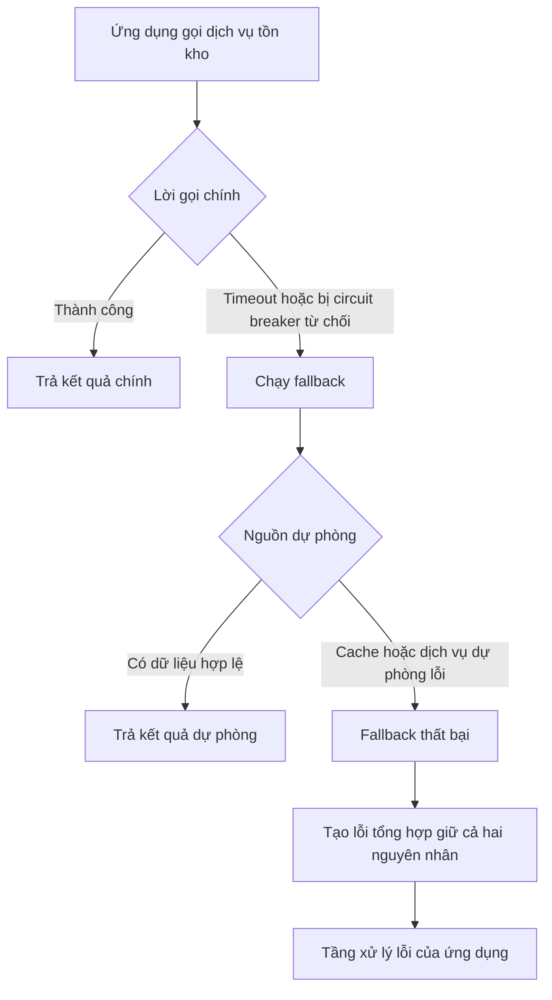

# Xử lý fallback tiếp tục thất bại và giữ nguyên nguyên nhân lỗi

Fallback giúp ứng dụng tiếp tục phục vụ khi lời gọi đến dịch vụ phụ thuộc thất bại hoặc circuit breaker từ chối lời gọi. Tuy nhiên, chính fallback cũng có thể gặp lỗi: cache không truy cập được, dịch vụ dự phòng timeout, dữ liệu dự phòng đã hết hạn hoặc logic chuyển đổi dữ liệu ném exception. Khi đó, ứng dụng phải xử lý hai sự cố trong cùng một luồng: lỗi ban đầu khiến fallback được gọi và lỗi mới phát sinh trong lúc fallback chạy.

Trong Spring Cloud CircuitBreaker với Resilience4j, hàm fallback nhận nguyên nhân của lời gọi được bảo vệ. Nếu fallback tiếp tục ném lỗi, lỗi đó có thể trở thành lỗi mà tầng gọi bên ngoài nhận được. Vì vậy, không nên giả định nguyên nhân ban đầu luôn được giữ nguyên tự động. Hãy chủ động tạo chuỗi exception thể hiện cả hai nguyên nhân, đồng thời ghi nhận riêng việc lời gọi chính thất bại và fallback thất bại.

## 1. Vì sao fallback có thể tiếp tục thất bại?

Một fallback thường sử dụng nguồn dữ liệu hoặc thao tác khác để tạo phản hồi thay thế. Ví dụ, khi dịch vụ tồn kho không phản hồi, ứng dụng đọc dữ liệu từ cache. Nhưng cache có thể hết hạn, Redis có thể mất kết nối hoặc việc chuyển đổi dữ liệu cache sang mô hình nghiệp vụ có thể phát sinh exception.

Các tình huống phổ biến:

- **Fallback dựa trên cache:** cache không khả dụng, không có dữ liệu hoặc dữ liệu cũ vượt giới hạn nghiệp vụ cho phép.
- **Fallback gọi dịch vụ thứ hai:** dịch vụ dự phòng cũng đang quá tải, timeout hoặc trả lỗi.
- **Fallback chuyển đổi dữ liệu:** dữ liệu thiếu trường, sai định dạng hoặc không tương thích với phiên bản mô hình hiện tại.
- **Fallback thực hiện thao tác phụ:** ghi audit, lưu trạng thái hoặc truy vấn cấu hình gặp lỗi.
- **Fallback trả kết quả không hợp lệ:** không ném exception nhưng trả `null`, publisher rỗng hoặc giá trị mặc định khiến tầng nghiệp vụ hiểu sai.

Ví dụ luồng lỗi:



Fallback không phải một vùng mã chắc chắn thành công. Nó là một thao tác có thể thất bại và cần được thiết kế, giới hạn thời gian cũng như quan sát như các thao tác phụ thuộc khác.

## 2. Phân biệt lỗi chính và lỗi fallback

Giả sử ứng dụng gọi `InventoryClient` và nhận `SocketTimeoutException`. Fallback được gọi để đọc cache, nhưng cache ném `RedisConnectionFailureException`.

| Loại lỗi | Thời điểm xảy ra | Ý nghĩa |
|---|---|---|
| Lỗi chính (*primary failure*) | Trong supplier hoặc khi circuit breaker từ chối lời gọi | Lý do ứng dụng phải chuyển sang fallback. |
| Lỗi fallback (*fallback failure*) | Trong lúc thực thi hàm dự phòng | Nguồn hoặc logic dự phòng cũng không thể tạo kết quả. |
| Lỗi tổng hợp (*combined failure*) | Được tạo sau khi fallback thất bại | Đại diện cho việc cả đường chính và đường dự phòng đều không cung cấp được kết quả. |

Hai lỗi cần được giữ riêng vì cách xử lý khác nhau. Lỗi chính giúp điều tra dịch vụ được bảo vệ. Lỗi fallback giúp điều tra cache, dịch vụ dự phòng hoặc logic thay thế. Nếu chỉ ghi lại lỗi fallback, nhóm vận hành có thể không biết rằng dịch vụ chính đã timeout trước đó. Nếu chỉ ghi lỗi chính, sự cố ở nguồn dự phòng cũng bị che khuất.

Lỗi chính có thể là `CallNotPermittedException`, nghĩa là circuit breaker đã từ chối lời gọi trước khi supplier chạy. Đây vẫn là nguyên nhân khiến fallback được gọi, nhưng không có request mới đến dịch vụ phụ thuộc. Hãy giữ nguyên loại lỗi đó trong chuỗi exception để phân biệt với timeout hoặc lỗi kết nối thực sự.

## 3. Giữ nguyên lỗi ban đầu bằng exception tổng hợp

Một cách rõ ràng là tạo exception riêng cho trường hợp cả lời gọi chính và fallback đều thất bại. Có thể giữ lỗi chính làm `cause` và gắn lỗi fallback vào danh sách `suppressed`:

```java
public class FallbackExecutionException extends RuntimeException {

    public FallbackExecutionException(
            String message,
            Throwable primaryFailure,
            Throwable fallbackFailure) {
        super(message, primaryFailure);
        addSuppressed(fallbackFailure);
    }
}
```

Với cấu trúc này:

- `getCause()` trả về lỗi chính khiến fallback được gọi.
- `getSuppressed()` chứa lỗi xảy ra trong lúc fallback chạy.
- Stack trace có thể hiển thị cả chuỗi cause và suppressed để hỗ trợ điều tra.

Đây là một chính sách biểu diễn lỗi có chủ đích: lỗi chính là nguyên nhân gốc của yêu cầu thất bại; lỗi fallback được giữ như nguyên nhân bổ sung giải thích vì sao phương án dự phòng cũng không thành công. Nếu hệ thống muốn ưu tiên lỗi fallback làm `cause`, có thể đảo cách gắn cause và suppressed, nhưng phải thống nhất quy ước giữa các service.

Không nên thay thế lỗi chính bằng một thông báo chung như `Service unavailable` mà không giữ exception gốc. Thông báo hướng người dùng có thể ngắn gọn, còn exception nội bộ cần đủ thông tin để truy vết.

## 4. Bọc fallback imperative để giữ cả hai lỗi

Ví dụ dưới đây dùng Spring Cloud CircuitBreaker với factory imperative. Hàm fallback nhận `primaryFailure`, thử đọc cache và nếu cache tiếp tục lỗi thì ném `FallbackExecutionException`:

```java
import io.github.resilience4j.circuitbreaker.CallNotPermittedException;
import org.springframework.cloud.client.circuitbreaker.CircuitBreakerFactory;
import org.springframework.stereotype.Service;

@Service
public class InventoryService {
    private final CircuitBreakerFactory<?, ?> circuitBreakerFactory;
    private final InventoryClient inventoryClient;
    private final InventoryCache inventoryCache;

    public InventoryService(
            CircuitBreakerFactory<?, ?> circuitBreakerFactory,
            InventoryClient inventoryClient,
            InventoryCache inventoryCache) {
        this.circuitBreakerFactory = circuitBreakerFactory;
        this.inventoryClient = inventoryClient;
        this.inventoryCache = inventoryCache;
    }

    public Stock getStock(String sku) {
        return circuitBreakerFactory.create("inventory").run(
            () -> inventoryClient.getStock(sku),
            primaryFailure -> fallback(sku, primaryFailure)
        );
    }

    private Stock fallback(String sku, Throwable primaryFailure) {
        try {
            Stock cached = inventoryCache.getStock(sku);
            if (cached == null || cached.isExpired()) {
                throw new IllegalStateException("Không có dữ liệu cache còn hiệu lực");
            }
            return cached.asStaleFallback();
        } catch (RuntimeException fallbackFailure) {
            throw new FallbackExecutionException(
                "Lời gọi tồn kho và fallback đều thất bại cho SKU " + sku,
                primaryFailure,
                fallbackFailure
            );
        }
    }
}
```

Trong ví dụ, `InventoryCache` là thành phần giả định của ứng dụng. Kiểm tra `null` và thời hạn cache giúp tránh trả dữ liệu không hợp lệ như thể đó là tồn kho hiện tại. `asStaleFallback()` nên biểu diễn rõ nguồn hoặc độ cũ của dữ liệu để tầng gọi quyết định có chấp nhận được hay không.

Đoạn `catch` chỉ bắt `RuntimeException` vì đó là loại lỗi mà các thao tác cache và kiểm tra nghiệp vụ thường ném trong ví dụ. Không nên bắt `Throwable` một cách tùy tiện; `Error` có thể biểu thị lỗi nghiêm trọng của JVM mà ứng dụng không nên chuyển thành một fallback thông thường. Nếu API fallback có thể ném checked exception qua một abstraction khác, hãy xử lý đúng loại exception theo hợp đồng của API đó.

Nếu `inventoryCache.getStock()` thành công và dữ liệu hợp lệ, fallback trả kết quả. Nếu nó thất bại, exception tổng hợp giữ lại cả `primaryFailure` và `fallbackFailure`. Tầng xử lý lỗi bên ngoài có thể nhận diện `FallbackExecutionException` và ghi log hai nguyên nhân.

## 5. Không để fallback tạo vòng gọi đệ quy

Một lỗi thiết kế nguy hiểm là fallback gọi lại chính service hoặc cùng circuit breaker đang thất bại. Ví dụ `getStock()` gọi fallback `getStockFromBackup()`, nhưng `getStockFromBackup()` lại gọi `getStock()` khi cache trống. Vòng lặp này có thể gây đệ quy vô hạn, tăng tải hoặc tạo chuỗi fallback khó truy vết.

Nên tổ chức phương án dự phòng thành một chuỗi có giới hạn và điểm kết thúc rõ ràng:

1. Thử lời gọi chính đến dịch vụ tồn kho.
2. Nếu thất bại, đọc cache còn hợp lệ.
3. Nếu cache không có dữ liệu, có thể dùng một nguồn dự phòng độc lập nếu nghiệp vụ cho phép.
4. Nếu mọi nguồn đều thất bại, ném exception tổng hợp để tầng trên xử lý.

Mỗi bước cần có timeout và giới hạn tài nguyên phù hợp. Không nên gọi lại dịch vụ chính từ fallback bằng một client khác chỉ để né circuit breaker. Cách đó có thể phá vỡ quyết định ngắt mạch và tạo thêm tải cho phụ thuộc đang gặp sự cố.

Nếu fallback gọi một dịch vụ thứ hai, dịch vụ đó cũng cần timeout và có thể cần circuit breaker riêng với ID riêng. Tuy nhiên, không nên tạo một chuỗi dài nhiều tầng mà mỗi fallback lại gọi thêm nhiều dịch vụ; số nhánh càng lớn thì độ trễ tổng và số kiểu lỗi càng khó kiểm soát.

## 6. Fallback reactive cũng cần giữ nguyên hai nguyên nhân

Trong ứng dụng WebFlux, fallback thường trả về `Mono<T>` hoặc `Publisher<T>`. Nên dùng `Mono.defer` để thao tác dự phòng chỉ chạy khi publisher được subscribe. Nếu fallback publisher phát lỗi, có thể dùng `onErrorMap` để bọc lỗi đó cùng với lỗi chính:

```java
import org.springframework.cloud.client.circuitbreaker.ReactiveCircuitBreakerFactory;
import org.springframework.stereotype.Service;
import reactor.core.publisher.Mono;

@Service
public class ReactiveInventoryService {
    private final ReactiveCircuitBreakerFactory<?, ?> circuitBreakerFactory;
    private final ReactiveInventoryClient inventoryClient;
    private final ReactiveInventoryCache inventoryCache;

    public ReactiveInventoryService(
            ReactiveCircuitBreakerFactory<?, ?> circuitBreakerFactory,
            ReactiveInventoryClient inventoryClient,
            ReactiveInventoryCache inventoryCache) {
        this.circuitBreakerFactory = circuitBreakerFactory;
        this.inventoryClient = inventoryClient;
        this.inventoryCache = inventoryCache;
    }

    public Mono<Stock> getStock(String sku) {
        return circuitBreakerFactory.create("inventory").run(
            inventoryClient.getStock(sku),
            primaryFailure -> Mono.defer(() -> inventoryCache.getStock(sku)
                .switchIfEmpty(Mono.error(
                    new IllegalStateException("Không có dữ liệu cache còn hiệu lực"))))
                .onErrorMap(fallbackFailure -> new FallbackExecutionException(
                    "Lời gọi tồn kho và fallback đều thất bại cho SKU " + sku,
                    primaryFailure,
                    fallbackFailure
                ))
        );
    }
}
```

`switchIfEmpty` xử lý trường hợp cache hoàn tất bình thường nhưng không phát dữ liệu. Nếu không chuyển trường hợp này thành lỗi hoặc một kết quả nghiệp vụ rõ ràng, fallback có thể trả `Mono.empty()` và caller không nhận được `Stock` mà cũng không thấy exception. Trong ví dụ, cache rỗng được xem là fallback thất bại.

`Mono.defer` giúp lỗi phát sinh khi gọi `inventoryCache.getStock(sku)` được chuyển thành tín hiệu lỗi reactive thay vì ném ngay trong lúc xây dựng chuỗi. `onErrorMap` chỉ bọc lỗi phát ra từ fallback publisher và gắn lỗi chính vào exception tổng hợp. Không gọi `block()` trong chuỗi reactive.

## 7. Phân biệt fallback thất bại với kết quả dự phòng rỗng

Trong reactive, `Mono.empty()` hoặc `Flux.empty()` là publisher hoàn tất bình thường mà không phát phần tử. Trong imperative, một hàm có thể trả `null`. Những kết quả này không tự động được xem là fallback thất bại.

Hãy xác định hợp đồng của fallback:

| Kết quả fallback | Cách diễn giải | Cách xử lý đề xuất |
|---|---|---|
| Trả dữ liệu cache còn hợp lệ | Fallback thành công | Trả dữ liệu kèm dấu hiệu nguồn dự phòng nếu cần. |
| Trả dữ liệu mặc định có ý nghĩa nghiệp vụ | Fallback thành công theo chính sách | Đảm bảo caller phân biệt được giá trị mặc định với dữ liệu thật. |
| Không có cache (`null` hoặc `Mono.empty()`) | Có thể là không có dữ liệu dự phòng | Chuyển thành lỗi rõ ràng hoặc kết quả `Unavailable` theo hợp đồng. |
| Cache hoặc dịch vụ dự phòng ném exception | Fallback thất bại | Giữ lỗi chính và lỗi fallback trong exception tổng hợp. |
| Dữ liệu cache hết hạn | Fallback không đáp ứng chính sách freshness | Không trả như dữ liệu hiện tại; báo không khả dụng hoặc dùng chính sách stale có giới hạn. |

Không nên dùng `null` để biểu thị đồng thời “không tìm thấy”, “cache lỗi” và “fallback thất bại”. Các trường hợp này có ý nghĩa khác nhau và cần được biểu diễn bằng kiểu kết quả hoặc exception rõ ràng.

## 8. Retry fallback có thể làm sự cố nặng hơn

Khi fallback thất bại, phản xạ tự nhiên là retry. Nhưng retry cache hoặc dịch vụ dự phòng liên tục có thể tạo thêm tải trong lúc hạ tầng đang gặp sự cố. Trước khi thêm retry, cần trả lời:

- Lỗi fallback có tính tạm thời và có khả năng phục hồi không?
- Thao tác fallback có an toàn khi thực hiện nhiều lần không?
- Có timeout tổng cho cả lời gọi chính và fallback không?
- Retry có nằm trong một giới hạn thời gian và số lần rõ ràng không?
- Retry có vô tình gọi lại dịch vụ chính hoặc bỏ qua circuit breaker không?

Nếu cần retry một thao tác fallback, hãy giới hạn số lần, dùng backoff có thể thêm jitter và bảo đảm thời gian tổng vẫn nằm trong ngân sách phản hồi của request. Không retry vô hạn `CallNotPermittedException`; đây là tín hiệu circuit breaker đang từ chối lời gọi. Với thao tác ghi như thanh toán hoặc cập nhật tồn kho, cần có tính idempotent hoặc idempotency key trước khi retry.

Thông thường, fallback nên ngắn và ít phụ thuộc. Một cache cục bộ hoặc giá trị dự phòng được chuẩn bị sẵn có thể phù hợp hơn việc gọi thêm nhiều dịch vụ trong lúc hệ thống đang suy giảm.

## 9. Ghi log và metrics cho hai loại lỗi

Khi fallback thất bại, log cần giúp truy ra cả hai nguyên nhân mà không làm lộ dữ liệu nhạy cảm. Với exception tổng hợp ở ví dụ, có thể ghi log như sau:

```java
try {
    return inventoryService.getStock(sku);
} catch (FallbackExecutionException error) {
    log.error(
        "Không lấy được tồn kho từ dịch vụ chính và nguồn dự phòng. sku={}",
        sku,
        error
    );
    throw error;
}
```

Stack trace của exception tổng hợp chứa lỗi chính trong `cause` và lỗi fallback trong `suppressed`. Không cần ghi log cùng một exception ở mọi tầng; hãy chọn một ranh giới chịu trách nhiệm ghi log để tránh nhân bản log. Trace nên giữ correlation ID hoặc trace ID để liên kết request chính với các lần gọi phụ thuộc và fallback.

Nên theo dõi các chỉ số riêng:

- Số lần lời gọi chính thất bại theo loại lỗi.
- Số lần circuit breaker từ chối lời gọi (`CallNotPermittedException`).
- Số lần fallback được gọi và tỷ lệ fallback thành công.
- Số lần fallback thất bại theo nguồn dự phòng.
- Độ trễ fallback và độ trễ tổng của request.
- Số lần trả dữ liệu stale hoặc kết quả mặc định.

Metrics nên gắn với ID circuit breaker hoặc tên phụ thuộc, nhưng tránh dùng SKU, user ID, request ID hay giá trị có độ đa dạng cao làm tag vì có thể làm tăng cardinality. Những giá trị định danh từng request nên nằm trong log hoặc trace có kiểm soát.

Nếu số lần fallback tăng nhưng fallback vẫn thành công, có thể dịch vụ chính đang suy giảm nhưng ứng dụng vẫn phục vụ được theo chính sách. Nếu tỷ lệ fallback thất bại tăng, chính phương án dự phòng cũng đang có vấn đề và cần cảnh báo riêng. Không gộp cả hai thành một metric `service_error` duy nhất.

## 10. Kiểm thử trường hợp fallback cũng thất bại

Kiểm thử cần chứng minh cả lỗi chính và lỗi fallback được giữ lại. Với JUnit và Mockito, có thể mô phỏng client chính timeout và cache cũng ném exception:

```java
import static org.junit.jupiter.api.Assertions.assertEquals;
import static org.junit.jupiter.api.Assertions.assertSame;
import static org.junit.jupiter.api.Assertions.assertThrows;
import static org.mockito.Mockito.when;

import org.junit.jupiter.api.Test;

class InventoryServiceTest {

    @Test
    void preservesPrimaryAndFallbackFailures() {
        RuntimeException primaryFailure = new RuntimeException("inventory timeout");
        RuntimeException fallbackFailure = new RuntimeException("cache unavailable");

        when(inventoryClient.getStock("SKU-1")).thenThrow(primaryFailure);
        when(inventoryCache.getStock("SKU-1")).thenThrow(fallbackFailure);

        FallbackExecutionException error = assertThrows(
            FallbackExecutionException.class,
            () -> inventoryService.getStock("SKU-1")
        );

        assertSame(primaryFailure, error.getCause());
        assertEquals(1, error.getSuppressed().length);
        assertSame(fallbackFailure, error.getSuppressed()[0]);
    }
}
```

Đây là ví dụ minh họa; phần khởi tạo `inventoryClient`, `inventoryCache` và `inventoryService` được cung cấp qua fixture hoặc Mockito extension của bài kiểm thử. Cần cấu hình circuit breaker để supplier được phép chạy trong ca kiểm thử này, tránh vô tình kiểm tra một lỗi bị từ chối trước khi client được gọi.

Nên có thêm các ca:

1. Lời gọi chính thành công: fallback không được gọi.
2. Lời gọi chính lỗi, cache trả dữ liệu hợp lệ: caller nhận dữ liệu fallback.
3. Lời gọi chính lỗi, cache rỗng: caller nhận kết quả không khả dụng hoặc exception theo hợp đồng.
4. Lời gọi chính lỗi, cache ném exception: exception tổng hợp giữ nguyên cả cause và suppressed.
5. Circuit breaker `OPEN`: fallback nhận `CallNotPermittedException` làm lỗi chính và không có request mới đến client.
6. Reactive fallback phát `Mono.empty()`, `Mono.error()` hoặc dữ liệu: xác nhận từng trường hợp theo hợp đồng đã chọn.

## 11. Xử lý ở tầng API và ranh giới nghiệp vụ

Khi exception tổng hợp đi đến controller hoặc message handler, tầng biên cần chuyển nó thành phản hồi phù hợp. Ví dụ, API đọc tồn kho có thể trả trạng thái không khả dụng với mã lỗi ổn định và correlation ID. Không nên trả HTTP 200 cùng số lượng tồn kho bằng 0 nếu ứng dụng không biết số lượng thật.

Với lệnh ghi, nếu lời gọi chính timeout và fallback cũng thất bại, trạng thái giao dịch có thể chưa rõ: request có thể đã được dịch vụ đích xử lý trước khi kết nối bị ngắt. Không được tự động báo thất bại chắc chắn hoặc thử lại một lệnh không idempotent. Cần có cơ chế tra cứu trạng thái giao dịch, idempotency key hoặc quy trình đối soát.

Không trả stack trace hoặc tên hệ thống nội bộ cho người dùng cuối. API response nên cung cấp thông tin vừa đủ để caller biết thao tác tạm thời không thể hoàn tất và có thể thử lại khi nào nếu hợp đồng cho phép. Chi tiết lỗi chính và lỗi fallback ở lại trong log/trace nội bộ.

## 12. Nguyên tắc thiết kế fallback có khả năng phục hồi

Trước khi phát hành fallback, hãy xác định rõ dữ liệu nào được phép dùng thay thế, độ cũ tối đa, timeout của nguồn dự phòng và kết quả khi nguồn đó không khả dụng. Chuỗi dự phòng nên có số bước giới hạn, không gọi ngược lại chính đường chính đang lỗi và không retry vô hạn.

Khi fallback tiếp tục thất bại, hãy tạo một exception tổng hợp có cấu trúc rõ ràng. Giữ lỗi khiến fallback được gọi trong `cause`, giữ lỗi của fallback trong `suppressed` hoặc theo quy ước thống nhất của hệ thống. Ghi nhận riêng primary failure, circuit breaker rejection và fallback failure bằng metrics, log và trace. Nhờ vậy, Spring Cloud CircuitBreaker và Resilience4j có thể bảo vệ lời gọi phụ thuộc mà không làm mất thông tin cần thiết để điều tra khi cả đường chính lẫn đường dự phòng đều không hoạt động.
