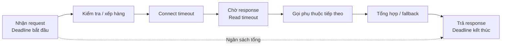
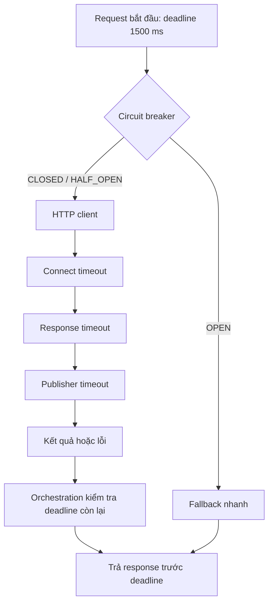

# Deadline tổng thể khác connect timeout và read timeout

Một request trong hệ thống Spring Cloud thường đi qua nhiều bước: chờ lấy connection, thiết lập kết nối mạng, gửi request, chờ dịch vụ phụ thuộc xử lý, đọc response, gọi thêm dịch vụ khác và tổng hợp kết quả. Mỗi bước có thể có timeout riêng, nhưng người dùng chỉ quan tâm tổng thời gian từ lúc gửi request đến khi nhận được kết quả. Giới hạn tổng thời gian đó là **deadline tổng thể** (*overall deadline*).

Deadline tổng thể khác với connect timeout và read timeout. Connect timeout giới hạn thời gian thiết lập kết nối. Read timeout hoặc response timeout giới hạn thời gian chờ dữ liệu theo semantics của HTTP client. Một request có thể không vượt bất kỳ timeout riêng lẻ nào nhưng vẫn mất quá lâu khi cộng nhiều lần gọi, retry và thời gian xử lý. Ngược lại, một bước có thể vượt timeout riêng dù deadline tổng thể vẫn còn thời gian.

`TimeLimiter` của Resilience4j và operator `timeout` của Reactor giúp giới hạn thời gian chờ một tác vụ hoặc publisher. Chúng cần được đặt trong ngân sách deadline của request và phối hợp với timeout của HTTP client. Circuit breaker bảo vệ phụ thuộc đang lỗi; nó không tự tạo ra deadline tổng thể cho toàn bộ luồng nghiệp vụ.

## 1. Phân biệt ba loại giới hạn thời gian

| Giới hạn | Bắt đầu tính từ đâu? | Kiểm soát điều gì? | Không tự đảm bảo điều gì? |
|---|---|---|---|
| Connect timeout | Khi HTTP client bắt đầu thiết lập kết nối | Thời gian mở kết nối TCP/TLS theo client và cấu hình | Không giới hạn thời gian server xử lý sau khi kết nối thành công |
| Read/response timeout | Khi client chờ dữ liệu phản hồi hoặc giữa các lần đọc, tùy HTTP client | Thời gian chờ dữ liệu từ server | Không nhất thiết giới hạn tổng thời gian tải toàn bộ response hoặc toàn bộ request |
| Deadline tổng thể | Khi request nghiệp vụ bắt đầu | Tổng thời gian được phép cho chuỗi xử lý | Không tự hủy mọi công việc đã được server hoặc database nhận |

Ví dụ, một gateway có deadline 2 giây. Kết nối đến dịch vụ tồn kho mất 100 ms, dịch vụ xử lý 700 ms và response được đọc trong 100 ms. Sau đó gateway gọi dịch vụ giá mất thêm 900 ms. Mỗi lời gọi riêng có thể hoàn tất trong timeout 1 giây, nhưng tổng thời gian đã vượt 2 giây. Nếu chỉ đặt timeout cho từng HTTP exchange, gateway có thể trả kết quả quá muộn so với cam kết với người dùng.

Ngược lại, nếu dịch vụ tồn kho không thể thiết lập kết nối trong 600 ms trong khi connect timeout chỉ là 300 ms, lời gọi thất bại ngay cả khi deadline tổng thể còn hơn một giây. Connect timeout bảo vệ tài nguyên kết nối; deadline tổng thể bảo vệ thời gian của cả request.

## 2. Deadline tổng thể bao gồm những gì?

Deadline nên được tính từ lúc hệ thống nhận request ở ranh giới nghiệp vụ đến khi hoàn tất response. Tùy kiến trúc, ngân sách này có thể bao gồm:

- Thời gian chờ trong hàng đợi, executor hoặc connection pool.
- DNS lookup và thiết lập kết nối TCP/TLS.
- Thời gian gửi request và chờ dịch vụ phụ thuộc xử lý.
- Thời gian đọc và giải mã response.
- Các lời gọi phụ thuộc tiếp theo, theo tuần tự hoặc song song.
- Retry delay, backoff và thời gian của từng lần thử.
- Chuyển đổi dữ liệu, kiểm tra nghiệp vụ, ghi log và tạo response.
- Thời gian dự phòng để chạy fallback và trả kết quả cho caller.

Nếu các lời gọi được thực hiện tuần tự, thời gian tổng gần bằng tổng thời gian của từng bước cộng với overhead. Nếu nhiều lời gọi chạy song song, thời gian đường găng thường phụ thuộc vào nhánh hoàn tất muộn nhất, nhưng tất cả nhánh vẫn tiêu thụ tài nguyên trong khoảng chờ đó. Retry có thể làm tổng thời gian tăng nhanh nếu không tính vào ngân sách.



Deadline tổng thể là giới hạn của toàn chuỗi. Connect timeout, read timeout, timeout của từng lời gọi và thời gian fallback phải nằm bên trong ngân sách này.

## 3. Ví dụ: từng lời gọi đúng timeout nhưng request vẫn quá chậm

Giả sử endpoint xem chi tiết đơn hàng gọi hai dịch vụ theo tuần tự:

| Bước | Thời gian thực tế | Timeout riêng |
|---|---:|---:|
| Kết nối và lấy tồn kho | 700 ms | 1.000 ms |
| Kết nối và lấy giá | 850 ms | 1.000 ms |
| Tổng hợp response | 150 ms | Không đặt riêng |
| **Tổng** | **1.700 ms** | **Deadline 1.500 ms** |

Không lời gọi riêng nào vượt timeout 1 giây, nhưng request mất 1,7 giây và vi phạm deadline 1,5 giây. Nếu hệ thống chỉ cấu hình timeout riêng cho từng client, nó không thể phát hiện sớm rằng toàn bộ request đã hết ngân sách.

Trong trường hợp này, tầng orchestration cần một deadline bao quanh toàn bộ pipeline. Khi deadline hết, hệ thống ngừng chờ các nhánh chưa hoàn tất và trả kết quả phù hợp trong giới hạn đã cam kết. Mỗi lời gọi con cũng cần timeout nhỏ hơn phần ngân sách còn lại để một phụ thuộc không chiếm hết thời gian của cả request.

## 4. Cấu hình connect timeout và response timeout cho WebClient

Với WebClient sử dụng Reactor Netty, có thể đặt timeout kết nối và response ở HTTP client nền:

```java
import java.time.Duration;

import io.netty.channel.ChannelOption;
import reactor.netty.http.client.HttpClient;

import org.springframework.context.annotation.Bean;
import org.springframework.context.annotation.Configuration;
import org.springframework.http.client.reactive.ReactorClientHttpConnector;
import org.springframework.web.reactive.function.client.WebClient;

@Configuration
public class InventoryHttpClientConfiguration {

    @Bean
    WebClient inventoryWebClient(WebClient.Builder builder) {
        HttpClient httpClient = HttpClient.create()
                .option(ChannelOption.CONNECT_TIMEOUT_MILLIS, 300)
                .responseTimeout(Duration.ofMillis(700));

        return builder
                .baseUrl("http://inventory-service")
                .clientConnector(new ReactorClientHttpConnector(httpClient))
                .build();
    }
}
```

`CONNECT_TIMEOUT_MILLIS` giới hạn thời gian thiết lập kết nối. `responseTimeout` của Reactor Netty đặt giới hạn thời gian giữa các lần đọc dữ liệu mạng khi nhận response; semantics chi tiết phụ thuộc phiên bản Reactor Netty. Nó không thay thế deadline tổng thể cho toàn bộ chuỗi xử lý.

Các HTTP client khác có tên thuộc tính và semantics khác nhau. Ví dụ, một số client định nghĩa read timeout là thời gian chờ một lần đọc, một số định nghĩa response timeout theo khoảng thời gian chờ phản hồi. Khi chuyển client hoặc nâng phiên bản, cần đọc đúng tài liệu của client đang dùng và kiểm thử bằng response chậm hoặc truyền dữ liệu theo từng phần.

## 5. Đặt deadline cho toàn bộ reactive pipeline

Trong Reactor, `Mono.timeout(Duration)` giới hạn thời gian publisher được phép phát tín hiệu. Khi hết thời gian, operator phát `TimeoutException` và hủy subscription upstream. Đặt operator này ở tầng orchestration để giới hạn tổng thời gian của toàn bộ chuỗi công việc:

```java
import java.time.Duration;

import org.springframework.stereotype.Service;
import reactor.core.publisher.Mono;

@Service
public class OrderSummaryService {
    private final InventoryGateway inventoryGateway;
    private final PricingGateway pricingGateway;

    public OrderSummaryService(
            InventoryGateway inventoryGateway,
            PricingGateway pricingGateway) {
        this.inventoryGateway = inventoryGateway;
        this.pricingGateway = pricingGateway;
    }

    public Mono<OrderSummary> load(String sku) {
        Mono<OrderSummary> workflow = inventoryGateway.find(sku)
                .flatMap(inventory -> pricingGateway.find(sku)
                        .map(price -> OrderSummary.of(inventory, price)));

        return workflow.timeout(Duration.ofMillis(1500));
    }
}
```

Timeout ở đây bao phủ cả lời gọi tồn kho, lời gọi giá và bước tổng hợp được thực hiện trong pipeline. Khi tổng thời gian vượt 1,5 giây, publisher phát timeout và hủy upstream. Các gateway vẫn cần timeout riêng cho kết nối và response để giới hạn từng trao đổi mạng.

Nếu cần fallback cho deadline tổng thể, đặt xử lý ở tầng orchestration, nơi biết toàn bộ request đã hết ngân sách:

```java
import java.util.concurrent.TimeoutException;

return workflow
        .timeout(Duration.ofMillis(1500))
        .onErrorResume(TimeoutException.class,
                error -> Mono.just(OrderSummary.partialUnavailable()));
```

Ví dụ giả định kiểu `OrderSummary` có thể biểu diễn dữ liệu một phần hoặc trạng thái không sẵn có. Không nên tạo một kết quả hoàn chỉnh giả khi một dữ liệu bắt buộc chưa được lấy. Cũng cần giữ log/metric cho timeout để phân biệt kết quả suy giảm với kết quả đầy đủ.

## 6. Ngân sách timeout phải giảm dần theo từng hop

Một lỗi thiết kế thường gặp là mỗi dịch vụ nhận request lại đặt timeout đầy đủ như thể nó vừa bắt đầu một request mới. Ví dụ, API gateway có deadline 2 giây, nhưng dịch vụ A tiêu thụ 1,2 giây rồi gọi B với timeout 2 giây. B có thể tiếp tục chạy đến 2 giây, khiến tổng thời gian vượt deadline của gateway.

Thay vào đó, mỗi tầng nên dùng **thời gian còn lại** (*remaining budget*). Nếu deadline tổng là 2 giây và A đã dùng 1,2 giây, A chỉ còn khoảng 800 ms cho B cùng phần xử lý còn lại. Nên giữ một phần ngân sách cho serialization, fallback và trả response.

Có thể biểu diễn deadline như một thời điểm tuyệt đối trong hợp đồng nội bộ hoặc truyền thời gian còn lại qua context/request metadata. HTTP không có một header deadline chung được mọi framework tự động hiểu; nếu dùng header tùy chỉnh như `X-Request-Deadline`, các dịch vụ phải thống nhất định dạng, đơn vị và cách xử lý khi giá trị không hợp lệ.

Ví dụ tính ngân sách cục bộ từ deadline được truyền dưới dạng `Instant`:

```java
import java.time.Duration;
import java.time.Instant;

public final class DeadlineBudget {
    private DeadlineBudget() {
    }

    public static Duration remaining(Instant deadline, Duration reserve) {
        Duration left = Duration.between(Instant.now(), deadline)
                .minus(reserve);
        if (left.isNegative() || left.isZero()) {
            return Duration.ZERO;
        }
        return left;
    }
}
```

`Instant` dùng đồng hồ thời gian thực và có thể bị ảnh hưởng bởi sai lệch đồng hồ giữa các máy. Với phép đo thời gian trôi qua bên trong một tiến trình, nên dùng đồng hồ monotonic như `System.nanoTime()`. Khi truyền deadline tuyệt đối qua mạng, các máy cần đồng bộ đồng hồ và dành biên an toàn cho clock skew. Một lựa chọn khác là truyền thời gian còn lại, nhưng mỗi hop phải trừ phần thời gian đã tiêu thụ và không được reset lại ngân sách ban đầu.

## 7. Phân bổ ngân sách cho connect, response và xử lý

Giả sử request có deadline 1.500 ms. Có thể phân bổ ngân sách minh họa như sau:

| Thành phần | Ngân sách |
|---|---:|
| DNS và thiết lập kết nối | 250 ms |
| Chờ response từ dịch vụ tồn kho | 600 ms |
| Xử lý và gọi phụ thuộc khác | 400 ms |
| Fallback, tổng hợp và trả response | 250 ms |
| **Tổng** | **1.500 ms** |

Đây chỉ là ví dụ. Ngân sách thực tế cần dựa trên latency percentile, mục tiêu SLO, đặc tính mạng và khả năng xử lý của backend. Không nên đặt timeout chỉ dựa trên latency trung bình; p95 hoặc p99 thường hữu ích hơn khi xác định ngưỡng bảo vệ.

Với các lời gọi song song, có thể phân bổ deadline chung cho cả nhóm và giới hạn mỗi nhánh theo thời gian còn lại. Khi một nhánh quan trọng hết thời gian, orchestration có thể trả kết quả suy giảm hoặc hủy các nhánh không còn cần thiết. Với các nhánh tùy chọn, có thể cho phép một nhánh hết timeout mà vẫn trả phần dữ liệu còn lại, nếu nghiệp vụ hỗ trợ.

## 8. Vai trò của TimeLimiter trong deadline

Resilience4j `TimeLimiter` giới hạn thời gian chờ của tác vụ bất đồng bộ như `Future` hoặc `CompletionStage`, tùy API tích hợp. Trong Spring Cloud CircuitBreaker, có thể cấu hình TimeLimiter theo ID của breaker:

```yaml
resilience4j:
  timelimiter:
    instances:
      inventory:
        timeoutDuration: 700ms
        cancelRunningFuture: true
      pricing:
        timeoutDuration: 500ms
        cancelRunningFuture: true
```

`timeoutDuration` ở đây là giới hạn cho tác vụ được TimeLimiter bảo vệ theo instance. Nó không tự cấu hình connect timeout hoặc read/response timeout của HTTP client. Nếu một thao tác được gọi bằng WebClient reactive, cần hiểu phiên bản Spring Cloud CircuitBreaker và implementation đang dùng áp dụng TimeLimiter cho publisher ra sao; với Reactor, operator `timeout` là cách rõ ràng để đặt giới hạn thời gian cho publisher.

`cancelRunningFuture: true` yêu cầu hủy Future khi TimeLimiter hết thời gian. Đây là yêu cầu hủy tác vụ, không phải cam kết rằng thread, socket, database hoặc server đã dừng. Nếu tác vụ không hỗ trợ interrupt/cancellation, nó có thể tiếp tục chạy sau khi bên gọi đã ngừng chờ.

TimeLimiter thường áp dụng cho một thao tác được bảo vệ. Nếu request nghiệp vụ có nhiều thao tác liên tiếp, không nên đặt cùng `timeoutDuration` đầy đủ cho từng thao tác rồi coi đó là deadline chung. Tầng orchestration vẫn cần giới hạn tổng và truyền phần ngân sách còn lại xuống từng gateway.

## 9. Kết hợp deadline với Circuit Breaker

Circuit breaker và deadline giải quyết hai vấn đề liên quan nhưng khác nhau:

- Deadline giới hạn tổng thời gian một request hoặc một tác vụ được phép tiêu thụ.
- Connect/read timeout giới hạn các giai đoạn của trao đổi mạng.
- Circuit breaker đánh giá kết quả gần đây của phụ thuộc và ngừng gửi lời gọi khi tỷ lệ lỗi hoặc lời gọi chậm vượt ngưỡng.
- TimeLimiter giới hạn thời gian chờ tác vụ được bảo vệ và có thể yêu cầu hủy tác vụ.

Ví dụ, gateway có deadline 1.500 ms và breaker `inventory` đang `CLOSED`. Lời gọi tồn kho được giới hạn connect timeout 250 ms, response timeout 600 ms và tổng publisher timeout 700 ms. Nếu nhiều lời gọi timeout hoặc lỗi mạng được ghi nhận, circuit breaker có thể chuyển sang `OPEN`. Khi breaker mở, lời gọi bị từ chối nhanh và fallback có thể dùng phần ngân sách còn lại để trả trạng thái không sẵn có.



Đặt timeout trong publisher được đưa vào reactive breaker nếu muốn timeout đó trở thành lỗi mà breaker có thể quan sát. Deadline tổng thể ở tầng orchestration có thể nằm ngoài từng breaker để kiểm soát cả chuỗi. Khi deadline ngoài hủy publisher bên trong, breaker có thể quan sát cancellation thay vì exception timeout do lớp ngoài tạo ra; nếu cần tính timeout của phụ thuộc vào failure rate, hãy cấu hình timeout tại publisher được bảo vệ và kiểm tra hành vi theo implementation.

Fallback cũng tiêu thụ thời gian. Nếu deadline đã hết, fallback phức tạp hoặc gọi thêm dịch vụ có thể làm response tiếp tục trễ. Nên ưu tiên fallback cục bộ, cache hoặc kết quả suy giảm đã chuẩn bị, và dành một phần ngân sách cho việc trả response.

## 10. Retry phải tính vào deadline

Retry có thể làm tăng khả năng thành công khi lỗi tạm thời, nhưng mọi lần thử và backoff đều tiêu thụ ngân sách. Ví dụ, ba lần thử với timeout 700 ms và hai khoảng backoff 200 ms có thể cần đến 2,5 giây, chưa kể xử lý ban đầu. Điều này không phù hợp với request có deadline 1,5 giây.

Khi thiết kế retry:

- Tính tổng thời gian tối đa của tất cả lần thử và backoff.
- Chỉ thử lại khi còn đủ thời gian cho một lần thử có ý nghĩa.
- Dùng exponential backoff và jitter để tránh nhiều client retry đồng thời.
- Không retry lỗi cấu hình cố định như hostname sai hoặc port không có listener mà không có điều kiện dừng.
- Bảo vệ thao tác có tác động phụ bằng idempotency key vì timeout không chứng minh server chưa thực hiện thao tác.
- Dừng retry khi deadline tổng đã hết, kể cả khi retry policy còn số lần thử.

Một retry policy tốt nên nhận biết remaining budget thay vì chỉ đếm số lần thử. Nếu thời gian còn lại nhỏ hơn timeout tối thiểu cần thiết cho một lần gọi, nên dừng và trả kết quả suy giảm.

## 11. Kiểm thử và quan sát deadline

Kiểm thử timeout riêng lẻ chưa đủ để xác nhận deadline tổng thể. Cần kiểm tra cả các chuỗi lời gọi có nhiều bước, retry và fallback.

Các tình huống cần kiểm tra:

1. Connect timeout xảy ra trước deadline tổng; xác nhận lỗi kết nối được phân loại đúng.
2. Response chậm vượt response timeout; xác nhận HTTP client dừng chờ theo semantics của client.
3. Từng lời gọi hoàn tất trong timeout riêng nhưng tổng pipeline vượt deadline; xác nhận orchestration trả timeout tổng.
4. Một nhánh song song hết thời gian; xác nhận nhánh còn lại được xử lý theo chính sách và cancellation được truyền đúng.
5. Deadline đã gần hết khi gọi dịch vụ tiếp theo; xác nhận gateway dùng remaining budget thay vì reset timeout đầy đủ.
6. Retry và backoff vượt ngân sách; xác nhận retry dừng trước khi request vượt deadline.
7. Breaker `OPEN`; xác nhận lời gọi bị từ chối nhanh và fallback hoàn tất trong phần ngân sách còn lại.
8. Deadline tổng hết trong khi tác vụ phía server đang chạy; xác nhận hệ thống không giả định tác vụ đã bị rollback.

Nên đo tổng latency từ lúc nhận request đến lúc trả response, latency từng dependency, connect time, response/read time, thời gian queue, số lần retry, thời gian fallback và số request hết deadline. Dùng trace để xác định bước nào tiêu thụ ngân sách. Metric cần có nhãn giới hạn như service, dependency và loại timeout; tránh dùng request ID hoặc user ID làm nhãn có cardinality cao.

## 12. Quy trình thiết kế deadline cho một gateway

Khi triển khai lời gọi phụ thuộc trong Spring Cloud, có thể làm theo trình tự sau:

1. Xác định SLO hoặc thời gian tối đa mà caller cho phép cho toàn bộ request.
2. Tạo deadline ở ranh giới request và giữ remaining budget xuyên suốt các tầng.
3. Đặt connect timeout và response/read timeout phù hợp với HTTP client.
4. Đặt timeout cho publisher hoặc tác vụ được circuit breaker bảo vệ nếu cần breaker ghi nhận timeout đó.
5. Đặt deadline tổng ở tầng orchestration để bao phủ nhiều lời gọi và xử lý nội bộ.
6. Trừ thời gian đã dùng trước khi gọi dependency tiếp theo; không cấp lại toàn bộ ngân sách ban đầu.
7. Tính retry, backoff và fallback vào ngân sách; dừng khi không còn đủ thời gian.
8. Theo dõi trace và metric để xác định timeout nào xảy ra, tại tầng nào và tác vụ phía server có tiếp tục sau khi client dừng chờ hay không.

Deadline tổng thể bảo vệ trải nghiệm và tài nguyên của cả request; connect timeout và read/response timeout bảo vệ từng giai đoạn của kết nối. `TimeLimiter` hoặc Reactor `timeout` có thể giới hạn một tác vụ hoặc publisher, còn circuit breaker quyết định có tiếp tục gọi phụ thuộc dựa trên lịch sử lỗi. Kết hợp các giới hạn theo một ngân sách thời gian chung giúp hệ thống trả kết quả đúng hạn, tránh retry kéo dài và hạn chế việc một dịch vụ chậm giữ tài nguyên của toàn bộ chuỗi xử lý.
