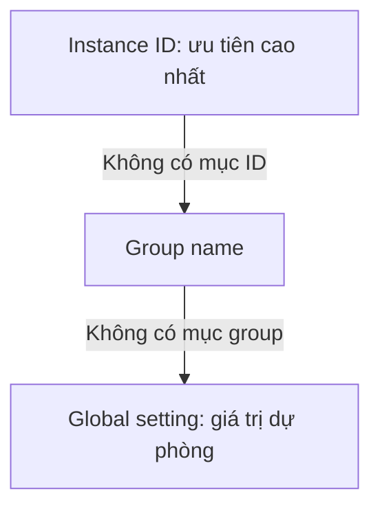

# Bật hoặc tắt TimeLimiter toàn cục, theo nhóm hoặc instance khi được hỗ trợ

## Mục tiêu

TimeLimiter giới hạn thời gian chờ của một lần thực thi được Spring Cloud CircuitBreaker bảo vệ. Với integration Resilience4j, TimeLimiter được bật mặc định; ứng dụng có thể tắt trên toàn hệ thống hoặc chọn bật/tắt theo group hay instance. Phạm vi cấu hình này hữu ích khi một số dependency cần giới hạn thời gian nghiêm ngặt, trong khi các luồng khác tự quản lý timeout ở HTTP client hoặc có thời gian xử lý dài hơn.

Sau bài học, bạn có thể:

- Phân biệt cấu hình TimeLimiter với cấu hình Circuit Breaker và timeout của HTTP client.
- Tắt TimeLimiter trên toàn ứng dụng bằng `disable-time-limiter`.
- Dùng `disable-time-limiter-map` để ghi đè theo ID instance hoặc group name.
- Áp dụng đúng thứ tự ưu tiên instance, group và global, kể cả trường hợp bật lại một instance khi global đang tắt.
- Kiểm chứng cấu hình cho cả factory đồng bộ và reactive, đồng thời nhận biết giới hạn theo implementation.

## TimeLimiter được bật mặc định

Khi dùng Spring Cloud CircuitBreaker với Resilience4j, mỗi lần thực thi được TimeLimiter bảo vệ theo mặc định. Thời hạn có thể đến từ cấu hình rõ ràng hoặc cấu hình mặc định của `TimeLimiterConfig` nếu ứng dụng chưa khai báo riêng.

TimeLimiter và Circuit Breaker có trách nhiệm khác nhau:

| Cơ chế | Quyết định |
|---|---|
| Circuit Breaker | Có cho phép lời gọi bắt đầu dựa trên trạng thái `CLOSED`, `OPEN` hoặc `HALF_OPEN` hay không. |
| TimeLimiter | Giới hạn thời gian chờ của lần thực thi được integration hỗ trợ. |
| HTTP client timeout | Giới hạn thời gian kết nối, chờ dữ liệu hoặc phản hồi ở tầng client mạng. |

Tắt TimeLimiter không tắt Circuit Breaker. Circuit Breaker vẫn ghi nhận kết quả và có thể chuyển trạng thái theo sliding window, tỷ lệ lỗi hoặc tỷ lệ lời gọi chậm. Tắt TimeLimiter cũng không tự xóa timeout đã cấu hình trực tiếp trên `WebClient`, Reactor hoặc HTTP client.

Các thuộc tính `disable-time-limiter` và `disable-time-limiter-map` thuộc Spring Cloud CircuitBreaker integration với Resilience4j. Chúng áp dụng cho cả implementation cơ bản và reactive của integration này. Không giả định cùng thuộc tính tồn tại hoặc có cùng tác dụng với implementation khác như Spring Retry.

## Tắt TimeLimiter toàn cục

Để tắt TimeLimiter cho tất cả Circuit Breaker được tạo bởi Resilience4j integration, đặt `spring.cloud.circuitbreaker.resilience4j.disable-time-limiter` thành `true`:

```yaml
spring:
  cloud:
    circuitbreaker:
      resilience4j:
        disable-time-limiter: true
```

Khi thuộc tính này là `true`, TimeLimiter bị vô hiệu hóa trên toàn cục. Circuit Breaker vẫn hoạt động và vẫn có thể từ chối lời gọi khi `OPEN` hoặc giới hạn số probe khi `HALF_OPEN`.

Nếu thuộc tính không được khai báo, TimeLimiter mặc định được bật. Có thể viết rõ `false` để thể hiện chủ ý:

```yaml
spring:
  cloud:
    circuitbreaker:
      resilience4j:
        disable-time-limiter: false
```

Giá trị global là mặc định áp dụng cho những instance hoặc group không có mục ghi đè tương ứng trong `disable-time-limiter-map`.

## Tắt theo group hoặc instance

Nếu chỉ một số dependency cần bỏ TimeLimiter, dùng `disable-time-limiter-map`. Khóa của map có thể là ID instance hoặc group name được truyền vào factory:

```yaml
spring:
  cloud:
    circuitbreaker:
      resilience4j:
        disable-time-limiter: false
        disable-time-limiter-map:
          slow-remote: true
          catalog-read: false
          payment-authorize: true
```

Giả sử ứng dụng tạo Circuit Breaker như sau:

```java
CircuitBreaker catalog = factory.create("catalog-read", "slow-remote");
CircuitBreaker inventory = factory.create("inventory-read", "slow-remote");
CircuitBreaker payment = factory.create("payment-authorize", "fast-remote");
CircuitBreaker reporting = factory.create("reporting", "batch-remote");
```

Kết quả theo cấu hình trên:

| Lời gọi | Khóa map được xét | Kết quả TimeLimiter |
|---|---|---|
| `catalog-read`, group `slow-remote` | Có cả ID `catalog-read: false` và group `slow-remote: true`; ID ưu tiên hơn. | Bật. |
| `inventory-read`, group `slow-remote` | Không có ID riêng; group `slow-remote: true` được áp dụng. | Tắt. |
| `payment-authorize`, group `fast-remote` | ID `payment-authorize: true`. | Tắt. |
| `reporting`, group `batch-remote` | Không có khóa ID hoặc group; dùng global `false`. | Bật. |

Giá trị `true` trong map nghĩa là tắt TimeLimiter cho khóa tương ứng. Giá trị `false` nghĩa là không tắt ở khóa đó; nó có thể bật lại TimeLimiter dù group hoặc global đang đặt `true`.

## Thứ tự ưu tiên instance, group và global

Khi có nhiều phạm vi cấu hình, Spring Cloud CircuitBreaker Resilience4j xét theo thứ tự:



Nếu map có khóa ID, dùng giá trị ID. Chỉ khi không có khóa ID mới xét group; nếu group cũng không có, dùng giá trị global.

Ví dụ bật TimeLimiter toàn cục nhưng tắt riêng một nhóm:

```yaml
spring:
  cloud:
    circuitbreaker:
      resilience4j:
        disable-time-limiter: false
        disable-time-limiter-map:
          batch-remote: true
```

Mọi instance thuộc group `batch-remote` sẽ tắt TimeLimiter, trừ instance có khóa ID riêng ghi đè giá trị group. Những instance khác vẫn dùng TimeLimiter.

Ví dụ tắt TimeLimiter toàn cục nhưng bật lại một instance:

```yaml
spring:
  cloud:
    circuitbreaker:
      resilience4j:
        disable-time-limiter: true
        disable-time-limiter-map:
          catalog-read: false
```

Trong trường hợp này, `catalog-read` có TimeLimiter; các instance còn lại không có mục ghi đè sẽ bị tắt TimeLimiter. Đây là cách hữu ích khi phần lớn luồng đã có timeout riêng ở client, nhưng một dependency quan trọng vẫn cần TimeLimiter do integration quản lý.

## Tách bật/tắt khỏi thời lượng timeout

`disable-time-limiter-map` quyết định TimeLimiter có được áp dụng hay không. Thời lượng và hành vi hủy tác vụ được cấu hình trong namespace `resilience4j.timelimiter`.

Ví dụ khai báo profile và instance:

```yaml
resilience4j:
  timelimiter:
    configs:
      remote-default:
        timeoutDuration: 2s
        cancelRunningFuture: true
      batch-default:
        timeoutDuration: 30s
        cancelRunningFuture: true
    instances:
      catalog-read:
        baseConfig: remote-default
      payment-authorize:
        baseConfig: remote-default
        timeoutDuration: 800ms
      report-export:
        baseConfig: batch-default
```

Trong ví dụ, `catalog-read` dùng timeout hai giây, `payment-authorize` ghi đè còn 800 mili giây và `report-export` dùng 30 giây. Nếu một khóa bị tắt trong `disable-time-limiter-map`, thời lượng được khai báo cho khóa đó không được dùng để áp dụng TimeLimiter của integration. Các giá trị timeout vẫn có thể hữu ích khi bật lại TimeLimiter ở môi trường hoặc profile khác.

`cancelRunningFuture: true` yêu cầu hủy future khi timeout theo khả năng của tác vụ. Việc hủy future không bảo đảm mọi I/O hoặc xử lý ở máy chủ từ xa dừng ngay lập tức. Hãy cấu hình timeout ở HTTP client và xác nhận hành vi hủy của thư viện gọi bên dưới.

## Áp dụng với factory đồng bộ và reactive

Các thuộc tính bật/tắt TimeLimiter được cung cấp trong Spring Cloud CircuitBreaker Resilience4j và áp dụng cho cả factory đồng bộ lẫn reactive.

Ví dụ đồng bộ:

```java
import org.springframework.cloud.client.circuitbreaker.CircuitBreaker;
import org.springframework.cloud.client.circuitbreaker.CircuitBreakerFactory;
import org.springframework.stereotype.Service;

@Service
public class CatalogGateway {
    private final CircuitBreaker catalogBreaker;

    public CatalogGateway(CircuitBreakerFactory<?, ?> factory) {
        this.catalogBreaker = factory.create("catalog-read", "slow-remote");
    }

    public Product findById(String id) {
        return catalogBreaker.run(
                () -> loadProduct(id),
                error -> Product.unavailable(id));
    }
}
```

Ví dụ reactive:

```java
import org.springframework.cloud.client.circuitbreaker.ReactiveCircuitBreaker;
import org.springframework.cloud.client.circuitbreaker.ReactiveCircuitBreakerFactory;
import org.springframework.stereotype.Service;
import reactor.core.publisher.Mono;

@Service
public class ReactiveCatalogGateway {
    private final ReactiveCircuitBreaker catalogBreaker;

    public ReactiveCatalogGateway(ReactiveCircuitBreakerFactory<?, ?> factory) {
        this.catalogBreaker = factory.create("catalog-read", "slow-remote");
    }

    public Mono<Product> findById(String id) {
        return catalogBreaker.run(
                loadProductReactive(id),
                error -> Mono.just(Product.unavailable(id)));
    }
}
```

`loadProduct`, `loadProductReactive` và `Product` là các thành phần ví dụ của ứng dụng. Cấu hình map dùng ID `catalog-read` và group `slow-remote` giống nhau cho cả hai dạng gọi. Khi chuyển từ đồng bộ sang reactive, không cần đổi quy tắc ưu tiên của các thuộc tính bật/tắt; vẫn phải kiểm tra starter phù hợp đã được thêm vào ứng dụng.

## Không nhầm với tắt auto-configuration

Thuộc tính sau có ý nghĩa rộng hơn:

```yaml
spring:
  cloud:
    circuitbreaker:
      resilience4j:
        enabled: false
```

`enabled: false` tắt auto-configuration Resilience4j của Spring Cloud CircuitBreaker. Nó không phải cách chọn riêng TimeLimiter. Nếu mục tiêu là giữ Circuit Breaker và chỉ bỏ giới hạn thời gian do integration cung cấp, hãy dùng `disable-time-limiter` hoặc `disable-time-limiter-map`.

Tương tự, đặt `timeoutDuration` rất lớn không tương đương với tắt TimeLimiter. TimeLimiter vẫn được tạo và vẫn áp dụng cơ chế chờ, chỉ là thời hạn ít có khả năng bị chạm tới. Nếu cần vô hiệu hóa rõ ràng theo phạm vi, dùng thuộc tính disable chuyên dụng.

## Khi nào nên bật hoặc tắt theo phạm vi?

| Tình huống | Cách cấu hình gợi ý | Lý do |
|---|---|---|
| Hầu hết lời gọi cần một giới hạn chung do integration quản lý. | Giữ mặc định hoặc đặt global `false`. | Có một chính sách thời gian chờ thống nhất. |
| Một nhóm tác vụ nền có thời lượng dài và timeout riêng ở client. | Đặt group trong `disable-time-limiter-map` thành `true`. | Tránh hai lớp timeout cạnh tranh nếu không cần TimeLimiter của integration. |
| Một dependency quan trọng phải có timeout của integration dù global đã tắt. | Global `true`, ID instance đặt `false`. | Bật lại đúng dependency cần bảo vệ. |
| Một instance có client timeout và cơ chế hủy riêng. | Tắt bằng ID instance nếu phù hợp. | Giữ chính sách riêng cho một dependency mà không ảnh hưởng group khác. |

Không tắt TimeLimiter chỉ để che lỗi timeout. Nếu timeout thường xuyên xảy ra, hãy đo độ trễ, xem lại SLA, giới hạn tài nguyên và xác định tầng nào nên sở hữu timeout. Việc bỏ TimeLimiter có thể khiến lời gọi chờ lâu hơn nếu không còn timeout hữu hiệu ở HTTP client hoặc ở tầng khác.

## Theo dõi và kiểm chứng cấu hình

Để xác nhận cấu hình có hiệu lực, cần kiểm tra cả quyết định bật/tắt và hành vi thời gian chờ:

1. Tạo một Circuit Breaker với ID và group đã khai báo trong map.
2. Dùng endpoint thử nghiệm có thể trì hoãn phản hồi lâu hơn `timeoutDuration`.
3. Khi TimeLimiter bật, xác nhận lời gọi kết thúc theo timeout của integration và kiểm tra fallback được gọi như dự kiến.
4. Khi TimeLimiter tắt, xác nhận integration không áp dụng timeout đó; HTTP client timeout hoặc timeout operator riêng vẫn có thể kết thúc lời gọi.
5. Thử cùng một group với hai ID, một ID có giá trị map ghi đè. Xác nhận ID ưu tiên hơn group.
6. Đặt global `true`, sau đó thêm một ID có giá trị `false`. Xác nhận instance đó được bật TimeLimiter trong khi các instance còn lại vẫn tắt.
7. Lặp lại thử nghiệm với factory reactive và factory đồng bộ nếu ứng dụng sử dụng cả hai.

Theo dõi trạng thái Circuit Breaker, số lời gọi, lỗi timeout, fallback và độ trễ HTTP. Tên metric cụ thể phụ thuộc phiên bản Resilience4j và registry Micrometer; kiểm tra metric thực tế thay vì giả định mọi môi trường có cùng tên hoặc tag.

## Lỗi cấu hình thường gặp

- **Nhầm `disable-time-limiter` với tắt Circuit Breaker:** thuộc tính này chỉ tắt TimeLimiter trong Resilience4j integration.
- **Nhầm `enabled: false` với tắt TimeLimiter:** thuộc tính này tắt auto-configuration Resilience4j rộng hơn.
- **Dùng sai khóa map:** khóa instance phải khớp ID trong `factory.create`; khóa group phải khớp group name được truyền vào factory.
- **Cho rằng group thắng instance:** khi cả hai cùng được khai báo, giá trị instance có ưu tiên cao hơn.
- **Không dùng được giá trị `false` để bật lại:** `false` là một giá trị ghi đè có ý nghĩa, có thể bật lại instance dù group hoặc global đang tắt.
- **Đặt timeoutDuration lớn để giả lập disable:** TimeLimiter vẫn tồn tại; dùng thuộc tính disable khi muốn tắt rõ ràng.
- **Cho rằng tắt TimeLimiter xóa timeout HTTP:** timeout của HTTP client, Reactor hoặc thư viện khác vẫn hoạt động độc lập.
- **Cho rằng hủy future dừng chắc chắn I/O:** phải kiểm tra khả năng hủy của client và máy chủ thực tế.
- **Áp dụng thuộc tính Resilience4j cho implementation khác:** xác minh tài liệu của implementation trước khi chuyển đổi.

## Tài liệu tham khảo

- [Spring Cloud CircuitBreaker – Circuit Breaker Properties Configuration](https://docs.spring.io/spring-cloud-circuitbreaker/reference/spring-cloud-circuitbreaker-resilience4j/circuit-breaker-properties-configuration.html)
- [Spring Cloud CircuitBreaker – Resilience4j configuration](https://docs.spring.io/spring-cloud-circuitbreaker/docs/current/reference/html/spring-cloud-circuitbreaker-resilience4j.html)
